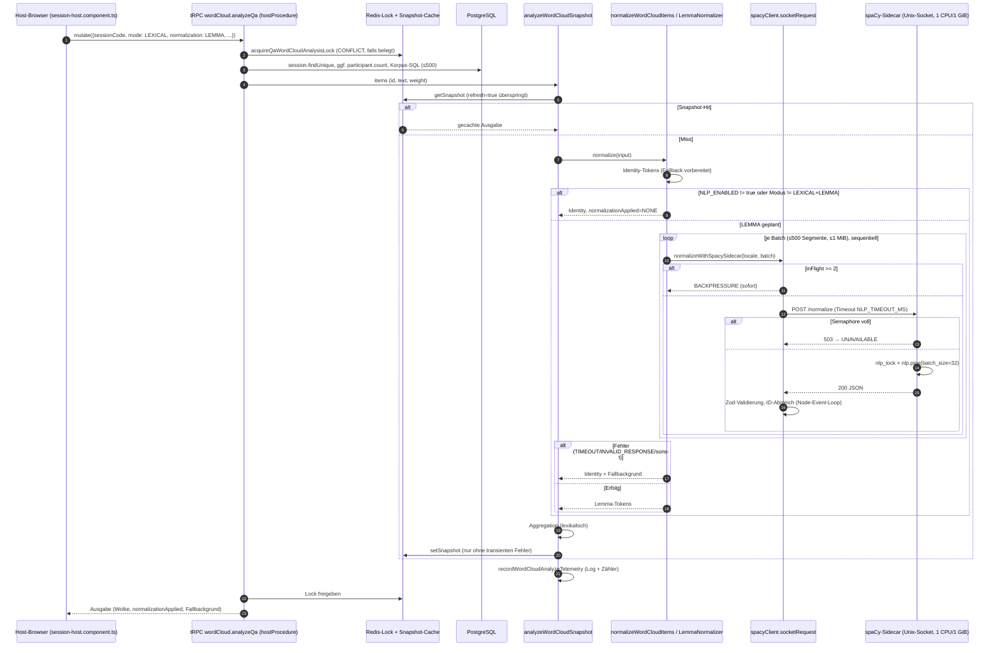

<!-- markdownlint-disable MD013 -->

# 1A – Ressourcenisolation auf dem Anwendungshost (Recherchedossier)

**Stand:** 2026-10-16 · **Codebasis:** Branch `referat/thema-1-notes`, Commit `27966e75` (HEAD). Der Tag `v1.3.0` zeigt auf `87c39334` (2026-10-08) und liegt 131 Commits zurück. Zwischen `v1.3.0` und HEAD sind die spaCy-Kerndateien (`docker/spacy/*`, `spacyClient.ts`, `nlpSidecarConfig.ts`, `wordCloudNormalizer.ts`, beide Compose-Dateien, `deploy.sh`, Lastskripte) **unverändert**; geändert wurden nur `wordCloud.ts` (Label-Telemetrie, +6/−2), `wordCloudNlpTelemetry.ts` (+6), `wordCloudAnalysisCache.ts` (+12), `health.ts` (+30, `openWeightLlmProbe`), ADR-0035, `word-cloud-spacy.md` und `.env.production.example` (geprüft mit `git diff --stat v1.3.0..HEAD`).
**Zweck:** Arbeits- und Evidenzmaterial für Gruppenauftrag 1A. Alle Zeilenangaben im Dokument sind 1-basiert und sind **HEAD-Zeilen (`27966e75`)**, auch wo das nicht eigens dasteht. Die Release-Baseline ist vermutlich der Tag `v1.3.0`; die Abweichungen stehen in Abschnitt 0. Vor Übernahme ins Handout gegen den vom Prüfer festgelegten 1.3-Commit prüfen.
**Kennzeichnung:** „Repo-Fakt“ = im Code/in Doku belegt. „Allgemeinwissen“ = Linux-/Docker-Wissen ohne Repo-Beleg. „Vorschlag“ = eigene Planung, kein Repo-Fakt.

---

## 0. Abweichungen v1.3.0 ↔ HEAD (27966e75)

Geprüft read-only mit `git diff v1.3.0 HEAD -- <pfad>`, `git diff --stat` und `git show v1.3.0:<pfad>`. Tag `v1.3.0` = `87c39334` (2026-10-08), HEAD liegt 131 Commits später.

| Bereich (1A-relevant)                                                  | v1.3.0 → HEAD                                                                                                                                                                                                                                                                                              | Folge für 1A                                                                                                                                        |
| ---------------------------------------------------------------------- | ---------------------------------------------------------------------------------------------------------------------------------------------------------------------------------------------------------------------------------------------------------------------------------------------------------- | --------------------------------------------------------------------------------------------------------------------------------------------------- |
| `docker-compose.prod.yml`, `docker-compose.yml`                        | **keine Änderung** (leerer Diff). spaCy am Tag: `pids_limit: 64`, `mem_limit: 1g`, `cpus: '1.0'` (Zeilen 95–97, wie HEAD); App-Env `NLP_TIMEOUT_MS: '5000'` (217), `WORD_CLOUD_ENCODER_TIMEOUT_MS: '120000'` (220); Encoder `cpus 1.0`/`2g` unverändert                                                    | Abschnitt 2 und alle Compose-Zeilen gelten auch für den Tag                                                                                         |
| `docker/spacy/*`, `docker/wordcloud-encoder/*`                         | keine Änderung                                                                                                                                                                                                                                                                                             | Sidecar-Verhalten (4.1, 4.2, 5.2) identisch                                                                                                         |
| `.env.production.example` (NLP-Teil)                                   | `NLP_ENABLED=false`, `NLP_TIMEOUT_MS=5000`, `NLP_CACHE_TTL_SECONDS=1800` (Tag-Zeilen 204–208), `WORD_CLOUD_ENCODER_TIMEOUT_MS=8000` (220), `QA_NLP_ENABLED=false`, `QA_NLP_TIMEOUT_MS=2000`, `QA_NLP_QUEUE_LIMIT=100`, `QA_NLP_CONCURRENCY=1`, `QA_NLP_MIN_CONFIDENCE=0.55` (226–230): **gleich wie HEAD** | Konfigurationshebel (9) unverändert; Widerspruch L-10 bestand schon am Tag                                                                          |
| `.env.production.example` (übrige Teile)                               | `MAX_SESSION_DURATION` P14D → P180D; `QA_SUMMARY_TIMEOUT_MS` 8000 → 90000; `OPEN_WEIGHT_LLM_LEARNING_TIMEOUT_MS` 120000 → 300000; neu `OPEN_WEIGHT_LLM_LEARNING_DEBUG_LOG=false`; Kommentar 4096- → 8192-Profil                                                                                            | nicht 1A-kritisch (Summary/LLM aus), aber im Manifest festhalten                                                                                    |
| `nlpSidecarConfig.ts`, `spacyClient.ts`, `wordCloudNormalizer.ts`      | keine Änderung                                                                                                                                                                                                                                                                                             | 4.3–4.5 gelten für den Tag                                                                                                                          |
| `qaNlpConfig.ts`, `qaNlpQueue.ts`, `routers/qa.ts`                     | keine Änderung                                                                                                                                                                                                                                                                                             | 5.1 gilt für den Tag                                                                                                                                |
| `wordCloudSemanticConfig.ts`, `wordCloudEncoderClient.ts`              | keine Änderung                                                                                                                                                                                                                                                                                             | 5.2 gilt für den Tag                                                                                                                                |
| `routers/wordCloud.ts` (+6/−2)                                         | `SEMANTIC` ruft am Tag `analyzeSemanticWordCloudSnapshot`, in HEAD `labelSemanticWordCloudSnapshot` (`wordCloudTopicLabels`); Telemetrie-Events erhalten `labelSettlement`, `labelModelAccepted`                                                                                                           | spaCy-Pfad (`LEXICAL + LEMMA`) unberührt; HEAD-Zeilen in 4.6 sind um wenige Zeilen verschoben                                                       |
| `wordCloudNlpTelemetry.ts` (+6)                                        | nur zwei zusätzliche optionale Logfelder (`labelSettlement`, `labelModelAccepted`); Zählerstruktur `WordCloudNlpTelemetrySnapshot` gleich                                                                                                                                                                  | `securityStats.qaWordCloud` hat am Tag dieselben Felder                                                                                             |
| `wordCloudAnalysisCache.ts` (+12)                                      | HEAD hängt `topicLabelCacheSegment()` (`topic-label:off` bzw. Modellalias) an jeden Snapshot-Schlüssel; `SEMANTIC` mit `labelSettlement === 'transient'` wird nicht gecacht                                                                                                                                | Snapshot-Schlüssel unterscheiden sich zwischen Tag und HEAD (bei Versionswechsel kalter Cache); spaCy-Logik gleich                                  |
| `routers/health.ts` (+30)                                              | HEAD fügt nur `health.openWeightLlmProbe` hinzu. `check`, `stats`, `securityStats`, `ping` unverändert                                                                                                                                                                                                     | Feldangaben in 4.7 und 7.3 gelten für den Tag; am Tag sind die Zeilen nach den Importen um 3, ab dem Probe-Block (HEAD ab Zeile 1126) um 30 kleiner |
| `libs/shared-types/src/schemas.ts` (+119/−1)                           | neue Schemas für Label-Herkunft, Freitext-Presenter-Projektion, `OpenWeightLlmRuntimeProbe`; `SESSION_HARD_MAX_DURATION_DAYS` 30 → 180. `HealthSecurityStatsDTOSchema` (`qaNlp`, `qaWordCloud`) und `ServerStatsDTOSchema` **ohne** Änderung im Diff                                                       | Schema-Zeilennummern (z. B. 4415, 4506, 5401, 5419) sind HEAD-Zeilen; am Tag kleiner                                                                |
| `apps/backend/src/__tests__/wordCloud.hotpath-isolation.test.ts`       | **identisch** (gleicher md5-Hash am Tag und in HEAD)                                                                                                                                                                                                                                                       | 6.2 gilt unverändert                                                                                                                                |
| `scripts/load/**`                                                      | keine Änderung (leerer Diff)                                                                                                                                                                                                                                                                               | alle Werkzeuge und Lücken in 7 und 11 (L-01, L-02) gelten für den Tag                                                                               |
| `scripts/spacy-dev-sidecar.sh`, `scripts/macos-spacy-wordcloud-dev.sh` | geändert (Python-Auswahl 3.10–3.13, +32/+29 Zeilen, Tests erweitert)                                                                                                                                                                                                                                       | nur lokaler Host-npm-Pfad, nicht Labor-Compose                                                                                                      |
| `docs/features/word-cloud-spacy.md` (+4/−4)                            | Sortierbegriffe umbenannt; Python-Hinweis; Semantik-Version am Tag `1.14d.1`, in HEAD `1.14c.2`                                                                                                                                                                                                            | Versionsangabe widersprüchlich, siehe Offene Punkte                                                                                                 |
| ADR-0035 (+24/−19)                                                     | Statuszeile und Abschnitte zu Summary/Timeouts nachgezogen                                                                                                                                                                                                                                                 | ADR-Zitate in 3.1 vor Übernahme gegen `git show v1.3.0:docs/architecture/decisions/0035-…` prüfen                                                   |

**Fazit:** Für den spaCy-A/B-Versuch sind Tag und HEAD in Compose, Sidecar, Client, Normalizer, Env-Defaults, 8.9b, Lastskripten, Health-Feldern und Hotpfad-Test gleich. Unterschiede betreffen den Semantik-/Label-Pfad, die Snapshot-Schlüssel und das LLM-Probe. Die in diesem Dossier zitierten Zeilennummern sind HEAD-Zeilen; in `health.ts`, `wordCloud.ts`, `wordCloudAnalysisCache.ts`, `schemas.ts` und ADR-0035 weichen sie am Tag ab.

---

## 1. Auftrag, Leitfrage, Gültigkeitsgrenze

### 1.1 Wortlaut (Quelle: `docs/didaktik/CLOUD-COMPUTING-REFERAT-PRUEFUNG.md`, Zeilen 176–185)

> #### Gruppenauftrag 1A: Ressourcenisolation auf dem Anwendungshost
>
> **Eigene Leitfrage:** Welche Ressourcenreserve hat der App-Host von Release 1.3 für seine optionalen Analysearbeiten, ohne die für den Moderationskompass relevanten Live-Signale zu verzögern?
>
> 1. Erfassen Sie die Dienste des App-Hosts und ordnen Sie spaCy, 8.9b, Kontextaufbau und Encoder fachlich richtig ein. Begründen Sie anhand ADR-0035, weshalb generative Inferenz keine normale weitere App-Host-Aufgabe ist.
> 2. Wählen Sie einen vorhandenen Sidecar, vorzugsweise spaCy, und vergleichen Sie ausgeschaltet, normal belastet und künstlich langsam beziehungsweise ressourcenbegrenzt. Halten Sie Q&A-Daten und Live-Last konstant; benennen Sie alle übrigen aktivierten Dienste.
> 3. Messen Sie CPU, RAM, gegebenenfalls Drosselung sowie p95-Latenz und Fehlerrate ausgewählter Liveaktionen. Erläutern Sie, welche Aussagen über Kompassaktualität daraus folgen und welche nicht.
> 4. Entscheiden Sie über Limits und Einsatzgrenze dieses Sidecars. Bewerten Sie als Gegenalternative die Deaktivierung mit vorhandener Baseline; berücksichtigen Sie Betriebsaufwand und den begrenzten Beitrag sprachlicher Glättung.
>
> **Individuelles Ergebnis:** Ressourcenbudget, reproduzierbarer A/B-Vergleich und begründete Betriebsentscheidung. **Gültigkeitsgrenze:** Ein funktionierender spaCy-Versuch belegt nicht die Tragfähigkeit eines zusätzlichen LLMs. **Diskussionskern:** Ressourcenisolation, Containergrenzen und Ursache einer gemessenen Live-Verzögerung.

### 1.2 Einordnung in den gemeinsamen Rahmen

- **Oberthema 1** (Zeile 160): „KI-Inferenz für den Moderationskompass – Systemgrenzen und entkoppelte Architektur“. Leitfrage (Zeile 162): Wie wirksam trennt die Architektur Anwendung, Kontextaufbau und private Inferenz unter realer Last?
- **Repo- und Issue-Basis** (Zeile 166): 1.14b/c, 8.9a–d, #456, ADR-0035, Feature-Dokumente; für das Deployment ausdrücklich `docker-compose.prod.yml`, `.env.production.example`, `scripts/deploy.sh`.
- **Leitplanke 1 Livebetrieb** (Zeile 100): Join, Vote, Q&A-Einreichen und WebSocket-Verarbeitung warten weder auf Modelle noch auf aufwendigen Kontextaufbau. `qa.submit` startet bei `QA_NLP_ENABLED=true` automatisch `enqueueQaNlpJob`, ohne darauf zu warten.
- **Leitplanke 2 Topologie** (Zeile 101): Live-Host 8 vCPU/16 GB mit Anwendung, PostgreSQL, Redis; kein zusätzliches LLM neben spaCy und Encoder auf dem 16-GB-Live-Host.
- **Nachweisformat** (Zeile 137): Release-Tag/Commit und Referenzmanifest → unveränderter Baselinelauf → Gegenvariante/Störung → vergleichbare Messdaten → Befund mit Gültigkeitsgrenze → konkrete Entscheidung.
- **Evidenzrahmen 4.1.3** (Zeilen 125–145): Hypothese und Gegenalternative vorab; mindestens ein eigener ausführbarer Mess-/Fehlertest; Messgrößen, Wiederholungen, Schwellen vorab; synthetische Daten; Last nie gegen die öffentliche Produktion.
- **Gruppensynthese** (Zeile 209): „A bewertet die Ressourcengrenze des App-Hosts, B die Isolation der privaten Inferenzrolle und C den realen Kontextübergang.“ 1A liefert damit die **Untergrenze**: Wie viel Reserve bleibt am App-Host, bevor 1B (zweiter Host) nötig ist, und wie viel Node-Last erzeugt der in-process Kontextaufbau, den 1C fachlich prüft.

### 1.3 Gültigkeitsgrenze und Diskussionskern (Konsequenz für die Arbeit)

- spaCy-Sidecar: 4 kleine CPU-Modelle, `mem_limit: 1g`, `cpus: '1.0'`, eine Inferenz gleichzeitig (Lock, siehe 4.2). Ein LLM braucht laut ADR-0035 ~4 GB plus KV-Cache und 2–4 Threads (ADR-0035 Zeilen 27–30, 115–117). Die beiden Lastprofile lassen sich **nicht** voneinander hochrechnen.
- Diskussionskern „Ursache einer gemessenen Live-Verzögerung“: Der Sidecar ist per cgroup begrenzt, die **App selbst ist es nicht** (siehe 2.1). Eine messbare Verzögerung kann deshalb auch im Node-Prozess entstehen, nämlich beim Parsen und Validieren der Sidecar-Antwort, beim Aufbau der Wortwolke und bei den Datenbankabfragen von `analyzeQa`. Das muss die Messung trennen können (siehe 6.3 und 10).

---

## 2. Systemüberblick App-Host

### 2.1 Dienste in `docker-compose.prod.yml` (Repo-Fakt)

| Dienst              | Zeilen  | Image                                                                   | Profil    | Start                                                     | `cpus` | `mem_limit` | `pids_limit` | `network_mode`                                        | `read_only` / `cap_drop` | Healthcheck                                                       |
| ------------------- | ------- | ----------------------------------------------------------------------- | --------- | --------------------------------------------------------- | ------ | ----------- | ------------ | ----------------------------------------------------- | ------------------------ | ----------------------------------------------------------------- |
| `postgres`          | 14–28   | `postgres:16-alpine`                                                    | –         | `deploy.sh` Zeile 526 (`up -d --wait postgres redis`)     | –      | –           | –            | Netz `app`                                            | nein / nein              | `pg_isready`, 5 s                                                 |
| `redis`             | 30–47   | `redis:7.4-alpine` (AOF `everysec`, Zeile 40)                           | –         | `deploy.sh` Zeile 526                                     | –      | –           | –            | Netz `app`                                            | nein / nein              | `redis-cli ping`, 5 s                                             |
| `pdf-worker`        | 49–79   | `${ARSNOVA_IMAGE}` (Digest Pflicht, Zeile 50)                           | –         | `deploy.sh` Zeile 721 (`up -d pdf-worker app`)            | `1.0`  | `1g`        | 128          | `none` (Zeile 60)                                     | ja / `ALL`               | `pdf-worker-healthcheck.mjs`, 10 s                                |
| `spacy`             | 81–111  | `${SPACY_IMAGE:-arsnova-spacy:3.8.15}` (Zeile 85, **Tag**, kein Digest) | `nlp`     | nur manuell: `prod-compose.sh up -d spacy` (Kommentar 82) | `1.0`  | `1g`        | 64           | `none` (Zeile 94)                                     | ja / `ALL`               | `python /app/healthcheck.py`, 15 s, `start_period` 90 s (105–110) |
| `wordcloud-encoder` | 113–143 | `${WORD_CLOUD_ENCODER_IMAGE:-arsnova-wordcloud-encoder:e5-small}`       | `encoder` | nur manuell (Kommentar 113)                               | `1.0`  | `2g`        | 64           | `none`                                                | ja / `ALL`               | `python /app/healthcheck.py`, `start_period` 120 s                |
| `open-weight-llm`   | 145–179 | `${OPEN_WEIGHT_LLM_IMAGE:-arsnova-open-weight-llm:llama-b10524}`        | `llm`     | **nur Labor** (Kommentar 145–147)                         | `4.0`  | `5g`        | 128          | `none`                                                | ja / `ALL`               | `/opt/arsnova/healthcheck.sh`, `start_period` 180 s               |
| `app`               | 181–257 | `${ARSNOVA_IMAGE}`                                                      | –         | `deploy.sh` Zeile 721                                     | **–**  | **–**       | **–**        | Netz `app`, Ports nur `127.0.0.1:3000–3002` (201–204) | ja / `ALL`               | `wget …/trpc/health.check`, 30 s (252–257)                        |

Weitere Repo-Fakten:

- **Sockets statt Ports:** Die App mountet `pdf_worker_socket`, `spacy_socket`, `wordcloud_encoder_socket`, `open_weight_llm_socket` jeweils `:ro` (Zeilen 194–198). Die Sidecars sind `network_mode: none` und nur über diese Unix-Sockets erreichbar.
- **Feste App-Umgebung** (Zeilen 205–221): `NLP_SOCKET_PATH=/run/spacy/nlp.sock`, `NLP_TIMEOUT_MS='5000'`, `NLP_CACHE_TTL_SECONDS='1800'`, `WORD_CLOUD_ENCODER_TIMEOUT_MS='120000'`, `WORD_CLOUD_ENCODER_CACHE_TTL_SECONDS='1800'`. Die Schalter `NLP_ENABLED`, `QA_NLP_ENABLED`, `QA_SUMMARY_ENABLED`, `WORD_CLOUD_SEMANTIC_ENABLED`, `OPEN_WEIGHT_LLM_ENABLED` kommen laut Kommentar aus `.env.production` (Zeilen 226–239).
- **`depends_on`** (240–249): App wartet auf `pdf-worker`, `postgres`, `redis` (healthy); `open-weight-llm` optional (`required: false`). **Kein** `depends_on` auf `spacy` oder `wordcloud-encoder`: Die App startet auch ohne Sidecar.
- **Keine Limits für `app`, `postgres`, `redis`:** Diese Container teilen sich ohne cgroup-Grenze den Rest des Hosts. Begrenzt sind nur die Hilfsdienste (Summe ohne Labor-LLM: `cpus` 3,0, `mem_limit` 4 GiB; mit Labor-LLM 7,0 bzw. 9 GiB).
- **Startwege:** `scripts/deploy.sh` startet nur `postgres redis` (Zeile 526) und `pdf-worker app` (Zeile 721). `scripts/prod-compose.sh` ist ein Wrapper um `docker compose`. Er setzt die Compose-Datei `docker-compose.prod.yml` sowie die Env-Dateien `.env.production` und optional `.env.arsnova-image` (Zeilen 19–21, 50–72). Sidecar-Start laut `docs/ENVIRONMENT.md` Zeilen 350–357: `docker build -t arsnova-spacy:3.8.15 docker/spacy` und `COMPOSE_PROFILES=nlp SPACY_IMAGE=arsnova-spacy:3.8.15 ./scripts/prod-compose.sh up -d spacy`, danach `NLP_ENABLED=true` und App-Neustart; Rollback `NLP_ENABLED=false` plus `./scripts/prod-compose.sh stop spacy`.
- **Zweiter Host:** `docker-compose.llm.yml` (separate Datei) ist laut Kommentar Zeile 146 die kanonische Produktion für das LLM; Gegenstand von 1B.

### 2.2 Unterschiede in der Dev-Datei `docker-compose.yml` (Repo-Fakt)

| Aspekt         | Dev (`docker-compose.yml`)                                                                                            | Prod                                    |
| -------------- | --------------------------------------------------------------------------------------------------------------------- | --------------------------------------- |
| App            | `build:` aus `Dockerfile` (38–41), `NODE_ENV: 'production'` (57), `NLP_ENABLED: 'false'` (60), keine Limits           | Digest-Image, Env aus `.env.production` |
| `pdf-worker`   | **fehlt** (kein eigener Dienst)                                                                                       | eigener Dienst, `network_mode: none`    |
| Postgres/Redis | Ports `5432`/`6379` öffentlich am Host gebunden (11–12, 26–27), Klartext-Passwort (9)                                 | keine Host-Ports                        |
| spaCy          | `build: ./docker/spacy` (93–95), `restart: unless-stopped` (97), kein `stop_grace_period`; Limits identisch (104–107) | Image-Variable, `restart: always`       |
| Labor-LLM      | zusätzlich `open-weight-llm-http` mit `network_mode: host` (197–230)                                                  | –                                       |
| npm-Starter    | `npm run docker:up:nlp` = `docker compose --profile nlp up -d --build spacy`                                          | `prod-compose.sh`                       |

Folge für das Labor: Wer mit `docker-compose.yml` misst, hat keinen getrennten PDF-Worker und offene DB-Ports. Für 1A ist ein **produktionsnaher Laboraufbau mit `docker-compose.prod.yml`** aussagekräftiger (Vorschlag, siehe 10).

### 2.3 RAM-/CPU-Budget laut Doku (Repo-Fakt) und Widerspruch

`docs/capacity-estimate-16gb-16cores.md` Zeilen 10–17 (Stand 2026-07-10):

| Komponente     | RAM (konservativ) | CPU               |
| -------------- | ----------------- | ----------------- |
| Node (Backend) | 2–3 GB            | 1 Kern Event-Loop |
| PostgreSQL     | 3–4 GB            | Mehrkern          |
| Redis          | 1–1,5 GB          | 1 Kern            |
| Yjs (Child)    | ~256 MB           | wenig             |
| OS + Puffer    | ~1,5–2 GB         | –                 |
| **Summe**      | **~10–11 GB**     | „16 Kerne“        |

Zeile 20: „Optionale Sidecars (spaCy ~1 GB, Encoder ~2 GB, PDF-Worker ~1 GB) liegen **über** dieser Baseline.“ ADR-0035 Zeilen 115–117 übernimmt das: „~10–11 GB Baseline plus spaCy 1 GB, Encoder 2 GB, PDF-Worker 1 GB“ trägt kein zusätzliches ~4-GB-LLM.

**Rechnerische Reserve (abgeleitet, kein Messwert):** 16 GB − (10–11 GB + 4 GB) = **1–2 GB** Rest-RAM, wenn alle drei Hilfsdienste ihr Limit ausschöpfen. Für CPU fehlt eine belastbare Budgetangabe; nur Node ist als 1 Kern beschrieben.

**Widerspruch 16 Kerne vs. 8 vCPU:**

- `docs/capacity-estimate-16gb-16cores.md` Titel (Zeile 1), Tabelle (Zeile 17), Abschnitt 4 (Zeile 41) und Kurzfassung (Zeile 66): **16 Kerne**.
- Dieselbe Datei §7 (Zeile 85): „SLO-Vorschlag (CAX31: **8 vCPU**, 16 GB RAM)“.
- ADR-0035 Zeile 27 und Prüfungsleitfaden Zeile 101: **8 vCPU / 16 GB**.
- Konsequenz: Die Obergrenzen aus Abschnitt 4 (~1.000 Verbindungen, 20–25 Quizze) sind auf 16 Kerne geschätzt, die verbindliche Topologie ist 8 vCPU. Das Referenzmanifest muss die tatsächliche Labor-Hardware nennen; die Kapazitätsschätzung ist nur Größenordnung. Siehe PR-Kandidat L-09.

Lokale Lastmessungen, die die Doku selbst als „lokal, nicht CAX31“ kennzeichnet: `capacity-estimate…md` Zeilen 97–109 (Vote-Spike 500 VU p95 874 ms; 600 Votes p95 766 ms aktiv nach Optimierung).

---

## 3. Dienstklassifikation nach ADR-0035

| Baustein                                   | Wo läuft er?                                                                                                                                                                                               | Beleg                                                                                                                                                                                                                                                                                                   | Einordnung für 1A                                                                                                |
| ------------------------------------------ | ---------------------------------------------------------------------------------------------------------------------------------------------------------------------------------------------------------- | ------------------------------------------------------------------------------------------------------------------------------------------------------------------------------------------------------------------------------------------------------------------------------------------------------- | ---------------------------------------------------------------------------------------------------------------- |
| **spaCy (1.14b)**                          | eigener Python-Container `spacy`, Unix-Socket, cgroup 1 CPU/1 GiB                                                                                                                                          | ADR-0035 Zeilen 95–97: „spaCy (1.14b) und der Encoder (1.14c Stufe 1) bleiben das **Härtemuster**: eigener Container, eigenes Image, eigenes Compose-Profil, kein öffentlicher Port, `deploy.sh` startet nichts, cgroup-Limits, eigener Kill-Switch.“                                                   | **Nichtgenerativer Sidecar am App-Host.** Untersuchungsobjekt für 1A.                                            |
| **8.9b Q&A-Klassifikation**                | **im Node-Prozess** (In-Process-Queue, Naive Bayes + k-NN)                                                                                                                                                 | ADR-0035 Zeile 143: „8.9b (Gatekeeper/k-NN) liegt **nicht** auf diesem Slot.“ Zeile 255: „8.9b (in-process Gatekeeper/k-NN) — kein dritter Auftrag auf dem llama.cpp-Slot“. ADR-0032 Zeile 210: „Asynchrone In-Process-Queue nach Persistenz von `QaQuestion`; `qa.submit` awaitet die Inferenz nicht“. | **App-Host, kein Container.** Konstant zu halten und als „übriger aktivierter Dienst“ zu nennen.                 |
| **Kontextaufbau (#456)**                   | im Node-Prozess: `buildModerationPromptContext` (`moderationPromptContext.ts` Zeile 532) ← `prepareFreshModerationSummaryContext` (`moderationSummaryContext.ts` Zeile 652) ← `qaSummaryQueue.ts` Zeile 83 | codebase-memory `trace_path` und Grep (siehe 6.2)                                                                                                                                                                                                                                                       | **App-Host, nichtgenerativ, aber DB- und CPU-Last.** Läuft nur bei Summary-/Kontextaufträgen; Fachprüfung in 1C. |
| **Encoder (1.14c Stufe 1 / 1.14d)**        | eigener Python-Container `wordcloud-encoder` (ONNX e5-small), cgroup 1 CPU/2 GiB; optional privates HTTP                                                                                                   | ADR-0035 Zeilen 32–33: „kein zweites Modellserver-Silo neben dem bereits beschlossenen privaten Encoder-Sidecar“; Zeile 103: Encoder darf über `WORD_CLOUD_ENCODER_URL` auf den zweiten Host „mit umziehen“; Zeilen 250–251                                                                             | **Nichtgenerativer Sidecar am App-Host** (Embeddings), umzugsfähig.                                              |
| **Generatives LLM (8.9d, `llama-server`)** | kanonisch **zweiter privater Host**; Same-Host nur Labor                                                                                                                                                   | ADR-0035 Zeilen 27–30, 101–108, 115–117, 343–347                                                                                                                                                                                                                                                        | **Keine App-Host-Aufgabe.** Gegenstand von 1B.                                                                   |

### 3.1 Warum generative Inferenz keine normale App-Host-Aufgabe ist (Belege aus ADR-0035)

1. **Topologie-Randbedingung** (Zeilen 27–30): „Live-Host bleibt **8 vCPU / 16 GB RAM** (Node-App, PostgreSQL, Redis). **Kein LLM auf diesem Host** … Die kanonische Inferenzrolle ist ein **zweiter, privater** Host … Ein streng gedeckelter Same-Host-Sidecar (cgroup: 2–4 Threads, ~4 GB) bleibt nur Labor“.
2. **RAM-Rechnung** (Zeilen 115–117): Baseline plus spaCy, Encoder, PDF-Worker „trägt **kein** zusätzliches ~4-GB-LLM. Same-Host-LLM plus `nlp` plus `encoder` ist unzulässig.“
3. **Hotpfad-Grenze** (Zeile 31): „Live-Hotpfade (`qa.submit`, Join, Vote, WebSocket) dürfen nie auf Inferenz warten.“
4. **Andere Topologie als spaCy** (Zeilen 95–97): Härtemuster ja, „Die **Topologie** des LLM ist eine andere als bei spaCy.“
5. **Kosten pro Auftrag** (Zeilen 169–173, 186–187): KV-Cache, `--ctx-size` 8192, CPU-Prefill; Timeouts erst nach Messung „auf der echten 8-vCPU-Box“. `QA_SUMMARY_TIMEOUT_MS` Default 90 s. Ein solcher Auftrag belegt mehrere Kerne über Sekunden bis Minuten.
6. **Umsetzungsleitplanke** (Zeilen 346–347): „Kein LLM auf dem Live-Host neben Node/PostgreSQL/Redis, auch nicht ‚streng gedeckelt‘ zusammen mit spaCy- und Encoder-Sidecar“.
7. **Compose spiegelt das:** Kommentar `docker-compose.prod.yml` Zeilen 145–147 („Ausschließlich Same-Host-Labor …“) und die deutlich größeren Laborlimits `cpus: '4.0'`, `mem_limit: 5g` (161–162).

Kontrast zu spaCy (abgeleitet): spaCy verarbeitet nur auf Host-Klick kurze Texte mit kleinen Modellen, hat einen 5-s-Timeout und fällt hart auf die lexikalische Wolke zurück. Ein LLM-Auftrag dauert länger, braucht mehr Speicher und skaliert mit der Kontextgröße. Siehe die Gültigkeitsgrenze in 1.3.

---

## 4. spaCy-Sidecar im Detail

### 4.1 Image (`docker/spacy/Dockerfile`, 41 Zeilen; Repo-Fakt)

- Basis per Digest gepinnt: `python:3.12-slim-bookworm@sha256:a116514e…` (Zeile 13).
- Nicht-root: Benutzer `spacy` UID/GID 1000 (Zeilen 22–25, `USER 1000:1000` Zeile 36).
- `requirements.txt` Zeilen 4–8: `spacy==3.8.15` plus `de_core_news_sm`, `en_core_web_sm`, `fr_core_news_sm`, `es_core_news_sm` jeweils 3.8.0 (Wheel-URLs). `it` fehlt wegen CC BY-NC-SA (Dockerfile Zeilen 5–7).
- Image-`HEALTHCHECK` (Zeilen 38–39) identisch zum Compose-Healthcheck; `CMD ["python", "/app/server.py"]` (Zeile 41).

### 4.2 Server-Protokoll (`docker/spacy/server.py`, 280 Zeilen; Repo-Fakt)

| Aspekt         | Wert / Verhalten                                                                                                                              | Zeilen          |
| -------------- | --------------------------------------------------------------------------------------------------------------------------------------------- | --------------- |
| Transport      | HTTP/1.1 über Unix-Socket (`ThreadingHTTPServer` mit `AF_UNIX`), Socketmodus `0o600`                                                          | 46–67           |
| Endpunkte      | `GET /health` → 204; `POST /normalize` → 200 JSON; sonst 404                                                                                  | 183–192         |
| Grenzen        | `MAX_REQUEST_BYTES=1_048_576`, `MAX_TEXT_CHARS=4_000`, `MAX_ITEMS=500`, `MAX_TOKENS_PER_TEXT=2_000`, `MAX_IN_FLIGHT=2`                        | 21–25           |
| Modelle        | `MODEL_IDS` de/en/fr/es `@3.8.0`; Laden mit `exclude=("parser","senter")`; alle vier Modelle werden beim Start geladen                        | 29–41, 160–169  |
| Backpressure   | `BoundedSemaphore(MAX_IN_FLIGHT)`, nicht blockierend; bei Überlauf **503**                                                                    | 193–195, 241    |
| Serialisierung | **ein globales `nlp_lock`** um `nlp.pipe(..., batch_size=32)`: Es läuft immer höchstens **eine** Inferenz, ein zweiter Request wartet im Lock | 128–157, 242    |
| Validierung    | `parse_normalize_request`: Locale ∈ MODEL_IDS, ≤500 Items, eindeutige IDs, Text 1–4000 Zeichen; sonst 400 bzw. 413                            | 96–125, 197–217 |
| Antwort        | `{locale, modelId, items:[{id, tokens:[{text,lemma,pos,tag,entType}]}]}`, Felder gekürzt (256/16/32 Zeichen)                                  | 70–93, 150–157  |
| Logging        | `log_message` unterdrückt; keine Rohtexte in Logs                                                                                             | 8, 180–181      |
| Shutdown       | SIGTERM/SIGINT → `server.shutdown` in Thread; Socket wird gelöscht                                                                            | 259–276         |

Healthcheck `docker/spacy/healthcheck.py`: verbindet sich mit `NLP_SOCKET_PATH`, sendet `GET /health`, Exit 0 nur bei Status 204, Socket-Timeout 2 s (Zeilen 13–34, 37–42).

**Folgerung (abgeleitet):** Wegen `nlp_lock` nutzt spaCy faktisch höchstens einen Inferenz-Thread. `cpus: '1.0'` ist deshalb eher eine Obergrenze gegen Ausreißer als eine Durchsatzbremse. Eine Senkung auf z. B. `0.25` sollte die Laufzeit pro Request ungefähr vervierfachen und CFS-Throttling auslösen. Das ist eine Hypothese und muss gemessen werden.

Es gibt **keinen** eingebauten Schalter für künstliche Verzögerung (kein Env für Delay); siehe 9 und 10.

### 4.3 Backend-Konfiguration (`apps/backend/src/lib/nlpSidecarConfig.ts`, 78 Zeilen)

| Export                                            | Bedeutung                                                                            | Zeilen |
| ------------------------------------------------- | ------------------------------------------------------------------------------------ | ------ |
| `NLP_DEFAULT_SOCKET_PATH`                         | `/run/spacy/nlp.sock`                                                                | 7      |
| `NLP_TIMEOUT_DEFAULT_MS` / `_MIN_MS` / `_MAX_MS`  | 5.000 / 1.000 / 15.000                                                               | 8–10   |
| `NLP_CACHE_TTL_DEFAULT_SECONDS` / `_MIN` / `_MAX` | 1.800 / 60 / 28.800                                                                  | 11–13  |
| `isNlpSidecarEnabled(value)`                      | nur exakt `'true'` aktiviert                                                         | 22–24  |
| `resolveNlpSocketPath`                            | getrimmt, sonst Default                                                              | 26–29  |
| `resolveNlpTimeoutMs`                             | nur Ziffern, sonst **wirft** (`NLP_TIMEOUT_MS muss …`); außerhalb 1.000–15.000 wirft | 31–48  |
| `resolveNlpCacheTtlSeconds`                       | analog, 60–28.800                                                                    | 50–69  |
| `resolveNlpSidecarConfig(env)`                    | bündelt `enabled`, `socketPath`, `timeoutMs`, `cacheTtlSeconds`                      | 71–78  |

Hinweis: Eine ungültige Env führt zu einem Fehler beim Auflösen der Konfiguration, nicht zu einem stillen Default.

### 4.4 Client (`apps/backend/src/lib/spacyClient.ts`, 263 Zeilen)

| Aspekt               | Verhalten                                                                                                                                                                                                                           | Zeilen         |
| -------------------- | ----------------------------------------------------------------------------------------------------------------------------------------------------------------------------------------------------------------------------------- | -------------- |
| Konstanten           | `SPACY_MAX_IN_FLIGHT = 2` (**keine Env**), `SPACY_MAX_TEXT_CHARS = WORD_CLOUD_MAX_ITEM_TEXT_CHARS` (4.000), Request/Response je 1 MiB, 2.000 Tokens, 500 Items                                                                      | 22–28          |
| Fehlercodes          | `UNAVAILABLE`, `TIMEOUT`, `INVALID_RESPONSE`, `BACKPRESSURE`; Meldungen ohne Socketpfad                                                                                                                                             | 30–41, 167–178 |
| Prozessweiter Zähler | `let inFlight = 0` (Modulvariable, pro Node-Prozess)                                                                                                                                                                                | 72             |
| Health-Probe         | `probeSpacySidecarHealth`: `GET /health`, 200/204 → `true`; zählt nicht für Backpressure. **Wird außerhalb von Tests nirgends aufgerufen** (Grep: nur `spacyClient.test.ts` Zeilen 108, 128)                                        | 78–96          |
| Normalize            | Kill-Switch aus → `UNAVAILABLE`; leere Liste → Antwort ohne Connect; Text >4.000 oder Payload >1 MiB → `UNAVAILABLE` ohne Socket                                                                                                    | 98–120         |
| Statuscodes          | **503 → `UNAVAILABLE`** (nicht `BACKPRESSURE`); ≠200 → `INVALID_RESPONSE`                                                                                                                                                           | 129–134        |
| Antwortprüfung       | Zod-Schema, Locale, erwartete `modelId`, Item-Anzahl und ID-Menge müssen exakt passen                                                                                                                                               | 136–164        |
| Backpressure         | `inFlight >= 2` → sofort `BACKPRESSURE`                                                                                                                                                                                             | 187–192        |
| Timeout              | `request.setTimeout(timeoutMs, …)` → `TIMEOUT`. In Node ist das ein **Socket-Inaktivitäts-Timeout**, keine Gesamtfrist (Allgemeinwissen, Node-`http`-API). Ein Sidecar, der langsam Bytes liefert, kann die 5 s also überschreiten. | 242–245        |
| Antwortgröße         | >1 MiB → `response.destroy()` und `INVALID_RESPONSE`                                                                                                                                                                                | 220–227        |

### 4.5 Normalizer, Fallback, Caching (`apps/backend/src/lib/wordCloudNormalizer.ts`, 478 Zeilen)

- `normalizeWordCloudItems` (Zeilen 152–233): löst über `resolveWordCloudLemmaApplication` (Shared Types) auf, ob `LEMMA` angewendet wird. **`sidecarAvailable: nlp.enabled`** (Zeile 163): Verfügbarkeit wird nicht per Health-Probe, sondern nur aus dem Kill-Switch abgeleitet. Nur `LEXICAL + LEMMA` ruft spaCy (Kommentar 148–151); `THEME`/`SEMANTIC` nie (Test `wordCloudNormalizer.test.ts` Zeile 246).
- Identity-Tokens werden **immer zuerst** berechnet (Zeilen 165–166) und dienen als Fallback.
- Textcache pro Hash (Zeilen 176–203). **In Produktion wirkungslos:** `getWordCloudAnalysisCache()` liefert die Redis-Variante (`wordCloudAnalysisCache.ts` Zeilen 668–674), deren `getText` immer `null` liefert und `setText` nichts tut (Zeilen 549–562, Begründung: Tokens enthalten Teilnehmertext). In Tests (`NODE_ENV=test`) ist der Cache ein No-op. Folge: `textHits` ist im Betrieb 0; **jeder Snapshot-Miss schickt alle Texte an spaCy**.
- `LemmaNormalizer.normalize` (Zeilen 94–121): zerlegt jeden Text in Segmente (`prepareWordCloudAnalysisText`), bildet IDs `itemId::index`, teilt in Batches (`chunkSpacyNormalizeTexts`, Zeilen 319–365, ≤500 Items und ≤1 MiB) und ruft sie **nacheinander** auf (Schleife Zeilen 116–119). Jeder Batch hat seinen eigenen Timeout. Ungünstigster Fall: Anzahl Batches × `NLP_TIMEOUT_MS`.
- Fehlerpfad (Zeilen 226–232): jede Exception → Identity-Tokens + `fallbackFromSidecarError`. Abbildung `reasonFromSidecarError` (468–478): `TIMEOUT` → `TIMEOUT`, `INVALID_RESPONSE` → `INVALID_RESPONSE`, **alles andere einschließlich `BACKPRESSURE` → `SIDECAR_UNAVAILABLE`**.
- Snapshot-Cache: Redis, sessiongebunden (Präfix `nlp:wc:snapshot:v2`, Zeile 43), TTL `NLP_CACHE_TTL_SECONDS`. Transiente Fehler und `NLP_DISABLED` werden **nicht** gecacht (`shouldCacheWordCloudSnapshot`, Zeilen 415–432). `refresh: true` umgeht den Snapshot-Cache (`routers/wordCloud.ts` Zeilen 132–135).

### 4.6 Aufrufer und Auslöser

**tRPC-Prozeduren** (`apps/backend/src/routers/wordCloud.ts`, 432 Zeilen):

- `wordCloud.analyze` (Zeilen 237–256): `hostProcedure`, Host-Token muss zum Session-Code passen; Freitext-Items kommen **vom Client** (Schema `AnalyzeWordCloudInputSchema`, `libs/shared-types/src/schemas.ts` Zeilen 4415–4435, max. `WORD_CLOUD_MAX_ANALYZE_ITEMS = 500`, `word-cloud-normalization.ts` Zeile 24). **Keine Session-Sperre, keine In-Flight-Telemetrie.**
- `wordCloud.analyzeQa` (Zeilen 258–431): `hostProcedure` plus Middleware mit **Session-Sperre** `acquireQaWordCloudAnalysisLock` (Zeilen 260–283; `CONFLICT` bei paralleler Analyse) und `beginWordCloudAnalysisTelemetry` (Zeile 276). Lädt den Korpus serverseitig aus PostgreSQL: zwei `session.findUnique`, bei `CONTROVERSIAL` zwei `participant.count`, eine Fensterabfrage mit bis zu `limit` (≤500) Fragen (Zeilen 293–371). Ändert sich die Revision dazwischen → `CONFLICT`.
- Gemeinsamer Kern `analyzeWordCloudSnapshot` (Zeilen 117–199): Snapshot-Cache → `normalizeWordCloudItems` → Aggregation (`analyzeFromNormalized`, 76–111) → Snapshot speichern → Telemetrie.

**Auslöser:** Nur der Host. `docs/features/word-cloud-spacy.md` Zeile 33: „Nur der Host löst die Analyse aus. Es gibt keinen Participant-Toggle und keine automatische Runde bei jeder neuen Antwort … **Beim Anzeigen** der Wolke startet die Glättung von selbst“. Neue Daten markieren den Snapshot nur als veraltet (Zeile 49). Weitere Neuberechnungen gibt es bei Ansichts-, Sprach- und Sortierwechsel (Zeilen 50–53). Frontend-Aufrufe: `apps/frontend/src/app/features/session/session-host/session-host.component.ts` Zeilen 13852 (`wordCloud.analyze`), 14040 (`wordCloud.analyzeQa`), 14114 (`wordCloud.analyze`).

**Lastmodell (abgeleitet):** spaCy-Last skaliert mit der Zahl **gleichzeitig aktiver Hosts**, die eine Wolke öffnen oder neu glätten, und mit der Korpusgröße. Sie skaliert nicht mit der Teilnehmerzahl. Pro Node-Prozess sind höchstens 2 Requests im Flug, der dritte bekommt sofort einen Fallback.

### 4.7 Telemetrie (`apps/backend/src/lib/wordCloudNlpTelemetry.ts`, 113 Zeilen)

- Zähler `snapshotHits`, `snapshotMisses`, `textHits`, `textMisses`, `sidecarCalls`, `timeouts`, `fallbacks`, `inFlight`, `lastLatencyMs` (Zeilen 27–49). `recordWordCloudAnalyzeTelemetry` erhöht sie und loggt `wordcloud:analyze` mit Dauer, Modus, Fallbackgrund, Cache-Treffern, `sidecarCalled` (Zeilen 67–103).
- `inFlight` zählt **laufende Analysen** (nur `analyzeQa`, Zeile 276 im Router), nicht spaCy-Requests. `lastLatencyMs` ist nur der letzte Wert; es gibt **kein Histogramm**.
- **Abruf:** nicht über `health.stats`, sondern über **`health.securityStats`** (`diagnosticProcedure`, `routers/health.ts` Zeilen 1176–1178) im Feld `qaWordCloud` (Zeile 1019; Schema `schemas.ts` Zeilen 5419–5429). `diagnosticProcedure` (`trpc.ts` Zeilen 218–233) verlangt den Header `x-admin-diagnostic-secret` (`lib/diagnosticAuth.ts` Zeilen 28–33) mit `ADMIN_DIAGNOSTIC_SECRET` ≥32 Zeichen, ungleich `ADMIN_SECRET` (Zeilen 4, 19–26).
- Ergänzend in `securityStats.qaApi` (`lib/qaApiDiagnostics.ts`): die Klasse `QA_ANALYSIS` für `wordCloud.analyzeQa` mit p95/p99 und Fehlerklassen (Zeile 34). `wordCloud.analyze` (Freitext) ist **nicht** klassifiziert.

### 4.8 Aufrufkette (Mermaid)



Hinweis zur Graph-Analyse: codebase-memory löst Aufrufe über Default-Parameter (`options.normalize ?? normalizeWordCloudItems`) und Namespace-Importe (`spacyClient.normalizeWithSpacySidecar`) nicht als `CALLS`-Kanten auf. `trace_path` liefert für `normalizeWithSpacySidecar` 0 Aufrufer. Die Kette wurde deshalb über `query_graph` (`USAGE`-/`IMPORTS`-Kanten) und den Quelltext belegt: Einziger Nicht-Test-Nutzer von `spacyClient.ts` ist `wordCloudNormalizer.ts`, einziger Importeur von `wordCloudNormalizer.ts` ist `routers/wordCloud.ts`.

---

## 5. Übrige Analyse-Dienste (konstant halten, benennen)

### 5.1 8.9b Q&A-NLP-Kaskade (in-process)

- **Konfiguration** `apps/backend/src/lib/qaNlpConfig.ts`: `QA_NLP_ENABLED` (nur `'true'`, Zeilen 39–41); `QA_NLP_TIMEOUT_MS` Default 2.000, 200–15.000 (9–11); `QA_NLP_QUEUE_LIMIT` 100, 1–1.000 (12–14); `QA_NLP_CONCURRENCY` 1, 1–4 (15–17); `QA_NLP_MIN_CONFIDENCE` 0,55, 0,2–0,95 (27–29). Modellversionen `gatekeeper-hash-nb-v1`, `fallback-knn-v1` (19–21).
- **Auslöser** `apps/backend/src/routers/qa.ts`: `submit` (Zeile 1835) liest `isQaNlpEnabled()` (1844), persistiert über `arsnova_create_qa_question(…, 'PENDING'|'DISABLED')` (1860–1869) und ruft **nach** der Persistenz bei neuem, nicht wiederholtem Submit `enqueueQaNlpJob` (1882–1888), ohne zu warten.
- **Queue** `apps/backend/src/lib/qaNlpQueue.ts`: `enqueueQaNlpJob` (273–304) prüft `queue.length + running >= queueLimit` → `skipped` und persistiert `queue-limit`-Fehler; `pump` (255–268) startet Jobs per `setImmediate` (148–155); `processJob` (197–253) baut einen minimierten Snapshot, ruft `runQaNlpClassifier` mit `withTimeout` (179–195) und schreibt nur, wenn der Text noch passt (66–71).
- **Wichtig für 1A:** `classifyQaNlpCascade` (`qaNlpCascade.ts` Zeile 89) ist eine **synchrone** Funktion (`export function`, kein `async`), und `runQaNlpClassifier` (`qaNlpWorker.ts` 14–16) gibt nur deren Ergebnis zurück. Die Klassifikation läuft also **auf dem Node-Event-Loop**. `withTimeout` kann eine laufende synchrone Berechnung nicht unterbrechen, sondern bewertet nur das Ergebnis danach (abgeleitet). 8.9b ist damit enger an die Live-Latenz gekoppelt als spaCy. Lokale Messung laut `docs/features/qa-nlp-moderation.md` Zeilen 107–117: Inferenz typisch 1–3 ms, max. 19 ms, Queue nie >0 bei 100 `qa.submit` im Artillery-500-Lauf.
- **Metriken:** `getQaNlpMetrics` (313–322); öffentlich in `health.securityStats.qaNlp` (`health.ts` 1010–1017; Schema `schemas.ts` 5401–5408) und hostgebunden in `qa.nlpRuntime` (`qa.ts` 1471–1501).

### 5.2 Encoder (1.14c/1.14d)

- **Config** `apps/backend/src/lib/wordCloudSemanticConfig.ts`: `WORD_CLOUD_ENCODER_TIMEOUT_DEFAULT_MS` 8.000, Bereich 500–120.000 (12–14); Cache-TTL 1.800, 60–28.800 (15–17); Socket-Default (18); **Circuit Breaker** 3 Fehler / 30 s (19–20); Kill-Switch `isWordCloudSemanticEnabled` (54–55); `WORD_CLOUD_ENCODER_URL` nur privat (79–158).
- **Client** `wordCloudEncoderClient.ts`: `WORD_CLOUD_ENCODER_MAX_IN_FLIGHT = 1` (22), Request 1 MiB, Response 16 MiB (23–24), Fehlercodes inkl. `SAAS_BLOCKED` (26–27), In-Flight-Sperre (134–135).
- **Sidecar** `docker/wordcloud-encoder/server.py`: `MAX_IN_FLIGHT = 1` (28), Lock um die Einbettung (165–166).
- **Compose:** `cpus: '1.0'`, `mem_limit: 2g` (prod 127–128). Prod setzt `WORD_CLOUD_ENCODER_TIMEOUT_MS='120000'` fest (220), während `.env.production.example` Zeile 220 `8000` vorschlägt (siehe 11, L-10).
- Nur `SEMANTIC`-Modus; `SEMANTIC + LEMMA` ist `MODE_UNSUPPORTED` (`word-cloud-spacy.md` Zeile 54). Bei einem A/B-Versuch für spaCy sollte der Encoder **aus** bleiben oder konstant ein-, aber unbenutzt sein.

### 5.3 Weitere in-process-Lasten am App-Host

- PDF-Export (eigener Worker-Container, `cpus 1.0`), Kontextaufbau für 8.9c-Summary (`qaSummaryQueue.ts`), Yjs-Relay (Child-Prozess laut Kapazitätsdoku Zeile 15), Subscriptions mit DB-Polling (Kapazitätsdoku Zeilen 3, 29).

---

## 6. Live-Hotpfade und Isolationsnachweis

### 6.1 Zu messende Live-Aktionen (Repo-Fakt)

| Aktion                     | Prozedur                            | Fundstelle                      | Server-Telemetrie                             |
| -------------------------- | ----------------------------------- | ------------------------------- | --------------------------------------------- |
| Join                       | `session.join` (public)             | `routers/session.ts` 10026      | `qaApi.JOIN_REJOIN`, SLO-Gruppe `sessionJoin` |
| Quiz-Vote                  | `vote.submit`                       | `routers/vote.ts` 159           | `qaApi.VOTE`, SLO `quizFeedback`              |
| Blitzlicht-Vote            | `quickFeedback.vote`                | `routers/quickFeedback.ts` 1274 | SLO `quizFeedback` (nicht in `qaApi`)         |
| Q&A einreichen             | `qa.submit`                         | `routers/qa.ts` 1835            | `qaApi.QA_SUBMIT`, SLO `qa`                   |
| Q&A bewerten               | `qa.upvote`, `qa.vote`              | `qa.ts` 1975, 2008              | `qaApi.QA_RATING`                             |
| Statusfan-out (WS)         | `session.onStatusChanged`           | `session.ts` 8201               | Artillery `statusFanoutDurationMs`            |
| Host-Vote-Fortschritt (WS) | `session.onHostVoteProgressChanged` | `session.ts` 9295               | `host-monitor.mjs`                            |
| Q&A-Liste (WS)             | `qa.onQuestionsUpdated`             | `qa.ts` 2217                    | –                                             |
| Blitzlicht-Ergebnis (WS)   | `quickFeedback.onResults`           | `quickFeedback.ts` 1400         | –                                             |

Server-seitige SLO-Gruppen in `apps/backend/src/lib/sloTelemetry.ts` Zeilen 53–68; Histogramm-Buckets 100 ms … 10 s (45–47); 60-s-Fenster in 10-s-Buckets (5–7). Pro Klasse p95/p99 in `health.stats.coreActionsQuality` (`health.ts` 364–373, 830, 847) und `health.securityStats.qaApi` (1009). `qaApiDiagnostics.ts` hält **die letzten 1.000 Samples pro Klasse** über die Prozesslebensdauer (Zeile 17, 88–91), ohne Zeitfenster und ohne Reset-API. Für saubere Varianten muss die App zwischen den Läufen neu gestartet werden, oder man verlässt sich auf die client-seitigen Messwerte.

### 6.2 Nachweis, dass die Hotpfade spaCy nicht aufrufen

- **Graph (codebase-memory, `query_graph`):** Alle eingehenden Kanten auf `spacyClient.ts` außerhalb von Tests kommen aus `wordCloudNormalizer.ts` (`LemmaNormalizer.constructor`, `normalizeWordCloudItems`, `chunkSpacyNormalizeTexts`). Alle eingehenden Nicht-Test-Kanten auf `wordCloudNormalizer.ts` kommen aus `routers/wordCloud.ts`. `vote.ts`, `qa.ts`, `session.ts` und `quickFeedback.ts` erscheinen nicht.
- **Statischer Test** `apps/backend/src/__tests__/wordCloud.hotpath-isolation.test.ts` (32 Zeilen): prüft per Regex, dass `vote.ts`, `qa.ts`, `session.ts` weder `spacyClient`, `wordCloudNormalizer`, `normalizeWordCloudItems`, `nlpSidecar` noch Encoder-/LLM-Clients referenzieren (Zeilen 8–15); dass `trpcWebSocketServer.ts` und `yjsRelay.ts` keine LLM-Runtime referenzieren (17–23); dass `qa.ts` keinen Klassifikator importiert, aber `enqueueQaNlpJob` nutzt (25–31).
- **Grenzen dieses Tests:** Er ist ein Quelltext-Regex, kein Import-Graph. `quickFeedback.ts` ist nicht abgedeckt. Er zeigt nur, dass kein **direkter Aufruf** stattfindet, und sagt nichts über **Ressourcenkonkurrenz** (PR-Kandidat L-08).

### 6.3 Wo trotzdem Konkurrenz entstehen kann (abgeleitet)

1. **Node-Event-Loop (ein Prozess, Kapazitätsdoku Zeile 19):** Das JSON-Parsen und die Zod-Validierung einer bis zu 1 MiB großen spaCy-Antwort (`spacyClient.ts` 137–153), das Token-Mapping (`wordCloudNormalizer.ts` 241–312), die lexikalische Aggregation und die Snapshot-Serialisierung laufen synchron im App-Prozess. Die cgroup des Sidecars schützt davor **nicht**. Ebenso die synchrone 8.9b-Klassifikation (5.1).
2. **Geteilte Host-CPU:** `app`, `postgres`, `redis` haben keine Limits (2.1). Die Sidecars sind gedeckelt (Summe 3 CPUs). Bei 8 vCPU bleiben rechnerisch ≥5 vCPU für App/DB/Redis/OS, ohne Reservierung (`cpus` ist ein Deckel, keine Garantie; Allgemeinwissen).
3. **PostgreSQL:** `analyzeQa` erzeugt pro Aufruf mehrere Abfragen (4.6). Die Subscriptions pollen die Datenbank (Kapazitätsdoku Zeilen 29–30). Die Analyse konkurriert also auch **ohne** spaCy um den Prisma-Pool.
4. **Redis:** Lock, Snapshot-Get/Set mit Index-Lua (`wordCloudAnalysisCache.ts` 591–605) und SLO-Flush teilen sich die Redis-Instanz mit Rate-Limits und Blitzlicht.
5. **RAM:** Ein spaCy-OOM trifft nur den Sidecar (cgroup). Steigt der Node-Heap durch große Antworten, wird dagegen der unbegrenzte App-Container belastet.
6. **Speicher-/Page-Cache:** Ein knapper Host (1–2 GB Reserve, 2.3) kann PostgreSQL über verdrängten Page-Cache verlangsamen (Allgemeinwissen).

---

## 7. Messwerkzeuge im Repo

### 7.1 Lastgeneratoren (alle `scripts/load/`, Repo-Fakt)

| Werkzeug                                                                          | Misst                                                                                                                                                                      | Aufruf                                                                                                                                   | Ausgabe                                                      | Voraussetzung                                               |
| --------------------------------------------------------------------------------- | -------------------------------------------------------------------------------------------------------------------------------------------------------------------------- | ---------------------------------------------------------------------------------------------------------------------------------------- | ------------------------------------------------------------ | ----------------------------------------------------------- |
| `run-artillery-500.mjs` + `artillery/500-live-session.yml` + `processor.mjs`      | Join, WS-Connect, Status-Fan-out (p95/p99), Zählwerte für Votes, `qa.submit` (jeder 5. TN, `processor.mjs` 353–373), Blitzlicht (375–396); Host-WS über `host-monitor.mjs` | `npm run load:artillery:500`; `TRPC_URL=… WS_URL=… PARTICIPANTS=500 SESSION_CODE=AB12CD npm run load:artillery:500` (Header Zeilen 9–17) | JSON-Report über `writeScenarioReport`, Gates (Zeilen 46–65) | Artillery, Backend, Postgres, Redis                         |
| `run-artillery-reconnect-500.mjs`                                                 | Reconnect-Welle                                                                                                                                                            | `npm run load:artillery:reconnect:500`                                                                                                   | JSON                                                         | wie oben                                                    |
| `k6-session-hotpaths-500vu.js` via `run-k6.mjs`                                   | `MODE=join-wave` / `active-question` / `vote-spike`, HTTP p95/p99, Fehlerrate                                                                                              | `MODE=join-wave SESSION_CODE=AB12CD npm run load:k6:hotpaths` (Header 1–23)                                                              | k6-Summary                                                   | lokales `k6`, sonst Docker `grafana/k6` (`run-k6.mjs` 1–10) |
| `k6-trpc-health-50vu.js`, `k6-trpc-session-50vu.js`, `k6-ops-monitoring-500vu.js` | Health-/Session-Polling                                                                                                                                                    | `npm run load:k6:health`, `load:k6:session`, `load:k6:ops-monitoring`                                                                    | k6-Summary                                                   | wie oben                                                    |
| `pdf-vs-live-voting-500.mjs`                                                      | **Vorlage für 1A:** 500 Votes, während der PDF-Worker-Cap ausgeschöpft ist; Vote p95/p99/Fehlerrate gegen Grenzen; nutzt `securityStats`                                   | `ADMIN_DIAGNOSTIC_SECRET=… REPORT_FILE=output/load/pdf-vs-live-voting-500.json npm run load:pdf-vs-voting:500` (Zeilen 5–9)              | JSON inkl. Host-Infos (`os.cpus`, `totalmem`, Zeile 12)      | Backend lokal, Diagnose-Secret                              |
| `freetext-wordcloud-classroom.mjs`                                                | Freitext-Votes p95, Host-Sichtbarkeit, **Analyse-Dauer** `wordCloud.analyze` für `LEXICAL` und `THEME`                                                                     | `PARTICIPANTS=300 ITERATIONS=5 REPORT_FILE=artifacts/wordcloud.json npm run load:freetext:wordcloud` (Header 7–28)                       | JSON                                                         | Backend                                                     |
| `qa-classroom-30.mjs`                                                             | 30 TN, 90 Fragen, Bewertungen, Host-Moderation; `SUBMIT_P95_LIMIT_MS`                                                                                                      | `npm run load:smoke:qa-classroom-30`                                                                                                     | JSON                                                         | Backend                                                     |
| `blitzlicht-classroom-30.mjs`                                                     | Blitzlicht-Tempo-Votes                                                                                                                                                     | `npm run load:smoke:blitzlicht-classroom-30`                                                                                             | JSON                                                         | Backend                                                     |
| `soak-live-session.mjs` + `lib/runtime-metrics.mjs`                               | Langlauf, Health/Stats/SecurityStats-Samples, Redis-/Postgres-Probe, **Backend-RSS/CPU via `ps`** (`runtime-metrics.mjs` 123–138)                                          | `SOAK_DURATION_MINUTES=30 SOAK_BACKEND_PID=<pid> npm run load:soak:live-session` (Header 1–11)                                           | JSON mit `backendProcess`, `eventLoop`                       | Backend-PID auf demselben Host                              |
| `demo-quiz-duration-monitoring.mjs`                                               | Demo-Quiz über Zeit, gleiche Runtime-Metriken; `DEMO_BACKEND_PID` (Zeilen 56–59)                                                                                           | `npm run load:duration:demo-classroom`                                                                                                   | JSON                                                         | wie oben                                                    |
| `qa-scale-epic405.mjs`                                                            | Q&A-Skalierung (`--validate`, `--release`, `--soak`)                                                                                                                       | `npm run load:qa-scale:release`                                                                                                          | JSON                                                         | Konfig `qa-scale-epic405.config.json`                       |

Wichtige Einschränkungen (Repo-Fakt):

- `freetext-wordcloud-classroom.mjs` ruft `wordCloud.analyze` mit **fest `normalization: 'NONE'`** auf (Zeilen 345–355). Ohne Codeänderung erzeugt kein Lastskript im Repo spaCy-Last (PR-Kandidat L-01).
- `run-artillery-500.mjs` berichtet Latenzen nur für Join, WS-Connect und Status-Fan-out (Zeilen 266–268), für Vote, `qa.submit` und Blitzlicht nur Zähler (276–284) (PR-Kandidat L-02). Server-seitige p95 dafür liefert `health.stats.coreActionsQuality` (6.1).
- `runtime-metrics.mjs` misst die Event-Loop-Verzögerung **des Lastgenerators**, nicht des Backends (`source: 'load-generator-process'`, Zeilen 366–373), und das Backend nur per `ps` über eine PID. Bei der App im Container ist das die Host-PID des Node-Prozesses; cgroup-Throttling wird nicht erfasst.
- In der App selbst gibt es **kein** `monitorEventLoopDelay` (Grep in `apps/backend/src`: 0 Treffer) (PR-Kandidat L-03).

### 7.2 Vergleich, Budgets, Baselines

- `compare-load-report.mjs`: vergleicht einen aktuellen Report mit einer Baseline anhand von Budgetregeln (`path`, `direction`, `maxRelativeRegression`, `maxAbsoluteRegression`), Hilfe in Zeilen 8–34. Aufruf `npm run load:report:compare -- --current <a.json> --baseline <b.json> --config <budgets.json>`.
- `load-regression-budgets.example.json` (16 Zeilen): Beispielregeln für `http.requestDuration.p95Ms` (lower, 10 %) und `http.requestsPerSecond`.
- `baselines/manifests/story-0.7-2026-07-12.json`: freigegebene lokale Baseline vom 2026-07-12, Commit `e3285372`, `environment: local-dev`, Szenarien mit Report- und Budgetpfaden (z. B. `artillery-500-live-session`: 500 Joins/Votes/WS, 0 Fehler). Begleitdoku `docs/implementation/LOCAL-BASELINE-FREIGABE-2026-07-12.md`. Das Format taugt als **Vorlage für ein 1A-Manifest**. Diese Baseline ist älter als 1.3 und enthält keine spaCy-Variante.

### 7.3 Health-Endpunkte

| Endpunkt               | Zugriff                        | Relevante Felder                                                                                                 | Fundstelle                |
| ---------------------- | ------------------------------ | ---------------------------------------------------------------------------------------------------------------- | ------------------------- |
| `health.check`         | public                         | `status`, `redis` (keine Sidecar-Info)                                                                           | `health.ts` 585–593, 1122 |
| `health.stats`         | public, 30 s Cache (Zeile 66)  | `serviceStatus`, `loadStatus`, `coreActionsQuality` (join/vote/qaRead/qaSubmit/qaRate p95/p99), `trafficQuality` | 1023–1051, 1124           |
| `health.securityStats` | `x-admin-diagnostic-secret`    | `qaWordCloud`, `qaNlp`, `qaSummary`, `qaApi`, WebSocket-Zähler, `pdfActiveJobs`                                  | 929–1021, 1176–1178       |
| `health.ping`          | WS-Subscription, 5 s Heartbeat | Erreichbarkeit                                                                                                   | 1190                      |
| `qa.nlpRuntime`        | Host                           | 8.9b-Metriken                                                                                                    | `qa.ts` 1471–1501         |

Beispielabruf (Vorschlag, tRPC-HTTP-GET ohne Input): `curl -s -H "x-admin-diagnostic-secret: $ADMIN_DIAGNOSTIC_SECRET" http://127.0.0.1:3000/trpc/health.securityStats | jq '.result.data.qaWordCloud'`. Das genaue Antwortformat (ggf. mit superjson-Hülle) ist vor dem Lauf zu prüfen.

### 7.4 `scripts/monitoring/arsnova_monitor.py`

Host-seitiger Alarmauswerter („W3.7“, Zeile 2) für Security-Telemetrie gegen `http://127.0.0.1:3000/trpc` (Zeile 24), Regeln ab Zeile 45 (z. B. Session-Erstellungen/min, 429-Ablehnungen). Er misst keine Container-Ressourcen. Für 1A ist er nur als Beispiel für das Abfragen von `securityStats` relevant. Tests: `scripts/monitoring/tests/`.

### 7.5 Container-CPU, RAM und Drosselung (Allgemeinwissen, nicht im Repo automatisiert)

Repo-Bezug: Nur Runbooks empfehlen `docker stats --no-stream` (`docs/operations/MONITORING-RUNBOOK.md` Zeile 197; `docs/implementation/LASTTEST-ARSNOVA-ARCHITEKTUR-ARBEITSAUFTRAG.md` Zeile 283). Ein Werkzeug für cgroup-Throttling gibt es im Repo nicht (Grep nach `cpu.stat`/`nr_throttled`: 0 Treffer).

Allgemeinwissen (cgroup v2, Docker mit systemd-cgroup-Treiber):

- Zeitreihe: `docker stats --no-stream --format '{{.Name}},{{.CPUPerc}},{{.MemUsage}},{{.PIDs}}' arsnova-v3-app arsnova-v3-spacy arsnova-v3-postgres arsnova-v3-redis` im Takt von 1–2 s (Schleife).
- Throttling: `cat /sys/fs/cgroup/system.slice/docker-$(docker inspect -f '{{.Id}}' arsnova-v3-spacy).scope/cpu.stat`. Relevant sind `usage_usec`, `nr_periods`, `nr_throttled`, `throttled_usec`. Auswerten als Differenz vor/nach dem Lauf: Drosselquote = Δ`nr_throttled` / Δ`nr_periods`. Bei cgroupfs-Treiber liegt der Pfad unter `/sys/fs/cgroup/docker/<id>/`. Alternativ im Container lesen: `docker exec arsnova-v3-spacy cat /sys/fs/cgroup/cpu.stat` (Leserechte reichen trotz `read_only`).
- Speicher: `memory.current`, `memory.peak` (Kernel ≥5.19), `memory.events` (`oom_kill`) im selben Verzeichnis.
- Limits zur Laufzeit ändern: `docker update --cpus 0.25 arsnova-v3-spacy` (ohne Neustart). Ein `mem_limit` kleiner als die aktuelle Nutzung kann scheitern oder OOM auslösen.
- Host: `vmstat 1`, `pidstat -u -p <pid> 1`, `mpstat -P ALL 1` (Paket `sysstat`).

---

## 8. Bestehende Tests

| Datei                                                            | Deckt ab                                                                                                                                                                          | Zeilen (Testfälle)                     |
| ---------------------------------------------------------------- | --------------------------------------------------------------------------------------------------------------------------------------------------------------------------------- | -------------------------------------- |
| `apps/backend/src/lib/spacyClient.test.ts`                       | Unix-Socket-Normalize + Health; kein Pfad in Fehlern; Timeout; ungültige Antwort/fremde Modell-ID; **parallele Requests begrenzt**; zu lange Texte ohne Socket; leere Snapshots   | 91, 114, 131, 148, 159, 174, 185       |
| `apps/backend/src/lib/nlpSidecarConfig.test.ts`                  | Kill-Switch nur `true`; Default-Socket; Timeout-Grenzen; Bündelung; TTL-Grenzen                                                                                                   | 18, 25, 30, 38, 54                     |
| `apps/backend/src/lib/wordCloudNormalizer.test.ts`               | Identity; Lemma-Regeln; Fallback bei Timeout/Invalid; kein Sidecar bei THEME/SEMANTIC; Textcache; Batching ≤500; Byte-Budget; 500 Items <100 ms; >500 Segmente → mehrere Requests | 27–395 (u. a. 224, 246, 347, 382, 395) |
| `apps/backend/src/__tests__/wordCloud.analyze.test.ts`           | Router-Ende-zu-Ende: LEMMA ohne NLP → NONE; Sidecar tot → Identity; Timeout/Invalid als Fallback; Snapshot-Cache; Telemetrie ohne Rohtexte                                        | 426, 585, 726, 753, 851, 893, 951      |
| `apps/backend/src/lib/wordCloudNlpTelemetry.test.ts`             | Zähler ohne Rohtexte; Inflight idempotent                                                                                                                                         | 14, 57                                 |
| `apps/backend/src/__tests__/wordCloud.hotpath-isolation.test.ts` | Statische Hotpfad-Isolation (6.2)                                                                                                                                                 | 8, 17, 25                              |
| `apps/backend/src/lib/qaNlpQueue.test.ts`                        | ohne Flag kein Job; **enqueue kehrt vor langsamem Worker zurück**; Queue-Limit; Timeout → failed; Invalidierung                                                                   | 20, 42, 77, 121, 179, 214, 266, 313    |
| `apps/backend/src/__tests__/qa.nlp.test.ts`                      | DTO-Stripping; **`qa.submit` kehrt vor langsamem NLP-Worker zurück**; Queue-Job nach Persistenz                                                                                   | 163, 210, 250, 312                     |
| `apps/backend/src/lib/wordCloudEncoderClient.test.ts`            | SaaS-Block, öffentliche Ziele blockiert, Schema, Timeout                                                                                                                          | 34, 38, 51, 64, 100                    |
| `docker/spacy/tests/test_server.py`                              | Request-Parsing, Locales (it abgelehnt), Lemma-Mapping mit Fake-NLP, Unix-Socket-API, 404                                                                                         | 90, 98, 119, 155, 181                  |
| `scripts/ci/spacy-compose-smoke.test.mjs`                        | Profil `nlp`, kein Port, Härtung (`assertSidecarHardening` 25–32), `SPACY_IMAGE` ≠ `ARSNOVA_IMAGE`                                                                                | 34, 42                                 |

**Befehle (Repo-Fakt, `package.json` / `docs/TESTING.md`):**

```bash
# spaCy-bezogene Backend-Tests (docs/TESTING.md Zeile 305)
npm test -w @arsnova/backend -- --run src/__tests__/wordCloud.analyze.test.ts src/lib/wordCloudNormalizer.test.ts src/lib/spacyClient.test.ts src/lib/wordCloudAnalysisCache.test.ts src/lib/wordCloudLemmaFixtures.test.ts
# Hotpfad-Isolation und Telemetrie (Vorschlag, gleicher Mechanismus)
npm test -w @arsnova/backend -- --run src/__tests__/wordCloud.hotpath-isolation.test.ts src/lib/wordCloudNlpTelemetry.test.ts src/lib/nlpSidecarConfig.test.ts
# Sidecar ohne Modell-Download, Compose-Smoke
npm run test:spacy-sidecar      # python3 -m unittest discover -s docker/spacy/tests -p 'test_*.py'
npm run test:spacy-compose      # node --test scripts/ci/spacy-compose-smoke.test.mjs
# 8.9b (docs/TESTING.md Zeilen 403-420)
npm test -w @arsnova/backend -- --run src/lib/qaNlpQueue.test.ts src/__tests__/qa.nlp.test.ts
# Load-Skript-Selbsttests
npm run load:duration:demo-classroom:test
npm run load:qa-scale:test
```

CI: `.github/workflows/ci.yml` Zeilen 163–164 kompiliert `server.py`/`healthcheck.py` und führt die Sidecar-Unittests aus.

**Testlücken (für 11):** kein Test für langsam tröpfelnde Antworten (Idle- vs. Gesamt-Timeout), keiner für die Gesamtdauer über mehrere Batches, keiner für die Abbildung `BACKPRESSURE` → Fallbackgrund, kein Lasttest mit `LEMMA`, kein Test, der Live-Latenz und spaCy-Last gemeinsam misst.

---

## 9. Konfigurationshebel für das A/B-Experiment

| Hebel                                                                                  | Default (Prod)                                                                  | Bereich / Werte          | Definiert in                                                                | Wirkung im Versuch                                                                                                                                                                                                                                |
| -------------------------------------------------------------------------------------- | ------------------------------------------------------------------------------- | ------------------------ | --------------------------------------------------------------------------- | ------------------------------------------------------------------------------------------------------------------------------------------------------------------------------------------------------------------------------------------------- |
| `NLP_ENABLED`                                                                          | `false` (`.env.production.example` 204)                                         | nur `true` aktiviert     | `nlpSidecarConfig.ts` 22–24                                                 | Variante „aus“ (Analyse läuft identity) vs. „an“                                                                                                                                                                                                  |
| Compose-Profil `nlp` / `docker stop spacy`                                             | nicht gestartet                                                                 | –                        | `docker-compose.prod.yml` 84                                                | Sidecar weg bei `NLP_ENABLED=true` → `SIDECAR_UNAVAILABLE` (Fehlerpfad)                                                                                                                                                                           |
| `NLP_TIMEOUT_MS`                                                                       | **in Compose fest `'5000'`** (prod 217, dev 62)                                 | 1.000–15.000             | `nlpSidecarConfig.ts` 8–10, 31–48                                           | Deckel für die Wartezeit pro Batch. **Achtung:** Werte unter `environment:` haben in Compose Vorrang vor `env_file` (Allgemeinwissen Docker Compose). Eine Änderung nur in `.env.production` wirkt dann nicht. Mit `docker compose config` prüfen |
| `NLP_CACHE_TTL_SECONDS`                                                                | Compose fest `'1800'` (prod 218)                                                | 60–28.800                | `nlpSidecarConfig.ts` 11–13, 50–69                                          | Nur Snapshot-Cache. Für Messungen besser `refresh: true` senden, um jeden Lauf als Miss zu erzwingen                                                                                                                                              |
| `NLP_SOCKET_PATH`                                                                      | `/run/spacy/nlp.sock`                                                           | Pfad                     | `nlpSidecarConfig.ts` 7, 26–29                                              | Ansatzpunkt für einen Labor-Verzögerungsproxy (Vorschlag, 10.4)                                                                                                                                                                                   |
| `cpus` (spaCy)                                                                         | `'1.0'`                                                                         | Docker: Gleitkomma       | prod 97                                                                     | Ressourcenbegrenzung; zur Laufzeit per `docker update --cpus`                                                                                                                                                                                     |
| `mem_limit` (spaCy)                                                                    | `1g`                                                                            | Docker                   | prod 96                                                                     | Untergrenze ermitteln (vier Modelle laden); OOM sichtbar in `memory.events`                                                                                                                                                                       |
| `pids_limit` (spaCy)                                                                   | 64                                                                              | Docker                   | prod 95                                                                     | Threads des `ThreadingHTTPServer`; begrenzt Verbindungsflut                                                                                                                                                                                       |
| `SPACY_MAX_IN_FLIGHT`                                                                  | 2                                                                               | **Konstante, keine Env** | `spacyClient.ts` 22                                                         | Änderung nur per Code. Sidecar-seitig `MAX_IN_FLIGHT = 2` (`server.py` 25)                                                                                                                                                                        |
| `SPACY_MAX_ITEMS`, `SPACY_MAX_REQUEST_BYTES`                                           | 500 / 1 MiB                                                                     | Konstante                | `spacyClient.ts` 24, 28                                                     | bestimmt die Batch-Anzahl                                                                                                                                                                                                                         |
| `limit` in `analyzeQa`                                                                 | Client-Parameter, Default `QA_LIST_DEFAULT_PAGE_SIZE = 100` (`schemas.ts` 4504) | 1–500                    | `schemas.ts` 4515–4522                                                      | **Lastregler** für Korpusgröße                                                                                                                                                                                                                    |
| `refresh`                                                                              | optional                                                                        | bool                     | `schemas.ts` 4431–4432                                                      | erzwingt Snapshot-Miss                                                                                                                                                                                                                            |
| `QA_NLP_ENABLED` / `_TIMEOUT_MS` / `_QUEUE_LIMIT` / `_CONCURRENCY` / `_MIN_CONFIDENCE` | `false` / 2000 / 100 / 1 / 0,55 (`.env.production.example` 226–230)             | siehe 5.1                | `qaNlpConfig.ts` 9–29                                                       | **konstant halten** in allen Varianten (empfohlen: einmal festlegen und dokumentieren)                                                                                                                                                            |
| `WORD_CLOUD_SEMANTIC_ENABLED`, Profil `encoder`                                        | `false` / aus                                                                   | –                        | `wordCloudSemanticConfig.ts` 54                                             | **konstant aus** halten oder ausdrücklich als „an, unbenutzt“ dokumentieren                                                                                                                                                                       |
| `WORD_CLOUD_ENCODER_TIMEOUT_MS`                                                        | Compose `'120000'` vs. Beispiel-Env `8000`                                      | 500–120.000              | `wordCloudSemanticConfig.ts` 12–14; prod 220; `.env.production.example` 220 | Nur relevant, wenn Encoder an                                                                                                                                                                                                                     |
| `QA_SUMMARY_ENABLED`, `OPEN_WEIGHT_LLM_ENABLED`                                        | `false`                                                                         | –                        | `.env.production.example` 240, 253                                          | **aus** (sonst Kontextaufbau-Last im Node-Prozess)                                                                                                                                                                                                |
| `PDF_WORKER_*`                                                                         | Worker an                                                                       | –                        | prod 49–79                                                                  | keine PDF-Exporte während der Läufe                                                                                                                                                                                                               |

---

## 10. Vorschlag Versuchsdesign (Vorschlag, kein Repo-Fakt)

### 10.1 Hypothese und Gegenalternative

- **H1:** Mit dem spaCy-Sidecar bei Default-Limits (`cpus 1.0`, `mem_limit 1g`) und realistischer Host-Analyselast (z. B. 5 Hosts, die alle 10 s eine Q&A-Wolke mit `limit=500` neu glätten) steigen p95 von `vote.submit`, `session.join`, `qa.submit` und `quickFeedback.vote` um höchstens 10 % bzw. 50 ms gegenüber `NLP_ENABLED=false`, bei gleicher Fehlerrate (≤0,5 %, SLO 3, Kapazitätsdoku Zeilen 119–124).
- **H2:** Bei `cpus 0.25` beziehungsweise künstlicher Verzögerung bleibt die Live-Latenz unverändert. Es steigen nur Analyse-Dauer, `timeouts` und `fallbacks`.
- **Gegenalternative (Pflicht, Zeile 183):** dauerhaft `NLP_ENABLED=false` mit der vorhandenen lexikalischen Baseline (2.x).

### 10.2 Konstanten und Manifest

Je Lauf ein Manifest im Stil von `scripts/load/baselines/manifests/story-0.7-2026-07-12.json` mit:

- Commit (`git rev-parse HEAD`) und Release-Tag; `docker image inspect --format '{{.Id}} {{index .RepoDigests 0}}'` für App, spaCy (lokal gebaut, daher Image-ID), Postgres, Redis.
- Hardware: Modell, vCPU, RAM, Kernel, cgroup-Version (`stat -fc %T /sys/fs/cgroup`), Docker-Version.
- `docker compose config` (vollständig aufgelöst, Secrets entfernt). So ist belegt, welche `environment`-Werte wirklich gelten (9).
- Alle Kill-Switches: `NLP_ENABLED`, `QA_NLP_ENABLED`, `WORD_CLOUD_SEMANTIC_ENABLED`, `QA_SUMMARY_ENABLED`, `OPEN_WEIGHT_LLM_ENABLED`, laufende Compose-Profile (`docker compose ps --format json`).
- **Übrige aktivierte Dienste benennen:** `postgres`, `redis`, `pdf-worker`, `app` (inkl. Yjs-Relay-Child), ggf. `spacy`. Encoder und LLM aus.
- Datensatz: synthetisch, fest (Seed-Skripte `seed:qa-forum`, `seed:session-votes` laut `word-cloud-spacy.md` Zeile 186, oder ein eigenes JSON mit fester Fragenliste). Hash des Datensatzes im Manifest. Ankerfixture: das Sechs-Fragen-Szenario aus #456 Abschnitt 12 (Leitfaden Zeile 139) plus Füllfragen bis `limit`.

### 10.3 Varianten

| Variante  | `NLP_ENABLED` | Sidecar                            | Host-Analyselast (gleich in allen außer V0)    | Zweck                                                                     |
| --------- | ------------- | ---------------------------------- | ---------------------------------------------- | ------------------------------------------------------------------------- |
| V0        | `false`       | aus                                | **keine** Analyse                              | reine Live-Baseline                                                       |
| V1        | `false`       | aus                                | Analysen mit `normalization: LEMMA` → identity | Kosten der Analyse **ohne** spaCy (DB, Node-Aggregation); trennt Ursachen |
| V2        | `true`        | an, `cpus 1.0`, `1g`               | wie V1                                         | Normalbetrieb                                                             |
| V3        | `true`        | an, `docker update --cpus 0.25`    | wie V1                                         | ressourcenbegrenzt, Throttling sichtbar                                   |
| V4        | `true`        | an, künstlich langsam (siehe 10.4) | wie V1                                         | Timeout-/Fallbackpfad unter Last                                          |
| V5 (opt.) | `true`        | `docker stop`/`pause`              | wie V1                                         | Ausfall: `SIDECAR_UNAVAILABLE` bzw. `TIMEOUT`                             |

Der Vergleich V1 → V2 isoliert den Sidecar-Effekt. V0 → V1 zeigt den Effekt der Analysefunktion selbst. Das ist der Kern des Diskussionspunkts „Ursache einer gemessenen Live-Verzögerung“.

### 10.4 Künstliche Verlangsamung (Labor)

- **CPU-Deckel:** `docker update --cpus 0.1|0.25 arsnova-v3-spacy` (Allgemeinwissen). Ohne Codeänderung.
- **Pause:** `docker pause arsnova-v3-spacy` friert den Prozess ein. Die Verbindung wird angenommen (Socket existiert), die Antwort bleibt aus, und nach `NLP_TIMEOUT_MS` folgt `TIMEOUT`. Bitte prüfen, ob das Kernel-Backlog den Connect annimmt.
- **Verzögerungsproxy:** Ein kleines Laborskript (Python, eigener Container ohne Netz, gemeinsames Volume), das auf einem zweiten Socket lauscht, jede Anfrage um X ms verzögert und an `/run/spacy/nlp.sock` weiterreicht. Die App zeigt per `NLP_SOCKET_PATH` auf den Proxy. Das ist Fault-Injection nach Leitfaden Zeile 143 („Testadapter dienen ausschließlich gezielter Fault-Injection“) und kein Releasecode. Varianten: konstante Verzögerung 2 s, 4,9 s, 6 s (über Timeout) sowie tröpfelnde Antwort (testet Idle- vs. Gesamt-Timeout, 4.4).
- **Lastgröße:** `limit=500` und lange Fragen erhöhen die Batch-Zahl und damit die Sidecar-Arbeit.

### 10.5 Lastprofil

- Live-Last: `npm run load:artillery:500` gegen eine vorbereitete Session (`SESSION_CODE=…`) mit `PARTICIPANTS` fest (z. B. 300 und 500). Zusätzlich `MODE=vote-spike` aus `k6-session-hotpaths-500vu.js`. Beides mit identischen Parametern je Variante.
- Analyselast: ein eigenes kleines Skript (Vorschlag, z. B. `evidenz/1A/host-analyze-loop.mjs`), das N Host-Clients (`createHttpTrpc` aus `scripts/load/lib/trpc-runtime.mjs`) im festen Takt `wordCloud.analyzeQa.mutate({ sessionCode, mode: 'LEXICAL', locale: 'de', metric: 'TOP', normalization: 'LEMMA', limit: 500, refresh: true })` aufrufen lässt. Je Aufruf werden Dauer, `normalizationApplied` und `normalizationFallbackReason` protokolliert. `CONFLICT` (Session-Sperre) zählt getrennt. Alternativ `freetext-wordcloud-classroom.mjs` um eine `NORMALIZATION`-Env erweitern (L-01).
- Ablauf je Wiederholung: App neu starten (setzt `qaApiDiagnostics` und Telemetriezähler zurück), Aufwärmphase 60 s, Messfenster 5 min (SLO-Fenster „Rolling 5 Minuten“, Kapazitätsdoku Zeile 95), Abkühlen.
- Wiederholungen: mindestens 5 je Variante, Reihenfolge randomisiert (z. B. V2, V0, V3, V1, V4 …), damit Erwärmungs- und Zeiteffekte sich verteilen.

### 10.6 Messgrößen und Rohdaten

| Ebene       | Größe                                                                                                                        | Quelle                                                                 |
| ----------- | ---------------------------------------------------------------------------------------------------------------------------- | ---------------------------------------------------------------------- |
| Client Live | p50/p95/p99, Fehlerrate für Join, Vote, `qa.submit`, Blitzlicht, Status-Fan-out                                              | Artillery/k6-Report (ggf. nach L-02 erweitert)                         |
| Server Live | `coreActionsQuality.*.p95Ms/p99Ms`, `technicalErrors`; `qaApi.*`                                                             | `health.stats`, `health.securityStats` (Snapshot vor/nach dem Fenster) |
| Analyse     | Dauer pro Aufruf (Client), `qaWordCloud.sidecarCalls/timeouts/fallbacks/lastLatencyMs`, Logzeilen `wordcloud:analyze`        | Analyse-Skript, `securityStats`, `docker logs arsnova-v3-app`          |
| Ressourcen  | CPU %, RAM, PIDs je Container; `cpu.stat` (Δ`nr_throttled`/Δ`nr_periods`, Δ`throttled_usec`); `memory.peak`, `memory.events` | `docker stats`-Schleife, cgroup-Dateien (7.5)                          |
| Host        | Load, CPU-Steal (bei VMs), freier RAM                                                                                        | `vmstat 1`                                                             |
| Node        | Event-Loop-Verzögerung im Backend                                                                                            | heute nicht verfügbar → L-03 oder `--inspect`-freie Laborvariante      |

Rohdatenformat: pro Lauf ein Verzeichnis `evidenz/1A/<variante>/<wiederholung>/` mit `manifest.json`, `artillery.json`, `k6-summary.json`, `analyze.jsonl` (eine Zeile pro Aufruf), `docker-stats.csv`, `cgroup-before.txt`/`cgroup-after.txt`, `health-stats-before.json`/`-after.json`, `security-stats-*.json` (ohne Secrets), `app.log` (gefiltert auf `wordcloud:analyze`, `qa_nlp:`). Auswertung mit `compare-load-report.mjs` und einem eigenen Budget-JSON.

### 10.7 Vorab festzulegende Schwellen (Vorschlag)

- Live-Akzeptanz: p95-Anstieg V2 gegenüber V1 ≤10 % **und** ≤50 ms für jede Live-Aktion; Fehlerrate ≤0,5 %; Vote p95 ≤1.000 ms (SLO 1) beziehungsweise ≤1.500 ms (Gate in `freetext-wordcloud-classroom.mjs` und `pdf-vs-live-voting-500.mjs`).
- Sidecar-Akzeptanz: Fallbackquote im Normalbetrieb ≤1 %; `nr_throttled`-Quote bei `cpus 1.0` ≤5 %; `memory.peak` ≤80 % von `mem_limit`.
- Entscheidungsregel: Ist V0 → V1 schon über der Schwelle, liegt die Ursache in der Analysefunktion (Node/DB), nicht im Sidecar.

### 10.8 Kursregeln

Nur die Laborinstanz, niemals Produktion oder eine laufende Lehrveranstaltung (Leitfaden Zeilen 84, 141). Nur synthetische Daten. Keine Secrets in Rohdaten. `ADMIN_DIAGNOSTIC_SECRET` nur als Umgebungsvariable. Rückweg zur Baseline dokumentieren: `NLP_ENABLED=false`, `docker update --cpus 1.0`, Sidecar stoppen.

### 10.9 Was die Messung über Kompassaktualität aussagt und was nicht

- **Folgt:** Ob Live-Signale (Votes, Q&A-Eingänge, Blitzlicht, Statusfan-out), aus denen 8.9a die Karten bildet, bei aktiver Glättung später beim Host ankommen. Ob die Analyse selbst länger braucht oder auf den Fallback fällt.
- **Folgt nicht:** Ob die Lehrperson schneller oder besser entscheidet. Ob geglättete Wörter fachlich hilfreicher sind. Ob der Kompass „richtig“ ist (Leitfaden Zeile 74: Signale sind keine Lernstandsmessungen). Ob ein LLM am selben Host tragbar wäre (Gültigkeitsgrenze). Lokale Hardware validiert nicht die Kapazität des 8-vCPU-Zielhosts (vgl. Kapazitätsdoku Zeilen 102–104).
- Die Kompass-Aktualität hängt außerdem vom Subscription-Polling und vom Client-Rendering ab. Beides misst dieser Versuch nur indirekt über den Status-Fan-out.

---

## 11. Lücken und PR-Kandidaten

Aufwand: S = <½ Tag, M = 1–2 Tage, L = >2 Tage. „Upstream-tauglich“ = kleiner, risikoarmer Beitrag an `kqc-real/arsnova.eu` nach AGENTS.md (Tests, Doku, ggf. schema-first).

| ID   | Befund                                                                                                                                                                                                                                                                                                           | Fundstelle                                                                                               | Möglicher PR                                                                                                                            | Aufwand | Upstream-tauglich                         |
| ---- | ---------------------------------------------------------------------------------------------------------------------------------------------------------------------------------------------------------------------------------------------------------------------------------------------------------------- | -------------------------------------------------------------------------------------------------------- | --------------------------------------------------------------------------------------------------------------------------------------- | ------- | ----------------------------------------- |
| L-01 | Kein Lastskript erzeugt spaCy-Last; Freitext-Skript fest auf `NONE`                                                                                                                                                                                                                                              | `scripts/load/freetext-wordcloud-classroom.mjs` 345–355                                                  | Env `NORMALIZATION=NONE\|LEMMA` und `REFRESH=1`; Report-Felder `normalizationApplied`, `fallbackReason`                                 | S       | ja                                        |
| L-02 | Artillery-500 misst keine Latenz für Vote, `qa.submit`, Blitzlicht                                                                                                                                                                                                                                               | `run-artillery-500.mjs` 266–284; `artillery/processor.mjs` 353–396                                       | Dauer je Aktion in den Runtime-State und `summarizeDurations` in den Report                                                             | S–M     | ja                                        |
| L-03 | Keine Event-Loop-Verzögerung des Backends messbar                                                                                                                                                                                                                                                                | Grep `monitorEventLoopDelay` in `apps/backend/src`: 0; `runtime-metrics.mjs` 366–373 misst den Generator | `perf_hooks.monitorEventLoopDelay` in `securityStats` (schema-first: `HealthSecurityStatsDTOSchema`, Backend, Test)                     | M       | ja (ADR-0026 beachten: geringe Nebenlast) |
| L-04 | `BACKPRESSURE` und 503 landen als `SIDECAR_UNAVAILABLE`; keine Zähler für Backpressure/Unavailable                                                                                                                                                                                                               | `spacyClient.ts` 129–131; `wordCloudNormalizer.ts` 468–478; `wordCloudNlpTelemetry.ts` 27–37             | Telemetriezähler `backpressure`, `unavailable` (kein neuer UI-Grund nötig)                                                              | S–M     | ja                                        |
| L-05 | Freitext-`wordCloud.analyze` ohne Session-Sperre, ohne In-Flight-Telemetrie, nicht in `qaApiDiagnostics`                                                                                                                                                                                                         | `routers/wordCloud.ts` 237–256 vs. 258–283; `qaApiDiagnostics.ts` 20–35                                  | `beginWordCloudAnalysisTelemetry` und Klasse für `wordCloud.analyze`; Sperre nur mit fachlicher Begründung                              | S       | ja (Telemetrie), Sperre diskutieren       |
| L-06 | Timeout ist Socket-Idle-Timeout und gilt je Batch; keine Gesamtfrist                                                                                                                                                                                                                                             | `spacyClient.ts` 242–245; `wordCloudNormalizer.ts` 116–119                                               | Gesamtdeadline per `AbortSignal.timeout` über alle Batches plus Test mit tröpfelndem Fake-Socket                                        | M       | ja, mit Test                              |
| L-07 | Kein Circuit Breaker für spaCy (Encoder hat einen)                                                                                                                                                                                                                                                               | `wordCloudSemanticConfig.ts` 19–20 vs. `spacyClient.ts`                                                  | Breaker analog Encoder. Nutzen erst messen (V5)                                                                                         | M       | erst nach Messbeleg                       |
| L-08 | Hotpfad-Isolationstest ist Regex auf drei Router, `quickFeedback.ts` fehlt                                                                                                                                                                                                                                       | `wordCloud.hotpath-isolation.test.ts` 9–14                                                               | `quickFeedback.ts` aufnehmen; optional transitive Importprüfung                                                                         | S       | ja                                        |
| L-09 | Kapazitätsdoku 16 Kerne vs. 8 vCPU                                                                                                                                                                                                                                                                               | `docs/capacity-estimate-16gb-16cores.md` 1, 17, 41, 66 vs. 85; ADR-0035 27                               | Doku-PR: Annahme klarstellen oder Abschnitt 4 auf 8 vCPU neu herleiten                                                                  | S       | ja (nur Doku)                             |
| L-10 | Compose-`environment` fixiert `NLP_TIMEOUT_MS`/`NLP_CACHE_TTL_SECONDS`/Encoder-Timeout; `.env.production.example` und ENVIRONMENT.md suggerieren Steuerung über `.env.production`; Encoder 120.000 vs. 8.000                                                                                                     | prod 217–221; `.env.production.example` 206–208, 220; `docs/ENVIRONMENT.md` 84–85                        | Doku-Hinweis oder Compose auf `${NLP_TIMEOUT_MS:-5000}` umstellen (betreiberrelevant, `deploy.sh`/CI prüfen)                            | S       | ja, Doku sofort; Compose nach Rücksprache |
| L-11 | `SPACY_IMAGE` ist ein lokaler Tag, kein Digest; ADR-0035 verlangt Digest-Pinning nur für das LLM                                                                                                                                                                                                                 | prod 85; ENVIRONMENT.md 350–355                                                                          | Doku: Digest im Manifest festhalten; optional Registry-Digest empfehlen                                                                 | S       | ja (Doku)                                 |
| L-12 | `probeSpacySidecarHealth` ungenutzt; App erkennt einen toten Sidecar erst im Request                                                                                                                                                                                                                             | `spacyClient.ts` 78–96; `wordCloudNormalizer.ts` 163                                                     | Sidecar-Status in `securityStats` (gecachte Probe)                                                                                      | S–M     | ja                                        |
| L-13 | `qaApiDiagnostics` ohne Zeitfenster/Reset (1.000-Sample-Ring)                                                                                                                                                                                                                                                    | `qaApiDiagnostics.ts` 17, 88–91                                                                          | Doku-Hinweis für Lasttests oder Zeitstempel/Fenster                                                                                     | S       | ja (Doku), Code diskutieren               |
| L-14 | Kein Werkzeug für Container-CPU/RAM/Throttling                                                                                                                                                                                                                                                                   | Grep `cpu.stat`: 0; Runbook nur `docker stats`                                                           | `scripts/load/lib/container-metrics.mjs` (liest `docker stats` und `cpu.stat`), in `runtime-metrics.mjs` optional einbinden             | M       | ja (Labortooling)                         |
| L-15 | `app`, `postgres`, `redis` ohne Limits oder Reservierungen                                                                                                                                                                                                                                                       | prod 14–47, 181–257                                                                                      | **Kein PR ohne Betreiberentscheid.** Im Referat als Befund und Option diskutieren (z. B. `cpus`-Reserve per `cpuset` oder `cpu_shares`) | M       | nein (Produktionsrisiko)                  |
| L-16 | Serena-Memories veraltet: `session/word-cloud-spacy` nennt `1.14b.13` (Doku `1.14b.14`, `word-cloud-spacy.md` Zeile 7); `deployment/core` nennt 8.9d „not implemented“ (ADR-0035 Zeile 8: Runtime R implementiert); `session/word-cloud-semantic` nennt 1.14d „open“ (Leitfaden Zeile 92: Teil der 1.3-Baseline) | `.serena/memories/…`                                                                                     | Memory-Abgleich (nur Links/Status)                                                                                                      | S       | ja                                        |

---

## 12. Gegenalternative und Entscheidungskriterien

### 12.1 Gegenalternative: Deaktivierung mit vorhandener Baseline

- **Ist-Zustand:** `NLP_ENABLED=false` ist Default (`.env.production.example` 204; `docs/ENVIRONMENT.md` 82). `deploy.sh` startet den Sidecar nicht.
- **Funktion ohne spaCy:** „Ohne Sidecar und bei jedem Fehler bleibt die bestehende Wortwolke 2.5 der Standard“ (`word-cloud-spacy.md` Zeile 15). Der Fallback ist getestet (`wordCloud.analyze.test.ts` 426, 585).
- **Kompass ohne spaCy:** 8.9a ist regelbasiert und ohne Inferenz nutzbar (Leitfaden Zeile 88). Die Wortwolke ist eine ergänzende Quelle (Zeile 90: „ergänzende Quellen für die Moderation, keine generative Lageeinschätzung“).

### 12.2 Begrenzter Beitrag der sprachlichen Glättung (Belege)

- `word-cloud-spacy.md` Zeile 13: Die Glättung „führt … Flexionsformen zusammen (`Frage`/`Fragen` …). Sie erzeugt **keine** Synonym-, Intent- oder Themencluster.“
- Zeile 54: `SEMANTIC + LEMMA` ist `MODE_UNSUPPORTED`. Im Themenmodus ist die Glättung ausgeblendet.
- Zeile 38: `THEME + LEMMA` ist `MODE_UNSUPPORTED`. Lemma gilt nur für Unigramme.
- Zeile 84: `it` fällt lexikalisch zurück (Lizenz). Nur 4 von 5 UI-Sprachen werden unterstützt.
- Zeilen 192–194 (Nicht-Ziele): keine Semantik, keine generativen Labels, keine automatische Neuberechnung.
- Zeilen 69–82: viele handgepflegte Sonderregeln (finite Verben, Partizipien, substantivierte Infinitive). Ein Hinweis auf begrenzte Robustheit der `sm`-Modelle, siehe auch die Oberflächenliste `GERMAN_FINITE_VERB_SURFACES` in `wordCloudNormalizer.ts` 45–64.

### 12.3 Betriebsaufwand bei Aktivierung (Repo-Fakt)

- Eigenes Image bauen und versionieren (ENVIRONMENT.md 350–355), Lizenzpflichten (LGPL-LR, GPL-3.0; Dockerfile 5–7, `NOTICE`).
- Zusätzlicher Container mit Healthcheck und 90 s Startzeit (prod 105–110), Profilstart außerhalb von `deploy.sh`, App-Neustart beim Umschalten.
- 1 GiB RAM-Reserve auf einem Host mit rechnerisch 1–2 GB Rest (2.3).
- Kein Monitoring-Alarm für den Sidecar im Repo (L-12, L-14).

### 12.4 Entscheidungsmatrix (Vorschlag, mit Messwerten zu füllen)

| Kriterium                        | Deaktiviert (Baseline) | Aktiv, Default-Limits   | Aktiv, enger begrenzt (z. B. `cpus 0.5`, `768m`) |
| -------------------------------- | ---------------------- | ----------------------- | ------------------------------------------------ |
| Live-p95-Abstand zu V1           | 0 (Referenz)           | Messwert V2             | Messwert V3                                      |
| Fallbackquote                    | 100 % (immer 2.x)      | Messwert                | Messwert                                         |
| RAM-Reserve am Host              | +1 GiB                 | −1 GiB                  | −0,75 GiB                                        |
| Betriebsaufwand                  | keiner                 | Image, Profil, Lizenz   | wie aktiv + Tuning                               |
| Fachlicher Nutzen                | 2.x-Wolke              | Flexionszusammenführung | wie aktiv, mehr Fallbacks                        |
| Risiko für die Gültigkeitsgrenze | –                      | keine Aussage über LLM  | keine Aussage über LLM                           |

Mögliche Entscheidungsformen: (a) Beibehaltung „aus“ als Produktionsdefault mit dokumentierter Laborfreigabe; (b) Aktivierung mit Einsatzgrenze (max. N gleichzeitige Host-Analysen, `limit` ≤ X, Limits Y), begründet durch V2/V3; (c) Aktivierung nur zusammen mit L-03/L-12 (Beobachtbarkeit zuerst).

---

## 13. Offene Punkte und Fragen an den Prüfer

1. **Release-Commit:** Gilt `v1.3.0` (`87c39334`) oder der produktiv eingesetzte Commit als Basis? Die spaCy-Kerndateien sind zwischen beiden gleich (siehe Kopf), Telemetrie und `health.ts` unterscheiden sich leicht.
2. **Labor-Hardware:** 8 vCPU wie ADR-0035 oder etwas anderes? Wird ein Referenzmanifest gestellt (Leitfaden Zeile 82)?
3. **Produktive Flagwerte:** Sind `NLP_ENABLED`, `QA_NLP_ENABLED`, `WORD_CLOUD_SEMANTIC_ENABLED` in Produktion tatsächlich `false`? Das bestimmt, welche Dienste in der Baseline „aktiviert“ sind.
4. **Konstante Live-Last:** Welche Größe gilt als repräsentativ (30er-Klassenraum, 300, 500)? Die Kapazitätsdoku nennt SLOs auf 50 aktive Teilnehmende (Zeile 92), die AGENTS.md-Leitplanke 500 Clients.
5. **Fault-Injection:** Ist ein Labor-Verzögerungsproxy auf dem Unix-Socket (10.4) als „Testadapter“ zulässig?
6. **Event-Loop-Metrik:** Darf für die Messung ein Labor-Patch (L-03) eingesetzt werden, oder nur der unveränderte Releasecode?
7. **Unklar, nicht verifiziert:** genaue RSS des spaCy-Containers mit vier geladenen Modellen; Antwortformat von `health.securityStats` per curl (superjson-Hülle?); ob `docker pause` beim Connect zum Unix-Socket blockiert oder sofort annimmt; ob Compose-`environment` in der eingesetzten Compose-Version tatsächlich Vorrang vor `env_file` hat (per `docker compose config` belegen).
8. **Frontend-Auto-Trigger:** Wie oft löst ein Host im realen Ablauf Glättungen aus (Öffnen, Sortierwechsel, Sprachwechsel)? Für ein realistisches Analyse-Lastprofil wäre eine Beobachtung oder Schätzung nötig.
9. **Semantik-Analyseversion:** `docs/features/word-cloud-spacy.md` nennt am Tag `v1.3.0` `1.14d.1`, in HEAD `1.14c.2`. Welche Angabe dem Code entspricht, ist für 1A nicht entscheidend, sollte aber im Manifest aus dem Code (Shared-Types-Konstante) statt aus der Doku übernommen werden.

---

## 14. Quellenverzeichnis

**Auftrag und Rahmen**

- `docs/didaktik/CLOUD-COMPUTING-REFERAT-PRUEFUNG.md` Zeilen 70–145 (4.1–4.1.3), 160–185 (4.3, 1A), 209 (Gruppensynthese)
- `docs/referat-thema-1/README.md`
- Issue #456: https://github.com/kqc-real/arsnova.eu/issues/456
- Roadmap #463: https://github.com/kqc-real/arsnova.eu/issues/463

**Architektur und Betrieb**

- `docs/architecture/decisions/0035-self-hosted-llm-runtime-llama-cpp-over-ollama.md` Zeilen 1–40, 95–143, 160–222, 245–260, 340–365, 380–461
- `docs/architecture/decisions/0032-optional-nlp-cascade-for-qa-moderation-signals.md` Zeilen 26, 31, 210, 213, 222
- `docs/capacity-estimate-16gb-16cores.md` Zeilen 1–147
- `docs/features/word-cloud-spacy.md` Zeilen 1–198
- `docs/features/qa-nlp-moderation.md` Zeilen 7, 23, 75–83, 107–117, 134
- `docs/ENVIRONMENT.md` Zeilen 82–102, 346–357
- `docs/TESTING.md` Zeilen 24–34, 299–317, 403–420
- `docs/deployment-debian-root-server.md` Zeilen 587–589, 709–716
- `docs/operations/MONITORING-RUNBOOK.md` Zeilen 195–200
- `docs/implementation/LASTTEST-ARSNOVA-ARCHITEKTUR-ARBEITSAUFTRAG.md` Zeile 283
- `docs/implementation/LOCAL-BASELINE-FREIGABE-2026-07-12.md` (referenziert im Manifest)

**Compose, Skripte, Env**

- `docker-compose.prod.yml` Zeilen 1–269
- `docker-compose.yml` Zeilen 1–237
- `scripts/prod-compose.sh` Zeilen 1–72
- `scripts/deploy.sh` Zeilen 38, 182–195, 526, 721
- `.env.production.example` Zeilen 37, 202–253
- `.env.example` Zeilen 23, 150–213
- `.github/workflows/ci.yml` Zeilen 163–164
- `package.json` (Skripte `test:spacy-*`, `docker:up:*`, `spacy:*`, `load:*`)

**spaCy-Sidecar**

- `docker/spacy/Dockerfile` Zeilen 1–41
- `docker/spacy/server.py` Zeilen 1–280
- `docker/spacy/healthcheck.py` Zeilen 1–46
- `docker/spacy/requirements.txt` Zeilen 1–8
- `docker/spacy/tests/test_server.py` Zeilen 89–181
- `scripts/ci/spacy-compose-smoke.test.mjs` Zeilen 25–50

**Backend**

- `apps/backend/src/lib/nlpSidecarConfig.ts` Zeilen 1–78
- `apps/backend/src/lib/spacyClient.ts` Zeilen 1–263
- `apps/backend/src/lib/wordCloudNormalizer.ts` Zeilen 1–478
- `apps/backend/src/lib/wordCloudAnalysisCache.ts` Zeilen 41–52, 415–452, 528–562, 591–605, 668–674
- `apps/backend/src/lib/wordCloudNlpTelemetry.ts` Zeilen 1–113
- `apps/backend/src/routers/wordCloud.ts` Zeilen 40–432
- `apps/backend/src/routers/health.ts` Zeilen 66, 364–440, 585–593, 820–860, 929–1051, 1121–1191
- `apps/backend/src/trpc.ts` Zeilen 216–233, 258
- `apps/backend/src/lib/diagnosticAuth.ts` Zeilen 1–40
- `apps/backend/src/lib/qaApiDiagnostics.ts` Zeilen 1–140
- `apps/backend/src/lib/sloTelemetry.ts` Zeilen 1–83
- `apps/backend/src/lib/qaNlpConfig.ts` Zeilen 1–125
- `apps/backend/src/lib/qaNlpQueue.ts` Zeilen 1–355
- `apps/backend/src/lib/qaNlpWorker.ts` Zeilen 1–16
- `apps/backend/src/lib/qaNlpCascade.ts` Zeile 89
- `apps/backend/src/routers/qa.ts` Zeilen 1471–1501, 1835–1900, 1975, 2008, 2217
- `apps/backend/src/routers/vote.ts` Zeile 159
- `apps/backend/src/routers/quickFeedback.ts` Zeilen 1274, 1400
- `apps/backend/src/routers/session.ts` Zeilen 8201, 9295, 10026
- `apps/backend/src/lib/wordCloudSemanticConfig.ts` Zeilen 12–20, 54–211
- `apps/backend/src/lib/wordCloudEncoderClient.ts` Zeilen 22–27, 100–145
- `docker/wordcloud-encoder/server.py` Zeilen 28, 165–176
- `apps/backend/src/lib/moderationPromptContext.ts` Zeile 532; `moderationSummaryContext.ts` Zeilen 652–659; `qaSummaryQueue.ts` Zeilen 16, 83
- Tests: `apps/backend/src/lib/spacyClient.test.ts`, `nlpSidecarConfig.test.ts`, `wordCloudNormalizer.test.ts`, `wordCloudNlpTelemetry.test.ts`, `qaNlpQueue.test.ts`, `wordCloudEncoderClient.test.ts`; `apps/backend/src/__tests__/wordCloud.analyze.test.ts`, `wordCloud.hotpath-isolation.test.ts`, `qa.nlp.test.ts` (Zeilen siehe 8)

**Shared Types**

- `libs/shared-types/src/schemas.ts` Zeilen 4415–4435, 4497–4522, 5401–5429
- `libs/shared-types/src/word-cloud-normalization.ts` Zeilen 18, 24

**Frontend**

- `apps/frontend/src/app/features/session/session-host/session-host.component.ts` Zeilen 13852, 14040, 14114

**Lastwerkzeuge**

- `scripts/load/run-artillery-500.mjs` Zeilen 1–65, 260–300, 337–401
- `scripts/load/artillery/500-live-session.yml` Zeilen 1–27
- `scripts/load/artillery/processor.mjs` Zeilen 353–396
- `scripts/load/artillery/host-monitor.mjs` Zeilen 1–70
- `scripts/load/k6-session-hotpaths-500vu.js` Zeilen 1–40; `scripts/load/run-k6.mjs` Zeilen 1–30
- `scripts/load/pdf-vs-live-voting-500.mjs` Zeilen 1–35
- `scripts/load/freetext-wordcloud-classroom.mjs` Zeilen 1–28, 339–375
- `scripts/load/qa-classroom-30.mjs` Zeilen 1–35; `scripts/load/blitzlicht-classroom-30.mjs` Zeilen 1–30
- `scripts/load/soak-live-session.mjs` Zeilen 1–40; `scripts/load/demo-quiz-duration-monitoring.mjs` Zeilen 56–59, 109–111
- `scripts/load/lib/runtime-metrics.mjs` Zeilen 123–175, 340–414
- `scripts/load/compare-load-report.mjs` Zeilen 1–40
- `scripts/load/load-regression-budgets.example.json` Zeilen 1–16
- `scripts/load/baselines/manifests/story-0.7-2026-07-12.json`
- `scripts/monitoring/arsnova_monitor.py` Zeilen 1–50

**Serena-Memories (gelesen)**

- `session/word-cloud-spacy`, `session/word-cloud-semantic`, `deployment/core`, `testing/core` (siehe L-16 zu Abweichungen)

**Werkzeuge der Recherche:** codebase-memory-mcp (`trace_path`, `query_graph`, `search_graph`, Projekt `home-jonas-Documents-Code-arsnova.eu`), Serena (`read_memory`, `list_memories`), Grep/Read, `git diff v1.3.0..HEAD`.
