# 1B-Diagramme: Zwei-Host-Labor und ein Summary-Auftrag

Diagramme zu Auftrag 1B (Aufbau und Zeitzerlegung, Stand 2026-11-13). Abbildung 1 zeigt die Topologie des Labors, Abbildung 2 den Ablauf eines Summary-Auftrags mit den drei Schnitten der Zeitmessung (Netz, Adapter, Inferenz). Die [Belegtabelle](#belegtabelle) bindet jede Codeangabe an einen festen Commit.

> **Code-Stand:** App-Code-Baseline [`a19ca70ff37d`](https://github.com/NiklasSkulll/arsnova.eu/tree/a19ca70ff37d) ([ADR 1B-001](adr/1B-001-baseline-fork-main-a19ca70f.md)). Der Produktionscode ist auf diesem Branch unverändert: `git diff --stat a19ca70ff37d HEAD -- apps libs docker scripts docker-compose*.yml` ist leer (geprüft 2026-11-13, `HEAD` = `7aab5d71`). Auch der Stand der Lab-VMs `747c8f7e` unterscheidet sich in diesen Pfaden nicht. Alle Zeilennummern zählen ab 1 und gelten für `a19ca70ff37d`, außer in der zweiten Tabelle (Skripte, dort `7aab5d71`).

Quellen der Diagramme: [`diagrams/1b-topologie.mmd`](diagrams/1b-topologie.mmd) und [`diagrams/1b-auftrag-sequenz.mmd`](diagrams/1b-auftrag-sequenz.mmd), gerendert nach [`diagrams/README.md`](diagrams/README.md).

## Abbildung 1: Topologie des Labors

Quellen: [ADR 1B-002](adr/1B-002-topologie-zwei-vms-ein-rechner.md), [ADR 1B-003](adr/1B-003-laborregel-virtuelles-netz.md), [Aufbauprotokoll](evidenz/1B/2026-11-12-aufbau.md#rechner-und-größen), [`netz.xml`](evidenz/1B/vm/netz.xml).

<picture>
  <source media="(prefers-color-scheme: dark)" srcset="diagrams/1b-topologie.dark.svg">
  
</picture>

_Abb. 1: Topologie des 1B-Labors. Eigene Darstellung (Jonas Weirauch, Auftrag 1B), KI-gestützt erstellt (Claude Code)._

Abweichungen von der Vorgabe des Auftrags, jeweils nach der Quelle:

- Der app-host startet laut Protokoll und `docker-compose.prod.yml` auch `pdf-worker` (nicht nur app, postgres, redis); Encoder und spaCy laufen nicht ([ADR 1B-005](adr/1B-005-abweichungen-vom-release.md)).
- Im llm-host laufen 4 CPUs und 4 Threads statt `cpus: '8.0'` und `OPEN_WEIGHT_LLM_THREADS: '8'` ([`llm-vm.override.yml`](evidenz/1B/llm-vm.override.yml), [ADR 1B-010](adr/1B-010-aufbau-automatisiert-mit-groessenempfehlung.md)).
- CPU 4 und 5 sind Hyperthread-Geschwister von Kern 0 und 1 und damit nicht vom llm-host getrennt. Das ist eine Gültigkeitsgrenze ([ADR 1B-002](adr/1B-002-topologie-zwei-vms-ein-rechner.md#folgen)).
- `ufw` im llm-host lässt TCP 8080 nur von `192.168.150.10` zu ([ADR 1B-003](adr/1B-003-laborregel-virtuelles-netz.md#entscheidung)).

## Abbildung 2: ein Summary-Auftrag und die drei Schnitte

Messregeln (Rechnung, Kontrolle C0, Gültigkeit): [ADR 1B-006](adr/1B-006-zeitmessung-per-mitschnitt.md), [Design Abschnitt 5](specs/2026-11-12-1b-zwei-host-design.md#5-zeitmessung-ki-vorschlag), Auswertung [`zeitzerlegung.mjs`](evidenz/1B/messung/zeitzerlegung.mjs). Hier stehen nur die Schnitte. Der Ablauf zeigt einen Auftrag mit Modellantwort; die Codestellen stehen in der [Belegtabelle](#belegtabelle).

<picture>
  <source media="(prefers-color-scheme: dark)" srcset="diagrams/1b-auftrag-sequenz.dark.svg">
  
</picture>

_Abb. 2: Ein Summary-Auftrag und die Schnitte der Zeitmessung. Eigene Darstellung (Jonas Weirauch, Auftrag 1B), KI-gestützt erstellt (Claude Code)._

Die drei Größen:

| Größe        | Von … bis …                                                                     | Was sie enthält                                                             |
| ------------ | ------------------------------------------------------------------------------- | --------------------------------------------------------------------------- |
| **Netz**     | Drahtzeit am app-host minus Drahtzeit am llm-host, über `GET /slots` und `POST` | Transport zwischen den VMs                                                  |
| **Adapter**  | `latencyMs` (Queue-Job) minus Drahtzeit am app-host                             | beide `prepare`-Läufe, Queue-Logik, Quality-Gate, DNS-Auflösung der Ziel-IP |
| **Inferenz** | `timings.prompt_ms + timings.predicted_ms` aus der Antwort                      | Prefill und Decode im `llama-server`                                        |

Der Rest (Drahtzeit des POST am llm-host minus Inferenz) ist der vierte Posten „Server ohne Inferenz“ (Template, Tokenisierung, Serialisierung). Er gehört nicht zu den drei Hauptgrößen ([ADR 1B-006](adr/1B-006-zeitmessung-per-mitschnitt.md#entscheidung)).

## Belegtabelle

Stand `a19ca70ff37d`. Jede Zeile wurde mit `git show a19ca70ff37d:<Pfad>` und Zeilennummern geprüft.

| Kurz  | Datei                                             |
| ----- | ------------------------------------------------- |
| `QR`  | `apps/backend/src/routers/qa.ts`                  |
| `Q`   | `apps/backend/src/lib/qaSummaryQueue.ts`          |
| `QC`  | `apps/backend/src/lib/qaSummaryConfig.ts`         |
| `AD`  | `apps/backend/src/lib/qaSummaryRuntimeAdapter.ts` |
| `CL`  | `apps/backend/src/lib/openWeightLlmClient.ts`     |
| `CF`  | `apps/backend/src/lib/openWeightLlmConfig.ts`     |
| `LLM` | `docker-compose.llm.yml`                          |
| `PRD` | `docker-compose.prod.yml`                         |
| `EP`  | `docker/open-weight-llm/entrypoint.sh`            |

| Station im Diagramm                          | Stelle                                 | Beleg                                                                                                                     |
| -------------------------------------------- | -------------------------------------- | ------------------------------------------------------------------------------------------------------------------------- |
| `qa.requestSummary`                          | `QR:1687-1723`                         | Mutation `requestSummary`; prüft Host-Token (1708) und Zustand, ruft in Zeile 1722 `requestQaSummary` auf                 |
| `qa.summaryRuntime`                          | `QR:1652`                              | Query, die der Treiber pollt                                                                                              |
| Kontext bauen, Cooldown, Einreihen           | `Q:454-540`                            | `requestQaSummary`: `prepare` (465), Cooldown-Vergleich (494-508), `queue.push` (532), `pump()` (538)                     |
| Cooldown 30 s                                | `QC:32`                                | `QA_SUMMARY_COOLDOWN_DEFAULT_MS = 30_000` (Grenzen 5 s bis 120 s in Zeile 33-34)                                          |
| Cooldown aus der Umgebung lesen              | `QC:206-216`, `QC:252`                 | `resolveQaSummaryCooldownMs` liest `QA_SUMMARY_COOLDOWN_MS`; `cooldownMs` im Config-Objekt                                |
| Cooldown wirkt (Cache-Treffer)               | `Q:497`                                | `now - current.lastFinishedAt < config.cooldownMs`; mit gleichem Hash liefert die Queue das alte Ergebnis (Zeile 506-507) |
| Queue startet den Job                        | `Q:404-412`, `Q:84`                    | `pump()`; Standard-Prozessor ist `runPreparedQaSummary` (84)                                                              |
| `processJob` und T_job-Start                 | `Q:292-293`                            | `const started = hooks.now()`                                                                                             |
| `prepare` vorher / nachher                   | `Q:297-301`, `Q:333-337`               | zwei Kontextaufbauten im Job, beide Teil von `latencyMs`                                                                  |
| Queue-Timeout                                | `Q:259-285`                            | `runWithQueueTimeout`; Timer in Zeile 268-271, Abbruch mit `QA_SUMMARY_TIMEOUT`                                           |
| `qa_summary:completed`                       | `Q:364-369`                            | Logzeile; als Zeitwert nur `latencyMs` in Zeile 368, keine Telemetrie des Adapters                                        |
| Adapter ruft den Client                      | `AD:114`, `AD:129`                     | `runPreparedQaSummary`; Aufruf `runOpenWeightLlmSummaryV2` in 129                                                         |
| Adapter liest keine Telemetrie               | `AD:129-146`                           | nutzt nur `result.status` und `result.output`; die Datei enthält weder `telemetry` noch `timings`                         |
| Client: Einstieg und Timeout                 | `CL:480`, `CL:501-512`                 | `runOpenWeightLlm`; Task-Timeout aus `config.timeoutsMs` (510), `AbortSignal.timeout` (511)                               |
| Client: Ziel auflösen                        | `CL:516`                               | `resolvePrivateTarget`, im Adapteranteil                                                                                  |
| Client: `GET /slots`                         | `CL:519-529`                           | Bearer-Header (519), Pfad `/slots?fail_on_no_slot=1` (525)                                                                |
| Client: `POST`                               | `CL:547-555`                           | Pfad `/v1/chat/completions` (551)                                                                                         |
| Client akzeptiert `timings`                  | `CL:70`                                | Schema der Antwort enthält `timings: z.record(...).optional()`; sonst kommt `timings` in der Datei nicht vor              |
| Client verwirft `timings`                    | `CL:463-473`                           | die Telemetrie des Ergebnisses enthält nur `taskType`, `elapsedMs`, `model`, Token-Zahlen                                 |
| Client: V2-Einstieg                          | `CL:698-718`                           | `runOpenWeightLlmSummaryV2`                                                                                               |
| Statusprobe nicht im Summary-Pfad            | `CL:591`                               | `inspectOpenWeightLlmAvailability`; wird nur von `learningObjectiveDerivation.ts` aufgerufen (Serena, Referenzsuche)      |
| Timeout `QA_SUMMARY_TIMEOUT_MS`              | `QC:136-146`                           | liest die Variable (137); Standard 90 000 ms (23), Maximum 300 000 ms (25)                                                |
| Effektiver Queue-Timeout                     | `QC:166-180`, `QC:249`                 | bei aktivem Open-Weight-Pfad `min(300 000, max(QA_SUMMARY_TIMEOUT_MS, OPEN_WEIGHT_LLM_SUMMARY_TIMEOUT_MS))`               |
| Timeout `OPEN_WEIGHT_LLM_SUMMARY_TIMEOUT_MS` | `CF:183-191`, `CF:224`, `CF:5`, `CF:8` | liest die Variable (184); in `timeoutsMs.qa_summary` (224); Standard 90 000 ms (5); Maximum 300 000 ms (8)                |
| App-Ports nur lokal                          | `PRD:202-205`                          | `127.0.0.1:3000`, `:3001`, `:3002` im Dienst `app` (182); postgres und redis veröffentlichen keine Ports                  |
| llm-host: Netz und Limits                    | `LLM:19`, `LLM:21-23`, `LLM:32`        | `network_mode: host`; `mem_limit 8g`, `memswap_limit 10g`, `cpus '8.0'`; Threads `'8'` (Labor-Override: 4)                |
| llm-host: Bindung und Token                  | `EP:45`, `EP:100-102`                  | `--api-key` (45); `--host "$bind_address" --port 8080` (102)                                                              |

Lab-Skripte (Stand `7aab5d71`, nicht `a19ca70ff37d`):

| Stelle                                         | Beleg                                                                                                                         |
| ---------------------------------------------- | ----------------------------------------------------------------------------------------------------------------------------- |
| `evidenz/1B/treiber.mjs:168`, `:175`           | `qa.requestSummary.mutate`, danach Polling mit `qa.summaryRuntime.query` (Takt 1 s)                                           |
| `evidenz/1B/messung/zeitzerlegung.mjs:173-183` | `jobMs` (173), `appWire`, `srvWire` (175-176), `inferMs` (178), `netzMs`, `adapterMs` (180-181), `serverOhneInferenzMs` (183) |

## Hinweis zu älteren Zeilenangaben

Das [Hauptdokument 1B](1B-private-inferenz-zweiter-host.md) nennt Zeilen eines früheren Code-Stands (etwa `openWeightLlmClient.ts` Z. 67 für `timings`, `qaSummaryRuntimeAdapter.ts` Z. 71–81 für die verworfene Telemetrie, `routers/qa.ts` 1538 für `requestSummary`). Für `a19ca70ff37d` gelten die Zeilen dieser Tabelle.
