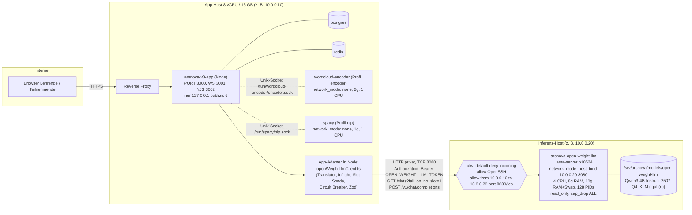
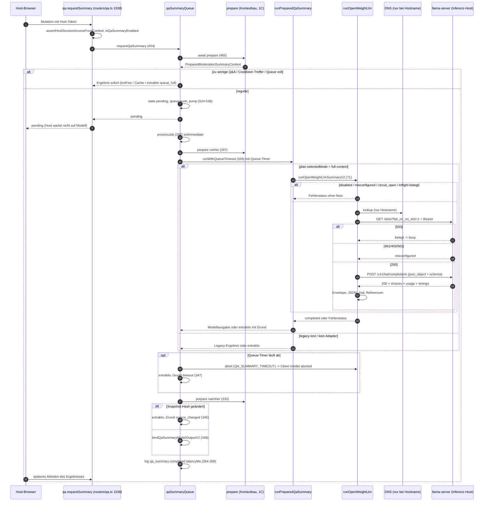

<!-- markdownlint-disable MD013 MD024 -->

# Recherchedossier 1B: Private Inferenz als getrennte Serverrolle

**Stand der Recherche:** 2026-10-16, Arbeitsbranch `referat/thema-1-notes`, `HEAD` = `27966e75215500b394b7a314f6c714eaae536452` (`git describe`: `v1.3.0-131-g27966e75`).
**Zweck:** Arbeitsgrundlage für das individuelle Referat 1B (Kurs mit 18 Teilnehmenden). Kein Produktdokument, keine Prüfungsleistung an sich.
**Kennzeichnung:** „Code-Befund“ = direkt am Repository belegt (Pfad und Zeile). „Ableitung“ = Schluss aus mehreren Code-Stellen, im Labor zu verifizieren. „Allgemeinwissen“ = nicht aus dem Repository, sondern aus allgemeiner Linux-/Docker-/llama.cpp-Kenntnis; vor Verwendung gegen eine autoritative Quelle prüfen. „Vorschlag“ = eigener Entwurf, nicht Bestandteil von Release 1.3.

> **Wichtigster Vorbefund:** Das Git-Tag `v1.3.0` (`87c39334…`, 2026-10-08) und der heutige `HEAD` unterscheiden sich gerade in den für 1B entscheidenden Werten (Kontextgröße, Speichergrenze, Timeouts, Statusprobe, Label-Consumer). Welcher Stand die „1.3-Baseline“ ist, muss die Lehrperson festlegen (siehe [Abschnitt 13](#13-offene-punkte-und-fragen-an-den-prüfer)). Dieses Dossier beschreibt `HEAD` und markiert die Abweichungen zum Tag.

---

## 1. Auftrag, Leitfrage, Gültigkeitsgrenze

### 1.1 Auftragstext (wörtlich)

Quelle: `docs/didaktik/CLOUD-COMPUTING-REFERAT-PRUEFUNG.md`, Zeilen 187–196.

> #### Gruppenauftrag 1B: Private Inferenz als getrennte Serverrolle
>
> **Eigene Leitfrage:** Welchen messbaren Isolationsgewinn und Betriebsaufwand zeigt die in Release 1.3 umgesetzte zweite private Serverrolle für die Kompass-Inferenz?
>
> 1. Reproduzieren Sie das Zwei-Host-Deployment von Release 1.3 mit dessen privaten Schnittstellen, Authentisierung, Ressourcenlimits und gepinnten Artefakten; gleichen Sie es mit ADR-0035 und dem Referenzmanifest ab. Unterscheiden Sie App-Adapter, Encoder und LLM-Server.
> 2. Führen Sie einen realen Label- oder Summary-Auftrag über die ausgelieferte private Runtime aus. Erfassen Sie Netzwerk-, Adapter- und Inferenzzeit getrennt. Für zusätzliche deterministische Störversuche darf ein Testdienst eingesetzt werden; Baseline und Leistungsurteil beruhen auf dem echten Releasepfad.
> 3. Vergleichen Sie normalen Dienst, hohe Antwortlatenz und Ausfall. Messen Sie Transportanteil, Gesamtlatenz und die Rückwirkung auf den App-Host. Dokumentieren Sie Netz-/Firewallannahmen und Wiederholbarkeit.
> 4. Bewerten Sie den Zusatzaufwand für zweite Serverrolle, Deployment und Betrieb gegen die Trennung von Fehler- und Ressourcenbereichen. Eine alternative Topologie darf im Labor verglichen werden; sie hebt die Produktionsleitplanke nicht auf.
>
> **Individuelles Ergebnis:** Deploymentbeschreibung beziehungsweise ausführbare Konfiguration, Messprotokoll und Architekturentscheidung. **Gültigkeitsgrenze:** Ein privates Netz allein belegt weder Autorisierung noch vollständige Datenschutzkonformität. **Diskussionskern:** Netzgrenzen, Prozessisolation, Latenzkosten und Verantwortlichkeiten.

### 1.2 Einordnung in den gemeinsamen Rahmen

| Rahmenpunkt                                 | Quelle (CLOUD-COMPUTING-REFERAT-PRUEFUNG.md) | Folge für 1B                                                                                                     |
| ------------------------------------------- | -------------------------------------------- | ---------------------------------------------------------------------------------------------------------------- |
| Release-Tag/Commit und Referenzmanifest fix | Z. 82 (4.1.1)                                | Image-/Modell-Digests, Limits, Timeouts und Flags müssen vor dem ersten Lauf feststehen.                         |
| Baseline → Variante → Messung               | Z. 82, Z. 137 (4.1.3)                        | Erst unveränderter Zwei-Host-Lauf, dann Latenz- und Ausfallvariante.                                             |
| Laborinstanz, nie Produktion                | Z. 84                                        | Störversuche (Latenz, Ausfall, Firewall) ausschließlich im Labor.                                                |
| Leitplanke 2 „Topologie“                    | Z. 101                                       | Live-Host 8 vCPU/16 GB mit App, PostgreSQL, Redis; LLM kanonisch auf zweitem privatem Host; Same-Host nur Labor. |
| Leitplanke 3 „Gemeinsame Runtime“           | Z. 102                                       | Ein Slot, ein Inflight über drei Auftragstypen; keine versteckte Queue.                                          |
| Leitplanke 7 „Fallback und Freigabe“        | Z. 106                                       | Extraktiver Summary-Fallback in der App-Queue; Dev-Helfer ist keine Baseline.                                    |
| Pflichtinhalte des Prüfungsauftrags         | Z. 127–135                                   | Hypothese, Gegenalternative, ausführbarer Test, Messgrößen, Schwellen, Entscheidung.                             |
| Testadapter nur für Fault-Injection         | Z. 143                                       | Ein Fake-`llama-server` ist zulässig, ersetzt aber nicht den realen Lauf.                                        |
| Thema 1, Repo-Basis                         | Z. 160–166                                   | Zusätzlich `docker-compose.prod.yml`, `.env.production.example`, `scripts/deploy.sh` am fixierten Commit prüfen. |

### 1.3 Leitfrage, Diskussionskern, Gültigkeitsgrenze — operationalisiert

- **„Isolationsgewinn“** lässt sich in zwei messbare Teile zerlegen:
  1. _Ressourcenbereich:_ CPU/RAM der Inferenz belasten den App-Host nicht (Vergleich App-Host-Kennzahlen während eines realen Inferenzlaufs: Zwei-Host vs. Same-Host-Labor).
  2. _Fehlerbereich:_ Langsamkeit oder Ausfall des Inferenzhosts bleibt auf Fallback-Zustände begrenzt (keine Fehler/Verzögerung bei Join, Vote, `qa.submit`, WebSocket).
- **„Betriebsaufwand“** = konkrete zusätzliche Tätigkeiten aus dem Runbook (siehe [Abschnitt 11](#11-betriebsaufwand-bewertung)) plus Kosten der zweiten Maschine.
- **Gültigkeitsgrenze:** Netzsegment und `ufw` beschränken _wer verbinden kann_, nicht _wer was darf_. Die Autorisierung der Aufträge erfolgt in der App (`hostProcedure`, Host-Token, Capability) — das ist Gegenstand von 1C/Thema 5. Die Runtime selbst prüft nur ein einziges geteiltes Bearer-Credential (Abschnitt 3.4). Zwischen den Hosts läuft standardmäßig **unverschlüsseltes HTTP** (Abschnitt 5.3); Datenschutzkonformität (Auftragsverarbeitung, Logging, Löschfristen) ist damit nicht belegt.

### 1.4 Rolle in der Gruppensynthese

Quelle: Z. 209. „A bewertet die Ressourcengrenze des App-Hosts, B die Isolation der privaten Inferenzrolle und C den realen Kontextübergang.“ Schnittstellen zu den Nachbarn:

- **zu 1A:** 1A liefert die App-Host-Reserve ohne LLM; 1B zeigt, was bei ausgelagertem LLM am App-Host übrig bleibt (gleiche Live-Lastmetriken verwenden).
- **zu 1C:** 1C liefert Kontextbau und Snapshot-/Hashlogik; 1B behandelt diese Phase nur als „Adapterzeit“ (zweimaliges `prepare` in `qaSummaryQueue.ts`, Z. 297–301 und 333–337) und zieht sie von der Gesamtzeit ab.

---

## 2. Zielarchitektur laut ADR-0035

Quelle: `docs/architecture/decisions/0035-self-hosted-llm-runtime-llama-cpp-over-ollama.md` (461 Zeilen; Status Accepted, Datum 2026-08-22, letzter Repo-Abgleich 2026-10-13, Z. 5–8).

### 2.1 Randbedingungen (Kontext, Z. 25–36)

- Live-Host bleibt 8 vCPU / 16 GB (Node, PostgreSQL, Redis); **kein LLM** auf diesem Host; kanonische Inferenzrolle ist ein **zweiter, privater** Host derselben Größenordnung; Same-Host-Sidecar (2–4 Threads, ~4 GB) nur Labor; keine GPU (Z. 27–30).
- Live-Hotpfade dürfen nie auf Inferenz warten (Z. 31).
- Kein öffentlicher Port, kein stiller SaaS-Fallback, kein zweites Modellserver-Silo neben dem Encoder (Z. 32–33).
- Drei getrennte Aufträge teilen sich eine Serverrolle, behalten Prompts, Verträge, Queues, Timeouts (Z. 34–36).

### 2.2 Entscheidungen

| Abschnitt                   | Zeilen  | Inhalt (Kurzfassung)                                                                                                                                                                                                                                                                                                                  |
| --------------------------- | ------- | ------------------------------------------------------------------------------------------------------------------------------------------------------------------------------------------------------------------------------------------------------------------------------------------------------------------------------------- |
| §1 Runtime                  | 57–91   | `llama-server` direkt statt Ollama; Ollama nutzt selbst `llama-server` als GGML-Engine, die Wahl betrifft nur die Produktschicht. vLLM (GPU-first), TGI (archiviert), `llamafile`, `LocalAI` verworfen.                                                                                                                               |
| §2 Betriebsmodell           | 93–97   | Sidecar-**Härte** (eigener Container, eigenes Image, Profil, kein öffentlicher Port, `deploy.sh` startet nichts, cgroup-Limits, Kill-Switch), aber andere **Topologie** als spaCy.                                                                                                                                                    |
| §2.1 Zwei Topologien        | 99–117  | Zweiter privater Host = privates HTTP + Credential, Bind nur intern, kein DNAT, kein `--host 0.0.0.0`; Encoder darf über `WORD_CLOUD_ENCODER_URL` mitziehen. Same-Host nur Labor über Unix-Socket, `network_mode: none`. URL-Allowlist nach DNS-Auflösung: nur Loopback/RFC1918/ULA. Live-Host-RAM trägt kein zusätzliches ~4-GB-LLM. |
| §2.2 Ein Slot, ein Inflight | 119–143 | `--parallel 1`; ein gemeinsames Inflight; vor POST `GET /slots?fail_on_no_slot=1` (503 → Backpressure; ohne `--slots` 501); `--slot-prompt-similarity 0`; Client-Abort muss Slot freigeben; 8.9b nicht auf dem Slot.                                                                                                                  |
| §2.3 Kein Drop-in           | 145–167 | `QA_SUMMARY_INFERENCE_URL` zeigt nie auf `/v1/chat/completions`; schmaler Node-Client `openWeightLlmClient`; Schema pro Request; `json_object` + `schema` statt `json_schema` (b10524-Realtest); Zod-Prüfung bleibt Pflicht. Summary V2: zwei Systemnachrichten + kanonisches JSON.                                                   |
| §2.4 Kontext/Timeout        | 169–198 | `--ctx-size` explizit (8192); `--n-predict` hart gedeckelt („Richtung 256“); getrennte Timeouts; Profil 8.192 / 640 Antwort / 128 Marge; Produktivaktivierung erst nach Messung auf der CPU-Box.                                                                                                                                      |
| §2.5 Fallback in der App    | 200–213 | Summary V2: Timeout, belegter Slot, ungültige Antwort, fehlender Adapter → quellengebundene extraktive Belege. Label: nur Label ersetzbar, Ausfall → extraktives Label.                                                                                                                                                               |
| §2.6 Kill-Switch-Matrix     | 215–227 | `OPEN_WEIGHT_LLM_ENABLED` (nur exakt `true`), Profil `llm`, eigenes Image; unabhängig von `WORD_CLOUD_SEMANTIC_ENABLED`, `QA_SUMMARY_ENABLED`, `NLP_ENABLED`/`QA_NLP_ENABLED`.                                                                                                                                                        |
| §2.7 Hartflags              | 229–243 | `--no-webui`, `--slots`, `--api-key`, `--reasoning off`, `--n-gpu-layers 0`, `--jinja`; kein `--embedding`/`--props`/`--metrics`; Image-Digest pinnen; GGUF als Volume; Health über `/health` mit `start_period`; kein `--host 0.0.0.0`/`-p 8080:8080`.                                                                               |
| §3 Geltungsbereich          | 245–266 | Nur Serving-Runtime; Encoder, Gemini-Dev-Helfer, 8.9b unberührt. Lernzielpfad lief am 12.10.2026 auf dem privaten Produktionshost; Summary V2 benötigt weiterhin realen Lauf.                                                                                                                                                         |
| Performance-Steckbrief      | 268–284 | Performance-kritisch (ADR-0025); Hintergrund-/On-Demand-Dienst; 2–4 Threads, ~4 GB + KV; Worst Case drei Aufträge gleichzeitig → Fallback/Retry; **Messstrategie: isolierter Zwei-Server-Laborpfad (kanonisch)**, TTFT/Prefill auf echter 8-vCPU-Box.                                                                                 |
| Konsequenzen                | 286–315 | Positiv: kleine Angriffsfläche, keine Registry. Negativ: manueller Modellbezug, ein Slot als Betriebsrisiko, CPU-Prefill kann Slice 4 unbrauchbar machen.                                                                                                                                                                             |
| Umsetzungsleitplanken       | 341–375 | Wiederholung als Checkliste; u. a. „Der Runtime-Container erhält ausschließlich seine eigenen Variablen und insbesondere keine App-, Datenbank-, Admin- oder Capability-Secrets“ (Z. 350–351); Credential-Zeichensatz `A–Z a–z 0–9 . _ ~ -` (Z. 345).                                                                                 |
| Ergänzung 2026-09-22 (#456) | 391–461 | Dritter Auftrag Lernzielableitung auf demselben Slot; Runtime-PR R inkl. Slot-Abnahme aller Auftragspaarungen (Z. 419–422); Messprofil 8.192 / Qwen3-4B-Instruct-2507 Q4_K_M (Z. 441–445); Summary-V2- und Lernziel-Betriebsnachweise offen (Z. 454–459).                                                                             |

### 2.3 Topologie (Zwei-Host-Produktion)

Die Werte stammen aus `docker-compose.llm.yml`, `docker-compose.prod.yml`, `.env.llm.example`, Runbook §5 und §12.1. Beispiel-IP-Adressen aus `.env.llm.example` Z. 10 und Runbook Z. 71–72.

**Was läuft wo (Aufgabenteilung 1B, Schritt 1):**

| Komponente  | Ort im Release 1.3                                                                      | Zweck                                                                                     | Transport                                      | Authentisierung                                                                  |
| ----------- | --------------------------------------------------------------------------------------- | ----------------------------------------------------------------------------------------- | ---------------------------------------------- | -------------------------------------------------------------------------------- |
| App-Adapter | Node-Prozess auf dem App-Host: `apps/backend/src/lib/openWeightLlmClient.ts` + Consumer | Vertrag → Chat Completions übersetzen, Slot-Schutz, Timeout, Circuit Breaker, Validierung | ausgehend HTTP (oder Unix-Socket im Labor)     | sendet Bearer-Token                                                              |
| Encoder     | Sidecar `wordcloud-encoder` auf dem **App-Host** (`docker-compose.prod.yml` Z. 114–143) | e5-small-Embeddings für semantische Themencluster (1.14c Stufe 1, 1.14d)                  | Unix-Socket; optional `WORD_CLOUD_ENCODER_URL` | Client sendet optional Bearer; **Encoder-Server prüft keinen Token** (Abschn. 6) |
| LLM-Server  | `llama-server` auf dem **Inferenz-Host** (`docker-compose.llm.yml`)                     | Labels, Summary V2, Lernziele (generativ)                                                 | HTTP an private IP, Port 8080                  | `--api-key` für `/slots` und `/v1/chat/completions`; `/health` ungeschützt       |

---

## 3. Deployment des Inferenz-Hosts im Detail

### 3.1 `docker-compose.llm.yml` (39 Zeilen) — Zeile für Zeile

| Zeile(n) | Inhalt                                                                                   | Bedeutung / Begründung                                                                                                                                              |
| -------- | ---------------------------------------------------------------------------------------- | ------------------------------------------------------------------------------------------------------------------------------------------------------------------- |
| 1–4      | Kommentar                                                                                | Nur über `scripts/open-weight-llm/prod-compose.mjs` bedienen; Wrapper prüft Digest, Bind, Credential, GGUF.                                                         |
| 7        | `profiles: ['llm']`                                                                      | Startet nur bei explizitem Profil.                                                                                                                                  |
| 8        | `image: ${OPEN_WEIGHT_LLM_IMAGE:?…digest image ref}`                                     | Ohne gesetzte Variable bricht Compose ab; Digest-Form erzwingt erst der Wrapper (`prod-compose.mjs` Z. 37–39).                                                      |
| 9        | `container_name: arsnova-open-weight-llm`                                                | Fester Name (Runbook §14.3 begründet `down` statt `stop` beim Checkout-Wechsel).                                                                                    |
| 10       | `restart: always`                                                                        | Automatischer Neustart, auch nach Reboot (Runbook Z. 983–984).                                                                                                      |
| 11       | `init: true`                                                                             | Init-Prozess als PID 1 (Signalweitergabe, Zombie-Reaping — Allgemeinwissen).                                                                                        |
| 12       | `read_only: true`                                                                        | Read-only Root-Dateisystem.                                                                                                                                         |
| 13–14    | `cap_drop: - ALL`                                                                        | Alle Linux-Capabilities entfernt.                                                                                                                                   |
| 15–16    | `security_opt: - no-new-privileges:true`                                                 | Keine Rechteausweitung über setuid.                                                                                                                                 |
| 17–19    | `network_mode: host`                                                                     | Kein Docker-Portmapping; der Prozess bindet direkt an `OPEN_WEIGHT_LLM_BIND_ADDRESS`. Damit greift `ufw` ohne Docker-DNAT-Umgehung (Runbook Z. 286–288).            |
| 20       | `pids_limit: 128`                                                                        | Prozess-/Thread-Obergrenze.                                                                                                                                         |
| 21       | `mem_limit: 8g`                                                                          | RAM-cgroup. **Am Tag `v1.3.0` noch `5g`**, angehoben nach OOM bei Lernziel-Batch 3 am 12.10.2026 (Runbook Z. 55–57; `ISSUE-456-SLICE-8-ABNAHME.md` Z. 89; PR #566). |
| 22       | `memswap_limit: 10g`                                                                     | RAM + Swap; am Tag `v1.3.0` nicht vorhanden.                                                                                                                        |
| 23       | `cpus: '4.0'`                                                                            | CPU-Quota 4 Kerne.                                                                                                                                                  |
| 24–25    | `tmpfs: /tmp … size=128m, noexec,nosuid,nodev`                                           | Einziger beschreibbarer Ort.                                                                                                                                        |
| 26–27    | `${OPEN_WEIGHT_LLM_MODEL_DIR:?…}:/models:ro`                                             | GGUF nur lesend, außerhalb des Images (ADR §2.7, Z. 241).                                                                                                           |
| 28–29    | `env_file: .env.llm`                                                                     | Eigene Datei, getrennt von `.env.production`; enthält Token, Bind-Adresse, Image, Modellpfad.                                                                       |
| 30–32    | `OPEN_WEIGHT_LLM_TRANSPORT: http`, `OPEN_WEIGHT_LLM_THREADS: '4'`                        | Erzwingt HTTP-Zweig im Entry-Point; 4 Threads (passt zu `cpus: '4.0'`).                                                                                             |
| 33–38    | Healthcheck `/opt/arsnova/healthcheck.sh`, 15 s / 5 s / `start_period` 180 s / 5 Retries | Großzügiges Startfenster wegen CPU-Modellladen.                                                                                                                     |
| 39       | `stop_grace_period: 10s`                                                                 | Zeit für sauberes `SIGTERM`.                                                                                                                                        |

Auffällig: Kein `ports:`-Eintrag (CI prüft das: `scripts/ci/open-weight-llm-compose-smoke.test.mjs` Z. 91–111).

### 3.2 `docker/open-weight-llm/Dockerfile` (22 Zeilen)

- Z. 1–2: Basis `ghcr.io/ggml-org/llama.cpp:server-b10524@sha256:57e505f69c3a55fa5dd9c15fced47cff7a899f5b5b504ea93d75b2f401b87830` („multi-arch manifest verified 2026-10-05“).
- Z. 4–7: OCI-Labels (Titel, Quelle, Lizenz MIT).
- Z. 9–13: Als `root` Gruppe/Benutzer `arsnova-llm` mit UID/GID `65532` ohne Home und Shell anlegen; `/run/open-weight-llm` gehört 65532.
- Z. 15–17: Skripte `entrypoint.sh`, `healthcheck.sh`, `validate-bind.sh`, `validate-token.sh` (Modus 0555) und `model.sha256` (0444) nach `/opt/arsnova/`.
- Z. 19: `USER 65532:65532` — der Server läuft nicht als root.
- Z. 20–22: Entry-Point und Image-eigener Healthcheck (dieselben Werte wie Compose).

Wichtig für die Reproduktion: Produktiv wird **nicht** das Basis-Image, sondern ein **eigenes, aus diesem Dockerfile gebautes Image** per Registry-Digest verwendet (Runbook Anhang A, Z. 1081–1133; Tag-Schema `server-b10524-<12-stelliger Commit>`, Z. 1093). Dieser zweite Digest steht **nicht** im Repository.

### 3.3 `docker/open-weight-llm/entrypoint.sh` (108 Zeilen)

Ablauf:

1. Z. 2–5: `set -eu`, `LC_ALL=C`, Validatoren einbinden.
2. Z. 7–8: Modellpfad `/models/Qwen3-4B-Instruct-2507-Q4_K_M.gguf` und erwarteter SHA-256 hart codiert.
3. Z. 9–11: Transport (Default `unix`), Token, Threads (Default 4).
4. Z. 13: Token-Prüfung (`validate-token.sh`), Exitcode 64 bei Verstoß.
5. Z. 14–23: Threads müssen ganzzahlig 1–4 sein (Exitcode 64).
6. Z. 24–27: GGUF muss lesbar sein (Exitcode 66).
7. Z. 28–32: **SHA-256 der ~2,5-GB-Datei bei jedem Start** (Exitcode 65 bei Abweichung) — verlängert den Kaltstart (Ableitung; Dauer im Labor messen).
8. Z. 34–53: Server-Argumente (Tabelle unten).
9. Z. 55–98: Unix-Zweig (Same-Host-Labor): Socket anlegen, `SIGTERM` weiterleiten, Socket nach Erscheinen auf `0770` setzen (Z. 78–91), damit die App mit Zusatzgruppe `65532` verbinden kann.
10. Z. 99–103: HTTP-Zweig (Zwei-Host): Bind-Adresse validieren, dann `exec … --host "$bind_address" --port 8080`.
11. Z. 104–107: Unbekannter Transport → Exitcode 64.

| Flag (Z.)                                                   | Wert                            | Warum (ADR-Bezug)                                                                                 |
| ----------------------------------------------------------- | ------------------------------- | ------------------------------------------------------------------------------------------------- |
| `--model` (36)                                              | gepinntes GGUF                  | Kein Download (s. a. `--offline`).                                                                |
| `--alias` (37)                                              | `qwen3-4b-instruct-2507-q4_k_m` | Muss zu `OPEN_WEIGHT_LLM_MODEL_ALIAS` passen (`openWeightLlmConfig.ts` Z. 17).                    |
| `--parallel 1` (38)                                         | ein Slot                        | §2.2: KV-Budget, keine zweite parallele Sequenz.                                                  |
| `--ctx-size 8192` (39)                                      | 8.192 Tokens                    | §2.4; **am Tag `v1.3.0`: 4096** (Commit `c0a7f7d7`).                                              |
| `--n-predict 768` (40)                                      | harte Antwortobergrenze         | §2.4 nennt „Richtung 256“ — Abweichung, siehe Abschnitt 12.                                       |
| `--threads`/`--threads-batch` (41–42)                       | 1–4                             | Prefill- und Decode-Threads gleich.                                                               |
| `--no-webui` (43)                                           |                                 | §2.7: WebUI default an.                                                                           |
| `--slots` (44)                                              |                                 | §2.2: ohne Flag kein `GET /slots` (501).                                                          |
| `--api-key` (45)                                            | Token                           | §2.7; Komma verboten, sonst CSV-Liste (ADR Z. 345).                                               |
| `--reasoning off` (46)                                      |                                 | §2.7: Thinking würde Timeouts sprengen.                                                           |
| `--n-gpu-layers 0` (47)                                     |                                 | CPU-only explizit.                                                                                |
| `--slot-prompt-similarity 0` (48)                           |                                 | §2.2: Slot-Wiederverwendung nicht nach Ähnlichkeit.                                               |
| `--jinja` (49)                                              |                                 | Chat-Template aus Modellmetadaten.                                                                |
| `--offline` (50)                                            |                                 | Kein Netzzugriff für Modellbezug.                                                                 |
| `--cors-origins localhost`, `--no-cors-credentials` (51–52) |                                 | Keine Browser-Cross-Origin-Nutzung.                                                               |
| `--log-verbosity 2` (53)                                    |                                 | Log-Detailgrad; für Messung relevant, weil llama.cpp Zeitangaben loggt (Allgemeinwissen, prüfen). |

### 3.4 Validatoren und Healthcheck

- **`validate-token.sh`** (15 Zeilen): Länge 32–512 (Z. 5), Zeichen nur `A-Za-z0-9._~-` (Z. 9–14).
- **`validate-bind.sh`** (14 Zeilen): Shell-`case` erlaubt `127.*`, `::1`, `10.*`, `192.168.*`, `172.16–31.*`, `fc*/fd*:` (Z. 6); sonst Exitcode 64. Hinweis (Ableitung): Das Glob-Muster prüft kein vollständiges IP-Literal (z. B. würde `10.x` den Shell-Test bestehen); die strenge Prüfung (`isIP` + BlockList) macht erst der Wrapper. Der Entry-Point erlaubt Loopback (für das `llm-http`-Labor), der Wrapper nicht.
- **`healthcheck.sh`** (27 Zeilen): HTTP-Zweig Z. 16–25 ruft `http://<bind>:8080/health` mit Bearer-Header und `--max-time 4`. Laut Feature-Doku Z. 148 und Runbook Z. 582–584 erzwingt `/health` in b10524 **keinen** API-Key; die Readiness ist keine Authentisierungsgrenze.

### 3.5 Gepinntes Modell: `docker/open-weight-llm/model-manifest.json`

| Feld               | Wert (Zeile)                                                            |
| ------------------ | ----------------------------------------------------------------------- |
| `model`            | `Qwen3-4B-Instruct-2507` (3)                                            |
| `quantization`     | `Q4_K_M` (4)                                                            |
| `license`          | `Apache-2.0` (5)                                                        |
| `sourceRepository` | `unsloth/Qwen3-4B-Instruct-2507-GGUF` (6)                               |
| `sourceRevision`   | `a06e946bb6b655725eafa393f4a9745d460374c9` (7)                          |
| `filename`         | `Qwen3-4B-Instruct-2507-Q4_K_M.gguf` (8)                                |
| `downloadUrl`      | revisionsgebundene Hugging-Face-URL (9)                                 |
| `sizeBytes`        | `2497281120` (10)                                                       |
| `sha256`           | `3605803b982cb64aead44f6c1b2ae36e3acdb41d8e46c8a94c6533bc4c67e597` (11) |
| `runtimeImage`     | `ghcr.io/ggml-org/llama.cpp:server-b10524@sha256:57e505f6…7830` (12)    |
| `runtimePlatforms` | `linux/amd64`, `linux/arm64`, `linux/s390x` (13)                        |

`docker/open-weight-llm/model.sha256` (1 Zeile) wiederholt den Hash im `sha256sum`-Format.

### 3.6 Betreiber-Wrapper

- **`scripts/open-weight-llm/prod-compose.mjs`** (80 Zeilen), aufgerufen als `npm run llm:prod -- <compose-args>` (`package.json` Z. 39):
  - Z. 10–21: BlockList nur RFC1918 + `fc00::/7` — **ohne Loopback** (CI prüft das: Smoke-Test Z. 110).
  - Z. 25–29: `.env.llm` muss existieren; Werte werden mit `process.env` gemischt.
  - Z. 36–59: Nur bei Start-Befehlen: Digest `@sha256:[a-f0-9]{64}$` (37–39), private IP-Literal (40–42), Token 32–512 URL-sicher (43–45), absoluter Modellpfad (46–48), dann `verify-model.mjs` als Kindprozess (49–58).
  - Z. 61–75: `docker compose -f docker-compose.llm.yml --env-file .env.llm --profile llm …`.
- **`prod-compose-policy.mjs`** (5 Zeilen): Validierung nur für `create`, `restart`, `run`, `start`, `up` (Z. 1); `ps`, `logs`, `stop`, `down`, `config`, `exec` bleiben auch bei defekter Konfiguration nutzbar (Rollback-Fähigkeit; Test Z. 113–125).
- **`verify-model.mjs`** (32 Zeilen): Größe gegen Manifest (Z. 16–19), SHA-256 per Stream (Z. 21–28), keine Netzoperation.

### 3.7 Same-Host- und Loopback-Laborvarianten

| Variante                       | Datei / Zeilen                       | Transport                                    | Limits                                   | Besonderheit                                                                                                                                                                                 |
| ------------------------------ | ------------------------------------ | -------------------------------------------- | ---------------------------------------- | -------------------------------------------------------------------------------------------------------------------------------------------------------------------------------------------- |
| Prod-Compose, Profil `llm`     | `docker-compose.prod.yml` Z. 145–179 | Unix-Socket, `network_mode: none`            | `mem_limit: 5g`, `cpus: '4.0'`, 128 PIDs | Kommentar Z. 145–147: „Ausschließlich Same-Host-Labor“; App mountet Socket-Volume read-only (Z. 198) und hat `group_add: '65532'` (Z. 185–186); `depends_on … required: false` (Z. 240–243). |
| Dev-Compose, Profil `llm`      | `docker-compose.yml` Z. 155–192      | Unix-Socket                                  | 5g / 4 CPU                               | Start: `npm run docker:up:llm` (`package.json` Z. 37) setzt `OPEN_WEIGHT_LLM_ENABLED=true` und baut App + Runtime.                                                                           |
| Dev-Compose, Profil `llm-http` | `docker-compose.yml` Z. 194–230      | HTTP, `network_mode: host`, Bind `127.0.0.1` | 5g / 4 CPU                               | Für Host-npm (macOS); `npm run docker:up:llm:http` (Z. 38).                                                                                                                                  |

Zu beachten: Die App selbst hat in `docker-compose.prod.yml` (Z. 181–257) **keine** `mem_limit`/`cpus`-Begrenzung. Ein Same-Host-LLM konkurriert also mit einer unbegrenzten App um denselben Host (Relevanz für den Topologievergleich; Detailmessung ist 1A).

### 3.8 Tabelle aller gepinnten Artefakte und Werte (Referenzmanifest-Entwurf)

| Artefakt / Wert                      | Wert bei `HEAD`                                                                 | Am Tag `v1.3.0`     | Fundstelle                                                            |
| ------------------------------------ | ------------------------------------------------------------------------------- | ------------------- | --------------------------------------------------------------------- |
| llama.cpp-Basisimage                 | `server-b10524@sha256:57e505f6…7830`                                            | gleich              | `Dockerfile` Z. 2; Manifest Z. 12                                     |
| arsnova-Runtime-Image                | Registry-Digest, nicht im Repo                                                  | —                   | `.env.llm.example` Z. 3; Runbook §8.1, Anhang A                       |
| GGUF Repo/Revision                   | `unsloth/Qwen3-4B-Instruct-2507-GGUF` @ `a06e946b…74c9`                         | gleich              | Manifest Z. 6–7                                                       |
| GGUF Größe/SHA-256                   | 2.497.281.120 B / `3605803b…e597`                                               | gleich              | Manifest Z. 10–11; `entrypoint.sh` Z. 8                               |
| Modell-ID in App-Audit               | `unsloth/…-GGUF@sha256:3605…e597`                                               | gleich              | `openWeightLlmConfig.ts` Z. 12–13                                     |
| Modellversion in App-Audit           | `revision:a06e…74c9`, `quant:Q4_K_M`, `llama:server-b10524` (mit `\|` getrennt) | gleich              | `openWeightLlmConfig.ts` Z. 15–16                                     |
| `--ctx-size`                         | 8192                                                                            | 4096                | `entrypoint.sh` Z. 39                                                 |
| `--n-predict`                        | 768                                                                             | 768                 | `entrypoint.sh` Z. 40                                                 |
| `max_tokens` je Auftrag              | Label 96, Summary 640, Lernziele 768                                            | gleich              | `openWeightLlmConfig.ts` Z. 229–233                                   |
| Container-RAM / RAM+Swap             | 8g / 10g                                                                        | 5g / —              | `docker-compose.llm.yml` Z. 21–22                                     |
| CPU / Threads / PIDs                 | 4.0 / 4 / 128                                                                   | gleich              | `docker-compose.llm.yml` Z. 20, 23, 32                                |
| Label-/Summary-/Lernziel-Timeout     | 30 s / 90 s / 300 s                                                             | 30 s / 90 s / 120 s | `openWeightLlmConfig.ts` Z. 4–6; `.env.production.example` Z. 262–264 |
| `QA_SUMMARY_TIMEOUT_MS`              | 90.000 (effektiv `max` mit Summary-Timeout)                                     | 8.000               | `.env.production.example` Z. 241; `qaSummaryConfig.ts` Z. 166–180     |
| Circuit Breaker                      | 3 Fehler → 30 s offen                                                           | gleich              | `openWeightLlmConfig.ts` Z. 9–10                                      |
| Lernziel-Gesamtbudget                | 20 min                                                                          | (nicht geprüft)     | `learningObjectiveDerivation.ts` Z. 32                                |
| Statusprobe                          | Cache 5 min; Topic/Lernziel 20 s; Summary = Summary-Timeout                     | nicht vorhanden     | `openWeightLlmRuntimeProbe.ts` Z. 38, 43, 57–73                       |
| Max. Antwortgröße                    | 262.144 Byte                                                                    | (nicht geprüft)     | `openWeightLlmClient.ts` Z. 41                                        |
| Max. Request (Label/Lernziel/Legacy) | 2.500 UTF-8-Byte User-Nachricht                                                 | (nicht geprüft)     | `libs/shared-types/src/open-weight-llm.ts` Z. 39; Feature-Doku Z. 21  |
| Label-Consumer                       | angeschlossen (`wordCloudTopicLabels.ts`)                                       | **nicht vorhanden** | Datei fehlt am Tag; Commit `f7b2b958` vom 2026-10-13                  |

---

## 4. Runbook als reproduzierbare Checkliste (Deploymentbeschreibung)

Quelle: `docs/operations/OPEN-WEIGHT-LLM-SECOND-HOST-RUNBOOK.md` (1143 Zeilen, Stand 2026-10-12, Z. 5). Zielsystem: Ubuntu Server 24.04 LTS oder Debian 12/13 (Z. 13–14). „I“ = Inferenz-Host, „A“ = App-Host.

| #   | Host | Schritt                                                                                                                                                                                                                         | Runbook-Zeilen | Prüfbarer Nachweis für das Messprotokoll                               |
| --- | ---- | ------------------------------------------------------------------------------------------------------------------------------------------------------------------------------------------------------------------------------- | -------------- | ---------------------------------------------------------------------- |
| 0   | —    | Zielbild: TCP 8080 nur vom App-Host, Secret, SHA-256 vor jedem Start, kein SaaS, 4 CPU / 8 GiB / 10 GiB, Deploy startet nichts. Erster Test nur Lernzielableitung, `QA_SUMMARY_ENABLED=false`.                                  | 16–38          | —                                                                      |
| 1   | —    | Hardware: min. 4 Kerne / 12 GiB / 10 GiB frei; Empfehlung 8 / 16 / 20; eigenes Segment/VLAN. Werteblatt (zwei private IPs, 40-stelliger Commit, Digest-Image).                                                                  | 42–77          | Hardwaretabelle beider Hosts                                           |
| 2   | —    | Ausschlüsse: keine öffentliche Freigabe, nicht auf 16-GiB-App-Host, kein K8s/LB/zweite Instanz, keine Secrets im Klartext.                                                                                                      | 79–85          | —                                                                      |
| 3   | I    | Vorprüfung: `os-release`, Architektur, `nproc`, `free -h`, `df -h /`, `ip -brief address`; Abbruchkriterien.                                                                                                                    | 87–125         | Ausgabe archivieren                                                    |
| 4   | I    | Pakete (`ufw`, `jq`, `curl` u. a.), Docker aus offiziellem APT-Repo, Nutzer in Gruppe `docker` (Hinweis: root-äquivalent), Node.js 22 ≥ 22.22.1.                                                                                | 127–242        | `docker version`, `node --version`                                     |
| 5   | I    | **Firewall zuerst:** IPs per Python `ipaddress.is_private` prüfen, dann `ufw default deny incoming`, `default allow outgoing`, `allow OpenSSH`, `allow from $APP to $LLM port 8080 proto tcp`, `enable`. Cloud-Firewall analog. | 244–288        | `ufw status verbose` (genau eine 8080-Regel)                           |
| 6   | I    | Freigegebenen Commit klonen (`/opt/arsnova-llm/repository`), `git checkout --detach`, `npm ci --omit=dev --ignore-scripts`.                                                                                                     | 290–318        | `git rev-parse HEAD`                                                   |
| 7   | I    | GGUF über revisionsgebundene URL laden (`.part` → umbenennen, `chmod 0444`), `verify-model.mjs`.                                                                                                                                | 320–349        | Zeile „verified 2497281120 bytes, sha256:…“                            |
| 8   | I    | Digest-Image prüfen (`^.+@sha256:[a-f0-9]{64}$`) und ziehen; Token mit `openssl rand -hex 32`; `.env.llm` mit Modus 0600.                                                                                                       | 351–430        | `ls -l .env.llm`, `grep` ohne Token                                    |
| 9   | I    | `npm run llm:prod -- config`, `up -d`, `ps`; bis 4 min auf `healthy` warten.                                                                                                                                                    | 432–470        | `Status=running Health=healthy Neustarts=0`; **Kaltstartdauer** messen |
| 10  | I    | `ss -ltnp` zeigt private IP (nicht `0.0.0.0`), `/health` 200, `docker stats`.                                                                                                                                                   | 474–493        | `ss`-Ausgabe                                                           |
| 11  | I    | `/slots` ohne Token → 401, mit Token → Array der Länge 1.                                                                                                                                                                       | 495–530        | HTTP-Codes                                                             |
| 12  | I    | Künstliche Testinferenz (`max_tokens: 8`, `temperature: 0`, `reasoning_effort: none`).                                                                                                                                          | 532–560        | Antwort + mit `curl -w` gemessene Zeit (Vorschlag)                     |
| 13  | A    | Netzprüfung `/health` ohne Token, `/slots` mit verdeckt eingegebenem Token. „Zugriff von einem beliebigen anderen Host muss scheitern“ — ohne Testkommando.                                                                     | 562–603        | Positiv- und **Negativtest von Dritthost** (eigener Nachweis nötig)    |
| 14  | A    | `.env.production` sichern, `OPEN_WEIGHT_LLM_ENABLED=false`, `OPEN_WEIGHT_LLM_URL=http://<LLM-IP>:8080`, `OPEN_WEIGHT_LLM_SOCKET_PATH=` (leer), Token; `QA_SUMMARY_ENABLED=false`; App neu erstellen.                            | 607–666        | `grep` der vier Variablen                                              |
| 15  | A    | Kurztest: Kill-Switch `true`, App neu erstellen, **nur** Lernzielableitung auslösen; Logs beider Hosts und `docker stats` beobachten; Abbruchkriterien.                                                                         | 668–706        | Logs, `docker stats`-Verlauf                                           |
| 16  | A/I  | Danach Kill-Switch `false`; Runtime optional stoppen; Sicherung kontrolliert löschen.                                                                                                                                           | 708–751        | —                                                                      |
| 17  | I/A  | Fehlersuche: Digest, Bind, GGUF, `starting`, Timeout/`Connection refused` (`ufw status numbered`, `ip route get`), 401 (Token-Hashvergleich), Swap.                                                                             | 753–861        | —                                                                      |
| 18  | A→I  | Aktualisierung: Consumer aus, neuen Checkout vorbereiten, `down`, Verzeichnistausch, `up`, Abschnitte 9–11 wiederholen; Rückkehr zum alten Checkout.                                                                            | 863–989        | Update-/Rollbackdauer (Vorschlag)                                      |
| 19  | A→I  | Sofort-Rollback: Kill-Switch aus, Runtime stoppen, Zustand dokumentieren (ohne Prompts/Tokens).                                                                                                                                 | 991–1016       | Rollbackdauer                                                          |
| 20  | I    | Regelbetrieb: täglich `docker inspect`/`docker stats`, nach Reboot, Logs; Sicherung = Secret, Commit, Digest, Netz-/Firewallkonfiguration; GGUF neu ladbar, keine Nutzerdaten.                                                  | 1018–1052      | —                                                                      |
| 21  | —    | Abnahmeprotokoll (16 Kästchen) plus für reale Abnahme: Hardware, Limits, Digests, Tokenzahlen, Prefill/TTFT, Gesamtlatenz, Tokens/s, RSS, Kalt-/Warmlauf, Slotstatus, Timeout, Fallback.                                        | 1054–1079      | Vorlage für das eigene Messprotokoll                                   |
| 22  | —    | Anhang A: Image bauen (`docker build --pull`), nach GHCR pushen, Digest zurücklesen.                                                                                                                                            | 1081–1133      | Digest-Referenz                                                        |

Für 1B relevant: Das Runbook ist auf einen **Produktivkurztest mit Lernzielen** zugeschnitten, nicht auf eine Messreihe mit Label/Summary. Für den Laborversuch werden die Schritte 0–14 übernommen; Schritt 15 wird durch das Versuchsdesign in [Abschnitt 10](#10-vorschlag-versuchsdesign) ersetzt.

---

## 5. App-Seite: Konfiguration, Client, Consumer

### 5.1 `apps/backend/src/lib/openWeightLlmConfig.ts` (235 Zeilen)

| Variable / Konstante                  | Default / Wert                                                                  | Grenzen / Regel                                                                                       | Zeilen          |
| ------------------------------------- | ------------------------------------------------------------------------------- | ----------------------------------------------------------------------------------------------------- | --------------- |
| `OPEN_WEIGHT_LLM_ENABLED`             | aus                                                                             | nur exakt `'true'`                                                                                    | 63–65           |
| `OPEN_WEIGHT_LLM_URL`                 | leer                                                                            | `http:`/`https:`; keine Credentials, kein Pfad/Query/Fragment; SaaS-Hosts gesperrt; Rückgabe `origin` | 100–124         |
| `OPEN_WEIGHT_LLM_SOCKET_PATH`         | leer                                                                            | absolut, endet auf `.sock`, ≤ 256 Zeichen                                                             | 126–135         |
| URL und Socket                        | —                                                                               | gegenseitig exklusiv (Fehler)                                                                         | 208–212         |
| `OPEN_WEIGHT_LLM_TOKEN`               | leer → `null`                                                                   | 32–512 Zeichen `A-Za-z0-9._~-`                                                                        | 137–144         |
| `OPEN_WEIGHT_LLM_LABEL_TIMEOUT_MS`    | 30.000                                                                          | 1.000–300.000                                                                                         | 4, 7–8, 173–181 |
| `OPEN_WEIGHT_LLM_SUMMARY_TIMEOUT_MS`  | 90.000                                                                          | 1.000–300.000                                                                                         | 5, 183–191      |
| `OPEN_WEIGHT_LLM_LEARNING_TIMEOUT_MS` | 300.000                                                                         | 1.000–300.000                                                                                         | 6, 193–201      |
| Circuit Breaker                       | 3 Fehler / 30.000 ms                                                            | Konstanten                                                                                            | 9–10            |
| SaaS-Sperrliste                       | 12 Hosts + `*.openai.azure.com`                                                 | Suffix-Match                                                                                          | 19–32, 78–85    |
| Private Zieladressen                  | `127/8`, `10/8`, `172.16/12`, `192.168/16`, `::1`, `fc00::/7`; IPv4-mapped IPv6 | BlockList                                                                                             | 34–40, 87–98    |
| `maxOutputTokens`                     | 96 / 640 / 768                                                                  | fest                                                                                                  | 229–233         |

Zusätzlich im Client gelesen: `OPEN_WEIGHT_LLM_LEARNING_DEBUG_LOG` (`openWeightLlmClient.ts` Z. 417–419; dokumentiert in `.env.production.example` Z. 265–269 und `docs/features/learning-objective-derivation.md` Z. 65, **nicht** in `docs/ENVIRONMENT.md`).

Unterschied App ↔ Wrapper: Die App akzeptiert Loopback (`127/8`, `::1`), der Produktionswrapper auf dem Inferenz-Host nicht (`prod-compose.mjs` Z. 10–14). Das ist für das `llm-http`-Labor gewollt.

### 5.2 `runOpenWeightLlm` Schritt für Schritt (`openWeightLlmClient.ts` Z. 369–468)

1. **Eingangsvalidierung** (373–374): `OpenWeightLlmRequestSchema.safeParse`; Fehler → `invalid_response` (vor Config, Slot und Netz; Test Z. 354).
2. **Config** (376–381): Fehler beim Auflösen → `misconfigured`.
3. **Kill-Switch** (382): → `disabled`.
4. **Transport/Token fehlen** (383): → `misconfigured`.
5. **Caller bereits abgebrochen** (384): → `aborted`.
6. **Circuit Breaker offen** (385, Logik 153–173): → `circuit_open`; schließt nach 30 s automatisch (155–158).
7. **Prozesslokales Inflight** (386–388): Modulvariable `inFlight` (133); belegt → `{ status: 'busy', retry: 'manual' }`. Gilt **pro Node-Prozess**, nicht über mehrere App-Instanzen (Ableitung).
8. **Startzeit und Signale** (389–391): `startedAt = hooks.now()`; `AbortSignal.timeout(timeoutsMs[taskType])`, kombiniert mit Caller-Signal über `AbortSignal.any`.
9. **Zielauflösung** (395, Funktion 186–211): SaaS-Sperre, IP-Literal muss privat sein; sonst `dns.lookup(all: true, verbatim: true)` unter demselben Signal (`waitForAbort` 213–229); **alle** Adressen müssen privat sein; erste Adresse wird gepinnt.
10. **Slot-Sonde** (400–408): `GET /slots?fail_on_no_slot=1` mit `authorization: Bearer …`.
11. **Statusabbildung Sonde** (409–415): 503 → `busy`; 401/403/501 → `misconfigured`; sonst ≠ 200 → `unavailable`.
12. **Request-Body** (416, Funktion 274–309): Summary V2 = zwei Systemnachrichten (`instructionText`, `definitionText`) + kanonisches Kontext-JSON (280–288); sonst Systeminstruktion + `JSON.stringify(request)` (289–292). `response_format: { type: 'json_object', schema: z.toJSONSchema(…, draft-7) }`, `max_tokens` je Auftrag, `temperature: 0`, `stream: false`, `reasoning_effort: 'none'`, `chat_template_kwargs.enable_thinking: false` (293–308).
13. **Optionales Debug-Logging** nur für Lernziele (417–425, 435–443).
14. **POST** (426–434) auf `/v1/chat/completions`.
15. **Statusabbildung POST** (444–450): 503 → `busy`; 401/403 → `misconfigured`; sonst ≠ 200 → `unavailable` (501 hier nicht gesondert).
16. **Antwortprüfung** (451–453, Funktion 311–363): HTTP-JSON → Envelope-Schema (48–69) → `content` als JSON → `OpenWeightLlmOutputSchema` → Auftragstyp gleich → nur erlaubte Referenzen (`hasOnlyAllowedOpenWeightLlmReferences`). Jeder Fehler → `invalid_response`.
17. **Fehlerklassifikation** (456–457, Funktion 175–184): Caller-Abbruch → `aborted`; eigenes Timeout → `timeout`; `AbortError` → `aborted`; sonst `unavailable`.
18. **Inflight frei** (458–460) in `finally`.
19. **Circuit Breaker** (462–466): Erfolg setzt zurück; nur `timeout`, `unavailable`, `invalid_response` zählen (365–367). `busy`, `aborted`, `misconfigured` zählen **nicht**.

**Transport** (`defaultRuntimeRequest`, Z. 547–603): `node:http`/`node:https`; bei HTTP wird `hostname` auf die geprüfte IP gesetzt, `host`-Header auf den Originalhost (556), SNI bei Hostnamen (572); Antwort abgebrochen über 262.144 Byte (584–586). Kein eigener `Agent` — Keep-Alive-Verhalten hängt am Node-Default (Allgemeinwissen: seit Node 19 hält der globale Agent Verbindungen offen; im Labor mit `ss -tnp` prüfen, ob Sonde und POST dieselbe TCP-Verbindung nutzen).

**Telemetrie** (`OpenWeightLlmTelemetry`, Z. 71–77; befüllt 355–361): `taskType`, `elapsedMs`, `model`, `promptTokens`, `completionTokens`. `elapsedMs` misst von `startedAt` (389, **vor** DNS und Slot-Sonde) bis nach der Zod-Prüfung — also DNS + Sonde + POST + Parsing in einem Wert. Nur Erfolge erhalten Telemetrie; Fehlerresultate sind nackte Statuswerte.

**Das ungenutzte `timings`-Feld:** Das Envelope-Schema akzeptiert `timings: z.record(z.string(), z.unknown()).optional()` (Z. 67), der Wert wird aber weder in die Telemetrie übernommen noch geloggt. llama.cpp liefert dort `prompt_n`, `prompt_ms`, `predicted_n`, `predicted_ms`, `cache_n` u. a. (Belege in Abschnitt 8.3).

**Test-Hook:** `resetOpenWeightLlmClientForTests(overrides?: Partial<ClientHooks>)` (146–151) ersetzt `config`, `resolveHostname`, `request`, `now` und setzt Inflight und Circuit zurück.

### 5.3 Auftragsspezifische Wrapper und ihre Aufrufer

Aufrufketten ermittelt mit codebase-memory `trace_path` (inbound) und Grep (für Aufrufe über injizierte Hooks, die der Graph nicht als Kante kennt).

| Wrapper (Zeilen)                               | Rückgabe bei Fehler                                 | Produktiver Aufrufer                                                                                                                                                                                                            | Einstieg (tRPC)                                                                                                      |
| ---------------------------------------------- | --------------------------------------------------- | ------------------------------------------------------------------------------------------------------------------------------------------------------------------------------------------------------------------------------- | -------------------------------------------------------------------------------------------------------------------- |
| `runOpenWeightLlmTopicLabel` (470–484)         | `{ status: 'fallback', reason, output }`            | `applyWordCloudTopicLabels` (`wordCloudTopicLabels.ts` Z. 159–239, Aufruf Z. 186/217) ← `labelSemanticWordCloudSnapshot` (241–254) ← `analyzeWordCloudSnapshot` (`routers/wordCloud.ts` Z. 117–199, Z. 164)                     | `wordCloud.analyze` und `wordCloud.analyzeQa` (`hostProcedure`, `routers/wordCloud.ts` Z. 237–256, 258 ff.)          |
| `runOpenWeightLlmSummary` (486–504, V1)        | Fallback                                            | **kein produktiver Aufrufer** (nur `openWeightLlmClient.test.ts` Z. 180, 455, 820)                                                                                                                                              | —                                                                                                                    |
| `runOpenWeightLlmSummaryV2` (507–527)          | nackter Fehlerstatus                                | `runPreparedQaSummary` (`qaSummaryRuntimeAdapter.ts` Z. 56–113, Aufruf Z. 71) ← `processor` ← `runWithQueueTimeout` (`qaSummaryQueue.ts` Z. 259–285) ← `processJob` (292–402) ← `pump` (404–412) ← `requestQaSummary` (454–540) | `qa.requestSummary` (`routers/qa.ts` Z. 1538–1568; `publicProcedure` + `assertHostSessionAccessFromContext` Z. 1559) |
| `runOpenWeightLlmLearningObjectives` (529–545) | nackter Fehlerstatus (`busy` mit `retry: 'manual'`) | `deriveLearningObjectiveDrafts` (`learningObjectiveDerivation.ts` Z. 364 ff., Aufruf über `hooks.run` Z. 405; Batches sequenziell Z. 416 ff.; Gesamtbudget Z. 32/407)                                                           | `quiz.deriveLearningObjectives` (`routers/quiz.ts` Z. 252–271; Capability-Reservierung als Autorisierung, Z. 251)    |
| alle drei (V2)                                 | —                                                   | `measureProbe` (`openWeightLlmRuntimeProbe.ts` Z. 289–387)                                                                                                                                                                      | `health.openWeightLlmProbe` (`routers/health.ts` Z. 1133–1151, `publicProcedure`, IP-Rate-Limit Z. 1139–1149)        |

**Unterschied für die Messung:** Label (Wortwolke) und Lernziele lassen die Host-Anfrage auf das Modell **warten** (synchroner `await` in der Mutation; Label-Phase begrenzt auf `max(8 s, Label-Timeout × Kandidaten)` ≤ 120 s, `wordCloudTopicLabels.ts` Z. 32–34, 147–157). Die Summary dagegen kehrt nach `requestQaSummary` mit `pending` zurück (Z. 524–539); das Modell läuft in der Queue. Vor der Rückkehr wird allerdings der Kontext **synchron** vorbereitet (`await hooks.prepare`, Z. 465).

**Telemetrie geht verloren:** `runPreparedQaSummary` übernimmt `result.output`, verwirft aber `result.telemetry` (Z. 72–80). `applyWordCloudTopicLabels` nutzt nur `result.output` (Z. 220–223). Nur `deriveLearningObjectiveDrafts` loggt `elapsedMs` und Tokenzahlen (`learning_objectives:batch_completed`, Z. 478–483).

### 5.4 Summary-Konfiguration und Queue-Timeout

- `resolveEffectiveQaSummaryTimeoutMs` (`qaSummaryConfig.ts` Z. 166–180): Bei aktivem Full-Context-Pfad `min(300.000, max(QA_SUMMARY_TIMEOUT_MS, OPEN_WEIGHT_LLM_SUMMARY_TIMEOUT_MS))`.
- Moduswahl `resolveQaSummaryAdapterPlan` (`moderationSummaryContext.ts` Z. 97–137): `full-context`, wenn Runtime aktiv **und** Transport **und** Token gesetzt; sonst `legacy-text` (privater Legacy-Adapter) oder extraktiv mit Grund `misconfigured`/`unavailable`/`disabled`.
- Queue-Timeout (`runWithQueueTimeout`, Z. 259–285): eigener `AbortController` + `setTimeout`; bei Ablauf `controller.abort(new Error('QA_SUMMARY_TIMEOUT'))` und Ergebnis `timeout` → extraktiver Fallback (Z. 346–347).

**Ableitung (im Labor zu verifizieren):** Mit den Defaults sind Queue- und Client-Timeout gleich (90 s). Der Queue-Timer startet vor dem Client-Timer (Z. 268 vor `openWeightLlmClient.ts` Z. 390). Läuft die Queue zuerst ab, sieht der Client einen **Caller-Abbruch** → Status `aborted` (Z. 180) → **zählt nicht** für den Circuit Breaker (Z. 365–367). Folge: Dauerhaft langsame Summary-Antworten öffnen den Breaker nicht; jeder neue Auftrag wartet erneut bis zum Timeout. Für Label-Aufrufe gilt Ähnliches, wenn das Phasenbudget kleiner ist als der Label-Timeout (`AbortSignal.timeout(Math.min(perCallCap, remaining))`, `wordCloudTopicLabels.ts` Z. 217–219). Dieser Punkt ist ein guter Kandidat für den Variantenversuch „hohe Latenz“.

### 5.5 Sequenzdiagramm: ein Summary-V2-Auftrag mit Fallback-Zweigen

---

## 6. Encoder vs. LLM

| Merkmal         | Encoder (1.14c Stufe 1 / 1.14d)                                                                                                                                                             | LLM (8.9d)                                |
| --------------- | ------------------------------------------------------------------------------------------------------------------------------------------------------------------------------------------- | ----------------------------------------- |
| Aufgabe         | e5-small-Embeddings, Clustering bleibt deterministisch in der App                                                                                                                           | generativ: Label, Summary, Lernziele      |
| Ort in 1.3      | **App-Host**, Sidecar `wordcloud-encoder` (`docker-compose.prod.yml` Z. 113–143)                                                                                                            | zweiter Host (`docker-compose.llm.yml`)   |
| Limits          | `network_mode: none`, 2g RAM, 1 CPU, 64 PIDs (Z. 125–128)                                                                                                                                   | host network, 8g/10g, 4 CPU, 128 PIDs     |
| Client          | `apps/backend/src/lib/wordCloudEncoderClient.ts`; Inflight 1 (Z. 22, 134–145); Socket bevorzugt, HTTP falls `inferenceUrl` (139–142)                                                        | `openWeightLlmClient.ts`                  |
| Config          | `wordCloudSemanticConfig.ts`: Timeout 8.000 (500–120.000), Cache-TTL 1.800, Circuit 3/30 s (Z. 12–20); private HTTP-Ziele nur `localhost` oder IP-Literale (Z. 92–112)                      | DNS-Namen erlaubt, nach Auflösung geprüft |
| Timeout in Prod | Compose setzt `WORD_CLOUD_ENCODER_TIMEOUT_MS: '120000'` (Z. 220), überschreibt `.env.production.example` Z. 220 (8000)                                                                      | 30/90/300 s                               |
| Server-Auth     | **Keine Token-Prüfung im Server** (`docker/wordcloud-encoder/server.py`: nur `Content-Length`-Header gelesen, Z. 126–130; keine Authorization-Auswertung)                                   | `--api-key`                               |
| HTTP-Betrieb    | `WORD_CLOUD_ENCODER_HTTP_BIND` (server.py Z. 194–203) nur als lokaler Loopback-Weg dokumentiert (`docs/features/word-cloud-semantic.md` Z. 121–140: „Produktion setzt den HTTP-Bind nicht“) | kanonisch                                 |

**Option „Encoder zieht mit“ (ADR §2.1 Z. 103):** Technisch kann die App per `WORD_CLOUD_ENCODER_URL=http://10.0.0.20:<port>/embed` einen entfernten Encoder ansprechen (IP-Literal nötig). Das Release liefert dafür aber **kein** Compose-Profil auf dem Inferenz-Host, keinen Wrapper und **keine serverseitige Authentisierung**; ein umgezogener Encoder wäre allein durch Netz und Firewall geschützt. Für 1B heißt das: Die Unterscheidung „App-Adapter / Encoder / LLM-Server“ ist im Release eindeutig — Encoder bleibt auf dem App-Host; ein Umzug wäre eine eigene, im Labor zu begründende Gegenvariante.

---

## 7. Status und Beobachtbarkeit

### 7.1 `health.openWeightLlmProbe` und `openWeightLlmRuntimeProbe.ts` (461 Zeilen)

- Öffentlicher Endpunkt (`routers/health.ts` Z. 1133–1151), getrennt von `footerBundle`/`serviceStatus` (Kommentar Z. 1126–1132).
- Führt **nacheinander** drei echte Mini-Aufträge aus: `topic_label` (Z. 310–317), Summary V2 mit `MODERATION_PROMPT_CONTEXT_MINIMAL_FIXTURE_V1` (117–150, 319–332), `learning_objectives` (334–341).
- Timeouts: Topic/Lernziel 20 s (`OPEN_WEIGHT_LLM_PROBE_TASK_TIMEOUT_MS`, Z. 43), Summary = konfiguriertes `OPEN_WEIGHT_LLM_SUMMARY_TIMEOUT_MS` (Z. 57–73); ungültiger Timeout → strukturiert `misconfigured` (297–303).
- Cache 5 min (`OPEN_WEIGHT_LLM_PROBE_CACHE_TTL_MS`, Z. 38); `refresh: true` umgeht ihn **nicht** (432–439); Single-Flight (441–460); Rate-Limit nur beim Leader (`beforeLiveMeasurement`, 448–452).
- Ergebnis je Aufgabe: `status`, `elapsedMs` (gemessen um den Wrapper-Aufruf, 257–287), `reason`; dazu `modelAlias`, `modelReported`.
- Statusabbildung `mapFailureReason` (210–227), Gesamtstatus `overallFromTasks` (229–249).

**Relevanz für 1B:** (a) `elapsedMs` der Probe ist heute die einzige über eine API abrufbare App-seitige Laufzeit je Auftragstyp. (b) Die Probe belegt den **einzigen** Slot für bis zu 20 + 90 + 20 s. Während einer Messreihe darf niemand den Statusdialog öffnen, sonst laufen Live-Aufträge in `busy`/Fallback (Ableitung aus 2.2 + 5.2).

### 7.2 Schemas in `libs/shared-types`

- `OpenWeightLlmProbeTaskStatusSchema` = `ok | busy | degraded | unavailable | disabled | unknown` (`schemas.ts` Z. 4900–4907).
- `OpenWeightLlmProbeTaskResultSchema` (4910–4916), `OpenWeightLlmRuntimeProbeSchema` (4919–4940), `OpenWeightLlmRuntimeProbeInputSchema` (4943–4949; Kommentar Z. 4945 „Cache umgehen“ widerspricht dem Verhalten).
- Fehlerstatus der Runtime: `OPEN_WEIGHT_LLM_RESULT_FAILURE_STATUSES` (`open-weight-llm.ts` Z. 197–206).

### 7.3 Frontend

`apps/frontend/src/app/shared/server-status-help-dialog/server-status-help-dialog.component.ts`: Abschnitt „Lokale Text-KI“ (Template ab Z. 244), Signale `llmProbe`/`llmProbeLoading`/`llmProbeError` (Z. 1752–1754), Abfrage in `loadLlmProbe` (Z. 2031–2045). Angezeigt werden nur Status und Modellbezeichnung (`formatLlmProbeStatus`, Z. 2001 ff.; `llmModelLabel`, Z. 1755–1759) — **`elapsedMs` wird nicht dargestellt**.

### 7.4 Welche Zeitdaten es heute gibt

| Quelle                                       | Inhalt                                                                       | Fundstelle                                                             | Zugriff                                                                                     |
| -------------------------------------------- | ---------------------------------------------------------------------------- | ---------------------------------------------------------------------- | ------------------------------------------------------------------------------------------- |
| `qa_summary:completed` / `qa_summary:failed` | `latencyMs` des gesamten Queue-Jobs, Modus, Fallback-Grund                   | `qaSummaryQueue.ts` Z. 364–369, 390–394                                | App-Log                                                                                     |
| Queue-Metriken                               | `completed`, `failed`, `timeouts`, `lastLatencyMs`, `queueLength`, `running` | `qaSummaryQueue.ts` Z. 72–79, 450–452                                  | `health.securityStats` (`diagnosticProcedure`, `routers/health.ts` Z. 949, 1018, 1176–1178) |
| `wordcloud:analyze`                          | `durationMs` (Encoder + Labels), `labelSettlement`, `labelModelAccepted`     | `wordCloudNlpTelemetry.ts` Z. 67–93; `routers/wordCloud.ts` Z. 181–197 | App-Log, `qaWordCloud` in `securityStats`                                                   |
| `learning_objectives:batch_completed`        | `elapsedMs`, Tokenzahlen je Batch                                            | `learningObjectiveDerivation.ts` Z. 478–483                            | App-Log                                                                                     |
| Probe                                        | `elapsedMs` je Auftrag                                                       | `openWeightLlmRuntimeProbe.ts` Z. 257–287                              | tRPC `health.openWeightLlmProbe`                                                            |
| llama.cpp-Antwort `timings`                  | Prefill-/Decode-Zeiten des Servers                                           | geparst in `openWeightLlmClient.ts` Z. 67, nicht verwendet             | nur über eigenes `curl`                                                                     |
| llama.cpp-Serverlog                          | `--log-verbosity 2`                                                          | `entrypoint.sh` Z. 53                                                  | `npm run llm:prod -- logs`                                                                  |

---

## 8. Messbarkeit: Netzwerk, Adapter, Inferenz

### 8.1 Zerlegung der Gesamtzeit (Vorschlag einer Begriffsdefinition)

Für einen Summary-V2-Auftrag:

- **T_host** = Rückkehrzeit von `qa.requestSummary` (enthält synchrones `prepare`, Z. 465).
- **T_job** = `latencyMs` aus `qa_summary:completed` (Start `processJob` Z. 293 bis Log Z. 364).
- **T_adapter** = T_job − T_client (zwei `prepare`-Läufe, Binding, Queue-Logik).
- **T_client** = Zeit in `runOpenWeightLlm` ab Z. 389 (entspricht `telemetry.elapsedMs`, heute verworfen).
- **T_dns** = Zeile 395 (bei IP-Literal ≈ 0).
- **T_slot** = Round-Trip der Sonde (400–408).
- **T_post** = Round-Trip des POST (426–434).
- **T_parse** = Zeile 451 (`parseCompletion`).
- **T_infer** = `timings.prompt_ms + timings.predicted_ms` aus der Antwort.
- **T_transport** ≈ (T_slot + T_post) − T_infer; enthält Netzlaufzeit, TCP-Aufbau, HTTP-Verarbeitung, Template/Tokenisierung und Antwortserialisierung im Server.

Für Labels gilt dasselbe ohne Queue; die Gesamtzeit ist `durationMs` aus `wordcloud:analyze` (enthält zusätzlich den Encoder-Lauf).

### 8.2 Was mit vorhandenem Code messbar ist, was Laborinstrumentierung braucht

| Größe                | Ohne Codeänderung                                                                                                                   | Mit Laborinstrumentierung (Vorschlag)                                                                                               |
| -------------------- | ----------------------------------------------------------------------------------------------------------------------------------- | ----------------------------------------------------------------------------------------------------------------------------------- |
| T_host               | Browser-DevTools / Playwright-Netzwerkzeit; Lastskript                                                                              | —                                                                                                                                   |
| T_job                | Log `qa_summary:completed.latencyMs`                                                                                                | —                                                                                                                                   |
| T_client             | nicht verfügbar für Summary/Label; Probe-`elapsedMs` nur für Fixtures                                                               | Log der verworfenen Telemetrie in `qaSummaryRuntimeAdapter.ts` Z. 71–81 bzw. `wordCloudTopicLabels.ts` Z. 217–223                   |
| T_dns/T_slot/T_post  | nicht verfügbar                                                                                                                     | `performance.now()` um Z. 395, 400–408, 426–434 in `openWeightLlmClient.ts`; alternativ `ClientHooks.request`-Wrapper im Laborbuild |
| T_infer              | nur per direktem `curl` an den Server                                                                                               | `completion.data.timings` in `parseCompletion` (Z. 352–362) in die Telemetrie übernehmen                                            |
| Netz-RTT             | `ping`, `ss -ti` (Allgemeinwissen)                                                                                                  | `tcpdump` auf beiden Hosts, Zeitstempel SYN / Request / erstes Antwortbyte                                                          |
| Ressourcen           | `docker stats` (Runbook Z. 488, 702), `free`, `vmstat` (Z. 853–856), cgroup `memory.peak` (Slice-8-Doku Z. 89)                      | `pidstat`/`sar` auf dem App-Host (Allgemeinwissen)                                                                                  |
| App-Host-Rückwirkung | vorhandene Lastskripte, z. B. `load:smoke:qa-classroom-30`, `load:smoke:ws-vote-progress-classroom-30` (`package.json` Z. 106, 113) | Event-Loop-Verzögerung per `perf_hooks.monitorEventLoopDelay` (Allgemeinwissen; im Backend nicht vorhanden)                         |

### 8.3 llama.cpp-`timings` als Inferenzzeit — Belege aus dem Repository

Quelle: `docs/features/open-weight-llm-runtime.md` Z. 150–237 (Apple M2 Pro, Docker arm64, 4 CPU / 5 GiB, **Unix-Socket**, `curl` im Container, Label-Fixture mit 143 Prompttokens):

| Lauf (Zeilen) | `prompt_ms` | `predicted_ms` | Summe    | `curl`-Gesamtzeit | Rest (≈ Nicht-Inferenz) | `cache_n` |
| ------------- | ----------- | -------------- | -------- | ----------------- | ----------------------- | --------- |
| 1 (199, 202)  | 2534,068    | 1059,411       | 3593,479 | 3683,744 ms       | ≈ 90 ms                 | 0         |
| 2 (209, 212)  | 38,513      | 961,079        | 999,592  | 1011,660 ms       | ≈ 12 ms                 | 142       |
| 3 (221, 224)  | 2647,132    | 1047,317       | 3694,449 | 3763,011 ms       | ≈ 69 ms                 | 0         |

Folgerungen (Ableitung):

1. Schon **ohne Netz** liegen 12–90 ms außerhalb von `prompt_ms + predicted_ms`. Der Transportanteil im Zwei-Host-Fall muss deshalb gegen eine **Same-Host-Kontrolle** (Unix-Socket oder Loopback) differenziert werden, nicht gegen null.
2. Lauf 2 zeigt **Prompt-Caching** (142 von 143 Tokens aus dem KV-Cache, `prompt_ms` 38 statt ~2.500 ms) trotz `--slot-prompt-similarity 0`. Wiederholte identische Requests messen also den Warmfall. Für reproduzierbare Messungen Kalt- und Warmlauf getrennt ausweisen; ein abwechselnder Fremd-Prompt oder der Request-Parameter `cache_prompt: false` (Allgemeinwissen zur llama.cpp-Server-API; gegen die b10524-README prüfen) kann den Cache umgehen — Letzteres ändert aber den Releasepfad und ist nur als Kontrollvariante zulässig.
3. Prefill dominiert beim kalten Lauf (~70 % der Zeit bei 143 Tokens). Für Summary V2 mit bis zu ~6.907 Kontext-Einheiten (ADR Z. 190–192) ist ein Vielfaches zu erwarten; das ist genau der offene Nachweis aus `ISSUE-456-SLICE-8-ABNAHME.md` Z. 79–83.

### 8.4 Werkzeuge (Allgemeinwissen, im Labor zu prüfen)

- `curl -w '%{time_namelookup} %{time_connect} %{time_starttransfer} %{time_total}\n'` vom App-Host gegen `/slots` und `/v1/chat/completions` mit der Fixture `scripts/open-weight-llm/fixtures/topic-label-reproduction-request.json` — trennt TCP-Aufbau, Wartezeit bis zum ersten Byte und Gesamtzeit.
- `ss -tinp dst <LLM-IP>` auf dem App-Host: RTT, Retransmits, Wiederverwendung der Verbindung.
- `tcpdump -i <if> -w … host <APP-IP> and port 8080` auf beiden Hosts mit synchronisierter Uhr (`chronyc tracking`), um Netz- und Serverzeit zu trennen.
- `docker stats --no-stream` auf **beiden** Hosts im Sekundentakt protokollieren; auf dem Inferenz-Host zusätzlich `/sys/fs/cgroup/…/memory.peak`.
- `npm run llm:prod -- logs --since=…` für llama.cpp-Logzeilen.

---

## 9. Fault-Injection

### 9.1 Vorhandene Test-Hooks

| Hook                                                          | Datei / Zeilen                            | Ersetzt                                                                   |
| ------------------------------------------------------------- | ----------------------------------------- | ------------------------------------------------------------------------- |
| `resetOpenWeightLlmClientForTests`                            | `openWeightLlmClient.ts` Z. 146–151       | Config, DNS, Transport, Uhr; setzt Inflight/Circuit zurück                |
| `resetOpenWeightLlmRuntimeProbeForTests`                      | `openWeightLlmRuntimeProbe.ts` Z. 389–392 | Cache, Single-Flight                                                      |
| Probe-Hooks (`ProbeHooks`)                                    | `openWeightLlmRuntimeProbe.ts` Z. 152–165 | Wrapper, Uhr, Env, Timeout                                                |
| `resetQaSummaryQueueForTests`, `waitForQaSummaryIdleForTests` | `qaSummaryQueue.ts` Z. 542, 562           | Queue-Hooks (`prepare`, `processor`, `config`, `plan`, `now`, `schedule`) |
| `TopicLabelCaller` (`options.label`)                          | `wordCloudTopicLabels.ts` Z. 46–56, 186   | Label-Aufruf                                                              |
| `hooks.run`                                                   | `learningObjectiveDerivation.ts` Z. 405   | Lernziel-Aufruf                                                           |
| `resetWordCloudEncoderClientForTests`                         | `wordCloudEncoderClient.ts` Z. 102–108    | Encoder-Fetch/Config                                                      |

### 9.2 Vorhandene Tests (modellfrei)

**`apps/backend/src/lib/openWeightLlmClient.test.ts`** (898 Zeilen): Fixture-Gleichheit mit dem Translator (Z. 210); Schema pro Request für alle drei Aufträge (242); Domainprompt/Injection (256); Summary V2 als zwei Systemnachrichten (294); Kontextgrenze vor Netz (354); falscher Auftragstyp (375); ungültige Ausgaben (388); rohe OpenAI-Antwort (446); Logging bei abgeschnittener Lernzielantwort (459) und Debug-Flag ohne Bearer (495); DNS nur bei ausschließlich privaten Adressen (537); IPv6-Literale (578, 596); DNS-Timeout und Caller-Abbruch (614, 639); Credential/Transport (673); Slotisolation in allen sechs Auftragspaarungen (687); drei gleichzeitige Aufträge, höchstens ein Modellaufruf (713); Slotfreigabe nach Timeout (740) und Abbruch (774); Remote-Backpressure 503 (810); fehlende Slots-API 501 (829); 401/403 (842); Circuit Breaker öffnet (858) und schließt (872). Der Transport ist durchgehend ein `vi.fn`-Fake (`successfulTransport`, Z. 140–172).

**`apps/backend/src/lib/openWeightLlmRuntimeProbe.test.ts`** (625 Zeilen): disabled ohne Aufruf (27); drei Aufgaben + Cache (42); `refresh` umgeht Cache nicht (139); gültiger V2-Probe-Request (213); Timeout-Verteilung (226, 281); ungültiger Summary-Timeout strukturiert (260); V2 `failed` ≠ ok (353); Live-Messung nur ohne Cache (420); Rate-Limit atomar mit Single-Flight (494); Gesamtstatus bei busy/Teilausfall (584).

**`apps/backend/src/lib/openWeightLlmConfig.test.ts`** (137 Zeilen): Kill-Switch, URL-Regeln, private Adressen, Socket/Exklusivität, Budgets, Credential (Z. 14–117).

**`apps/backend/src/__tests__/wordCloud.hotpath-isolation.test.ts`**: spaCy/Encoder/LLM nicht in Vote-, Q&A-Submit- und Join-Routern (Z. 8), LLM nicht in WebSocket-Servern (17), Submit-Router frei von Klassifikator (25) — statische Isolation, keine Laufzeitmessung.

**`scripts/ci/open-weight-llm-runtime.test.mjs`** (134 Zeilen): Pins (13), Hartflags (29), CSV-sicheres Credential (73), Bind-Validator (88–102: erlaubt `127.0.0.1`, `::1`, `10.0.0.20`, `192.168.2.20`, `fd00::20`; verbietet leer, `0.0.0.0`, `::`, öffentliche IPs), Modellprüfer ohne Netz (104).

**`scripts/ci/open-weight-llm-compose-smoke.test.mjs`** (140 Zeilen): Laborprofile privat (39), Loopback-HTTP-Labor (63), Same-Host startet App und Runtime konsistent (74), Zwei-Host-Compose (91–111), Wrapper blockiert Rollback nicht (113–125), `deploy.sh` startet Runtime nicht (127–130), Einbindung in `npm test` (132–139).

Ausführung: `npm run test:open-weight-llm:all` (`package.json` Z. 36), Liste in `docs/features/open-weight-llm-runtime.md` Z. 243–254 und `docs/TESTING.md` Z. 459–469.

**Lücke:** Kein Test läuft gegen einen echten HTTP-Server; Latenz, langsamer Body, Verbindungsabbruch mitten im Body oder TCP-Blackhole sind nicht abgedeckt.

### 9.3 Warum `scripts/qa-summary-dev-server.mjs` nicht passt

Der Dev-Helfer (685 Zeilen) spricht den **Legacy-Vertrag** `POST /summary` (`QaSummaryInferenceRequest → QaSummaryModelOutput`, Z. 3–13), bindet nur Loopback (Z. 22, 28) und kann optional nach Gemini übersetzen (Z. 8–9). Er implementiert weder `/slots` noch `/v1/chat/completions` noch Bearer-Prüfung und testet daher den Pfad `legacy-text`, nicht `full-context`. ADR Z. 158–159 und Leitplanke 7 (Prüfungsdoku Z. 106) schließen ihn als Baseline aus.

### 9.4 Optionen für Latenz und Ausfall (Vorschlag)

| Störung                         | Technik (Allgemeinwissen)                                                                                            | Erwartetes App-Verhalten (Ableitung aus Abschnitt 5)                                                | Bemerkung                                                        |
| ------------------------------- | -------------------------------------------------------------------------------------------------------------------- | --------------------------------------------------------------------------------------------------- | ---------------------------------------------------------------- |
| Netzlatenz +50/+200/+1000 ms    | `tc qdisc add dev <if> root netem delay 200ms 20ms` auf dem Inferenz-Host (oder nur für Ziel-IP per `prio`/`filter`) | T_transport steigt ~2 × RTT je Request (Sonde + POST), plus TCP-Aufbau falls keine Wiederverwendung | braucht root; nach Versuch `tc qdisc del` dokumentieren          |
| Hohe Antwortlatenz (Server)     | Fake-Server mit Verzögerung vor dem Body; alternativ realer Server mit großem Prompt                                 | Timeout → Summary extraktiv `timeout`, Label extraktiv `transient`; Circuit zählt evtl. nicht (5.4) | Fake-Server nur für deterministische Varianten                   |
| Ausfall: Container gestoppt     | `npm run llm:prod -- stop open-weight-llm`                                                                           | TCP-RST → sofort `unavailable` → nach 3 Fehlern `circuit_open` für 30 s                             | schneller Fehlerpfad                                             |
| Ausfall: Paketverlust/Blackhole | `ufw deny from <APP>` vor die Allow-Regel bzw. `iptables -I INPUT -s <APP> -p tcp --dport 8080 -j DROP`              | SYN ohne Antwort → Hängen bis Timeout (30/90/300 s) → `timeout`/`aborted`                           | langsamer Fehlerpfad; wichtigster Unterschied zum Containerstopp |
| Ausfall: Host aus               | VM stoppen                                                                                                           | wie Blackhole (keine RST)                                                                           | —                                                                |
| Slot belegt                     | zweiten Auftrag parallel per `curl` direkt an `llama-server` senden                                                  | `/slots` 503 → `busy` → Fallback / manueller Retry                                                  | prüft die Slot-Sonde                                             |
| Race Sonde → POST               | Fake-Server, der `/slots` 200 meldet, dann den POST verzögert; oder fremder Request genau zwischen Sonde und POST    | Hypothese: llama-server reiht den POST intern ein (versteckte Queue, ADR §2.2)                      | prüft eine Lücke der Sonde (TOCTOU); Ergebnis offen              |
| Falscher Token                  | `.env.production` mit anderem Token                                                                                  | `/slots` 401 → `misconfigured` (zählt nicht für den Circuit)                                        | Runbook Z. 828–849                                               |
| Fake OpenAI-kompatibler Server  | kleines Node-Skript mit `/slots`, `/v1/chat/completions`, konfigurierbarer Verzögerung/Status/Body, Bearer-Prüfung   | deterministische Reproduktion aller Zweige                                                          | im Repo nicht vorhanden (Abschnitt 12)                           |

---

## 10. Vorschlag: Versuchsdesign

> Alles in diesem Abschnitt ist ein **Vorschlag**. Ausführung nur in der von der Lehrperson bereitgestellten Laborinstanz (Prüfungsdoku Z. 84, 141), nie gegen Produktion.

### 10.1 Hypothese und Gegenalternative

- **H1:** Mit dem Zwei-Host-Deployment bleibt die p95-Latenz ausgewählter Liveaktionen auf dem App-Host während realer Inferenz innerhalb von +10 % gegenüber „Runtime aus“, und der Transportanteil am Label-Auftrag liegt unter 5 % der Gesamtzeit.
- **H2:** Bei Ausfall oder hoher Latenz des Inferenzhosts erhalten Liveaktionen keine zusätzlichen Fehler; Label/Summary liefern ihren Fallback spätestens nach dem konfigurierten Timeout.
- **Gegenalternative (Labor):** Same-Host-Profil `llm` (`docker-compose.prod.yml` Z. 148–179, 5g/4 CPU, Unix-Socket) auf dem App-Host — mit dem ausdrücklichen Hinweis, dass das keine zulässige Produktionsvariante ist (Prüfungsdoku Z. 101, ADR Z. 115–117).

### 10.2 Aufbau

1. Zwei Labor-VMs nach Runbook (App 8 vCPU/16 GB, Inferenz ≥ 8 Kerne/16 GiB empfohlen, Runbook Z. 46–51), gleiches privates Segment.
2. Fixierter Commit und Referenzmanifest (Tabelle 3.8 ausfüllen, inkl. arsnova-Image-Digest).
3. App mit `OPEN_WEIGHT_LLM_ENABLED=true`, `WORD_CLOUD_SEMANTIC_ENABLED=true` (für Labels; Encoder-Profil `encoder` auf dem App-Host), `QA_SUMMARY_ENABLED=true` nur in der Summary-Reihe.
4. Statusdialog während der Reihen nicht öffnen (Probe belegt den Slot, 7.1).

### 10.3 Variantenmatrix

| Variante | Topologie         | Störung                                  | Auftrag                                                            | Wiederholungen (Vorschlag)            |
| -------- | ----------------- | ---------------------------------------- | ------------------------------------------------------------------ | ------------------------------------- |
| B0       | Zwei-Host         | keine, Runtime **aus**                   | Liveaktionen ohne Inferenz                                         | 10 Läufe                              |
| B1       | Zwei-Host         | keine                                    | Label (Host-Q&A-Wortwolke `SEMANTIC`, `refresh: true`)             | 30 kalt/warm getrennt                 |
| B2       | Zwei-Host         | keine                                    | Summary V2 (Sechs-Fragen-Fixture #456 §12)                         | 10                                    |
| C0       | Zwei-Host, direkt | keine                                    | `curl` mit Label-Fixture von App-Host und vom Inferenz-Host selbst | je 30                                 |
| L1/L2    | Zwei-Host         | `netem` +50 ms / +500 ms                 | Label                                                              | je 20                                 |
| L3       | Zwei-Host         | Serververzögerung > Label-Timeout (Fake) | Label                                                              | 10                                    |
| F1       | Zwei-Host         | Container gestoppt                       | Label, Summary                                                     | je 10, Circuit-Verlauf protokollieren |
| F2       | Zwei-Host         | Firewall-DROP                            | Label, Summary                                                     | je 5 (lange Laufzeit)                 |
| S1       | Same-Host-Labor   | keine                                    | Label, Summary                                                     | wie B1/B2                             |

Parallel zu B1–F2 und S1 läuft eine konstante Live-Last, z. B. `npm run load:smoke:qa-classroom-30` oder `load:smoke:ws-vote-progress-classroom-30` (`package.json` Z. 106, 113) — dieselbe wie bei 1A, damit die Gruppe vergleichen kann.

### 10.4 Messgrößen

- T_host, T_job, T_client, T_slot, T_post, T_infer, T_transport (Definitionen 8.1).
- Ergebnisstatus und Fallback-Grund (`effectiveMode`, `fallback.reason`, `labelSettlement`).
- Circuit-Zustand (indirekt: Anzahl Aufträge ohne Netzverkehr in `tcpdump`).
- App-Host: CPU, RSS des App-Containers, p95/Fehlerrate der Liveaktionen.
- Inferenz-Host: CPU, `memory.peak`, Restart-Zähler.
- Netz: RTT (`ping`), Retransmits (`ss -ti`), Verbindungswiederverwendung.

### 10.5 Entscheidungsschwellen (Vorschlag, vorab begründen)

- Transportanteil < 5 % von T_client im Normalbetrieb → Zwei-Host-Latenzkosten vernachlässigbar.
- p95 Liveaktionen in B1/B2 ≤ 1,1 × B0 → Ressourcenisolation bestätigt; Vergleichswert S1 zeigt den vermiedenen Effekt.
- F1/F2: 0 zusätzliche Fehler bei Liveaktionen; Fallback ≤ Timeout + 1 s.
- Unterschied F1 vs. F2 > Faktor 10 in der Zeit bis zum Fallback → Empfehlung zu Timeout/Circuit-Breaker-Verhalten (Abschnitt 5.4).

### 10.6 Netz-/Firewallannahmen und Reproduzierbarkeit dokumentieren

- Netzwerkdiagramm mit IPs, Segment/VLAN, MTU, Cloud-Firewall/Security Group.
- `ufw status verbose` beider Hosts, `ss -ltnp` auf dem Inferenz-Host, Negativtest von einem Dritthost (`curl --max-time 5 http://<LLM-IP>:8080/health` muss scheitern).
- NAT-Annahme: Die App läuft im Bridge-Netz `app` (`docker-compose.prod.yml` Z. 250–251, 259–261); ausgehender Verkehr erscheint am Inferenz-Host mit der privaten App-Host-IP (Docker-Masquerading, Allgemeinwissen) — das muss die `ufw`-Quelle sein. Mit `tcpdump` belegen.
- Uhrensynchronisation beider Hosts.
- Reproduktionspaket: Commit-ID, `model-manifest.json`, beide Image-Digests, `.env.llm` und `.env.production` **ohne Secrets** (Token durch SHA-256 ersetzt, Runbook Z. 835–845), Rohdaten als CSV, Skripte, `tc`-/Firewallbefehle samt Rückbau.

---

## 11. Betriebsaufwand-Bewertung

### 11.1 Zusätzliche Tätigkeiten durch die zweite Serverrolle (aus dem Runbook)

| Tätigkeit                                                           | Häufigkeit          | Runbook    |
| ------------------------------------------------------------------- | ------------------- | ---------- |
| Zweite Maschine beschaffen, privates Segment, Routing               | einmalig            | §2.1       |
| OS-Härtung, Updates, Reboot-Management                              | laufend             | §4.1       |
| Docker- und Node-Installation und -Pflege                           | einmalig + Updates  | §4.2–4.3   |
| Host-Firewall und ggf. Cloud-Firewall                               | einmalig + Prüfung  | §5         |
| Release-Checkout auf zweitem Host                                   | je Release          | §6, §14.2  |
| GGUF (~2,5 GB) laden und verifizieren                               | je Modellwechsel    | §7         |
| Runtime-Image bauen, publizieren, Digest freigeben                  | je Runtime-Release  | Anhang A   |
| Separates Secret erzeugen, auf zwei Hosts synchron halten, rotieren | einmalig + Rotation | §8.2, §13  |
| Start, Healthcheck, Auth- und Inferenztests                         | je Deploy           | §9–11      |
| App-Konfiguration ändern und App neu erstellen                      | je Aktivierung      | §12        |
| Logs/Ressourcen beider Hosts beobachten                             | laufend             | §12.2, §16 |
| Kontrollierte Aktualisierung mit Rückkehrpfad                       | je Update           | §14        |
| Sofort-Rollback                                                     | im Störfall         | §15        |
| Sicherung von Secret, Commit, Digest, Netzkonfiguration             | laufend             | §16        |

Nicht automatisiert: `scripts/deploy.sh` startet die Runtime bewusst nicht (CI-Test Smoke Z. 127–130). Jede Runtime-Änderung ist ein **zweiter, manueller Deploy-Strang**. Die Kopplung erfolgt nur über vier Variablen in `.env.production` (Runbook Z. 638–643).

### 11.2 Getrennte Fehler- und Ressourcenbereiche

| Bereich                      | Zwei-Host (Release)                                                    | Same-Host-Labor                                                                            |
| ---------------------------- | ---------------------------------------------------------------------- | ------------------------------------------------------------------------------------------ |
| CPU                          | 4 CPU auf eigener Maschine                                             | 4 CPU-Quota auf dem App-Host, App selbst unbegrenzt (`docker-compose.prod.yml` Z. 181–257) |
| RAM / OOM                    | 8g/10g auf eigener Maschine; OOM trifft nur Runtime                    | 5g auf dem 16-GB-Host neben ~10–11 GB Baseline (ADR Z. 115–117)                            |
| Ausfall des Prozesses        | App sieht `unavailable`/`timeout` → Fallback                           | gleich, plus geteilte Host-Ressourcen                                                      |
| Ausfall der Maschine         | nur Inferenz betroffen                                                 | Lehrveranstaltung betroffen                                                                |
| Netz als neuer Fehlerbereich | ja (Firewall, Routing, Latenz, Blackhole)                              | nein (Unix-Socket, `network_mode: none`)                                                   |
| Angriffsfläche               | offener TCP-Port 8080 im Segment; Bearer im Klartext-HTTP              | kein Netzport; Socket-Volume + Bearer                                                      |
| Secrets                      | getrennte `.env.llm`; Runtime sieht keine App-Secrets (ADR Z. 350–351) | Token im selben Compose-Projekt                                                            |
| Verantwortlichkeit           | zweiter Betriebsverantwortlicher/Host möglich; klare Grenze            | ein Host, eine Verantwortung                                                               |

### 11.3 Kostentreiber

- Zweite VM/Box mit 8 Kernen / 16 GiB (Runbook-Empfehlung Z. 46–50) — Fixkosten unabhängig von der Nutzung, da `restart: always` und Modell im RAM.
- Personalzeit für zweiten Deploy-Strang, Secret-Rotation und Monitoring (11.1).
- Kein GPU-, Registry- oder SaaS-Aufwand (ADR Z. 290–299).
- Kostenvergleich CPU/GPU/Managed ist Thema 6; 1B nennt nur die Treiber.

---

## 12. Lücken und PR-Kandidaten

| #   | Lücke                                                                                                                     | Belege                                                                                                                        | Möglicher kleiner PR                                                                                                         | Aufwand                  | Upstream-tauglich                    |
| --- | ------------------------------------------------------------------------------------------------------------------------- | ----------------------------------------------------------------------------------------------------------------------------- | ---------------------------------------------------------------------------------------------------------------------------- | ------------------------ | ------------------------------------ |
| 1   | Telemetrie von Summary V2 und Label wird verworfen; nur Lernziele loggen `elapsedMs`/Tokens                               | `qaSummaryRuntimeAdapter.ts` Z. 71–81; `wordCloudTopicLabels.ts` Z. 217–223; vgl. `learningObjectiveDerivation.ts` Z. 478–483 | Telemetrie analog `learning_objectives:batch_completed` loggen (ohne Prompttext)                                             | S                        | ja                                   |
| 2   | llama.cpp-`timings` geparst, aber ungenutzt; keine Trennung DNS/Sonde/POST                                                | `openWeightLlmClient.ts` Z. 67, 355–361, 389–434                                                                              | `OpenWeightLlmTelemetry` um `promptMs`, `predictedMs`, `cacheTokens`, `slotProbeMs`, `postMs` erweitern; Tests anpassen      | S–M                      | ja (keine Inhalte, nur Zahlen)       |
| 3   | Fehlerresultate ohne Laufzeit; Ausfälle nicht quantifizierbar                                                             | `openWeightLlmClient.ts` Z. 85–91, 456–467                                                                                    | Strukturiertes Log `open_weight_llm:run` mit Status und `elapsedMs` am Ende von `runOpenWeightLlm`                           | S                        | ja                                   |
| 4   | Kein Fake-`llama-server` für deterministische Netz-/Latenztests                                                           | Tests nutzen nur `vi.fn` (`openWeightLlmClient.test.ts` Z. 140–172); Dev-Helfer spricht anderen Vertrag                       | `scripts/open-weight-llm/fake-llama-server.mjs` (nur Loopback/Labor) mit `/slots`, `/v1/chat/completions`, Delay/Status/Body | M                        | ja, als Testwerkzeug                 |
| 5   | Summary-Queue-Timeout erscheint im Client als `aborted` und zählt nicht für den Circuit Breaker (Ableitung)               | `qaSummaryQueue.ts` Z. 268–270; `openWeightLlmClient.ts` Z. 180, 365–367                                                      | Erst Regressionstest, dann ggf. Klassifikation „Abbruch wegen Queue-Timeout“ als `timeout`                                   | S–M                      | nach Maintainer-Entscheidung         |
| 6   | Feature-Doku: „bricht pro Aufgabe nach 20 Sekunden ab“, Code nutzt für Summary den Summary-Timeout                        | `docs/features/open-weight-llm-runtime.md` Z. 27; `openWeightLlmRuntimeProbe.ts` Z. 39–43, 57–73                              | Doku korrigieren                                                                                                             | S                        | ja                                   |
| 7   | Schema-Kommentar „Cache umgehen“ widerspricht Verhalten                                                                   | `libs/shared-types/src/schemas.ts` Z. 4945; `openWeightLlmRuntimeProbe.ts` Z. 432–439                                         | Kommentar korrigieren                                                                                                        | S                        | ja                                   |
| 8   | ADR §2.4 „`--n-predict` Richtung 256“ vs. Entry-Point 768                                                                 | ADR Z. 184; `entrypoint.sh` Z. 40; Feature-Doku Z. 141                                                                        | ADR-Ergänzung mit Begründung (Lernziele 768) oder Wert angleichen                                                            | S                        | ja (Doku)                            |
| 9   | ADR nennt Label-Consumer „offen“, Code und Feature-Doku: angeschlossen                                                    | ADR Z. 8, 262, 373; `docs/features/open-weight-llm-runtime.md` Z. 19; `wordCloudTopicLabels.ts`                               | ADR-Repo-Abgleich aktualisieren                                                                                              | S                        | ja                                   |
| 10  | `docs/ENVIRONMENT.md` nennt `OPEN_WEIGHT_LLM_ENABLED` noch „geplant“ und kennt `OPEN_WEIGHT_LLM_LEARNING_DEBUG_LOG` nicht | `docs/ENVIRONMENT.md` Z. 363, Tabelle Z. 111–117; `.env.production.example` Z. 265–269                                        | Zeile korrigieren, Variable ergänzen                                                                                         | S                        | ja                                   |
| 11  | Serena-Memories veraltet („Planned … not implemented“)                                                                    | Memory `deployment/core`; Memory `session/moderation-compass`                                                                 | Memories auf Link nach `docs/features/open-weight-llm-runtime.md` kürzen                                                     | S                        | ja                                   |
| 12  | Runbook verlangt Negativtest von Dritthost ohne Kommando; Abnahmeprotokoll ohne Kästchen dafür                            | Runbook Z. 601–603, 1056–1073                                                                                                 | Kommando und Kästchen ergänzen                                                                                               | S                        | ja                                   |
| 13  | Kein TLS zwischen App- und Inferenz-Host dokumentiert; Bearer im Klartext im Segment                                      | `.env.production.example` Z. 257; Runbook Z. 640; Client unterstützt `https:` (`openWeightLlmClient.ts` Z. 554, 572)          | Doku-Abschnitt „Transportverschlüsselung: Annahmen und Optionen“ (z. B. WireGuard, TLS-Proxy); keine Codeänderung            | S (Doku) / M (Umsetzung) | Doku ja; Umsetzung nach Entscheidung |
| 14  | Encoder-Umzug laut ADR möglich, aber ohne Server-Auth und ohne Compose für zweiten Host                                   | ADR Z. 103; `docker/wordcloud-encoder/server.py` Z. 188–203; `docs/features/word-cloud-semantic.md` Z. 140                    | ADR-Präzisierung „Encoder bleibt auf App-Host, Umzug nur nach eigener Auth“                                                  | S (Doku) / L (Umsetzung) | Doku ja                              |
| 15  | Slot-Sonde und POST sind zwei Requests; Race nicht getestet                                                               | `openWeightLlmClient.ts` Z. 400–434; ADR Z. 136–139                                                                           | Labortest mit Fake-Server (Lücke 4); Ergebnis dokumentieren                                                                  | M                        | ja (Test)                            |
| 16  | Öffentlich auslösbare Probe belegt den einzigen Slot (gecacht, rate-limitiert)                                            | `routers/health.ts` Z. 1133–1151; `openWeightLlmRuntimeProbe.ts` Z. 38                                                        | Nur dokumentieren (Messhinweis); Änderung nicht nötig                                                                        | S                        | ja (Doku)                            |

---

## 13. Offene Punkte und Fragen an den Prüfer

1. **Welcher Commit ist die 1.3-Baseline?** Tag `v1.3.0` = `87c39334619fbcb0c5782b061da1ba0df0ba3142` (2026-10-08). Gegenüber `HEAD` fehlen dort: `--ctx-size 8192` (dort 4096), `mem_limit: 8g`/`memswap_limit: 10g` (dort 5g), Lernziel-Timeout 300 s (dort 120 s), `QA_SUMMARY_TIMEOUT_MS=90000` (dort 8000), die Statusprobe `openWeightLlmRuntimeProbe.ts` und der Label-Consumer `wordCloudTopicLabels.ts` (Commit `f7b2b958`, 2026-10-13). Mit dem Tag wäre ein **Label-Auftrag über die Runtime gar nicht auslösbar**. Die Prüfungsdoku verlangt die Festlegung durch die Lehrperson (Z. 82).
2. **Digest des arsnova-Runtime-Images** (aus Dockerfile gebaut): nicht im Repository; wer stellt ihn bereit (Runbook Z. 74, Anhang A)?
3. **Laborhardware:** Spezifikation beider Hosts, Segment/VLAN, Cloud-Firewall, Zugriff mit root (für `tc netem`, `tcpdump`, `iptables`).
4. **Produktiver Inferenz-Host als Referenz:** Laut Runbook Z. 55 „15 GiB nutzbares RAM“; CPU-Typ und Kernzahl sind nicht dokumentiert.
5. **Modellbezug im Labor:** Ist der Download von ~2,5 GB von Hugging Face erlaubt, oder liegt das GGUF bereit?
6. **Freigegebene Testdaten:** Sechs-Fragen-Fixture aus #456 §12 für Summary; welche Daten für Host-Q&A-Wortwolke (Label)?
7. **Darf `QA_SUMMARY_ENABLED=true` im Labor gesetzt werden?** Das Runbook verlangt für den Produktivkurztest `false` (Z. 645–649).
8. **Dürfen Laborbuilds instrumentiert werden** (Logzeilen für Telemetrie, Lücken 1–3)? Nach Prüfungsdoku Z. 137 muss der Rückweg zur unveränderten Baseline dokumentiert sein.
9. **Abgrenzung zu 1C:** Wird T_adapter (Kontextbau) von 1B nur subtrahiert oder gemeinsam mit 1C gemessen?
10. **Messdaten aus der Slice-8-Abnahme** (`ISSUE-456-SLICE-8-ABNAHME.md`): Gibt es Rohdaten des Lernziellaufs vom 12.10.2026 (Laufzeit, Prefill), die als Vergleichsmaterial dienen dürfen?
11. **Fragen an die Runtime, ungeklärt im Repo:** Gibt `GET /slots` in b10524 Prompt- oder Ergebnisinhalte zurück (Datenschutzrelevanz)? Reiht `llama-server` einen POST bei belegtem Slot ein (Race 15)? Wirkt `cache_prompt: false` in b10524? — gegen die b10524-Server-README prüfen.

---

## 14. Quellenverzeichnis

**Aufgabenstellung**

- `docs/didaktik/CLOUD-COMPUTING-REFERAT-PRUEFUNG.md` — Z. 70–106 (4.1, 4.1.1, Leitplanken), Z. 108–123 (4.1.2), Z. 125–145 (4.1.3), Z. 160–166 (4.3), Z. 187–196 (1B), Z. 209 (Gruppensynthese).
- Issue #456: <https://github.com/kqc-real/arsnova.eu/issues/456> (verlinkt in der Prüfungsdoku Z. 76).
- Roadmap #463: <https://github.com/kqc-real/arsnova.eu/issues/463> (Z. 76).

**Architektur und Betrieb**

- `docs/architecture/decisions/0035-self-hosted-llm-runtime-llama-cpp-over-ollama.md` — Z. 1–461 (zitierte Abschnitte s. Abschnitt 2.2).
- `docs/operations/OPEN-WEIGHT-LLM-SECOND-HOST-RUNBOOK.md` — Z. 1–1143.
- `docs/features/open-weight-llm-runtime.md` — Z. 1–260 (insb. 11–27, 29–48, 49–121, 123–148, 150–241, 243–260).
- `docs/features/learning-objective-derivation.md` — Z. 65.
- `docs/features/word-cloud-semantic.md` — Z. 115–140.
- `docs/implementation/ISSUE-456-SLICE-8-ABNAHME.md` — Z. 3–17, 79–114, 139.
- `docs/ENVIRONMENT.md` — Z. 92–96, 102–103, 111–119, 363–370, 388, 392.
- `docs/TESTING.md` — Z. 459–469.

**Konfiguration und Deployment**

- `docker-compose.llm.yml` — Z. 1–39.
- `docker-compose.prod.yml` — Z. 83–111 (spaCy), 113–143 (Encoder), 145–179 (LLM-Labor), 181–257 (App), 259–269.
- `docker-compose.yml` — Z. 38–88 (App), 155–192 (`llm`), 194–230 (`llm-http`).
- `docker/open-weight-llm/Dockerfile` (Z. 1–22), `entrypoint.sh` (1–108), `healthcheck.sh` (1–27), `validate-bind.sh` (1–14), `validate-token.sh` (1–15), `model-manifest.json` (1–14), `model.sha256` (1).
- `.env.llm.example` — Z. 1–15.
- `.env.production.example` — Z. 210–221, 232–269.
- `scripts/open-weight-llm/prod-compose.mjs` (1–80), `prod-compose-policy.mjs` (1–5), `verify-model.mjs` (1–32), `fixtures/topic-label-reproduction-request.json`.
- `scripts/prod-compose.sh` — Z. 1–72.
- `package.json` — Z. 29, 34–41, 96–116.
- `docker/wordcloud-encoder/server.py` — Z. 1–20, 126–130, 160–215.

**Backend**

- `apps/backend/src/lib/openWeightLlmConfig.ts` — Z. 1–235.
- `apps/backend/src/lib/openWeightLlmClient.ts` — Z. 1–603.
- `apps/backend/src/lib/openWeightLlmRuntimeProbe.ts` — Z. 1–461.
- `apps/backend/src/lib/qaSummaryRuntimeAdapter.ts` — Z. 1–113.
- `apps/backend/src/lib/qaSummaryQueue.ts` — Z. 27–100, 255–540, 542–570.
- `apps/backend/src/lib/qaSummaryConfig.ts` — Z. 136–180, 240–249.
- `apps/backend/src/lib/moderationSummaryContext.ts` — Z. 97–137.
- `apps/backend/src/lib/wordCloudTopicLabels.ts` — Z. 25–57, 134–254.
- `apps/backend/src/lib/learningObjectiveDerivation.ts` — Z. 32, 364–483.
- `apps/backend/src/lib/wordCloudEncoderClient.ts` — Z. 22–24, 75–253.
- `apps/backend/src/lib/wordCloudSemanticConfig.ts` — Z. 12–40, 92–112, 190–213.
- `apps/backend/src/lib/wordCloudNlpTelemetry.ts` — Z. 63–93.
- `apps/backend/src/routers/qa.ts` — Z. 1538–1568.
- `apps/backend/src/routers/wordCloud.ts` — Z. 117–199, 236–256.
- `apps/backend/src/routers/quiz.ts` — Z. 251–271.
- `apps/backend/src/routers/health.ts` — Z. 929–1021, 1121–1191.

**Shared Types und Frontend**

- `libs/shared-types/src/open-weight-llm.ts` — Z. 31–46, 133–139, 189–212.
- `libs/shared-types/src/schemas.ts` — Z. 4896–4950.
- `apps/frontend/src/app/shared/server-status-help-dialog/server-status-help-dialog.component.ts` — Z. 244–370, 1752–1759, 2001–2045.

**Tests**

- `apps/backend/src/lib/openWeightLlmClient.test.ts` — Z. 140–206, 207–898.
- `apps/backend/src/lib/openWeightLlmRuntimeProbe.test.ts` — Z. 26–625.
- `apps/backend/src/lib/openWeightLlmConfig.test.ts` — Z. 13–137.
- `apps/backend/src/__tests__/wordCloud.hotpath-isolation.test.ts` — Z. 7–25.
- `scripts/ci/open-weight-llm-runtime.test.mjs` — Z. 13–134.
- `scripts/ci/open-weight-llm-compose-smoke.test.mjs` — Z. 1–140.
- `scripts/qa-summary-dev-server.mjs` — Z. 1–40.

**Git-Bezug**

- `git describe --tags`: `v1.3.0-131-g27966e75`; Tag `v1.3.0` = `87c39334` (2026-10-08); relevante Folgecommits u. a. `c0a7f7d7` (ctx 4096 → 8192), `01278868` (Speichergrenze 2. Host), `f7b2b958` (Topic-Labels), `baa27b31` (Queue-Timeout 8k), `1c9134a0`/`0c296e95` (Probe-Timeouts).

**Werkzeuge der Recherche:** codebase-memory-mcp (`trace_path` inbound für `runOpenWeightLlm`, `runPreparedQaSummary`, `labelSemanticWordCloudSnapshot`), Serena (`get_symbols_overview`, Memories `deployment/core`, `session/moderation-compass`, `testing/core`, `security/auth`), Grep/Read für Skripte, Compose-Dateien und Dokumentation.
