# 1C diagrams: context path from host request to private inference

Diagrams for assignment 1C ([issue #10](https://github.com/NiklasSkulll/arsnova.eu/issues/10)). Author: Jonas Weirauch, role Y. The Matrikelnummer goes only into the handout PDF and the slides, not into this public repository. Diagrams as of 2026-10-23, tests and measurements 2026-10-24.

> **Code state:** written against `main` at commit
> [`248029dc`](https://github.com/NiklasSkulll/arsnova.eu/tree/248029dc) (2026-10-23), which is
> `v1.3.0-228-g248029dc`. This is **not** the release tag `v1.3.0` (`87c39334`). Which baseline
> applies is an open question to the examiner
> ([00-rahmen](./00-rahmen-und-pruefung.md#offene-fragen-an-den-prüfer)). Elements that exist only on
> `main` are listed in [Differences to v1.3.0](#differences-to-v130).

## Figures

| No.    | Figure                               | Use                  | Language | Source                                                                                                                           |
| ------ | ------------------------------------ | -------------------- | -------- | -------------------------------------------------------------------------------------------------------------------------------- |
| Abb. 1 | Context path, structure (simplified) | handout, slide       | German   | [`1c-context-path-overview.mmd`](./diagrams/1c-context-path-overview.mmd) + legend [`1c-legende.mmd`](./diagrams/1c-legende.mmd) |
| Abb. 2 | Context path, timing (simplified)    | handout, slide       | German   | [`1c-context-path-overview-sequence.mmd`](./diagrams/1c-context-path-overview-sequence.mmd)                                      |
| A1     | Working map, structure               | appendix, discussion | English  | [`1c-context-path-map.mmd`](./diagrams/1c-context-path-map.mmd) + legend [`1c-legend.mmd`](./diagrams/1c-legend.mmd)             |
| A2     | Working map, timing                  | appendix, discussion | English  | [`1c-context-path-sequence.mmd`](./diagrams/1c-context-path-sequence.mmd)                                                        |
| A3     | Contract layers                      | appendix, discussion | English  | [`1c-contract-layers.mmd`](./diagrams/1c-contract-layers.mmd) + legend [`1c-legend.mmd`](./diagrams/1c-legend.mmd)               |

Notation and print sizes:

- **Flowcharts (Abb. 1, A1, A3)** are activity/flow diagrams. They contain decisions, so they are not pure data-flow diagrams. Bands are process steps or host boundaries.
- **Sequence diagrams (Abb. 2, A2)** use UML notation:
  - a filled arrowhead is a synchronous call;
  - an open arrowhead (`-)`) is an asynchronous message;
  - a dashed arrow is a reply;
  - `alt`, `par` and `loop` are combined fragments;
  - numbers give the order.
- **Print size:** Abb. 1 and Abb. 2 are sized for about half an A4 page each, which gives text of about 6–7 pt at 16 cm width.
- **Appendix:** A1–A3 are detailed evidence figures for the appendix and the discussion, not for the 5-page handout.

## Handout figures (German)

### Abb. 1: structure

<picture>
  <source media="(prefers-color-scheme: dark)" srcset="diagrams/1c-context-path-overview.dark.svg">
  
</picture>

<picture>
  <source media="(prefers-color-scheme: dark)" srcset="diagrams/1c-legende.dark.svg">
  
</picture>

_Abb. 1: Kontextpfad der Moderationszusammenfassung (vereinfacht). Stand `main` `248029dc` (v1.3.0 + 228 Commits). Eigene Darstellung (Jonas Weirauch, Auftrag 1C) auf Basis des Quellcodes, KI-gestützt erstellt (Claude Code, siehe [KI-Nutzung](#method-verification-and-ai-use))._

### Abb. 2: timing

<picture>
  <source media="(prefers-color-scheme: dark)" srcset="diagrams/1c-context-path-overview-sequence.dark.svg">
  
</picture>

_Abb. 2: Zeitlicher Ablauf der Zusammenfassung (UML-Sequenzdiagramm, vereinfacht). Stand `main` `248029dc` (v1.3.0 + 228 Commits). Eigene Darstellung (Jonas Weirauch, Auftrag 1C) auf Basis des Quellcodes, KI-gestützt erstellt (Claude Code, siehe [KI-Nutzung](#method-verification-and-ai-use))._

## Appendix figures (English)

### A1: working map, structure

<picture>
  <source media="(prefers-color-scheme: dark)" srcset="diagrams/1c-context-path-map.dark.svg">
  
</picture>

<picture>
  <source media="(prefers-color-scheme: dark)" srcset="diagrams/1c-legend.dark.svg">
  
</picture>

_A1: Working map of the context path. `main` `248029dc`. Own figure (Jonas Weirauch, assignment 1C), based on the source code, AI-assisted (Claude Code, see [AI use](#method-verification-and-ai-use))._

### A2: working map, timing

<picture>
  <source media="(prefers-color-scheme: dark)" srcset="diagrams/1c-context-path-sequence.dark.svg">
  
</picture>

_A2: Timing of the context path (UML sequence diagram). `main` `248029dc`. Own figure (Jonas Weirauch, assignment 1C), based on the source code, AI-assisted (Claude Code, see [AI use](#method-verification-and-ai-use))._

### A3: contract layers

<picture>
  <source media="(prefers-color-scheme: dark)" srcset="diagrams/1c-contract-layers.dark.svg">
  
</picture>

_A3: Contract layers and validation points. `main` `248029dc`. Own figure (Jonas Weirauch, assignment 1C), based on the source code, AI-assisted (Claude Code, see [AI use](#method-verification-and-ai-use))._

## Task coverage (exam document 4.3, 1C)

Status per item: **static** = code reading with file:line on this page; **unit** = tests T1–T4; **pg** = PostgreSQL tests T5; **e2e** = end-to-end tests E1–E9 up to a local test runtime ([protocol part 2](evidenz/1C/2026-10-24-teil2.md)); **measured** = M1–M5 and V1; **open** = not yet shown.

| Item                                                                                                                              | Where                                                     | Status                                                                                                                                                                        |
| --------------------------------------------------------------------------------------------------------------------------------- | --------------------------------------------------------- | ----------------------------------------------------------------------------------------------------------------------------------------------------------------------------- |
| 1. builder, preview, snapshot/hash, adapter contract; for each `#456` area its source, function, schema version and authorization | A1 bands 3–5, A3, [area table](#456-areas-at-248029dc)    | static; hash: pg (T5)                                                                                                                                                         |
| 2. real job through the versioned contracts to the private runtime                                                                | A2, A3; E1, E5                                            | e2e up to a **test runtime** on 127.0.0.1 (real router, queue, context build, client and HTTP). **Open:** a run against the shipped private runtime (needs the lab instance). |
| 2. preview vs. actual payload for the same revision                                                                               | [preview vs. payload](#preview-vs-packed-payload); E1, E3 | e2e: byte-identical for the same revision (E1); differs after a vote in between (E3)                                                                                          |
| 2. internal state vs. domain context vs. model request; contract changed only in a marked negative probe                          | A3 layers 1–3; E2, E4                                     | e2e: no host token, session or participant IDs, `snapshotHash`, `packedAt` or budget on the wire (E2); foreign output version → `invalid_response` (E4)                       |
| 3. success, incompatible schema version, missing context area, slow receiver                                                      | A3, A1/A2; T1.1–T1.6, T2.1–T2.3, E1, E4, E5, E6a/b        | unit, e2e. **Exception (finding):** a stale topic snapshot in Redis reads as "no data" (T2.3).                                                                                |
| 3. no silent field loss; host does not wait                                                                                       | finding 1; T4.1, E1, E5, M1                               | unit, e2e, measured (return time independent of runtime delay)                                                                                                                |
| 4. vote change and source deletion between request and result                                                                     | finding 3; T5.1–T5.4b, E7, E8, E9                         | pg, e2e (job state and host view)                                                                                                                                             |
| 4. hash boundary, re-checking sources, legacy/rule fallback                                                                       | findings 3–5, A1 band 5; T3, T5, E7, E8; V1               | unit, pg, e2e, measured. **Static only:** the legacy-text adapter path.                                                                                                       |
| Result: costs of validation and context provision; keep or improve                                                                | M3–M5, V1                                                 | measured locally ([protocol part 2](evidenz/1C/2026-10-24-teil2.md#messungen-m1m5-und-gegenvariante-v1))                                                                      |

## `#456` areas at `248029dc`

| Area                          | Source                                                                                                 | Builder                                                                                                        | Schema / contract                                                             | Authorization fence                                                                | #456       |
| ----------------------------- | ------------------------------------------------------------------------------------------------------ | -------------------------------------------------------------------------------------------------------------- | ----------------------------------------------------------------------------- | ---------------------------------------------------------------------------------- | ---------- |
| Q&A questions, votes, NLP     | Postgres `QaQuestion` (raw SQL, LIMIT 200), `Participant` count; RepeatableRead                        | `collectQaContextCandidates` `MQC:436-549`                                                                     | revisions `qa-ranking-v1:…` `MQC:537-547`; NLP `qa-nlp:<sha256>`              | `loadAuthorizedModerationState` `MQC:1009`, `MQC:1067`                             | §2, §4     |
| Semantic topics               | Redis `nlp:wc:snapshot:v2:{session}:value:latest-qa-semantic`, members re-checked against `QaQuestion` | `collectQaTopicContext` `MQC:625-915`                                                                          | `qa-semantic-topic-snapshot-v1` (`qaSemanticTopicSnapshot.ts:11`)             | inside the Q&A build; `WORD_CLOUD_SEMANTIC_ENABLED` checked                        | §3         |
| Compass signals               | derived from Q&A, topics, results and feedback                                                         | `buildCompassContext` (`moderationTeachingSignals.ts:1550`)                                                    | `moderation-compass-rules-v1`                                                 | teaching-signal fences `:1990`, `:2006`, `:2030`                                   | §5         |
| Released quiz results         | Postgres `Question`, `Participant`, `Vote`, `VoteAnswer`, `AnswerOption` (COMPLETED questions only)    | `collectReleasedQuizSignals` (`moderationTeachingSignals.ts:1364`)                                             | `effective-vote-v1`, `round-comparison-v1`; fingerprint `released-results-v1` | teaching fences + fingerprint double read (`:2021-2029`)                           | §7         |
| Blitzlicht                    | Redis `qf:<CODE>` + purge fence, atomic Lua read                                                       | `loadQuickFeedbackModerationSnapshot` (`quickFeedbackModerationSnapshot.ts:295`)                               | fingerprint `feedback-v1`                                                     | teaching fences + fingerprint double read                                          | §7         |
| Learning objectives           | Postgres `SessionLearningObjective`, `Question`, Q&A catalogue; RepeatableRead                         | `projectLearningContext` `MPC:234-416`                                                                         | schema version 1; `learning-context-v1`                                       | `MPC:557`, `MPC:585`; `assertLearningSnapshotStillCurrent` `MPC:443-457`           | §6         |
| Assembly                      | —                                                                                                      | `buildModerationPromptContext` `MPC:534-651`                                                                   | `moderation-analysis-context-v1`                                              | first fence `MPC:547`                                                              | §1, §8, §9 |
| Source register and integrity | sources of all areas                                                                                   | `buildModerationPromptContext`; references checked by `hasOnlyAllowedOpenWeightLlmReferences` and at bind time | typed source IDs (`qa-question:…`, aggregates)                                | client reference check `CL:446-447`; bind `V2:26-35` (finding 5)                   | §8         |
| Token budget and selection    | packed analysis                                                                                        | `packSummaryModerationPromptContext`, `trimSummaryAnalysisQuestions` (`MSC:190-384`)                           | `moderation-prompt-budget-v1`                                                 | — (operates on the authorized analysis)                                            | §9         |
| Definitions lexicon           | constant text                                                                                          | `QA_SUMMARY_TECHNICAL_DEFINITION_TEXT` (`MSC:48-49`)                                                           | `moderation-prompt-definitions-v1`                                            | —                                                                                  | §10        |
| Preview and adapter handoff   | the prepared context                                                                                   | `getQaSummaryContextPreview` (`Q:442-448`); `buildChatCompletionBody` (`CL:368-405`)                           | `qa-summary-context-preview-v1`; `QaSummaryInferenceRequestV2`                | host token (`QR:1659-1673`); wire body without tokens or participant IDs (test E2) | §11        |

Every prepare passes 8 fences. With Q&A disabled, `MQC:1015` replaces `MQC:1067` (still 8). On the request path this case cannot occur, because `qa.requestSummary` rejects Q&A-disabled sessions (`QR:1698-1703`); it occurs only through preview or runtime reads.

## Preview vs. packed payload

- **Within one prepare:** the preview DTO and the request share the same `promptContext` object (`MSC:802-823`).
- **Across prepares:** the preview is its own prepare (`Q:442-448`), and the job sends the result of prepare (2). The two are equal only if their `snapshotHash` values match. A vote between them already breaks this.
- **What the wire drops:** it does not send the full `promptContext`, only `promptContext.context` as canonical JSON plus two texts (`CL:368-381`). Budget, `snapshotHash`, `packedAt` and the envelope versions stay on the server. The domain context keeps `moderation-domain-context-v1` and `definitionsVersion` (`libs/shared-types/src/moderation-prompt-context.ts:2175-2179`).

## Missing context area

- **States:** every section has a `state`: `available`, `unavailable`, `disabled`, `not-applicable`, `not-released`, `failed` or `pending`. All except `available` carry a reason, and the strict schemas never drop a section (`libs/shared-types/src/moderation-prompt-context.ts`).
- **What the model is told:** the definition text says "omitted data is unknown" (`MSC:49`).
- **Example:** with the semantic topics switched off, `topics.state` is `disabled` with the limitation `module-disabled` (`MQC:633-653`). With more than 500 topic members it is `failed` (`MQC:674-690`). Both are confirmed by tests T2.1 and T2.2 ([protocol](evidenz/1C/2026-10-24-tests.md#t21--deaktivierte-themen-behalten-zustand-grund-und-limitation)).
- **Exception (test T2.3, finding):** a structurally valid topic snapshot in Redis with a different `version` is silently read as `null` (`wordCloudAnalysisCache.ts:623-624`). The context then reports `unavailable`/`no-data`, exactly as if no analysis existed. The section is kept, but the version conflict itself is lost ([protocol](evidenz/1C/2026-10-24-tests.md#t23--veralteter-themen-snapshot-in-redis-prozesskonflikt)).

## Evidence per station

Line numbers are 1-based and valid for `248029dc`. Short names:

| Short   | File                                                                            |
| ------- | ------------------------------------------------------------------------------- |
| `FE`    | `apps/frontend/src/app/features/session/session-host/session-host.component.ts` |
| `QR`    | `apps/backend/src/routers/qa.ts`                                                |
| `Q`     | `apps/backend/src/lib/qaSummaryQueue.ts`                                        |
| `QC`    | `apps/backend/src/lib/qaSummaryConfig.ts`                                       |
| `MSC`   | `apps/backend/src/lib/moderationSummaryContext.ts`                              |
| `MPC`   | `apps/backend/src/lib/moderationPromptContext.ts`                               |
| `MQC`   | `apps/backend/src/lib/moderationQaContext.ts`                                   |
| `PK`    | `apps/backend/src/lib/moderationPromptContextPacking.ts`                        |
| `AD`    | `apps/backend/src/lib/qaSummaryRuntimeAdapter.ts`                               |
| `CL`    | `apps/backend/src/lib/openWeightLlmClient.ts`                                   |
| `CF`    | `apps/backend/src/lib/openWeightLlmConfig.ts`                                   |
| `V2`    | `apps/backend/src/lib/qaSummaryValidateV2.ts`                                   |
| `ST`    | `libs/shared-types/src/qa-summary-v2.ts`                                        |
| `MIG15` | `prisma/migrations/20260915120000_qa_scale_counters/migration.sql`              |
| `MIG18` | `prisma/migrations/20260918120000_qa_vote_atomic_counters/migration.sql`        |

| Band   | Station                                                                  | Function                                                                                                                                                                  | Location                                                                                                             |
| ------ | ------------------------------------------------------------------------ | ------------------------------------------------------------------------------------------------------------------------------------------------------------------------- | -------------------------------------------------------------------------------------------------------------------- |
| 1      | Summary button, gate 3+ questions                                        | `canRequestQaSummary`, `requestQaSummary()`                                                                                                                               | `libs/shared-types/src/qa-summary-visibility.ts:43-55`; `FE:13531-13560`                                             |
| 1      | Preview button                                                           | `requestQaSummaryContextPreview`                                                                                                                                          | `FE:13562-13580`, `FE:2869`                                                                                          |
| 1      | Runtime reads: poll 750 ms, page load, dialog open                       | `startQaSummaryPolling`, `refreshQaSummaryRuntime`                                                                                                                        | `FE:13582-13587`, `FE:13512-13529`, `FE:5355`, `FE:2846`                                                             |
| 1      | Request error is swallowed; runtime-read error clears the result         | catch handlers                                                                                                                                                            | `FE:13557-13559`; `FE:13525-13527`                                                                                   |
| 2      | `qa.requestSummary` and its rejections                                   | host token, post-session window, Q&A and summary enabled                                                                                                                  | `QR:1675-1711` (window `QR:258-278`)                                                                                 |
| 2      | `qa.summaryContextPreview`                                               | `getQaSummaryContextPreview`                                                                                                                                              | `QR:1659-1673`; `Q:442-448`                                                                                          |
| 2      | `qa.summaryRuntime`, prepare (4)                                         | `getQaSummaryRuntimeFresh`                                                                                                                                                | `QR:1640-1657`; `Q:418-440`                                                                                          |
| 3      | prepare                                                                  | `prepareFreshModerationSummaryContext` (bound as `hooks.prepare`)                                                                                                         | `MSC:851-876`; `Q:83`                                                                                                |
| 3      | 8 fences; CONFLICT on any of about 23 compared fields                    | `loadAuthorizedModerationState`, `assertModerationStateStillCurrent`                                                                                                      | `MQC:182-205`, `MQC:939-973` (fields `MQC:943-966`)                                                                  |
| 3      | build analysis                                                           | `buildModerationPromptContext`                                                                                                                                            | `MPC:534-651`                                                                                                        |
| 3      | pack: about 4 ranked candidates plus protected IDs, 13 lanes, cache 30 s | `trimSummaryAnalysisQuestions`, `packSummaryModerationPromptContext`, `ensureMinimumQaQuestionCoverage`, `packModerationPromptContext`                                    | `MSC:190-384`, `MSC:751-771`, `MSC:701-744`; `PK:1035-1085`, lanes `PK:502-516`, cache `PK:1142-1192`, TTL `PK:24`   |
| 3      | snapshotHash                                                             | `hashModerationPromptContextMaterial`                                                                                                                                     | `PK:212-234`, `PK:1070-1074`                                                                                         |
| 3      | a vote changes the hash                                                  | router `arsnova_change_qa_vote` (`QR:362`); the function sets the skip flag and updates the counters directly; the counter update fires `QaQuestion_track_ranking_update` | `MIG18:64ff` (skip `:125`, update `:164-173`); `MIG15:372-395`                                                       |
| 3      | new question, deletion, join or leave change the hash                    | `QaQuestion_track_insert`, `QaQuestion_track_delete`, `Participant_track_revision`; `revisions.questionVotes`                                                             | `MIG15:318-344`, `MIG15:346-370`, `MIG15:264-267`; `MQC:537-547`                                                     |
| 3      | assemble, strict parse                                                   | `assemblePreparedModerationSummaryContext`                                                                                                                                | `MSC:793-836` (parse `MSC:802`); schema `ST:79-116`                                                                  |
| 4      | inflight check before and after prepare (1)                              | `requestQaSummary`                                                                                                                                                        | `Q:463`, `Q:472`. `Q:461` (disabled) cannot be reached through the router, because `QR:1704-1709` already rejects it |
| 4      | gates in code order: too few, cooldown, queue full                       | `requestQaSummary`                                                                                                                                                        | `Q:476-492`, `Q:494-508`, `Q:510-522`; defaults `QC:26-34`                                                           |
| 4      | pending result, host token copied                                        | `createPendingQaSummaryResultV2`, `cloneMinimalHostAccess`                                                                                                                | `Q:524-537`, `Q:105-111`; `V2:127-143`                                                                               |
| 4      | pump, default concurrency 1                                              | `pump`, `hooks.schedule`                                                                                                                                                  | `Q:404-412`, `Q:88-95`                                                                                               |
| 4      | prepare (2), too few again                                               | `processJob`                                                                                                                                                              | `Q:297-317`                                                                                                          |
| 5      | queue timeout around the run                                             | `runWithQueueTimeout`; `QA_SUMMARY_TIMEOUT_MS`, on the active full-context path `max(QA_SUMMARY_TIMEOUT_MS, OPEN_WEIGHT_LLM_SUMMARY_TIMEOUT_MS) ≤ 300 s`                  | `Q:259-285`, `Q:326-330`; `QC:166-180`, `QC:249`                                                                     |
| 5      | adapter plan: full-context, legacy-text, none                            | `runPreparedQaSummary`, `resolveQaSummaryAdapterPlan`                                                                                                                     | `AD:113-170` (legacy `AD:145-156`, none `AD:165-169`); `MSC:97-138`                                                  |
| 5      | client gates, shared in-process slot                                     | `runOpenWeightLlm`                                                                                                                                                        | `CL:472-482`; circuit `CL:156-176`, `CF:9-10`; private target `CL:189-214`                                           |
| 5      | GET /slots                                                               | slot probe                                                                                                                                                                | `CL:506-520`                                                                                                         |
| 5      | POST /v1/chat/completions                                                | `buildChatCompletionBody`, wire schema                                                                                                                                    | `CL:368-405`, `CL:532-540`; wire schema `CL:316-365`; `max_tokens` `CF:231`                                          |
| 5      | client task timeout (GET and POST)                                       | `AbortSignal.timeout`                                                                                                                                                     | `CL:486-497`; default `CF:5`                                                                                         |
| 5      | parseCompletion, reference check                                         | output schema, `hasOnlyAllowedOpenWeightLlmReferences`                                                                                                                    | `CL:407-459` (check `CL:446-447`); `libs/shared-types/src/open-weight-llm.ts:300-345`; V2 variant `ST:130-138`       |
| remote | llama-server, model, ctx, slot                                           | entry point, pinned model                                                                                                                                                 | `docker/open-weight-llm/entrypoint.sh:7, 38-39`; `CF:12-13`                                                          |
| 6      | prepare (3), token cleared                                               | `processJob`, `clearEphemeralAccess`                                                                                                                                      | `Q:333-338`, `Q:101-103`, `Q:398`                                                                                    |
| 6      | hash (2) = hash (3)?                                                     | order: source_changed, then timeout, then bind                                                                                                                            | `Q:340-353`                                                                                                          |
| —      | model summary, sources re-bound                                          | `bindQaSummaryModelOutputV2`, `bindStatement`                                                                                                                             | `V2:50-125`, `V2:26-35`                                                                                              |
| —      | fallback                                                                 | `bindExtractiveResult`, `createUnavailableResult`, `fallbackReasonForError`                                                                                               | `Q:174-212`, `Q:246-257`; enum `ST:189-205`                                                                          |
| —      | session purge                                                            | `invalidateQaSummaryForSession`: state dropped, job aborted                                                                                                               | `Q:123-136`                                                                                                          |

## Fallback reasons by origin

| Origin        | Reason                                                                   | Produced at                                      |
| ------------- | ------------------------------------------------------------------------ | ------------------------------------------------ |
| gate          | `queue_full`                                                             | `Q:514`                                          |
| gate          | too few questions → `context_unavailable` (rule-based, status uncertain) | `Q:233` (again after prepare (2), `Q:306-317`)   |
| plan          | `no_packed_sources`                                                      | `MSC:789`, `AD:125`                              |
| plan          | `misconfigured`, `disabled` (`unavailable` is effectively unreachable)   | `MSC:133`                                        |
| client        | `busy`                                                                   | `CL:482`, `CL:516`, `CL:551`                     |
| client        | `unavailable`                                                            | `CL:186`, `CL:520`, `CL:555`                     |
| client        | `circuit_open`                                                           | `CL:481`                                         |
| client        | `invalid_response`                                                       | `CL:470`, `CL:557-559`, `CL:658`                 |
| client        | `misconfigured`, `disabled`                                              | `CL:476`, `CL:478`, `CL:479`, `CL:518`, `CL:553` |
| client        | `timeout` (own task timeout)                                             | `CL:184` → `AD:141`                              |
| after the run | `source_changed`                                                         | `Q:345`; on read `Q:432`                         |
| after the run | `timeout` (queue timeout)                                                | `Q:347`                                          |
| prepare error | `context_unavailable` (e.g. CONFLICT)                                    | `Q:256`                                          |
| prepare error | `permission_changed`                                                     | `Q:254`                                          |

`effectiveMode` (extractive, rule-based, full-context, legacy-text) and `status` (ready, uncertain, failed) are separate fields. An extractive fallback can have status `ready`.

Not shown in the diagrams:

- `aborted` (`CL:480`, `CL:183/185`) is never stored. `Promise.race` has already resolved to `timeout` when the signal aborts (`Q:267-279`). A purge or generation mismatch drops the job at `Q:331`.
- `purged` is defined (`ST:204`) but never produced. A purge deletes the state.
- `adapter_incompatible` belongs to the legacy-text plan (`MSC:123`).

## Key findings

1. **Decoupled from the model, not from the context build.** `qa.requestSummary` returns `pending` before any model call (`Q:524-539`). It does wait for prepare (1). Test T4.1 confirms that the request returns `pending` before the processor starts and stays `pending` while it runs; T1.4 confirms the INTERNAL_SERVER_ERROR without a job.
   - A change to a fenced field during that build ends the request with CONFLICT. The fenced fields are the 23 session-row fields, such as Q&A revision, participants, quiz progress, Q&A and Blitzlicht flags, sort mode and learning context, plus the released-results and Blitzlicht fingerprints. A quiz vote on the still-running question changes no fenced field: T5.5 shows that the Q&A ranking revision and the hash stay unchanged (vote inserted directly in the database, so the CONFLICT check itself was not exercised). A schema violation during the build ends the request with INTERNAL_SERVER_ERROR instead (T1.4). The frontend swallows the error (`FE:13557-13559`).
   - A failing runtime read sets the runtime to `null`, so a finished summary disappears from the UI (`FE:13525-13527`).
2. **Prepare runs often.** It runs three times per job: (1) on request, (2) before inference and (3) after it. It runs once more on every runtime read of a finished result (page load, dialog open, poll) and once per preview. The 30 s packing cache saves only the packing step.
3. **Almost any session activity changes the hash.** These all bump revisions that end up in `snapshotHash` (see the band 3 table):
   - votes;
   - new questions;
   - joins and leaves;
   - question edits, status changes and deletions.

   The CONFLICT fence additionally compares quiz progress, the Blitzlicht enabled/open flags and sort mode (`MQC:943-966`). During active Q&A a model answer can therefore end as `source_changed` (`Q:341-345`, `Q:427-438`); how often depends on the activity during the run and was not measured. A force-fit pack keeps `meta` constant, but corpus counts and the top-N selection can still change the hash (`MSC:531-575`).

   PostgreSQL tests T5.1–T5.3 confirm that the triggers raise the revisions, and T5.1–T5.4b confirm that each change (a vote, a new question, a join, a host delete, a participant's own delete) alters the hash. Whether the revision or the content drives the hash cannot be separated: votes and joins reach it on two independent paths, the revisions in `meta` and the content (vote counts, `participantBasis`), and each path alone is enough (mutations 1–3 and 6). A fault in one path therefore does not disable the detection. A limit found by the tests: a quiz vote on a still-running question does not change the hash, a vote on a released question does (T5.5; votes inserted directly in the database) ([protocol](evidenz/1C/2026-10-24-tests.md#t5--echte-datenbankänderungen-ändern-den-snapshot-hash-postgresql)).

4. **Client failures do not skip the consistency check.** A busy, unavailable or invalid run still goes through prepare (3), and `source_changed` takes precedence over the client reason (`Q:340-353`). Tests T3.1–T3.3 confirm this for a queue timeout and a reported client failure, with T3.3 as control. Limit (T3.4): if the processor throws instead of returning a run, the job ends rule-based with `context_unavailable` and prepare (3) is skipped. The real adapter does not throw on client failures, so this needs a code defect.
5. **Sources are checked again at bind time.** Statements may only cite sources packed by prepare (3). Unknown IDs are dropped, a dropped statement adds a limitation, and no remaining statement means `uncertain` (`V2:26-35`, `V2:50-125`). For full-context answers this is a defensive second check. `parseCompletion` already rejects any answer with an unknown source ID as `invalid_response` (`CL:446-447`), and bind only runs when hash (2) = hash (3). In practice the drop path is reachable only for legacy-text output.
6. **The output contract has four different limits.**

   | Layer            | Statements | Next steps | Limitations          | Other                                 |
   | ---------------- | ---------- | ---------- | -------------------- | ------------------------------------- |
   | Instruction text | 2 to 4     | at most 1  | 0 (`limitations:[]`) | `MSC:46`                              |
   | Wire grammar     | ≤ 3        | ≤ 1        | 0                    | 180 characters, 1–2 IDs; `CL:316-365` |
   | Zod schema       | ≤ 4        | ≤ 2        | ≤ 2                  | `ST:55-57`                            |
   | Bind             | 6          | 4          | 6                    | `V2:45`, `V2:64`, `V2:68`             |
   - The instruction allows up to 4 statements, but the grammar allows only 3.
   - The constant `QA_SUMMARY_MODEL_OUTPUT_V2_CONTRACT_VERSION` holds the value `qa-summary-model-output-v3` (`ST:14`).

7. **The queue is global.** By default it holds at most 8 jobs across all sessions and runs them one at a time. Both are configurable: limit 1–32, concurrency 1–2, cooldown 5–120 s (`QC:26-34`). The timeout covers only the run, not the wait in the queue (`Q:326-330`).

## Differences to v1.3.0

`v1.3.0` is `87c39334`. Checked with `git grep` and `git show v1.3.0:…`. Rows marked "main only" affect diagram content:

| Item                                                                                   | `v1.3.0`                                                     | `248029dc`                   | Affects                                   |
| -------------------------------------------------------------------------------------- | ------------------------------------------------------------ | ---------------------------- | ----------------------------------------- |
| `--ctx-size` / `contextWindowTokens`                                                   | 4096                                                         | 8192                         | A1 remote host, A3 budget                 |
| Default `QA_SUMMARY_TIMEOUT_MS`                                                        | 8,000 ms                                                     | 90,000 ms                    | A1 band 5, A2                             |
| `resolveEffectiveQaSummaryTimeoutMs` (queue timeout raised to the client timeout)      | absent: the queue times out after 8 s, the client after 90 s | present, at most 300 s       | A1 band 5 title (main only)               |
| Wire grammar with an enum of source IDs, ≤ 3 / ≤ 1 / 0 / 180                           | absent; the schema is derived from Zod                       | present                      | A3 output step 1 (main only)              |
| Zod output limits                                                                      | 6 / 4 / 6                                                    | 4 / 2 / 2                    | A3 output step 2, finding 6               |
| `trimSummaryAnalysisQuestions`, `ensureMinimumQaQuestionCoverage`, `no_packed_sources` | absent                                                       | present                      | A1 band 3 pack, fallback plan (main only) |
| Output contract / instruction version                                                  | `-output-v2` / `-handoff-v1`                                 | `-output-v3` / `-handoff-v2` | A3                                        |
| `arsnova_change_qa_vote`                                                               | present                                                      | present                      | —                                         |

## Deviations from the dossier

The dossier ([`1C-kontext-und-adapterpfad.md`](./1C-kontext-und-adapterpfad.md)) was written on `27966e75`. At `248029dc`:

- `requestSummary` now uses `assertQaHostContentReadAllowed` and a Q&A-enabled check (`QR:1697-1703`).
- The contract versions and model-output limits changed (finding 6).
- There is a new trimming step, `trimSummaryAnalysisQuestions` (`MSC:190-384`).
- Many line numbers moved. Use this page's tables.

## Method, verification and AI use

- **Method:** The path was traced with codebase-memory-mcp (`trace_path`, `search_graph`) and Serena (`find_symbol`, `find_referencing_symbols`) at `248029dc`. One edge is invisible to the graph: the queue calls `prepareFreshModerationSummaryContext` through the hook `hooks.prepare` (`Q:83`), and `trace_path` reports unrelated callers for it. This indirection was resolved by reading the code.
- **Verification of the diagrams:** The cited locations were checked against the source. Several AI-run skeptical reviews (separate agent sessions of the same model family, so not independent human reviews) compared the statements with the code. They found, among other things, one wrong reference (`MIG18`) and several imprecise statements, all corrected on this page.
- **Rendering:** All SVGs were rendered with the pinned mermaid-cli (image digest in `render.sh`), checked for `Syntax error`, and looked at in a browser.
- **Executed evidence:** Tests T1–T5 ([protocol part 1](evidenz/1C/2026-10-24-tests.md)) and the end-to-end tests E1–E9 plus the measurements M1–M5 and the counter-variant V1 ([protocol part 2](evidenz/1C/2026-10-24-teil2.md)), each designed and committed before execution ([specs](specs/)). Every test was shown able to fail by a local mutation probe. **Not executed:** a run against the shipped private runtime; the end-to-end tests use a local test runtime instead. Deployment facts (second private host, private network) follow ADR-0035 and the runbook. The client also allows a Unix socket or any private IP (`CL:189-214`).
- **AI use (to be disclosed in the handout):**
  - **Tools:** Claude Code (Anthropic), model Claude Opus 5.5, with the MCP servers Serena and codebase-memory-mcp; 2026-10-23 to 2026-10-24.
  - **What the AI produced:** the code tracing, the diagram drafts and this text; the test designs, plans, test code, measurement code, evidence protocols and the pull-request text; all reviews (separate agent sessions).
  - **Central prompts:** "trace the host-side and the asynchronous half of the Q&A summary V2 path with file:line evidence"; "review the 1C diagrams skeptically against the code"; "only one PR with all of 1C, methodologically defensible, then a maximally skeptical review and fix everything".
  - **Own contribution of the author:** choosing the scope and the depth of the work (all of 1C in one PR, model-free extension instead of waiting for the lab instance); the methodological requirements (pre-registered hypotheses and decision rule, mutation probes, skeptical reviews before every hand-in); approving each design before execution; the decisions at every branch point (baseline question to the examiner, disclosure of AI use, handling of the T2.3 finding); checking the results and this page before submission.
