# 1C-Diagramme: Kontextpfad von der Host-Anfrage bis zur privaten Inferenz

Diagramme zu Auftrag 1C ([Issue #10](https://github.com/NiklasSkulll/arsnova.eu/issues/10)). Autor: Jonas Weirauch, Rolle Y. Die Matrikelnummer steht nur im Handout-PDF und auf den Folien, nicht in diesem öffentlichen Repository. Diagramme zuerst gezeichnet mit Stand 2026-10-23, am 2026-11-10 an `def56700` angeglichen; Tests und Messungen 2026-10-24 bis 2026-10-25, Laborläufe 2026-11-05 und 2026-11-09, dazwischen der modellfreie [Trockenlauf](evidenz/1C/2026-11-06-trockenlauf-upstream.md) 2026-11-06.

> **Code-Stand:** Diagramme, Tabellen und Zeilenbelege gelten für upstream `main`
> [`def56700`](https://github.com/NiklasSkulll/arsnova.eu/tree/def56700) (2026-11-08), auf diesem
> Branch Commit `f746ffba`; der App-Code des Branch-`HEAD` ist damit identisch. Zuerst gezeichnet
> wurden die Diagramme auf [`248029dc`](https://github.com/NiklasSkulll/arsnova.eu/tree/248029dc)
> (2026-10-23, `v1.3.0-228-g248029dc`; `9f230abc` der Laborläufe ist `v1.3.0-322`); damals war die Baseline eine offene Frage an den Prüfer
> ([00-rahmen](./00-rahmen-und-pruefung.md#offene-fragen-an-den-prüfer)). Keiner der Stände ist der
> Release-Tag `v1.3.0` (`87c39334`). _Aktualisiert 2026-11-10:_ `def56700` ist `v1.4.0-14-gdef56700`, also
> 14 Commits nach dem Release `v1.4.0` (`babc3a97`, 2026-11-07); `v1.4.0` enthält das Quality-Gate
> (`12f1d8e4`, `a998ada0`) bereits, und die Gate-, Adapter-, Kontext-, Client-, Schema- und Bindungsdateien
> sind zwischen `v1.4.0` und `def56700` unverändert. Elemente, die es in `v1.3.0` nicht gibt, stehen in
> [Unterschiede zu v1.3.0](#unterschiede-zu-v130). **Belege bleiben an ihren Commit gebunden:** Tests
> Teil 1–3 an `248029dc`, Laborläufe vom 2026-11-05 an `9f230abc`, Nachlauf vom 2026-11-09 an
> `f746ffba`.

> **Aktualisiert 2026-11-05:** Die Baseline-Frage ist entschieden (aktueller `main`), und die Laborläufe liefen auf `main@9f230abc`. Das zusammengefasste Ergebnis, die Entscheidungen und die offenen Punkte stehen im [Ergebnisbericht](./1C-ergebnis.md) und in den [ADRs](./adr/README.md).

> **Aktualisiert 2026-11-10:** Anhangsabbildungen A1–A3, ihre Legende und dieser Text ins Deutsche übertragen; danach Abbildungen, Tabellen und Befunde an den Code-Stand `def56700` angeglichen (Quality-Gate, Packing, Bindung, Instruktion v5, Grammatik 2–4, Cooldown-Ausnahme, alle Zeilenbelege) und der Abschnitt [Kritische Punkte](#kritische-punkte-stand-def56700) ergänzt.

## Abbildungen

| Nr.    | Abbildung                             | Verwendung         | Quelle                                                                                                                                |
| ------ | ------------------------------------- | ------------------ | ------------------------------------------------------------------------------------------------------------------------------------- |
| Abb. 1 | Kontextpfad, Struktur (vereinfacht)   | Handout, Folie     | [`1c-context-path-overview.mmd`](./diagrams/1c-context-path-overview.mmd) + Legende [`1c-legende.mmd`](./diagrams/1c-legende.mmd)     |
| Abb. 2 | Kontextpfad, Zeitablauf (vereinfacht) | Handout, Folie     | [`1c-context-path-overview-sequence.mmd`](./diagrams/1c-context-path-overview-sequence.mmd)                                           |
| A1     | Arbeitskarte, Struktur                | Anhang, Diskussion | [`1c-context-path-map.mmd`](./diagrams/1c-context-path-map.mmd) + Legende [`1c-legende-anhang.mmd`](./diagrams/1c-legende-anhang.mmd) |
| A2     | Arbeitskarte, Zeitablauf              | Anhang, Diskussion | [`1c-context-path-sequence.mmd`](./diagrams/1c-context-path-sequence.mmd)                                                             |
| A3     | Vertragsschichten                     | Anhang, Diskussion | [`1c-contract-layers.mmd`](./diagrams/1c-contract-layers.mmd) + Legende [`1c-legende-anhang.mmd`](./diagrams/1c-legende-anhang.mmd)   |

Notation und Druckgrößen:

- **Flussdiagramme (Abb. 1, A1, A3)** sind Aktivitäts- bzw. Ablaufdiagramme. Sie enthalten Entscheidungen und sind deshalb keine reinen Datenflussdiagramme. Bänder sind Prozessschritte oder Host-Grenzen.
- **Sequenzdiagramme (Abb. 2, A2)** verwenden UML-Notation:
  - eine gefüllte Pfeilspitze ist ein synchroner Aufruf;
  - eine offene Pfeilspitze (`-)`) ist eine asynchrone Nachricht;
  - ein gestrichelter Pfeil ist eine Antwort;
  - `alt`, `par` und `loop` sind kombinierte Fragmente;
  - Nummern geben die Reihenfolge an.
- **Druckgröße:** Bei 16 cm Breite ist Abb. 1 etwa 13,7 cm hoch und mit ihrer flachen Legende (etwa 4,4 cm) etwa 18,0 cm, also gut drei Fünftel einer A4-Seite; Abb. 2 ist etwa 15,1 cm hoch. Der Text liegt bei etwa 6–7 pt.
- **Anhang:** A1–A3 sind detaillierte Belegabbildungen für den Anhang und die Diskussion, nicht für das 5-seitige Handout.

## Handout-Abbildungen

### Abb. 1: Struktur

<picture>
  <source media="(prefers-color-scheme: dark)" srcset="diagrams/1c-context-path-overview.dark.svg">
  
</picture>

<picture>
  <source media="(prefers-color-scheme: dark)" srcset="diagrams/1c-legende.dark.svg">
  
</picture>

_Abb. 1: Kontextpfad der Moderationszusammenfassung (vereinfacht). Stand upstream `def56700` (Branch `f746ffba`). Eigene Darstellung (Jonas Weirauch, Auftrag 1C) auf Basis des Quellcodes, KI-gestützt erstellt (Claude Code, siehe [KI-Nutzung](#methode-prüfung-und-ki-nutzung))._

### Abb. 2: Zeitablauf

<picture>
  <source media="(prefers-color-scheme: dark)" srcset="diagrams/1c-context-path-overview-sequence.dark.svg">
  
</picture>

_Abb. 2: Zeitlicher Ablauf der Zusammenfassung (UML-Sequenzdiagramm, vereinfacht). Stand upstream `def56700` (Branch `f746ffba`). Eigene Darstellung (Jonas Weirauch, Auftrag 1C) auf Basis des Quellcodes, KI-gestützt erstellt (Claude Code, siehe [KI-Nutzung](#methode-prüfung-und-ki-nutzung))._

## Anhangsabbildungen

### A1: Arbeitskarte, Struktur

<picture>
  <source media="(prefers-color-scheme: dark)" srcset="diagrams/1c-context-path-map.dark.svg">
  
</picture>

<picture>
  <source media="(prefers-color-scheme: dark)" srcset="diagrams/1c-legende-anhang.dark.svg">
  
</picture>

_A1: Arbeitskarte des Kontextpfads. upstream `def56700` (Branch `f746ffba`). Eigene Darstellung (Jonas Weirauch, Auftrag 1C) auf Basis des Quellcodes, KI-gestützt erstellt (Claude Code, siehe [KI-Nutzung](#methode-prüfung-und-ki-nutzung))._

### A2: Arbeitskarte, Zeitablauf

<picture>
  <source media="(prefers-color-scheme: dark)" srcset="diagrams/1c-context-path-sequence.dark.svg">
  
</picture>

_A2: Zeitablauf des Kontextpfads (UML-Sequenzdiagramm). upstream `def56700` (Branch `f746ffba`). Eigene Darstellung (Jonas Weirauch, Auftrag 1C) auf Basis des Quellcodes, KI-gestützt erstellt (Claude Code, siehe [KI-Nutzung](#methode-prüfung-und-ki-nutzung))._

### A3: Vertragsschichten

<picture>
  <source media="(prefers-color-scheme: dark)" srcset="diagrams/1c-contract-layers.dark.svg">
  
</picture>

_A3: Vertragsschichten und Validierungspunkte. upstream `def56700` (Branch `f746ffba`). Eigene Darstellung (Jonas Weirauch, Auftrag 1C) auf Basis des Quellcodes, KI-gestützt erstellt (Claude Code, siehe [KI-Nutzung](#methode-prüfung-und-ki-nutzung))._

## Aufgabenabdeckung (Prüfungsdokument 4.3, 1C)

Status je Punkt: **statisch** = Code-Lektüre mit Datei:Zeile auf dieser Seite; **unit** = Tests T1–T4; **pg** = PostgreSQL-Tests T5; **e2e** = Ende-zu-Ende-Tests bis zu einer lokalen Test-Runtime, E1–E9 ([Protokoll Teil 2](evidenz/1C/2026-10-24-teil2.md)) und E10–E14 plus Befund T3.1 ([Protokoll Teil 3](evidenz/1C/2026-10-24-teil3.md)); **gemessen** = M1–M5 und V1 (Teil 2), M6 und M7 mit den Nachläufen M7b und M7c (Teil 3); **widerlegt** = eine vorregistrierte Erwartung, die am unveränderten Code gescheitert ist; **offen** = noch nicht gezeigt.

| Punkt                                                                                                                   | Wo                                                                                    | Status                                                                                                                                                                                                                                                                                                                                                                                                                                                                                                                                                                                                                                                                                                                                                                                                                                                                                                                                                                                                                                                                                                                                                                                                                                                                                                                                                                                                                                                                                                                                                                                                                  |
| ----------------------------------------------------------------------------------------------------------------------- | ------------------------------------------------------------------------------------- | ----------------------------------------------------------------------------------------------------------------------------------------------------------------------------------------------------------------------------------------------------------------------------------------------------------------------------------------------------------------------------------------------------------------------------------------------------------------------------------------------------------------------------------------------------------------------------------------------------------------------------------------------------------------------------------------------------------------------------------------------------------------------------------------------------------------------------------------------------------------------------------------------------------------------------------------------------------------------------------------------------------------------------------------------------------------------------------------------------------------------------------------------------------------------------------------------------------------------------------------------------------------------------------------------------------------------------------------------------------------------------------------------------------------------------------------------------------------------------------------------------------------------------------------------------------------------------------------------------------------------- |
| 1. Builder, Vorschau, Snapshot/Hash, Adaptervertrag; je `#456`-Bereich Quelle, Funktion, Schemaversion und Berechtigung | A1 Bänder 3–5, A3, [Bereichstabelle](#456-bereiche-stand-def56700)                    | statisch; Hash: pg (T5)                                                                                                                                                                                                                                                                                                                                                                                                                                                                                                                                                                                                                                                                                                                                                                                                                                                                                                                                                                                                                                                                                                                                                                                                                                                                                                                                                                                                                                                                                                                                                                                                 |
| 1./2. voller `#456`-Kontext (Themen, Lernziele, Blitzlicht, freigegebene Ergebnisse, Kompass) auf dem Draht             | E15, M6; [fehlender Kontextbereich](#fehlender-kontextbereich)                        | **widerlegt** (E15): Bei gefüllten Bereichen lässt das 8k-Budget der Zusammenfassung Blitzlicht, freigegebene Ergebnisse und Kompass `available`, aber leer, in manchen Fixture-Instanzen auch das Lernziel; nur das Thema kommt immer durch. Kein Transportfehler beobachtet. Kosten gemessen (M6).                                                                                                                                                                                                                                                                                                                                                                                                                                                                                                                                                                                                                                                                                                                                                                                                                                                                                                                                                                                                                                                                                                                                                                                                                                                                                                                    |
| 2. echter Job über die versionierten Verträge bis zur privaten Runtime                                                  | A2, A3; E1, E5                                                                        | e2e bis zu einer **Test-Runtime** auf 127.0.0.1 (echte Router-Prozeduren über `createCaller` mit gemockter Host-Token-Prüfung; echte Queue, echter Kontextaufbau, echter Client und HTTP zur Runtime). **gemessen** gegen das ausgelieferte Runtime-Rezept auf der Laborinstanz (eigener Rechner, 2026-11-05, [Laborprotokoll](evidenz/1C/2026-11-05-labor.md)): L1 20/20 Vorschau = Draht, L2 Median q 0,32, L3a erfüllt, L4 19/20 `full-context` (1 OOM-Kill der Runtime an der Laborgrenze von 5 GiB), L5 bestätigt T3.1. Grenzen: ein Notebook, Timeout 300 s statt 90 s, lokal gebautes Image. Nachlauf mit **Produktionsgrenzen** (8 CPUs, 8 GiB + 2 GiB Swap, 8 Threads) auf einem Desktop-PC (2026-11-05, [PC-Protokoll](evidenz/1C/2026-11-05-labor-pc.md)): L1–L5 reproduziert (L4 19/20, Median der Inferenz 98,8 s, also 90 s weiterhin zu kurz); **L6 verfehlt**: Der Speicher wächst je Job um ≈ 0,4 GB bis zu einem OOM-Kill bei 8 + 2 GiB. Ursachenexperiment U1: der Prompt-Cache der Runtime im RAM (`--cache-ram`, Default 8192 MiB, im Entry-Point nicht gesetzt); mit `--cache-ram 0` bleibt der Speicher flach, ohne Prefill-Kosten. Korrekturkandidat, nicht angewendet. **Nachlauf auf `f746ffba` (upstream `def56700`, 2026-11-09, [Protokoll](evidenz/1C/2026-11-09-labor-nachlauf.md)):** Vorschau = Draht in allen 18 Läufen mit Completion-Aufruf (N1), q Median 0,318 (N2), Rückkehr der Anfrage Median 29,4 ms (N3a), Inferenz Median 223,7 s (N3b); **0 von 20 `full-context`**, 17-mal `invalid_response` vom Quality-Gate, 3-mal `unavailable` nach OOM-Kill im 19. Auftrag (N4, N6). |
| 2. Vorschau und tatsächliche Nutzlast für dieselbe Revision                                                             | [Vorschau und Nutzlast](#vorschau-und-gepackte-nutzlast); E1, E3                      | e2e: byte-gleich für dieselbe Revision (E1); verschieden nach einer Stimme dazwischen (E3)                                                                                                                                                                                                                                                                                                                                                                                                                                                                                                                                                                                                                                                                                                                                                                                                                                                                                                                                                                                                                                                                                                                                                                                                                                                                                                                                                                                                                                                                                                                              |
| 2. interner Zustand, Domänenkontext und Modellanfrage; Vertrag nur in einer markierten Negativprobe geändert            | A3 Schichten 1–3; E2, E4                                                              | e2e: kein Host-Token, keine Sitzungs- oder Teilnehmer-IDs, kein `snapshotHash`, `packedAt` oder Budget auf dem Draht (E2); fremde Ausgabeversion → `invalid_response` (E4)                                                                                                                                                                                                                                                                                                                                                                                                                                                                                                                                                                                                                                                                                                                                                                                                                                                                                                                                                                                                                                                                                                                                                                                                                                                                                                                                                                                                                                              |
| 3. Erfolg, inkompatible Schemaversion, fehlender Kontextbereich, langsamer Empfänger, belegter Slot                     | A3, A1/A2; T1.1–T1.6, T2.1–T2.3, E1, E4, E5, E6a/b, E10                               | unit, e2e; belegter Slot (`GET /slots` 503 → `busy`, kein POST): e2e (E10). **Ausnahme (Befund):** Ein veralteter Themen-Snapshot in Redis liest sich als „keine Daten“ (T2.3).                                                                                                                                                                                                                                                                                                                                                                                                                                                                                                                                                                                                                                                                                                                                                                                                                                                                                                                                                                                                                                                                                                                                                                                                                                                                                                                                                                                                                                         |
| 2./3. eine echte Modellantwort erreicht die Lehrperson (Stand `def56700`)                                               | A1 Band 5, A2, A3 Schritt 3; N4; [Kritische Punkte](#kritische-punkte-stand-def56700) | **Befund (gemessen, Nachlauf):** Das Quality-Gate im Adapter verwirft alle 28 aufgezeichneten Antworten des ausgelieferten Modells; die Lehrperson sieht nur den extraktiven Fallback mit Status `ready` ([N4](evidenz/1C/2026-11-09-labor-nachlauf.md#n4-endstatus), [ADR 1C-018](adr/1C-018-quality-gate-verwirft-echte-antworten.md), [Issue #13](https://github.com/NiklasSkulll/arsnova.eu/issues/13)). Teil 1–3 und die Läufe vom 2026-11-05 liefen ohne dieses Gate.                                                                                                                                                                                                                                                                                                                                                                                                                                                                                                                                                                                                                                                                                                                                                                                                                                                                                                                                                                                                                                                                                                                                             |
| 3. kein stiller Feldverlust; Host wartet nicht                                                                          | Befund 1; T4.1, E1, E5, M1                                                            | unit, e2e, gemessen (Rückkehrzeit unabhängig von der Verzögerung der Runtime). Grenze: Ein aus Budgetgründen verworfener Abschnitt bleibt `available` und leer (E15)                                                                                                                                                                                                                                                                                                                                                                                                                                                                                                                                                                                                                                                                                                                                                                                                                                                                                                                                                                                                                                                                                                                                                                                                                                                                                                                                                                                                                                                    |
| 3./4. volle Queue                                                                                                       | Befund 7; E11                                                                         | e2e: Eine dritte Anfrage bekommt sofort `queue_full`, die zwei angenommenen Jobs enden `ready`; die Grenze zählt laufende und wartende Jobs                                                                                                                                                                                                                                                                                                                                                                                                                                                                                                                                                                                                                                                                                                                                                                                                                                                                                                                                                                                                                                                                                                                                                                                                                                                                                                                                                                                                                                                                             |
| 4. Stimmenänderung und Löschen einer Quelle zwischen Anfrage und Ergebnis                                               | Befund 3; T5.1–T5.4b, E7, E8, E9, M7                                                  | pg, e2e (Job-Zustand und Host-Ansicht), gemessen: Anteil `source_changed` unter Poisson-Abstimmung (M7, M7b, M7c; bei 0,5 Stimmen/s 50 % in M7 und 52,5 % in M7c, beide Intervalle überdecken 50 %; die 85 % aus M7b sind nicht unabhängig)                                                                                                                                                                                                                                                                                                                                                                                                                                                                                                                                                                                                                                                                                                                                                                                                                                                                                                                                                                                                                                                                                                                                                                                                                                                                                                                                                                             |
| 4. Stimmenänderung während des Kontextaufbaus (CONFLICT)                                                                | Befund 1; E12                                                                         | e2e: eine echte Q&A-Stimme während des Aufbaus der Anfrage → `CONFLICT`, kein Job, kein Runtime-Aufruf; Kontrolle ohne Stimme → `pending`                                                                                                                                                                                                                                                                                                                                                                                                                                                                                                                                                                                                                                                                                                                                                                                                                                                                                                                                                                                                                                                                                                                                                                                                                                                                                                                                                                                                                                                                               |
| 4. Hash-Grenze, erneute Prüfung der Quellen, Legacy- und Regel-Fallback                                                 | Befunde 3–5, A1 Band 5; T3, T5, E7, E8, E13, E14; V1                                  | unit, pg, e2e, gemessen. Legacy-Text-Pfad: e2e (E13 Erfolg mit byte-gleichem Legacy-Body, E14 unbekannte Quellen-IDs verworfen)                                                                                                                                                                                                                                                                                                                                                                                                                                                                                                                                                                                                                                                                                                                                                                                                                                                                                                                                                                                                                                                                                                                                                                                                                                                                                                                                                                                                                                                                                         |
| 4. Hash stabil ohne Datenänderung                                                                                       | Befund 8; Tests zu T3.1                                                               | **Befund (exploratorisch):** Bei einer live Blitzlicht-Runde außer `TEMPO` ergibt jeder Aufbau einen neuen Hash, sodass jede Modellantwort als `source_changed` endet ([Issue-Entwurf](evidenz/1C/issue-t3-1-entwurf.md); _aktualisiert 2026-11-09:_ angelegt als [Fork-Issue #18](https://github.com/NiklasSkulll/arsnova.eu/issues/18)); auf dem echten Pfad bestätigt (L5, N5), dort auch für einen aus Budgetgründen nicht gesendeten Blitzlicht-Bereich                                                                                                                                                                                                                                                                                                                                                                                                                                                                                                                                                                                                                                                                                                                                                                                                                                                                                                                                                                                                                                                                                                                                                            |
| Ergebnis: Kosten von Validierung und Kontextbereitstellung; beibehalten oder verbessern                                 | M3–M6, V1, M7                                                                         | lokal gemessen ([Teil 2](evidenz/1C/2026-10-24-teil2.md#messungen-m1m5-und-gegenvariante-v1), [Teil 3](evidenz/1C/2026-10-24-teil3.md#messungen-m6-und-m7)); maßgebliches Ergebnis zu M7: Zeile 3 der Regel, Vorhersagemodell verfehlt, Empfehlung zurückgehalten ([Teil 3](evidenz/1C/2026-10-24-teil3.md#entscheidung-zu-m7-stand-nach-auswertung))                                                                                                                                                                                                                                                                                                                                                                                                                                                                                                                                                                                                                                                                                                                                                                                                                                                                                                                                                                                                                                                                                                                                                                                                                                                                   |
| Offen                                                                                                                   | —                                                                                     | die Kontrollläufe ohne Proxy (im Laborlauf ungültig, Neustart der Runtime); ob der Speicher der Runtime über aufeinanderfolgende Jobs wächst (_Aktualisiert 2026-11-05:_ beantwortet durch L6 und U1, siehe [ADR 1C-024](./adr/1C-024-prompt-cache-ram-begrenzen.md)) (5 GiB Labor, 8 GiB Produktion); wie oft Abstimmungsraten und live Blitzlicht-Runden in echten Vorlesungen vorkommen; die Prüfung der Teile 1–3 durch den Autor                                                                                                                                                                                                                                                                                                                                                                                                                                                                                                                                                                                                                                                                                                                                                                                                                                                                                                                                                                                                                                                                                                                                                                                   |

## `#456`-Bereiche (Stand `def56700`)

| Bereich                              | Quelle                                                                                                      | Builder                                                                                                          | Schema / Vertrag                                                                                                                                                                                          | Rechteprüfung                                                                                            | #456       |
| ------------------------------------ | ----------------------------------------------------------------------------------------------------------- | ---------------------------------------------------------------------------------------------------------------- | --------------------------------------------------------------------------------------------------------------------------------------------------------------------------------------------------------- | -------------------------------------------------------------------------------------------------------- | ---------- |
| Q&A-Fragen, Stimmen, NLP             | Postgres `QaQuestion` (rohes SQL, LIMIT 200), Anzahl `Participant`; RepeatableRead                          | `collectQaContextCandidates` `MQC:436-549`                                                                       | Revisionen `qa-ranking-v1:…` `MQC:537-547`; NLP `qa-nlp:<sha256>`                                                                                                                                         | `loadAuthorizedModerationState` `MQC:1018`, `MQC:1076`                                                   | §2, §4     |
| Semantische Themen                   | Redis `nlp:wc:snapshot:v2:{session}:value:latest-qa-semantic`, Mitglieder erneut gegen `QaQuestion` geprüft | `collectQaTopicContext` `MQC:625-924`                                                                            | `qa-semantic-topic-snapshot-v1` (`qaSemanticTopicSnapshot.ts:12`); Label optional modellgeneriert (`modelLabel` → `labelOrigin` `model-generated`, `topic-label-system-v1`, `MQC:727-728`, `MQC:792-799`) | innerhalb des Q&A-Aufbaus; `WORD_CLOUD_SEMANTIC_ENABLED` geprüft                                         | §3         |
| Kompass-Signale                      | abgeleitet aus Q&A, Themen, Ergebnissen und Feedback                                                        | `buildCompassContext` (`moderationTeachingSignals.ts:1656`); neues Signal `confidence-misconception` (`:144`)    | `moderation-compass-rules-v1`                                                                                                                                                                             | Prüfungen der Lehrsignale `:2117`, `:2133`, `:2157`                                                      | §5         |
| Freigegebene Quizergebnisse          | Postgres `Question`, `Participant`, `Vote`, `VoteAnswer`, `AnswerOption` (nur COMPLETED-Fragen)             | `collectReleasedQuizSignals` (`moderationTeachingSignals.ts:1466`)                                               | `effective-vote-v1`, `round-comparison-v1`; Fingerprint `released-results-v1`                                                                                                                             | Prüfungen der Lehrsignale + doppeltes Lesen des Fingerprints (`:2136-2156`)                              | §7         |
| Blitzlicht                           | Redis `qf:<CODE>` + Purge-Prüfung, atomares Lesen per Lua                                                   | `loadQuickFeedbackModerationSnapshot` (`quickFeedbackModerationSnapshot.ts:295`)                                 | Fingerprint `feedback-v1`                                                                                                                                                                                 | Prüfungen der Lehrsignale + doppeltes Lesen des Fingerprints                                             | §7         |
| Lernziele                            | Postgres `SessionLearningObjective`, `Question`, Q&A-Katalog; RepeatableRead                                | `projectLearningContext` `MPC:234-416`                                                                           | Schemaversion 1; `learning-context-v1`                                                                                                                                                                    | `MPC:557`, `MPC:585`; `assertLearningSnapshotStillCurrent` `MPC:443-457`                                 | §6         |
| Zusammensetzung                      | —                                                                                                           | `buildModerationPromptContext` `MPC:534-651`                                                                     | `moderation-analysis-context-v1`                                                                                                                                                                          | erste Prüfung `MPC:547`                                                                                  | §1, §8, §9 |
| Quellenregister und Integrität       | Quellen aller Bereiche                                                                                      | `buildModerationPromptContext`; Referenzen geprüft durch `hasOnlyAllowedOpenWeightLlmReferences` und beim Binden | typisierte Quellen-IDs (`qa-question:…`, Aggregate)                                                                                                                                                       | Referenzprüfung im Client `CL:461-462`; Binden `V2:26-35`, nur Quellen mit Text-Label `V2:58` (Befund 5) | §8         |
| Token-Budget und Auswahl             | gepackte Analyse                                                                                            | `packSummaryModerationPromptContext`, `trimSummaryAnalysisQuestions` (`MSC:784-804`, `MSC:192-399`)              | `moderation-prompt-budget-v1`                                                                                                                                                                             | — (arbeitet auf der autorisierten Analyse)                                                               | §9         |
| Definitionslexikon                   | konstanter Text                                                                                             | `QA_SUMMARY_TECHNICAL_DEFINITION_TEXT` (`MSC:48-49`)                                                             | `moderation-prompt-definitions-v1`                                                                                                                                                                        | —                                                                                                        | §10        |
| Vorschau und Übergabe an den Adapter | der vorbereitete Kontext                                                                                    | `getQaSummaryContextPreview` (`Q:442-448`); `buildChatCompletionBody` (`CL:383-420`)                             | `qa-summary-context-preview-v1`; `QaSummaryInferenceRequestV2`                                                                                                                                            | Host-Token (`QR:1671-1685`); Draht-Body ohne Tokens oder Teilnehmer-IDs (Test E2)                        | §11        |

Jedes prepare durchläuft 8 Rechteprüfungen. Bei deaktiviertem Q&A ersetzt `MQC:1024` die Prüfung `MQC:1076` (weiterhin 8). Auf dem Anfragepfad kann dieser Fall nicht eintreten, weil `qa.requestSummary` Sitzungen mit deaktiviertem Q&A ablehnt (`QR:1710-1715`); er tritt über Vorschau oder Runtime-Lesezugriffe auf und in prepare (2) und (3) eines laufenden Jobs, wenn der Host Q&A nach der Anfrage abschaltet: `processJob` prüft das nicht (`Q:297`, `Q:306`, `Q:333`), und in prepare (2) folgt dann das regelbasierte Ergebnis „zu wenige Fragen“.

## Vorschau und gepackte Nutzlast

- **Innerhalb eines prepare:** Das Vorschau-DTO und die Anfrage teilen dasselbe `promptContext`-Objekt (`MSC:835-856`).
- **Über prepares hinweg:** Die Vorschau ist ein eigenes prepare (`Q:442-448`), und der Job sendet das Ergebnis von prepare (2). Beide sind nur gleich, wenn ihre `snapshotHash`-Werte übereinstimmen. Schon eine Stimme dazwischen bricht das.
- **Was auf dem Draht fehlt:** Gesendet wird nicht der volle `promptContext`, sondern nur `promptContext.context` als kanonisches JSON plus zwei Texte (`CL:383-396`). Budget, `snapshotHash`, `packedAt` und die Hüllversionen bleiben auf dem Server. Der Domänenkontext behält `moderation-domain-context-v1` und `definitionsVersion` (`libs/shared-types/src/moderation-prompt-context.ts:2175-2179`).

## Fehlender Kontextbereich

- **Zustände:** Jeder Abschnitt hat einen `state`: `available`, `unavailable`, `disabled`, `not-applicable`, `not-released`, `failed` oder `pending`. Alle außer `available` tragen einen Grund, und die strikten Schemas verwerfen nie einen Abschnitt (`libs/shared-types/src/moderation-prompt-context.ts`).
- **Was dem Modell gesagt wird:** Der Definitionstext sagt „omitted data is unknown“ (`MSC:49`).
- **Beispiel:** Bei abgeschalteten semantischen Themen ist `topics.state` gleich `disabled` mit der Einschränkung `module-disabled` (`MQC:633-653`). Bei mehr als 500 Themenmitgliedern ist er `failed` (`MQC:674-690`). Beides bestätigen die Tests T2.1 und T2.2 ([Protokoll](evidenz/1C/2026-10-24-tests.md#t21--deaktivierte-themen-behalten-zustand-grund-und-limitation)).
- **Budget (E15, M6):** Ein Abschnitt kann `available` und nach dem Packen trotzdem leer sein. Mit dem vollen `#456`-Kontext in der Fixture verwirft das 8k-Profil der Zusammenfassung das Blitzlicht-Aggregat, die freigegebenen Ergebnisse und die Kompass-Signale aus Budgetgründen. Der Zustand `available` trägt keinen Grund; das Verwerfen steht in `budget.truncations` ([Protokoll Teil 3](evidenz/1C/2026-10-24-teil3.md#e15--voller-456-kontext-auf-dem-draht), Stand `248029dc`). An `def56700` packt die Zusammenfassung zusätzlich `topics-first` (`PK:520-541`, gesetzt in `MSC:690`): Themen vor Kompass-Signalen vor Fragen, Lernziele, freigegebene Ergebnisse und Blitzlicht zuletzt; diese fallen also zuerst aus dem Budget.
- **Ausnahme (Test T2.3, Befund):** Ein strukturell gültiger Themen-Snapshot in Redis mit anderer `version` wird still als `null` gelesen (`wordCloudAnalysisCache.ts:729-730`, an `248029dc` `:623-624`). Der Kontext meldet dann `unavailable`/`no-data`, genau so, als gäbe es keine Analyse. Der Abschnitt bleibt erhalten, aber der Versionskonflikt selbst geht verloren ([Protokoll](evidenz/1C/2026-10-24-tests.md#t23--veralteter-themen-snapshot-in-redis-prozesskonflikt)).

## Belege je Station

Zeilennummern zählen ab 1 und gelten für `def56700` (= `f746ffba`; Stand der ersten Fassung: `248029dc`, die Ausführungsbelege in den Protokollen behalten ihre eigenen Zeilen). Kurznamen:

| Kurz    | Datei                                                                           |
| ------- | ------------------------------------------------------------------------------- |
| `FE`    | `apps/frontend/src/app/features/session/session-host/session-host.component.ts` |
| `QR`    | `apps/backend/src/routers/qa.ts`                                                |
| `Q`     | `apps/backend/src/lib/qaSummaryQueue.ts`                                        |
| `QC`    | `apps/backend/src/lib/qaSummaryConfig.ts`                                       |
| `MSC`   | `apps/backend/src/lib/moderationSummaryContext.ts`                              |
| `MPC`   | `apps/backend/src/lib/moderationPromptContext.ts`                               |
| `MQC`   | `apps/backend/src/lib/moderationQaContext.ts`                                   |
| `PK`    | `apps/backend/src/lib/moderationPromptContextPacking.ts`                        |
| `AD`    | `apps/backend/src/lib/qaSummaryRuntimeAdapter.ts`                               |
| `CL`    | `apps/backend/src/lib/openWeightLlmClient.ts`                                   |
| `CF`    | `apps/backend/src/lib/openWeightLlmConfig.ts`                                   |
| `V2`    | `apps/backend/src/lib/qaSummaryValidateV2.ts`                                   |
| `QG`    | `apps/backend/src/lib/qaSummaryQuality.ts`                                      |
| `EX`    | `apps/backend/src/lib/qaSummaryExtractive.ts`                                   |
| `ST`    | `libs/shared-types/src/qa-summary-v2.ts`                                        |
| `MIG15` | `prisma/migrations/20260915120000_qa_scale_counters/migration.sql`              |
| `MIG18` | `prisma/migrations/20260918120000_qa_vote_atomic_counters/migration.sql`        |

| Band     | Station                                                                                                                                                                                                                                                                                                                                                                                                                                                                                                                                                                                                                                                                                                                                                                                                                             | Funktion                                                                                                                                                                                           | Ort                                                                                                                                                                                                                                                          |
| -------- | ----------------------------------------------------------------------------------------------------------------------------------------------------------------------------------------------------------------------------------------------------------------------------------------------------------------------------------------------------------------------------------------------------------------------------------------------------------------------------------------------------------------------------------------------------------------------------------------------------------------------------------------------------------------------------------------------------------------------------------------------------------------------------------------------------------------------------------- | -------------------------------------------------------------------------------------------------------------------------------------------------------------------------------------------------- | ------------------------------------------------------------------------------------------------------------------------------------------------------------------------------------------------------------------------------------------------------------ |
| 1        | Button Zusammenfassung, Gate ab 3+ Fragen                                                                                                                                                                                                                                                                                                                                                                                                                                                                                                                                                                                                                                                                                                                                                                                           | `canRequestQaSummary`, `requestQaSummary()`                                                                                                                                                        | `libs/shared-types/src/qa-summary-visibility.ts:43-55`; `FE:14226-14271`                                                                                                                                                                                     |
| 1        | Button Vorschau                                                                                                                                                                                                                                                                                                                                                                                                                                                                                                                                                                                                                                                                                                                                                                                                                     | `requestQaSummaryContextPreview`                                                                                                                                                                   | `FE:14273-14293`, `FE:3105`                                                                                                                                                                                                                                  |
| 1        | Runtime-Lesezugriffe: Polling sofort, dann alle 750 ms (ein Abruf zur Zeit), Seitenaufruf, Öffnen des Dialogs                                                                                                                                                                                                                                                                                                                                                                                                                                                                                                                                                                                                                                                                                                                       | `startQaSummaryPolling`, `pollQaSummaryRuntime`, `refreshQaSummaryRuntime`                                                                                                                         | `FE:14295-14301`, `FE:14303-14313`, `FE:14182-14224`, `FE:5829`, `FE:3079`                                                                                                                                                                                   |
| 1        | Fehler der Anfrage wird verschluckt; Fehler beim Runtime-Lesezugriff löscht ein fertiges Ergebnis; während `pending` werden Fehler außer UNAUTHORIZED ignoriert; UNAUTHORIZED wird einmal mit erneuertem Host-Zugang wiederholt                                                                                                                                                                                                                                                                                                                                                                                                                                                                                                                                                                                                     | catch-Handler, `withHostAccessRetry`                                                                                                                                                               | `FE:14262-14270`; `FE:14205-14223`; `FE:7883-7893`                                                                                                                                                                                                           |
| 2        | `qa.requestSummary` und seine Ablehnungen                                                                                                                                                                                                                                                                                                                                                                                                                                                                                                                                                                                                                                                                                                                                                                                           | Host-Token, Nachlauffenster nach Sitzungsende, Q&A und Zusammenfassung aktiv                                                                                                                       | `QR:1687-1723` (Fenster `QR:263-283`)                                                                                                                                                                                                                        |
| 2        | `qa.summaryContextPreview`                                                                                                                                                                                                                                                                                                                                                                                                                                                                                                                                                                                                                                                                                                                                                                                                          | `getQaSummaryContextPreview`                                                                                                                                                                       | `QR:1671-1685`; `Q:442-448`                                                                                                                                                                                                                                  |
| 2        | `qa.summaryRuntime`, prepare (4)                                                                                                                                                                                                                                                                                                                                                                                                                                                                                                                                                                                                                                                                                                                                                                                                    | `getQaSummaryRuntimeFresh`                                                                                                                                                                         | `QR:1652-1669`; `Q:418-440`                                                                                                                                                                                                                                  |
| 3        | prepare                                                                                                                                                                                                                                                                                                                                                                                                                                                                                                                                                                                                                                                                                                                                                                                                                             | `prepareFreshModerationSummaryContext` (gebunden als `hooks.prepare`)                                                                                                                              | `MSC:884-909`; `Q:83`                                                                                                                                                                                                                                        |
| 3        | 8 Rechteprüfungen; CONFLICT bei jedem von 23 verglichenen Feldern                                                                                                                                                                                                                                                                                                                                                                                                                                                                                                                                                                                                                                                                                                                                                                   | `loadAuthorizedModerationState`, `assertModerationStateStillCurrent`                                                                                                                               | `MQC:182-205`, `MQC:948-982` (Felder `MQC:953-975`)                                                                                                                                                                                                          |
| 3        | Analyse aufbauen                                                                                                                                                                                                                                                                                                                                                                                                                                                                                                                                                                                                                                                                                                                                                                                                                    | `buildModerationPromptContext`                                                                                                                                                                     | `MPC:534-651`                                                                                                                                                                                                                                                |
| 3        | packen: höchstens 3 Fragen bei Korpus < 100, sonst 16; geschützte IDs (Themen, Signale, Lernziele) belegen die Plätze zuerst, freie Plätze gehen nach Rang an ungeschützte Fragen (`MSC:240-252`); geschützte IDs über die Grenze hinaus bleiben zusätzlich, danach bekommt jedes verfügbare Thema Mitglieder, bis es mindestens 2 hat (`MSC:256-269`); Rangfolge Status-Lanes, dann `bestScore`, Gleichstand nach `sourceId` (`qa-question:<UUID>`); Mindestabdeckung 8 Fragen ab Korpus 100; Force-Fit 16/12/8/5/3/2/1; Kandidaten `topics-first`; 13 Lanes; Cache 30 s                                                                                                                                                                                                                                                           | `trimSummaryAnalysisQuestions`, `forceFitQuestionCandidates`, `packSummaryModerationPromptContext`, `ensureMinimumQaQuestionCoverage`, `packModerationPromptContext`, `prioritizeCandidateBundles` | `MSC:187-197`, `MSC:192-399`, `MSC:486-510`, `MSC:644`, `MSC:784-804`, `MSC:717-777` (Ziel `MSC:728-737`), `topics-first` `MSC:690`; `PK:1065-1119`, Lanes `PK:503-517`, Priorität `PK:520-541`, Gleichstand `PK:456-457`, Cache `PK:1150-1226`, TTL `PK:24` |
| 3        | snapshotHash                                                                                                                                                                                                                                                                                                                                                                                                                                                                                                                                                                                                                                                                                                                                                                                                                        | `hashModerationPromptContextMaterial`                                                                                                                                                              | `PK:213-235`, `PK:1104-1108`                                                                                                                                                                                                                                 |
| 3        | eine Stimme ändert den Hash                                                                                                                                                                                                                                                                                                                                                                                                                                                                                                                                                                                                                                                                                                                                                                                                         | Router `arsnova_change_qa_vote` (`QR:367`); die Funktion setzt das Skip-Flag und aktualisiert die Zähler direkt; das Zähler-Update löst `QaQuestion_track_ranking_update` aus                      | `MIG18:64ff` (Skip `:125`, Update `:164-173`); `MIG15:372-395`                                                                                                                                                                                               |
| 3        | neue Frage, Löschung, Beitritt oder Austritt ändern den Hash                                                                                                                                                                                                                                                                                                                                                                                                                                                                                                                                                                                                                                                                                                                                                                        | `QaQuestion_track_insert`, `QaQuestion_track_delete`, `Participant_track_revision`; `revisions.questionVotes`                                                                                      | `MIG15:318-344`, `MIG15:346-370`, `MIG15:264-267`; `MQC:537-547`                                                                                                                                                                                             |
| 3        | zusammensetzen, strikter Parse                                                                                                                                                                                                                                                                                                                                                                                                                                                                                                                                                                                                                                                                                                                                                                                                      | `assemblePreparedModerationSummaryContext`                                                                                                                                                         | `MSC:826-869` (Parse `MSC:835`); Schema `ST:79-116`                                                                                                                                                                                                          |
| 4        | Prüfung auf laufenden Job vor und nach prepare (1)                                                                                                                                                                                                                                                                                                                                                                                                                                                                                                                                                                                                                                                                                                                                                                                  | `requestQaSummary`                                                                                                                                                                                 | `Q:463`, `Q:472`. `Q:461` (deaktiviert) ist über den Router nicht erreichbar, weil `QR:1716-1721` den Fall schon ablehnt                                                                                                                                     |
| 4        | Gates in Code-Reihenfolge: zu wenige, Cooldown (greift nicht nach extraktivem oder regelbasiertem Ergebnis mit `retry: 'manual'`), Queue voll                                                                                                                                                                                                                                                                                                                                                                                                                                                                                                                                                                                                                                                                                       | `requestQaSummary`                                                                                                                                                                                 | `Q:476-492`, `Q:494-508` (Ausnahme `Q:500-504`), `Q:510-522`; Defaults `QC:26-34`                                                                                                                                                                            |
| 4        | ausstehendes Ergebnis, Host-Token kopiert                                                                                                                                                                                                                                                                                                                                                                                                                                                                                                                                                                                                                                                                                                                                                                                           | `createPendingQaSummaryResultV2`, `cloneMinimalHostAccess`                                                                                                                                         | `Q:524-537`, `Q:105-111`; `V2:128-144`                                                                                                                                                                                                                       |
| 4        | Pump, Default-Parallelität 1                                                                                                                                                                                                                                                                                                                                                                                                                                                                                                                                                                                                                                                                                                                                                                                                        | `pump`, `hooks.schedule`                                                                                                                                                                           | `Q:404-412`, `Q:88-95`                                                                                                                                                                                                                                       |
| 4        | prepare (2), erneut zu wenige                                                                                                                                                                                                                                                                                                                                                                                                                                                                                                                                                                                                                                                                                                                                                                                                       | `processJob`                                                                                                                                                                                       | `Q:297-317`                                                                                                                                                                                                                                                  |
| 5        | Queue-Timeout um den Lauf                                                                                                                                                                                                                                                                                                                                                                                                                                                                                                                                                                                                                                                                                                                                                                                                           | `runWithQueueTimeout`; `QA_SUMMARY_TIMEOUT_MS`, auf dem aktiven Full-Context-Pfad `max(QA_SUMMARY_TIMEOUT_MS, OPEN_WEIGHT_LLM_SUMMARY_TIMEOUT_MS) ≤ 300 s`                                         | `Q:259-285`, `Q:326-330`; `QC:166-180`, `QC:249`                                                                                                                                                                                                             |
| 5        | Adapterplan: full-context, legacy-text, none                                                                                                                                                                                                                                                                                                                                                                                                                                                                                                                                                                                                                                                                                                                                                                                        | `runPreparedQaSummary`, `resolveQaSummaryAdapterPlan`                                                                                                                                              | `AD:114-183` (legacy `AD:153-176`, none `AD:178-182`); `MSC:97-138`                                                                                                                                                                                          |
| 5        | Client-Gates, gemeinsamer prozessinterner Slot                                                                                                                                                                                                                                                                                                                                                                                                                                                                                                                                                                                                                                                                                                                                                                                      | `runOpenWeightLlm`                                                                                                                                                                                 | `CL:487-497`; Circuit `CL:161-181`, `CF:9-10`; privates Ziel `CL:194-219`                                                                                                                                                                                    |
| 5        | GET /slots                                                                                                                                                                                                                                                                                                                                                                                                                                                                                                                                                                                                                                                                                                                                                                                                                          | Slot-Probe                                                                                                                                                                                         | `CL:521-535`                                                                                                                                                                                                                                                 |
| 5        | POST /v1/chat/completions                                                                                                                                                                                                                                                                                                                                                                                                                                                                                                                                                                                                                                                                                                                                                                                                           | `buildChatCompletionBody`, Drahtschema                                                                                                                                                             | `CL:383-420`, `CL:547-555`; Drahtschema `CL:293-381` (Aussagen 2–4 `CL:359-363`); `max_tokens` `CF:231`                                                                                                                                                      |
| 5        | Task-Timeout des Clients: ein gemeinsamer Timeout für DNS-Auflösung, GET und POST                                                                                                                                                                                                                                                                                                                                                                                                                                                                                                                                                                                                                                                                                                                                                   | `AbortSignal.timeout`                                                                                                                                                                              | `CL:501-512`; Default `CF:5`                                                                                                                                                                                                                                 |
| 5        | parseCompletion, Referenzprüfung                                                                                                                                                                                                                                                                                                                                                                                                                                                                                                                                                                                                                                                                                                                                                                                                    | Ausgabeschema, `hasOnlyAllowedOpenWeightLlmReferences`                                                                                                                                             | `CL:422-474` (Prüfung `CL:461-462`); `libs/shared-types/src/open-weight-llm.ts:300-349`; V2-Variante `ST:130-138`                                                                                                                                            |
| 5        | Quality-Gate im Adapter (seit `12f1d8e4`; in `a998ada0` Geltungsbereich auf `uncertain` mit Aussagen ausgeweitet, `QG:63-64`; zugleich sperrt die Meta-Regel weniger, sieben enge Muster statt Einzelwörter wie `votes` oder `budget`, `QG:34-42`, und die Trennerregel ist strenger, nur `:` oder ein Strich `-`, `–` oder `—` mit Leerzeichen davor und danach, `QG:12-19`): nur bei `completed`; ≥ 2 Aussagen, jede „Lead: Satz“ (Trenner nach höchstens 48 Zeichen), verschiedene, nicht generische Leads, kein Markdown, kein Treffer der sieben engen Metamuster (Sprache ungeprüft); sonst oder bei Modellstatus `failed` extraktiv `invalid_response`, Status `ready` (ohne Quelle mit Label `uncertain`, `EX:143-151`); der Client hat den Lauf schon als Circuit-Erfolg gezählt; `retry: 'manual'` sperrt keinen Cooldown | `hasAcceptableQaSummaryQuality`, `extractiveRun`, `createExtractiveQaSummaryOutput`                                                                                                                | `QG:59-83` (Regeln `QG:11-52`); Aufruf `AD:130-137`, Folge `AD:147-150`, legacy `AD:157-160`, `AD:172-175`; `retry` `AD:93`; `EX:154`; Circuit `CL:583-584`; Cooldown `Q:500-504`                                                                            |
| entfernt | llama-server, Modell, ctx, Slot                                                                                                                                                                                                                                                                                                                                                                                                                                                                                                                                                                                                                                                                                                                                                                                                     | Entry-Point, gepinntes Modell                                                                                                                                                                      | `docker/open-weight-llm/entrypoint.sh:7, 38-39`; `CF:12-13`                                                                                                                                                                                                  |
| 6        | prepare (3), Token gelöscht                                                                                                                                                                                                                                                                                                                                                                                                                                                                                                                                                                                                                                                                                                                                                                                                         | `processJob`, `clearEphemeralAccess`                                                                                                                                                               | `Q:333-338`, `Q:101-103`, `Q:398`                                                                                                                                                                                                                            |
| 6        | Hash (2) = Hash (3)?                                                                                                                                                                                                                                                                                                                                                                                                                                                                                                                                                                                                                                                                                                                                                                                                                | Reihenfolge: source_changed, dann timeout, dann Binden                                                                                                                                             | `Q:340-353`                                                                                                                                                                                                                                                  |
| —        | Modell-Zusammenfassung, Quellen neu gebunden: nur Quellen mit Text-Label; `uncertain`, wenn das Modell es meldet oder keine Aussage übrig bleibt                                                                                                                                                                                                                                                                                                                                                                                                                                                                                                                                                                                                                                                                                    | `bindQaSummaryModelOutputV2`, `bindStatement`; Labels aus `sourceText`                                                                                                                             | `V2:50-126`, `V2:26-35`, Menge `V2:58`, Status `V2:106-107`; Labels `MSC:861-866`, `MSC:140-153`                                                                                                                                                             |
| —        | Fallback                                                                                                                                                                                                                                                                                                                                                                                                                                                                                                                                                                                                                                                                                                                                                                                                                            | `bindExtractiveResult`, `createUnavailableResult`, `fallbackReasonForError`                                                                                                                        | `Q:174-212`, `Q:246-257`; Enum `ST:189-205`                                                                                                                                                                                                                  |
| —        | Sitzungs-Purge                                                                                                                                                                                                                                                                                                                                                                                                                                                                                                                                                                                                                                                                                                                                                                                                                      | `invalidateQaSummaryForSession`: Zustand verworfen, Job abgebrochen                                                                                                                                | `Q:123-136`                                                                                                                                                                                                                                                  |

## Fallback-Gründe nach Herkunft

| Herkunft               | Grund                                                                                                                                                | Erzeugt in                                                              |
| ---------------------- | ---------------------------------------------------------------------------------------------------------------------------------------------------- | ----------------------------------------------------------------------- |
| Gate                   | `queue_full`                                                                                                                                         | `Q:514`                                                                 |
| Gate                   | zu wenige Fragen → `context_unavailable` (regelbasiert, Status uncertain)                                                                            | `Q:233` (erneut nach prepare (2), `Q:306-317`)                          |
| Plan                   | `no_packed_sources`                                                                                                                                  | `MSC:822`, `AD:126`                                                     |
| Plan                   | `misconfigured`, `disabled` (`unavailable` ist unerreichbar)                                                                                         | `MSC:133`                                                               |
| Client                 | `busy`                                                                                                                                               | `CL:497`, `CL:531`, `CL:566`                                            |
| Client                 | `unavailable`                                                                                                                                        | `CL:191`, `CL:535`, `CL:570`                                            |
| Client                 | `circuit_open`                                                                                                                                       | `CL:496`                                                                |
| Client                 | `invalid_response`                                                                                                                                   | `CL:485`, `CL:572-574`, `CL:717`                                        |
| Adapter (Quality-Gate) | `invalid_response`: Antwort `completed`, aber Formprüfung verfehlt oder Modellstatus `failed`; legacy: ohne Ausgabe Grund nach `legacyFailureReason` | `AD:147-150` (Bedingung `AD:130-137`); legacy `AD:172-175`, `AD:98-107` |
| Client                 | `misconfigured`, `disabled`                                                                                                                          | `CL:491`, `CL:493`, `CL:494`, `CL:533`, `CL:568`                        |
| Client                 | `timeout` (eigener Task-Timeout)                                                                                                                     | `CL:189` → `AD:149`                                                     |
| nach dem Lauf          | `source_changed`                                                                                                                                     | `Q:345`; beim Lesen `Q:432`                                             |
| nach dem Lauf          | `timeout` (Queue-Timeout)                                                                                                                            | `Q:347`                                                                 |
| prepare-Fehler         | `context_unavailable` (z. B. CONFLICT)                                                                                                               | `Q:256`                                                                 |
| prepare-Fehler         | `permission_changed`                                                                                                                                 | `Q:254`                                                                 |

`effectiveMode` (extractive, rule-based, full-context, legacy-text) und `status` (ready, uncertain, failed) sind getrennte Felder. Ein extraktiver Fallback kann den Status `ready` haben. So endet eine vom Quality-Gate verworfene Antwort als `ready`/`extractive`/`invalid_response` (ohne Quelle mit Label als `uncertain`, `EX:143-151`); die Lehrperson sieht bis zu 4 Fragen im Wortlaut, wenn mindestens 2 Fragen ein Label haben, sonst bis zu 4 beliebige Quellen mit Label (`EX:120-165`, Auswahl `EX:136-141`).

Nicht in den Diagrammen dargestellt:

- `aborted` (`CL:495`, `CL:188/190`) wird nie gespeichert. `Promise.race` hat bereits zu `timeout` aufgelöst, wenn das Signal abbricht (`Q:267-279`). Ein Purge oder eine abweichende Generation verwirft den Job bei `Q:331`.
- `purged` ist definiert (`ST:204`), wird aber nie erzeugt. Ein Purge löscht den Zustand.
- `adapter_incompatible` gehört zum Legacy-Text-Plan (`MSC:123`).

## Kernbefunde

Die Befunde stammen aus der Code-Lektüre und den Tests auf `248029dc`. Je Befund steht dabei, ob er an `def56700` noch gilt; Zeilenbelege sind auf `def56700` umgestellt.

1. **Vom Modell entkoppelt, nicht vom Kontextaufbau.** `qa.requestSummary` gibt `pending` vor jedem Modellaufruf zurück (`Q:524-539`). Auf prepare (1) wartet es aber. Test T4.1 bestätigt, dass die Anfrage `pending` zurückgibt, bevor der Prozessor startet, und `pending` bleibt, während er läuft; T1.4 bestätigt den INTERNAL_SERVER_ERROR ohne Job.
   - Eine Änderung an einem geprüften Feld während dieses Aufbaus beendet die Anfrage mit CONFLICT. Geprüft werden die 23 Felder des autorisierten Zustands: 21 Spalten der Sitzungszeile (etwa Q&A-Revision, Teilnehmer-Revision, Quizfortschritt, Q&A- und Blitzlicht-Flags und Lernkontext), die Teilnehmerzahl (`_count.participants`) und der Sortiermodus aus dem Speicher (`resolveQaPresenterSortMode`; `MQC:198-203`), dazu die Fingerprints der freigegebenen Ergebnisse und des Blitzlichts. Eine Quizstimme auf die noch laufende Frage ändert kein geprüftes Feld: T5.5 zeigt, dass die Q&A-Ranking-Revision und der Hash unverändert bleiben (Stimme direkt in die Datenbank eingefügt, die CONFLICT-Prüfung selbst wurde dort also nicht durchlaufen). E12 durchläuft sie Ende zu Ende: Eine echte Q&A-Stimme über `arsnova_change_qa_vote` zwischen zwei Prüfungen des Aufbaus der Anfrage beendet die Anfrage mit `CONFLICT`, erzeugt keinen Job und löst keinen Runtime-Aufruf aus; die Kontrolle ohne Stimme liefert `pending` ([Protokoll Teil 3](evidenz/1C/2026-10-24-teil3.md#e12--conflict-beim-kontextaufbau)). Ein Schemaverstoß während des Aufbaus beendet die Anfrage stattdessen mit INTERNAL_SERVER_ERROR (T1.4). Das Frontend verschluckt den Fehler (`FE:14262-14270`).
   - Ein scheiternder Runtime-Lesezugriff setzt die Runtime auf `null`, sodass eine fertige Zusammenfassung aus der Oberfläche verschwindet (`FE:14205-14223`).
   - **Stand `def56700`:** gilt weiter. Seit upstream `12f1d8e4` ignoriert das Frontend während `pending` Fehler außer UNAUTHORIZED, und UNAUTHORIZED wird einmal mit erneuertem Host-Zugang wiederholt (`withHostAccessRetry`, `FE:7883-7893`); ein fertiges Ergebnis verschwindet bei einem Fehler weiterhin. Die Nachlaufmessung N3a bestätigt die Entkopplung (Median 29,4 ms, [N3](evidenz/1C/2026-11-09-labor-nachlauf.md#n3-zeiten)).
2. **prepare läuft oft.** Es läuft dreimal je Job: (1) bei der Anfrage, (2) vor der Inferenz und (3) danach. Dazu läuft es einmal bei jedem Runtime-Lesezugriff auf ein fertiges Ergebnis (Seitenaufruf, Öffnen des Dialogs, Polling) und einmal je Vorschau. Der Packing-Cache von 30 s spart nur den Packschritt. **Stand `def56700`:** gilt unverändert (`Q:465`, `Q:297`, `Q:333`, `Q:426`, `Q:447`).
3. **Fast jede Aktivität in der Sitzung ändert den Hash.** Folgende Ereignisse erhöhen Revisionen, die in `snapshotHash` eingehen (siehe Tabelle zu Band 3):
   - Stimmen;
   - neue Fragen;
   - Beitritte und Austritte;
   - Bearbeitungen, Statusänderungen und Löschungen von Fragen.

   Die CONFLICT-Prüfung vergleicht zusätzlich Quizfortschritt, die Blitzlicht-Flags enabled/open und den Sortiermodus (`MQC:953-975`). Bei aktivem Q&A kann eine Modellantwort deshalb als `source_changed` enden (`Q:341-345`, `Q:427-438`). Ein Force-Fit-Pack hält `meta` konstant, aber Korpuszahlen und die Top-N-Auswahl können den Hash trotzdem ändern (`MSC:549-591`).

   Die PostgreSQL-Tests T5.1–T5.3 bestätigen, dass die Trigger die Revisionen erhöhen, und T5.1–T5.4b bestätigen, dass jede Änderung (eine Stimme, eine neue Frage, ein Beitritt, ein Löschen durch den Host, ein Löschen durch die Teilnehmerin oder den Teilnehmer selbst) den Hash ändert. Ob die Revision oder der Inhalt den Hash treibt, lässt sich nicht trennen: Stimmen und Beitritte erreichen ihn auf zwei unabhängigen Wegen, über die Revisionen in `meta` und über den Inhalt (Stimmenzahlen, `participantBasis`), und jeder Weg allein genügt (Mutationen 1–3 und 6). Ein Fehler in einem Weg schaltet die Erkennung daher nicht ab. Eine von den Tests gefundene Grenze: Eine Quizstimme auf eine noch laufende Frage ändert den Hash nicht, eine Stimme auf eine freigegebene Frage schon (T5.5; Stimmen direkt in die Datenbank eingefügt) ([Protokoll](evidenz/1C/2026-10-24-tests.md#t5--echte-datenbankänderungen-ändern-den-snapshot-hash-postgresql)).

   **Ende zu Ende gemessen (M7, Nachläufe M7b und M7c; [Protokoll Teil 3](evidenz/1C/2026-10-24-teil3.md#m7--anteil-source_changed-unter-voting)).** Q&A-Stimmen als geseedeter Poisson-Prozess während Anfragen mit 2000 ms Verzögerung der Test-Runtime:
   - In allen Läufen mit zwei Hashes bis auf einen unterschieden sich die Hashes von prepare (2) und (3) genau dann, wenn zwischen ihnen eine Stimme committet worden war (die Ausnahme, M7b bei 0,1 Stimmen/s: eine Stimme, deren Commit-Intervall das Ende von prepare (2) überlappte, was den Hash ebenfalls ändert). Jede angenommene Stimme ändert den Hash, und das Zurücknehmen einer Stimme stellt ihn nicht wieder her (Kalibrierung).
   - Eine Stimme während des Aufbaus eines Jobs beendet den Job nach `CONFLICT` als `failed` statt `source_changed`; der Host sieht ihn beim nächsten Lesen als `source_changed`.
   - Bei 0,5 Stimmen/s endeten 50 % (M7, n = 20, 95-%-Intervall 29,9–70,1 %) und 52,5 % (M7c, n = 40, 37,5–67,1 %) der Anfragen als `source_changed`. Beide unabhängigen Intervalle überdecken 50 %, trennen also die Zeilen 1 und 2 der Entscheidungsregel nicht. Die 85 % aus M7b (n = 40) sind nicht unabhängig: 19 seiner 40 Seeds stammen aus dem extremen M7-Block bei 0,1 Stimmen/s.
   - Das vorregistrierte Vorhersagekriterium K ist in allen drei Messungen bei einigen Raten gescheitert. **Maßgebliches Ergebnis: Zeile 3 der Regel, Vorhersagemodell verfehlt, Empfehlung zurückgehalten** ([Entscheidung](evidenz/1C/2026-10-24-teil3.md#entscheidung-zu-m7-stand-nach-auswertung)). Verbesserungskandidaten sind benannt, nicht empfohlen; umgesetzt ist nichts.
   - Zuordnung (post hoc, nicht vorregistriert): Die Abweichungen liegen in den gezogenen Ankunftsplänen oder im Ausgang `CONFLICT`; das System folgt den Plänen bis auf zwei Grenzfälle und die Läufe mit `CONFLICT`. Eine frühere Fassung des Protokolls hat die Empfehlung auf dieser Grundlage freigegeben; diese Freigabe durch die KI-gestützte Steuerung widersprach der für M7c festgelegten Regel und wurde nach einem Review zurückgezogen.
   - Grenzen: Die Abstimmungsraten sind Annahmen, keine beobachtete Nutzung; lokale Test-Runtime statt privater Inferenz.

   **Ausnahme:** Solange eine Blitzlicht-Runde außer `TEMPO` live ist, ändert sich der Hash bei jedem Aufbau auch ohne Datenänderung (Befund 8).

   **Stand `def56700`:** gilt weiter; Trigger und Migrationen sind unverändert. Die Messungen M7–M7c gehören zu `248029dc`; im Nachlauf trat ohne Abstimmung kein `source_changed` auf (0 von 20, [N4](evidenz/1C/2026-11-09-labor-nachlauf.md#n4-endstatus)).

4. **Client-Fehler überspringen die Konsistenzprüfung nicht.** Auch ein belegter, nicht verfügbarer oder ungültiger Lauf geht durch prepare (3), und `source_changed` hat Vorrang vor dem Client-Grund (`Q:340-353`). Die Tests T3.1–T3.3 bestätigen das für einen Queue-Timeout und einen gemeldeten Client-Fehler, mit T3.3 als Kontrolle. Grenze (T3.4): Wirft der Prozessor, statt einen Lauf zurückzugeben, endet der Job regelbasiert mit `context_unavailable`, und prepare (3) entfällt. Der echte Adapter wirft bei Client-Fehlern nicht, dafür braucht es also einen Code-Defekt. **Stand `def56700`:** gilt weiter, auch für eine Ablehnung durch das Quality-Gate: Der Adapter liefert dann einen extraktiven Lauf, wirft nicht (`AD:147-150`), und prepare (3) läuft.
5. **Quellen werden beim Binden erneut geprüft.** Aussagen dürfen nur Quellen zitieren, die prepare (3) gepackt hat. Unbekannte IDs werden verworfen, eine verworfene Aussage fügt eine Einschränkung hinzu, und bleibt keine Aussage übrig, ist das Ergebnis `uncertain` (`V2:26-35`, `V2:50-126`). Für Full-Context-Antworten ist das eine defensive zweite Prüfung. `parseCompletion` lehnt jede Antwort mit unbekannter Quellen-ID bereits als `invalid_response` ab (`CL:461-462`), und Binden läuft nur, wenn Hash (2) = Hash (3).

   **Durch E13/E14 präzisiert (Ende zu Ende, [Protokoll Teil 3](evidenz/1C/2026-10-24-teil3.md#e14--legacy-text-pfad-unbekannte-quellen-id-befund-5-dynamisch)).** Die frühere Aussage „in der Praxis ist der Verwerfpfad nur für Legacy-Text-Ausgaben erreichbar“ ist für den Bindeschritt falsch. Im Legacy-Text-Pfad verwirft schon der Adapter unbekannte IDs, wenn er die Legacy-Ausgabe auf V2 projiziert (`bindLegacyStatement`, `AD:27-36`, gegen die Quellen von prepare (2), `AD:42-43`). Binden prüft gegen prepare (3) und läuft nur, wenn beide Hashes gleich sind, was die Quellen-IDs einschließt. Das Verwerfen beim Binden (`V2:26-35`) wird also auch im Legacy-Pfad nicht erreicht. Mutationsproben: Entfernt man nur den Adapterfilter oder nur den Bindefilter, bleibt E14 grün; entfernt man beide, wird er rot, weil dann das Ergebnisschema die unbekannte ID ablehnt und der Job als `failed` (`context_unavailable`) endet. Was gilt: Im Legacy-Pfad werden unbekannte IDs verworfen und als Einschränkung vermerkt (E14a), und eine Antwort, die nur unbekannte IDs zitiert, endet `uncertain` (E14b), beides getragen vom Adapterfilter; der Bindefilter ist in beiden Pfaden eine redundante zweite Linie, und das Ergebnisschema ist eine dritte Linie, die den Job scheitern lässt, statt still zu verwerfen. (E13/E14 liefen auf `248029dc`.)

   **Stand `def56700`: geändert durch upstream `12f1d8e4` und `a998ada0` (gemergt mit `96b2e46e`, PR #643).** Binden prüft seit `12f1d8e4` nicht mehr gegen alle gepackten Quellen, sondern nur gegen Quellen mit Text-Label (`V2:58`; Labels `MSC:861-866` aus `sourceText`, `MSC:140-153`). Eine `qa-question`-Quelle ohne eingeschlossenen Text hat kein Label. Der Client lässt ihre ID zu, weil er gegen alle gesendeten Quellen prüft (`ST:130-138`); beim Binden wird sie verworfen. Für Full-Context-Antworten ist Binden damit nicht mehr nur defensiv. Außerdem wird das Ergebnis seit `a998ada0` `uncertain`, wenn das Modell selbst `uncertain` meldet (`V2:106-107`). Die Aussagen zu E13/E14 oben sind an `def56700` nicht neu geprüft.

6. **Der Ausgabevertrag hat je Schicht eigene Grenzen** (an `248029dc` vier verschiedene).

   | Schicht                                                   | Aussagen                     | Nächste Schritte | Einschränkungen      | Sonstiges                                                  |
   | --------------------------------------------------------- | ---------------------------- | ---------------- | -------------------- | ---------------------------------------------------------- |
   | Instruktionstext                                          | 2 bis 4                      | höchstens 1      | 0 (`limitations:[]`) | `MSC:46`                                                   |
   | Draht-Grammatik                                           | 2 bis 4 (an `248029dc`: ≤ 3) | ≤ 1              | 0                    | 180 Zeichen, 1–2 IDs; `CL:331-381` (Aussagen `CL:359-363`) |
   | Zod-Schema                                                | ≤ 4                          | ≤ 2              | ≤ 2                  | `ST:55-57`                                                 |
   | Quality-Gate (seit `12f1d8e4`, in `a998ada0` ausgeweitet) | ≥ 2                          | —                | —                    | Form „Lead: Satz“, verschiedene Leads; `QG:59-83`          |
   | Binden                                                    | 6                            | 4                | 6                    | `V2:64`, `V2:68`, `V2:45`                                  |
   - An `248029dc` erlaubte die Instruktion bis zu 4 Aussagen, die Grammatik aber nur 3. **Stand `def56700`: behoben durch upstream `12f1d8e4`** (gemergt mit `96b2e46e`, PR #643): Die Grammatik verlangt jetzt 2 bis 4 Aussagen (`minItems: 2`, `maxItems: 4`, `CL:361-362`), passend zur Instruktion v5 (`MSC:46`, `ST:21`). Neu ist das Quality-Gate als fünfte Grenze (Befund 9). Weil die Grammatik mindestens 2 Aussagen erzwingt, ist der Gate-Zweig „`uncertain` ohne Aussagen“ (`QG:64`, seit `a998ada0`) auf dem Full-Context-Pfad unerreichbar, solange llama-server die Grammatik einhält: Die Untergrenze erzwingt nur die Runtime (`CL:361`, Kommentar `CL:405-407`); das Zod-Schema der Ausgabe hat keine (`ST:55`; `ready` verlangt nur ≥ 1 Aussage, `ST:64`), eine `uncertain`-Ausgabe ohne Aussagen nähme der Client also an.
   - Die Konstante `QA_SUMMARY_MODEL_OUTPUT_V2_CONTRACT_VERSION` enthält den Wert `qa-summary-model-output-v3` (`ST:14`).

7. **Die Queue ist global.** Standardmäßig hält sie über alle Sitzungen höchstens 8 Jobs und führt sie einzeln aus. Beides ist konfigurierbar: Grenze 1–32, Parallelität 1–2, Cooldown 5–120 s (`QC:26-34`). Der Timeout deckt nur den Lauf ab, nicht das Warten in der Queue (`Q:326-330`). Die Grenze zählt laufende und wartende Jobs zusammen (`queue.length + running >= config.queueLimit`, `Q:510`); E11 bestätigt Ende zu Ende, dass eine Anfrage darüber hinaus sofort `queue_full` bekommt, während die angenommenen Jobs normal fertig werden ([Protokoll Teil 3](evidenz/1C/2026-10-24-teil3.md#e11--volle-queue-queue_full)). **Stand `def56700`:** gilt unverändert. Der Cooldown greift nicht nach einem extraktiven oder regelbasierten Ergebnis mit `retry: 'manual'` (`Q:500-504`); das galt schon an `248029dc`, die erste Fassung von A1 und A2 hat es ausgelassen.
8. **Eine live Blitzlicht-Runde macht den Hash zeitabhängig (Befund T3.1, exploratorisch, nicht vorregistriert).** Bei aktivem Blitzlicht und einer gültigen Runde eines anderen Typs als `TEMPO` ist das Ende des Zeitfensters der Quelle der Zeitpunkt des Aufbaus (`quickFeedbackModerationSnapshot.ts:389-391`, `:398`; `authorizedAt = new Date()`, `MQC:196`, `MQC:203`). Intervallgrenzen sind bewusst Teil von `sourceRevision` und `snapshotHash` (`MPC:517-528`, `PK:162-167`). Jeder Aufbau ergibt daher ohne Datenänderung einen neuen Hash. Folgen, Ende zu Ende getestet mit einer Negativprobe (`YESNO`, keine Stimmen) und einer Kontrolle (`TEMPO`): Jeder Job endet nach der Inferenz als `source_changed`, jeder Runtime-Lesezugriff ersetzt das Ergebnis erneut, der Cooldown-Cache und der Packing-Cache treffen nie. Wie oft das in echten Vorlesungen vorkommt, ist nicht gemessen. **Issue-Kandidat:** [Entwurf](evidenz/1C/issue-t3-1-entwurf.md) mit Lösungsoptionen, nicht eingereicht; das Einreichen braucht die Freigabe des Autors ([Protokoll Teil 3](evidenz/1C/2026-10-24-teil3.md#befund-t31--zeitabhängige-sourcerevision-bei-aktiver-blitzlicht-runde)).
   - **Stand `def56700`:** gilt weiter und ist verschärft: Auch ein aus Budgetgründen nicht gesendeter Blitzlicht-Bereich ändert den Hash, weil `sourceRevision` über die ungepackte Analyse gebildet wird ([Trockenlauf](evidenz/1C/2026-11-06-trockenlauf-upstream.md#befund-t31-auch-für-einen-nicht-gesendeten-bereich), [N5](evidenz/1C/2026-11-09-labor-nachlauf.md#n5-t31-auf-dem-echten-pfad)). Angelegt am 2026-11-09 als [Fork-Issue #18](https://github.com/NiklasSkulll/arsnova.eu/issues/18).
9. **Das Quality-Gate verwirft echte Antworten (neu an `def56700`; upstream `12f1d8e4`, in `a998ada0` ausgeweitet, gemergt mit `96b2e46e`, PR #643).** Nach den Client-Prüfungen prüft der Adapter die Form jeder `completed`-Antwort (`AD:130-137`, `QG:59-83`): mindestens 2 Aussagen, jede „Lead: Satz“, verschiedene und nicht generische Leads, kein Markdown, kein Treffer der sieben engen Metamuster (`QG:34-42`; die Sprache prüft das Gate nicht). Scheitert das, endet der Lauf extraktiv mit `invalid_response` (`AD:147-150`) und dem Status `ready` (im Nachlauf immer; ohne Quelle mit Label wäre er `uncertain`, `EX:143-151`); die Lehrperson sieht bis zu 4 Fragen im Wortlaut (bei mindestens 2 Fragen mit Label, sonst beliebige Quellen mit Label; `EX:120-165`, `EX:136-141`). Das Gate prüft die Form, nicht den Inhalt. An `12f1d8e4` ließ es jede Ausgabe mit Status ≠ `ready` durch; erst `a998ada0` hat den Geltungsbereich auf `uncertain` mit Aussagen ausgeweitet (`QG:63-64`); zugleich sperrt die Meta-Regel weniger (sieben enge Muster statt Einzelwörter wie `votes` oder `budget`, `QG:34-42`), und die Trennerregel ist strenger (nur `:` oder ein Strich `-`, `–` oder `—` mit Leerzeichen davor und danach, `QG:12-19`). Die 18 ruhigen aufgezeichneten Antworten (Aufwärmlauf und 17 Messläufe von N4; Modellstatus `uncertain`, je 4 Aussagen) scheitern, weil seit dieser Ausweitung auch `uncertain` mit Aussagen geprüft wird; an `12f1d8e4` wären sie ungeprüft durchgegangen. Keine ihrer 72 Aussagen hat einen Trenner nach der Gate-Regel, weder einen Doppelpunkt noch einen Strich mit Leerzeichen davor und danach, also keine die Form „Lead: Satz“. Das Protokoll nennt nur den Doppelpunkt; nachgezählt am 2026-11-10, indem ein Skript die Aussagen der 18 `uncertain`-Antworten aus dem Feld `rawResponseBody` der [Rohdaten](evidenz/1C/messung/2026-11-09-labor-nachlauf.json.gz) zog und die Trennerregel `QG:12-20` darauf anwendete. Im Nachlauf bestand keine der 28 aufgezeichneten Antworten des ausgelieferten Modells, 0 von 20 Aufträgen endeten `full-context` ([N4](evidenz/1C/2026-11-09-labor-nachlauf.md#n4-endstatus), [ADR 1C-018](adr/1C-018-quality-gate-verwirft-echte-antworten.md), [Issue #13](https://github.com/NiklasSkulll/arsnova.eu/issues/13)).

## Kritische Punkte (Stand `def56700`)

Punkte, die für den Vortrag und die Diskussion zählen. Code-Belege an `def56700`; Messwerte aus den verlinkten Protokollen übernommen, nicht neu gerechnet. „nicht geprüft“ heißt: weder im Repository-Code noch in einem Lauf belegt.

| Punkt                                         | Was passiert                                                                                                                                                                                                                                                                                                                                                                                                                                                                                                                                                                                                            | Beleg                                                                                                                                                                                                                                                 | Abbildung                                                                                         | Issue                                                                 |
| --------------------------------------------- | ----------------------------------------------------------------------------------------------------------------------------------------------------------------------------------------------------------------------------------------------------------------------------------------------------------------------------------------------------------------------------------------------------------------------------------------------------------------------------------------------------------------------------------------------------------------------------------------------------------------------- | ----------------------------------------------------------------------------------------------------------------------------------------------------------------------------------------------------------------------------------------------------- | ------------------------------------------------------------------------------------------------- | --------------------------------------------------------------------- |
| Quality-Gate verwirft echte Antworten         | Nach bestandener Client-Prüfung verwirft das Gate formwidrige Antworten (≥ 2 Aussagen „Lead: Satz“, verschiedene, nicht generische Leads); Ergebnis `ready`/`extractive`/`invalid_response`, Fragen im Wortlaut. Prüft Form, nicht Inhalt. Nachlauf (`def56700`, Laptop): 0 von 28 Antworten bestehen, 0 von 20 `full-context`                                                                                                                                                                                                                                                                                          | `QG:59-83`; `AD:130-150`; [N4](evidenz/1C/2026-11-09-labor-nachlauf.md#n4-endstatus); [ADR 1C-018](adr/1C-018-quality-gate-verwirft-echte-antworten.md)                                                                                               | Abb. 1, Abb. 2 (Format, „Antwort verworfen“); A1 Band 5; A2; A3 Schritt 3                         | [#13](https://github.com/NiklasSkulll/arsnova.eu/issues/13)           |
| Gate-Ablehnung bremst nichts                  | Der Client meldet `completed` und zählt einen Circuit-Erfolg; der extraktive Fallback hat `retry: 'manual'` und sperrt keinen Cooldown. Eine sofortige neue Anforderung belegt den einzigen Slot erneut für eine volle Inferenz (Nachlauf, `def56700`, Laptop: Median 223,7 s)                                                                                                                                                                                                                                                                                                                                          | `CL:583-584`; `AD:93`; `Q:500-504`; [N3](evidenz/1C/2026-11-09-labor-nachlauf.md#n3-zeiten)                                                                                                                                                           | A1 Quality-Gate und Kante „Gates beim Einreihen“ → „Aktuelles Ergebnis zurück“; A2 Cooldown-Zweig | [#13](https://github.com/NiklasSkulll/arsnova.eu/issues/13)           |
| Release-Timeout 90 s zu kurz für CPU-Inferenz | Queue-Timeout = max(90 s, 90 s) = 90 s; gemessene Inferenz-Mediane 98,8 s (PC) und 163,4 s (Laptop) an `9f230abc`, 223,7 s (Laptop) an `def56700`                                                                                                                                                                                                                                                                                                                                                                                                                                                                       | `QC:23`, `QC:166-180`, `CF:5`; [ADR 1C-023](adr/1C-023-release-timeout-90-s-zu-kurz.md); [N3](evidenz/1C/2026-11-09-labor-nachlauf.md#n3-zeiten)                                                                                                      | A1 Titel Band 5; A2 (Queue-Timeout)                                                               | [#16](https://github.com/NiklasSkulll/arsnova.eu/issues/16)           |
| Rechnet llama-server nach dem Abbruch weiter? | Bei Queue-Timeout bricht der Client per `AbortSignal` ab; ob die Runtime den Slot danach weiter belegt, ist **nicht geprüft**                                                                                                                                                                                                                                                                                                                                                                                                                                                                                           | `Q:268-270`, `CL:511-512`                                                                                                                                                                                                                             | —                                                                                                 | [#16](https://github.com/NiklasSkulll/arsnova.eu/issues/16) (Kontext) |
| Speicherwachstum durch `--cache-ram`          | Flag im Entry-Point nicht gesetzt; 0,419 GB je Auftrag (Median), OOM-Kill im 19. Auftrag (`def56700`, Laptop); am 2026-11-05 im 21. Auftrag (`9f230abc`, Laptop) und mit 8 + 2 GiB ebenfalls im 21. Auftrag bei ≈ 0,4 GB je Auftrag (`9f230abc`, PC). Default-Wert und Wachstum stammen aus U1/N6, nicht aus dem Repository-Code                                                                                                                                                                                                                                                                                        | `docker/open-weight-llm/entrypoint.sh:34-53`; [N6](evidenz/1C/2026-11-09-labor-nachlauf.md#n6-speicher); [L6](evidenz/1C/2026-11-05-labor-pc.md#l6-speicher-mit-produktionslimits-design-144); [ADR 1C-024](adr/1C-024-prompt-cache-ram-begrenzen.md) | A1 entfernter Host                                                                                | [#14](https://github.com/NiklasSkulll/arsnova.eu/issues/14)           |
| Token-Schätzung = UTF-8-Bytes                 | q Median 0,320 (`9f230abc`, Laptop) und 0,318 (`def56700`, Laptop): rund zwei Drittel des 8k-Fensters bleiben ungenutzt; das Budget kürzt Bereiche, die gepasst hätten                                                                                                                                                                                                                                                                                                                                                                                                                                                  | `PK:22`, `PK:152-154`; [N2](evidenz/1C/2026-11-09-labor-nachlauf.md#n2-tokens); [ADR 1C-014](adr/1C-014-byte-schaetzung-kontextbudget-pruefen.md)                                                                                                     | Abb. 1 nur „passt ins Modellfenster“                                                              | [#17](https://github.com/NiklasSkulll/arsnova.eu/issues/17)           |
| T2.3: Themen-Snapshot fremder Version         | still `null` → `unavailable`/`no-data`; der Versionskonflikt geht verloren                                                                                                                                                                                                                                                                                                                                                                                                                                                                                                                                              | `wordCloudAnalysisCache.ts:729-730`; [T2.3](evidenz/1C/2026-10-24-tests.md#t23--veralteter-themen-snapshot-in-redis-prozesskonflikt) (`248029dc`)                                                                                                     | A3 „Fehlender Kontextbereich“                                                                     | [#15](https://github.com/NiklasSkulll/arsnova.eu/issues/15)           |
| T3.1: live Blitzlicht außer `TEMPO`           | neuer Hash bei jedem Aufbau, jede Antwort `source_changed`; auch wenn der Bereich aus Budgetgründen nicht gesendet wird                                                                                                                                                                                                                                                                                                                                                                                                                                                                                                 | `quickFeedbackModerationSnapshot.ts:389-398`; `MQC:196`, `MQC:203`; `MPC:517-528`; [N5](evidenz/1C/2026-11-09-labor-nachlauf.md#n5-t31-auf-dem-echten-pfad)                                                                                           | A1 snapshotHash                                                                                   | [#18](https://github.com/NiklasSkulll/arsnova.eu/issues/18)           |
| Gleichstand im Packing nach zufälliger UUID   | Rangfolge reihum über die Status-Lanes PINNED, PENDING, ACTIVE und Sonstige, innerhalb einer Lane nach `bestScore`, bei Gleichstand nach `sourceId` = `qa-question:<UUID>` (`@default(uuid())`); bei Korpus < 100 behält die Kürzung höchstens 3 Fragen, geschützte IDs zuerst, die freien Plätze nach Rang (weitere geschützte IDs und Themenmitglieder bis mindestens 2 je Thema bleiben zusätzlich); welche ungeschützte Frage einen Platz bekommt, entscheidet bei gleicher Punktzahl die UUID. Der extraktive Fallback sortiert erst nach Quellenart (`sourcePriority`), innerhalb einer Quellenart ebenso nach ID | `MSC:486-509`, `MSC:237-252`, `MSC:192-197`; `PK:456-457`; `prisma/schema.prisma:732`; `EX:131-135`                                                                                                                                                   | A1 Packen                                                                                         | —                                                                     |
| Kleiner Korpus, wenige Fragen                 | Bei Korpus < 100 behält die Kürzung höchstens 3 Fragen: geschützte IDs (Themen, Signale, Lernziele) zuerst, freie Plätze nach Rang; ab 3 geschützten Fragen bleibt keine ungeschützte. Darüber hinaus bleiben nur weitere geschützte IDs und je Thema Mitglieder, bis es mindestens 2 hat; mehr Fragen sieht das Modell nicht, das Budget kann weitere streichen; Instruktion v5 verlangt Themen „across multiple included sources“                                                                                                                                                                                     | `MSC:192-197`, `MSC:240-269`, `MSC:46`                                                                                                                                                                                                                | A1 Packen                                                                                         | —                                                                     |
| `topics-first`                                | Themen und Signale vor Fragen; Lernziele, freigegebene Ergebnisse und Blitzlicht zuletzt, fallen also zuerst aus dem Budget                                                                                                                                                                                                                                                                                                                                                                                                                                                                                             | `PK:520-541`, `MSC:690`                                                                                                                                                                                                                               | A1 Packen                                                                                         | —                                                                     |
| Modellgenerierte Themenlabels als Eingabe     | Die Ausgabe des Themenlabel-Laufs wird Eingabe der Zusammenfassung                                                                                                                                                                                                                                                                                                                                                                                                                                                                                                                                                      | `MQC:727-728`, `MQC:792-799`                                                                                                                                                                                                                          | —                                                                                                 | —                                                                     |
| Binden streicht Aussagen mit Fragen ohne Text | Eine gepackte `qa-question` ohne eingeschlossenen Text hat kein Label; der Client lässt ihre ID zu, Binden verwirft sie                                                                                                                                                                                                                                                                                                                                                                                                                                                                                                 | `V2:58`; `MSC:140-153`, `MSC:861-866`; `ST:130-138`                                                                                                                                                                                                   | A1 Modell-Zusammenfassung; A2 Binden; A3 Schritt 4                                                | —                                                                     |
| Cooldown-Ausnahme                             | Kein Cooldown nach extraktivem oder regelbasiertem Ergebnis mit `retry: 'manual'` (schon an `248029dc`, in der ersten Fassung von A1/A2 ausgelassen)                                                                                                                                                                                                                                                                                                                                                                                                                                                                    | `Q:494-508`                                                                                                                                                                                                                                           | A1 Kante „läuft schon · Cooldown …“; A2                                                           | —                                                                     |
| Fertiges Ergebnis verschwindet                | Scheitert ein Runtime-Abruf eines fertigen Ergebnisses, setzt das Frontend die Runtime auf `null`                                                                                                                                                                                                                                                                                                                                                                                                                                                                                                                       | `FE:14205-14223`                                                                                                                                                                                                                                      | A1 „Anfrage scheitert“; A2 prepare (4)                                                            | —                                                                     |
| Gate-Zweig unerreichbar                       | Die Grammatik erzwingt ≥ 2 Aussagen; der Gate-Zweig „`uncertain` ohne Aussagen ist ok“ greift auf `full-context` daher nie, solange llama-server die Grammatik einhält (vom Server erzwungen, im Client nicht geprüft: `ST:55`)                                                                                                                                                                                                                                                                                                                                                                                         | `CL:361`; `QG:64`                                                                                                                                                                                                                                     | A3 Schritte 1 und 3                                                                               | —                                                                     |
| Messwerte                                     | Alle Zeiten, Quoten und Speicherwerte sind aus den Protokollen übernommen und je Rechner gültig; Produktionshost **nicht geprüft**                                                                                                                                                                                                                                                                                                                                                                                                                                                                                      | [Nachlauf](evidenz/1C/2026-11-09-labor-nachlauf.md), [PC-Protokoll](evidenz/1C/2026-11-05-labor-pc.md)                                                                                                                                                | —                                                                                                 | —                                                                     |

## Unterschiede zu v1.3.0

`v1.3.0` ist `87c39334`. _Aktualisiert 2026-11-10:_ Der Vergleich bleibt bei `v1.3.0`, dem Release vor den Messungen; `def56700` liegt schon nach dem Release `v1.4.0` (`v1.4.0-14-gdef56700`), und `v1.4.0` enthält das Quality-Gate (`12f1d8e4`, `a998ada0`). Zwischen `v1.4.0` und `def56700` ändert sich auf diesem Pfad nur der Leertext des extraktiven Fallbacks („open“ → „unanswered“ in en, sinngemäß in fr, es, it). Geprüft mit `git show 87c39334:…`, `git show 248029dc:…` und am Branch-`HEAD` (App-Code = `def56700`). Spalte „neu“: **ja** = an `248029dc` noch nicht so, seither durch upstream geändert oder hinzugekommen.

| Element                                                                                | `v1.3.0`                                              | `248029dc`                   | `def56700`                                                                                                                             | Betrifft                                              | neu                |
| -------------------------------------------------------------------------------------- | ----------------------------------------------------- | ---------------------------- | -------------------------------------------------------------------------------------------------------------------------------------- | ----------------------------------------------------- | ------------------ |
| `--ctx-size` / `contextWindowTokens`                                                   | 4096                                                  | 8192                         | 8192                                                                                                                                   | A1 entfernter Host, A3 Budget                         | nein               |
| Default `QA_SUMMARY_TIMEOUT_MS`                                                        | 8.000 ms                                              | 90.000 ms                    | 90.000 ms                                                                                                                              | A1 Band 5, A2                                         | nein               |
| `resolveEffectiveQaSummaryTimeoutMs` (Queue-Timeout auf den Client-Timeout angehoben)  | fehlt: Queue bricht nach 8 s ab, Client nach 90 s     | vorhanden, höchstens 300 s   | unverändert                                                                                                                            | A1 Titel Band 5                                       | nein               |
| Draht-Grammatik mit Enum der Quellen-IDs                                               | fehlt; Schema aus Zod abgeleitet                      | ≤ 3 / ≤ 1 / 0 / 180          | **2–4** / ≤ 1 / 0 / 180 (`CL:359-363`, `12f1d8e4`)                                                                                     | A3 Schritt 1, Befund 6                                | **ja**             |
| Zod-Ausgabegrenzen                                                                     | 6 / 4 / 6                                             | 4 / 2 / 2                    | 4 / 2 / 2                                                                                                                              | A3 Schritt 2, Befund 6                                | nein               |
| `trimSummaryAnalysisQuestions`, `ensureMinimumQaQuestionCoverage`, `no_packed_sources` | fehlt                                                 | vorhanden, 4 Kandidaten      | vorhanden, **3 Fragen (Korpus < 100) sonst 16, Abdeckungsziel 8, Force-Fit 16/12/8/5/3/2/1** (`MSC:187-197`, `MSC:728-737`, `MSC:644`) | A1 Band 3 Packen, Fallback Plan                       | **ja** (Parameter) |
| Version von Ausgabevertrag / Instruktion                                               | `-output-v2` / `-handoff-v1`                          | `-output-v3` / `-handoff-v2` | `-output-v3` / **`-handoff-v5`** (`ST:21`, `12f1d8e4`)                                                                                 | A3 Schicht 3                                          | **ja**             |
| `arsnova_change_qa_vote`                                                               | vorhanden                                             | vorhanden                    | vorhanden                                                                                                                              | —                                                     | nein               |
| Quality-Gate `hasAcceptableQaSummaryQuality`                                           | fehlt                                                 | fehlt                        | vorhanden (`QG:59-83`, `AD:130-150`; `12f1d8e4`, `a998ada0`)                                                                           | Abb. 1, Abb. 2, A1 Band 5, A2, A3 Schritt 3, Befund 9 | **ja**             |
| Packing-Priorität `topics-first`                                                       | fehlt                                                 | fehlt                        | vorhanden (`PK:520-541`, `MSC:690`; Option `12f1d8e4`, für die Zusammenfassung aktiviert in `a998ada0`)                                | A1 Packen                                             | **ja**             |
| Modellgenerierte Themenlabels (`modelLabel`)                                           | fehlt                                                 | fehlt                        | vorhanden (`MQC:727-728`, `MQC:792-799`; `12f1d8e4`)                                                                                   | —                                                     | **ja**             |
| Binden: erlaubte Quellen / Status                                                      | alle gepackten Quellen; `uncertain` nur ohne Aussagen | wie `v1.3.0`                 | nur Quellen mit Text-Label; `uncertain` auch, wenn das Modell es meldet (`V2:58`, `12f1d8e4`; `V2:106-107`, `a998ada0`)                | A1, A2, A3 Binden, Befund 5                           | **ja**             |
| Extraktiver Fallback                                                                   | „Hervorgehobener Beleg: …“                            | wie `v1.3.0`                 | Fragen im Wortlaut (`EX:15-26`, `EX:120-165`; `12f1d8e4`)                                                                              | Abb. 1 Fallback                                       | **ja**             |
| Frontend: Sofort-Poll, Fehler während `pending` toleriert, `withHostAccessRetry`       | fehlt                                                 | fehlt                        | vorhanden (`FE:14295-14313`, `FE:14205-14223`, `FE:7883-7893`; `12f1d8e4`)                                                             | A1 Band 1, A2                                         | **ja**             |
| Kompass-Signal `confidence-misconception`                                              | fehlt                                                 | fehlt                        | vorhanden (`moderationTeachingSignals.ts:144`; `79aa2025`)                                                                             | A1 Analyse (Kompass-Signale)                          | **ja**             |
| `inspectOpenWeightLlmAvailability` (Slot-Vorabprüfung)                                 | fehlt                                                 | fehlt                        | vorhanden (`CL:591-633`), aber nur für Lernziele aufgerufen, nicht auf dem Pfad der Zusammenfassung                                    | —                                                     | **ja**             |

## Abweichungen vom Dossier

Das Dossier ([`1C-kontext-und-adapterpfad.md`](./1C-kontext-und-adapterpfad.md)) entstand auf `27966e75`. Schon auf `248029dc` gilt (Zeilen an `def56700`):

- `requestSummary` verwendet jetzt `assertQaHostContentReadAllowed` und eine Prüfung auf aktiviertes Q&A (`QR:1709-1715`).
- Die Vertragsversionen und die Grenzen der Modellausgabe haben sich geändert (Befund 6).
- Es gibt einen neuen Kürzungsschritt, `trimSummaryAnalysisQuestions` (`MSC:192-399`).
- Viele Zeilennummern haben sich verschoben. Maßgeblich sind die Tabellen dieser Seite.

## Methode, Prüfung und KI-Nutzung

- **Methode:** Der Pfad wurde mit codebase-memory-mcp (`trace_path`, `search_graph`) und Serena (`find_symbol`, `find_referencing_symbols`) auf `248029dc` nachverfolgt und am 2026-11-10 gegen `def56700` erneut geprüft (codebase-memory-mcp `trace_path`, `get_code_snippet`; Serena `find_symbol`, `get_symbols_overview`; `git diff 248029dc f746ffba`). Eine Kante ist für den Graphen unsichtbar: Die Queue ruft `prepareFreshModerationSummaryContext` über den Hook `hooks.prepare` auf (`Q:83`), und `trace_path` meldet dafür keinen Aufrufer. Diese Indirektion wurde durch Lesen des Codes aufgelöst.
- **Prüfung der Diagramme:** Die zitierten Stellen wurden gegen den Quellcode geprüft. Mehrere KI-gestützte skeptische Reviews (getrennte Agentensitzungen derselben Modellfamilie, also keine unabhängigen menschlichen Reviews) haben die Aussagen mit dem Code verglichen. Sie fanden unter anderem eine falsche Referenz (`MIG18`) und mehrere ungenaue Aussagen, alle auf dieser Seite korrigiert.
- **Rendern:** Alle SVGs wurden mit dem gepinnten mermaid-cli gerendert (Image-Digest in `render.sh`), auf `Syntax error` geprüft und im Browser angesehen.
- **Ausgeführte Belege:** Tests T1–T5 ([Protokoll Teil 1](evidenz/1C/2026-10-24-tests.md)) und die Ende-zu-Ende-Tests E1–E9 plus die Messungen M1–M5 und die Gegenvariante V1 ([Protokoll Teil 2](evidenz/1C/2026-10-24-teil2.md)), jeweils vor der Ausführung entworfen und committet ([Specs](specs/)); der Robustheitslauf, die Bootstrap-Intervalle, die Ersatzmutation für E3 und die Proben auf Job-Ebene für E7/E8 kamen nach Reviews hinzu und sind als solche markiert. Für jeden Test wurde mit einer lokalen Mutationsprobe gezeigt, dass er scheitern kann, außer für die Kontrollen (T3.3, E9) und die Charakterisierung von Befund T2.3. Teil 3 ([Protokoll Teil 3](evidenz/1C/2026-10-24-teil3.md)) ergänzt E10–E14 mit Mutationsproben, den widerlegten Fall E15 (als versionierter Patch aufbewahrt, nicht in der Suite), den exploratorischen Befund T3.1 mit Negativprobe, Kontrolle und Mutationsprobe sowie die Messungen M6 und M7; M7b und M7c kamen nach M7 hinzu, jeweils mit vor dem Lauf committeter Regel, und M7b erwies sich als nicht unabhängig von M7 (Seed-Überlappung, dort offengelegt). **Nicht ausgeführt in Teil 1–3:** ein Lauf gegen die ausgelieferte private Runtime; die Ende-zu-Ende-Tests verwenden stattdessen eine lokale Test-Runtime. Gegen das ausgelieferte Runtime-Rezept liefen erst die späteren Laborläufe auf eigener Hardware: am 2026-11-05 L1–L5 auf dem Laptop, L6 und U1 auf dem PC ([Laptop](evidenz/1C/2026-11-05-labor.md), [PC](evidenz/1C/2026-11-05-labor-pc.md)) und am 2026-11-09 N1–N6 ([Nachlauf](evidenz/1C/2026-11-09-labor-nachlauf.md)); dazwischen lief am 2026-11-06 der modellfreie Trockenlauf auf `44c0a796` mit Test-Runtime ([Trockenlauf](evidenz/1C/2026-11-06-trockenlauf-upstream.md)). Der Produktionshost selbst ist nicht geprüft. Deployment-Fakten (zweiter privater Host, privates Netz) folgen ADR-0035 und dem Runbook. Der Client erlaubt auch einen Unix-Socket oder jede private IP (`CL:194-219`).
- **KI-Nutzung (im Handout offenzulegen):**
  - **Werkzeuge:** Claude Code (Anthropic), Modell Claude Opus 5.5, mit den MCP-Servern Serena und codebase-memory-mcp; 2026-10-23 bis 2026-10-25, 2026-11-04 (Überarbeitung des Labor-Designs, [Abschnitt 12](specs/2026-10-25-1c-labor-design.md#12-ki-nutzung)), 2026-11-05 (Laborläufe), 2026-11-06 (Trockenlauf, Nachlauf-Design), 2026-11-09 (Nachlauf) und 2026-11-10 (Übertragung ins Deutsche, Angleichung an `def56700`).
  - **Fehler der KI-gestützten Steuerung:** Die Seed-Regel von M7b überlappte mit M7, daher ist M7b keine unabhängige Wiederholung; nach dem Lauf gefunden, offengelegt und gefolgt von M7c mit disjunkten Seeds ([Protokoll Teil 3](evidenz/1C/2026-10-24-teil3.md#m7b-seed-überlappung-mit-m7-nachträglich-nach-hinweis-der-steuerung)). Die KI-gestützte Steuerung hat die Empfehlung zu M7 in einer früheren Fassung (Commit `111a62fc`) entgegen der für M7c festgelegten Regel freigegeben; die Freigabe wurde nach einem Review zurückgezogen ([Entscheidung](evidenz/1C/2026-10-24-teil3.md#entscheidung-zu-m7-stand-nach-auswertung)). Das Design von Teil 3 erwartete, dass das Entfernen eines einzelnen Quellenfilters E14 rot macht, aber zwei Filter prüfen dieselbe Menge (äquivalente Mutation), und seine Hypothese zu E15 übersah das Packbudget des 8k-Profils ([Protokoll Teil 3](evidenz/1C/2026-10-24-teil3.md#abweichungen-und-lesarten)). Weitere Korrekturen nach demselben Review stehen im Abschnitt zur KI-Nutzung des Protokolls.
  - **Was die KI erstellt hat:** die Nachverfolgung im Code, die Diagrammentwürfe und diesen Text; die Testdesigns (einschließlich Schwellen wie der Wesentlichkeitsgrenze von 5 %, n und D, die der Autor freigegeben hat), Pläne, Testcode, Messcode, Belegprotokolle und den Text der Pull-Request; alle Reviews (getrennte Agentensitzungen desselben Modells).
  - **Zentrale Prompts:** für die Diagramme (sinngemäß, die Originale stehen in der Sitzungshistorie des Autors): „die hostseitige und die asynchrone Hälfte des Pfads der Q&A-Zusammenfassung V2 mit Datei:Zeile-Belegen nachverfolgen“; „die 1C-Diagramme skeptisch gegen den Code prüfen“. Für Tests, Messungen und diese PR (wörtlich): „Doch nur eine pr mit ganz 1c aber perfekt wie möglich komplett verteidigbar methodisch absolut perfekt alles nach Best practices und conventions das der skeptischste Prüfer nichts sagen kann hier auch am Ende einen davon drüber laufen lassen wie bei den Diagrammen der es so skeptisch wie möglich drüberguclt und dann fixen er und du sollt beide codebase und Serena nutzen damits absolut flawless wird“.
  - **Eigenanteil des Autors:** Wahl von Umfang und Tiefe der Arbeit (ganz 1C in einer PR, modellfreie Erweiterung statt Warten auf die Laborinstanz); die methodischen Vorgaben (vorregistrierte Hypothesen und Entscheidungsregel, Mutationsproben, skeptische Reviews vor jeder Abgabe); Freigabe der Designs der Teile 1–3 vor der Ausführung (die Nachlaufregeln M7b und M7c in Teil 3 hat die KI-gestützte Steuerung geschrieben und ohne vorherige Freigabe des Autors ausgeführt); die Entscheidungen an den Weichen der Teile 1–2 (Baseline-Frage an den Prüfer, Offenlegung der KI-Nutzung, Umgang mit Befund T2.3). In Teil 3 hat die KI-gestützte Steuerung die Weichenentscheidungen getroffen (Beibehalten der Widerlegung durch E15, Ausführen von M7b und M7c, Umgang mit M7); sie warten auf die Bestätigung des Autors; Prüfung der Ergebnisse und dieser Seite vor der Abgabe (mit Datum in den Protokollen zu bestätigen).
