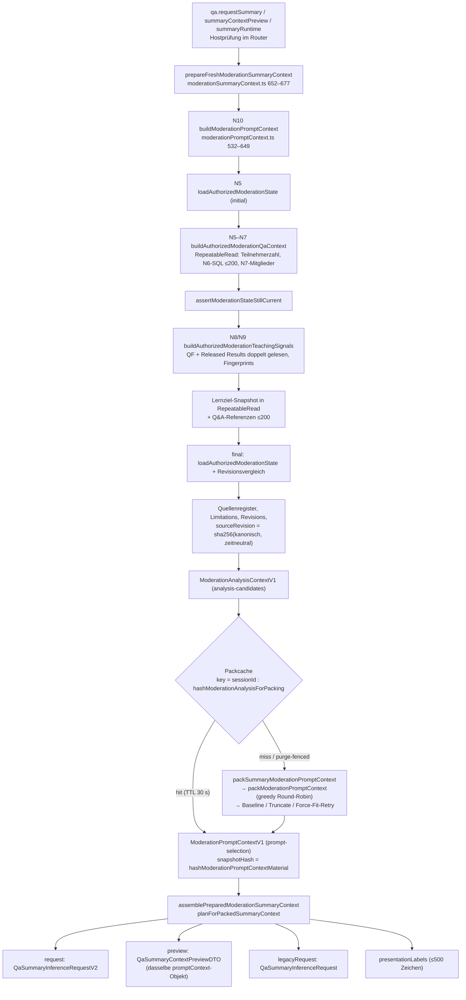
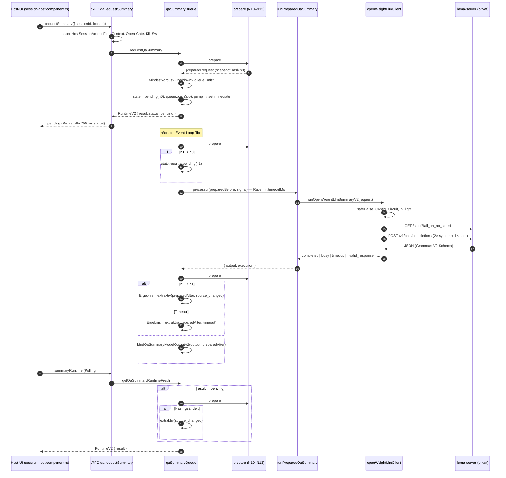

<!-- markdownlint-disable MD013 -->

# Dossier 1C – Autorisierter Kontext und asynchroner Adapterpfad

> **Überholt (2026-10-24):** Dieses Dossier ist der Recherche-Stand vom 2026-10-16 auf `27966e75`. Maßgeblich für 1C sind [`1C-diagrams.md`](./1C-diagrams.md) (Belege auf `248029dc`, dort auch die Abweichungen zu diesem Dossier) und die Protokolle unter [`evidenz/1C/`](./evidenz/1C/). Die Testlücken und Versuchsvorschläge unten sind dort teils umgesetzt, teils als offen ausgewiesen.

**Zweck:** Forschungsdossier zur Vorbereitung des Gruppenauftrags 1C (Thema 1, Referatsprüfung Cloud Computing).
**Repo-Stand der Analyse:** Branch `referat/thema-1-notes`, HEAD `27966e75215500b394b7a314f6c714eaae536452` (2026-10-15, Merge von PR #574). **Alle Zeilenangaben in diesem Dossier sind HEAD-Zeilen** (1-basiert; Serena-Ausgaben wurden von 0- auf 1-basiert umgerechnet). Der Release-Tag `v1.3.0` (`87c39334`, 2026-10-08) liegt 131 Commits früher. Er ist vermutlich die Prüfungsbaseline; die für 1C relevanten Abweichungen stehen in Abschnitt 1A.
**Methode:** Quelltext gelesen (Read/grep), Aufrufketten mit codebase-memory-MCP (`trace_path` auf `processJob` und `prepareFreshModerationSummaryContext`) und Serena (`find_referencing_symbols`, Memories) gegengeprüft, Issue #456 und #463 per `gh issue view` gelesen. Es wurden **keine** Tests ausgeführt und **keine** Messungen durchgeführt; alle Laufzeitaussagen sind Code-Analyse. Abschnitte mit »Vorschlag« sind Versuchsentwürfe, keine Befunde.
**Abgrenzung:** Dieses Dokument ersetzt weder `docs/features/moderation-prompt-context.md` noch `docs/features/qa-summary.md`; es ordnet deren Aussagen dem Code zu und markiert Abweichungen.

---

## 1. Auftrag, Leitfrage, Gültigkeitsgrenze

### 1.1 Auftragstext (wörtlich aus `docs/didaktik/CLOUD-COMPUTING-REFERAT-PRUEFUNG.md`, Z. 198–207)

> #### Gruppenauftrag 1C: Autorisierter Kontext und asynchroner Adapterpfad
>
> **Eigene Leitfrage:** Wie zuverlässig hält der implementierte 1.3-Kontextpfad seine Vertrags-, Konsistenz- und Entkopplungszusagen vom App-Zustand bis zur privaten Inferenz ein?
>
> 1. Rekonstruieren Sie den ausgelieferten Kontextbuilder, die Host-Vorschau, den Snapshot-/Hashmechanismus und den Adaptervertrag. Ordnen Sie jedem Bereich aus #456 seine tatsächliche Datenquelle, Funktion, Schemafassung und Berechtigungsprüfung in Release 1.3 zu.
> 2. Verfolgen Sie einen realen Auftrag durch die vorhandenen versionierten Verträge bis zur privaten Runtime. Vergleichen Sie für denselben Revisionsstand Host-Vorschau und tatsächlich gepackte Nutzlast. Trennen Sie autorisierten internen Zustand, fachlichen Kontext und Modellauftrag; verändern Sie den Vertrag nur für eine gekennzeichnete Negativprobe.
> 3. Prüfen Sie Erfolg, inkompatible Schemaversion, fehlenden Kontextbereich und langsamen Empfänger. Belegen Sie, dass kein stiller Feldverlust auftritt und der Host-Aufruf nicht auf die Modellantwort wartet.
> 4. Prüfen Sie exemplarisch eine Stimmenänderung und eine Quellenlöschung zwischen Auftrag und Ergebnis. Begründen Sie Snapshot-/Hashgrenze, erneute Quellenprüfung und kontrollierten Legacy-/Regelfallback.
>
> **Individuelles Ergebnis:** Datenfluss am Releasecode, Ende-zu-Ende-/Vertragsnachweis und Beibehaltungs- oder Verbesserungsempfehlung einschließlich Kosten der Validierung und Kontextbereitstellung. **Gültigkeitsgrenze:** Ein formal korrekter Releasepfad belegt keine optimierten Prompts. **Diskussionskern:** Konsistenz, Verträge und Entkopplung.
>
> **Gruppensynthese:** A bewertet die Ressourcengrenze des App-Hosts, B die Isolation der privaten Inferenzrolle und C den realen Kontextübergang. Zusammen entsteht eine evidenzbasierte Bewertung der 1.3-Architektur mit begründeten Betriebs- oder Änderungsempfehlungen; Kapazitätsoptimierung und vollständige Sicherheitsprüfung bleiben die Schwerpunkte der Themen 3 und 5.

### 1.2 Verbindlicher Rahmen (Abschnitte 4.1–4.1.3 und 4.3, Kurzfassung mit Zeilen)

| Rahmenpunkt                                                                                                                      | Fundstelle (Prüfungsdokument) | Bedeutung für 1C                                                                                                                           |
| -------------------------------------------------------------------------------------------------------------------------------- | ----------------------------- | ------------------------------------------------------------------------------------------------------------------------------------------ |
| #456 ist verbindliche fachliche Grundlage, #463 ordnet ein                                                                       | Z. 76                         | Abschnitt 2 dieses Dossiers bildet #456 auf Code ab                                                                                        |
| 1.3-Baseline gilt als vollständig umgesetzt; Release-Tag/Commit, Referenzmanifest, Baseline vs. Variante vs. Messung trennen     | Z. 80–84                      | Der hier analysierte HEAD ist **nicht** automatisch der vom Prüfer fixierte 1.3-Tag (Offener Punkt O1)                                     |
| Leitplanke 1 (Livebetrieb wartet nicht auf Modelle/aufwendigen Kontextaufbau)                                                    | Z. 100                        | Kernprüfgröße »Host-Aufruf wartet nicht auf Modellantwort«; Nuance: `qa.requestSummary` wartet auf **einen** Kontextaufbau (Abschnitt 6.2) |
| Leitplanke 4 (keine Tokens, IPs, Nicknames, Teilnehmerprofile im Modellkontext)                                                  | Z. 103                        | Abschnitt 4                                                                                                                                |
| Leitplanke 6 (»vollständiger Kontext« = unterstützte Bereiche mit expliziten Lücken)                                             | Z. 105                        | Abschnitt 5.5 (Lücken-Darstellung)                                                                                                         |
| Leitplanke 7 (extraktiver Fallback liegt in der App-Queue)                                                                       | Z. 106                        | Abschnitt 6.6                                                                                                                              |
| Nachweisformat: Release → Baseline → Gegenvariante/Störung → Messdaten → Befund mit Grenze → Entscheidung                        | Z. 137                        | Abschnitt 11 (Versuchsdesign)                                                                                                              |
| Sechs-Fragen-Szenario aus #456 Abschnitt 12 als feste Fixture                                                                    | Z. 139                        | Abschnitt 2.3                                                                                                                              |
| Gegenfälle: fehlende statt nullwertige Daten, Text-/Stimmenänderungen, Quellenlöschung, Budgetnot, überlastete Inferenz          | Z. 141                        | Abschnitte 9–11                                                                                                                            |
| Testadapter nur für Fault-Injection; realer privater Baselinelauf bleibt Pflicht                                                 | Z. 143                        | Abschnitt 11                                                                                                                               |
| Thema-1-Leitfrage und Repo-Basis (`docker-compose.prod.yml`, `.env.production.example`, `scripts/deploy.sh` am fixierten Commit) | Z. 162–166                    | Für 1C relevant: `docker-compose.llm.yml`, `docker/open-weight-llm/entrypoint.sh` (`--ctx-size 8192`, `--parallel 1`, Z. 38–39)            |

### 1.3 Diskussionskern und Rolle in der Gruppensynthese

- **Konsistenz:** Wie stark binden `snapshotHash`, `sourceRevision`, Revisionszähler und die doppelte Kontextvorbereitung Modellantwort und Datenstand aneinander? Wo ist die Grenze bewusst konservativ (jede Stimme im Raum invalidiert)?
- **Verträge:** Strikte Zod-Literale für Schema-/Vertragsversionen, `strict()`-Objekte gegen Feldschmuggel, ausdrückliche Adapterfähigkeiten statt stiller Projektion.
- **Entkopplung:** `qa.requestSummary` kehrt mit `pending` zurück, bevor der Prozessor startet (`setImmediate`-Scheduling). Sie wartet aber auf den vollständigen Kontextaufbau N10–N12.
- **Beitrag zur Synthese:** 1A misst den App-Host-Ressourcenrand, 1B die Transport-/Prozessgrenze zur privaten Runtime. 1C liefert die **Daten- und Vertragsgrenze dazwischen**: Was verlässt den App-Host, in welcher Version, unter welcher Autorisierung, und wie wird ein veraltetes Ergebnis verhindert. Die Kosten der Validierung (Abschnitt 12) betreffen direkt die von 1A gemessene CPU-/DB-Last.

### 1.4 Gültigkeitsgrenze (präzisiert)

Ein grüner Vertrags- oder Ende-zu-Ende-Lauf belegt: Formate stimmen, Rechte werden geprüft, veraltete Antworten werden verworfen, Fallbacks sind typisiert. Er belegt **nicht**:

- dass der Prompt gut ist. `QA_SUMMARY_TECHNICAL_INSTRUCTION_TEXT` bezeichnet sich selbst als »Technical handoff only; not an evaluated final moderation prompt« (`apps/backend/src/lib/moderationSummaryContext.ts`, Z. 45–46);
- dass eine gültige Quellen-ID inhaltlich trägt (#456 Abschnitt 8; `docs/features/moderation-prompt-context.md` Z. 298);
- dass das 8.192-Profil auf der Ziel-CPU in der Zeit prefillt. Laut `docs/implementation/ISSUE-456-SLICE-8-ABNAHME.md` Z. 79–83 und `docs/features/qa-summary.md` Z. 123 ist das ausdrücklich offen.

---

## 1A. Abweichungen v1.3.0 ↔ HEAD (27966e75)

**Ermittelt mit** (nur lesend): `git rev-list --count v1.3.0..HEAD` ergibt 131, außerdem `git diff --stat v1.3.0 HEAD -- <1C-Pfade>`, `git log --oneline v1.3.0..HEAD -- <1C-Pfade>` und `git show v1.3.0:<Pfad>`.

**Unverändert zwischen Tag und HEAD** (leerer Diff): `apps/backend/src/lib/qaSummaryQueue.ts`, `moderationPromptContext.ts`, `moderationQaContext.ts`, `moderationTeachingSignals.ts`, `qaSummaryValidateV2.ts`, `qaSummaryExtractive.ts`, `apps/backend/src/routers/qa.ts`, `libs/shared-types/src/moderation-prompt-context.ts`, `open-weight-llm.ts`, `moderation-prompt-context-fixtures.ts`, `qaSummaryQueue.test.ts` und `__tests__/qa.summary.test.ts`. Damit gelten Kontextbuilder N5–N10, Autorisierung, Doppel-Prepare, Hashvergleich, Fallback-Mapping der Queue und die Routen am Tag genauso wie in den Abschnitten 4, 6 und 8 beschrieben.

**Geändert** (Diffstat: 9 Dateien, +549/−85):

| Bereich                      | v1.3.0 (`87c39334`)                                                                                                                                                                                        | HEAD (`27966e75`)                                                                                                                                                                                                                                                                    | Commits (Auswahl)                              | Folge für 1C                                                                                                                                                                                                                                                                                                                                                                     |
| ---------------------------- | ---------------------------------------------------------------------------------------------------------------------------------------------------------------------------------------------------------- | ------------------------------------------------------------------------------------------------------------------------------------------------------------------------------------------------------------------------------------------------------------------------------------ | ---------------------------------------------- | -------------------------------------------------------------------------------------------------------------------------------------------------------------------------------------------------------------------------------------------------------------------------------------------------------------------------------------------------------------------------------- |
| Packprofil / Runtime-Fenster | `modelProfile: 'qwen3-4b-instruct-2507-q4_k_m:ctx-4096:summary-v2'`, `contextWindowTokens: 4_096` (Tag `moderationSummaryContext.ts` Z. 51–52); `entrypoint.sh` `--ctx-size 4096`; `mem_limit: 5g`         | `ctx-8192`, `8_192` (HEAD Z. 52–53); `--ctx-size 8192`; `mem_limit: 8g`, `memswap_limit: 10g`                                                                                                                                                                                        | `c0a7f7d7`, `01278868`                         | Am Tag bleiben für das Kontext-JSON höchstens **2.811** Byte (4.096 − 314 − 203 − 640 − 128). Die Slice-8-Doku (Z. 70) beschreibt also den **Tag-Stand**. Da `modelProfile` und Fenster ins Hashmaterial eingehen, sind `snapshotHash`-Werte zwischen Tag und HEAD nicht vergleichbar                                                                                            |
| Summary-Packing              | `packWithBoundedBaseline` (Tag Z. 254–277): voller Pack; nur wenn die **Basismetadaten** das Budget sprengen, ein Q&A-Baseline-Pack. Keine Mindestcoverage, kein Force-Fit                                 | `packSummaryModerationPromptContext` und `ensureMinimumQaQuestionCoverage` mit Baseline, Textkürzung 480/240/120/72 und Force-Fit Top-5/3/2/1 (HEAD Z. 503–572); Round-Robin über Statuslanes (Z. 273–297)                                                                           | `06a0a10f`, `567a58b9`, `d67741ac`, `7d717b6a` | Am Tag kann ein Full-Context-Pack **ohne einen einzigen `included`-Q&A-Text** entstehen und trotzdem ans Modell gehen. Die Force-Fit-Ausnahme der Hashgrenze (Abschnitt 8.2 Punkt 5) existiert am Tag nicht                                                                                                                                                                      |
| Plan bei leerer Evidenz      | `assemblePreparedModerationSummaryContext` übernimmt den Plan unverändert (Tag Z. 279–284)                                                                                                                 | `planForPackedSummaryContext` setzt `selectedMode: null` mit `no_packed_sources` (HEAD Z. 574–592); zusätzlicher Wächter in `runPreparedQaSummary` (HEAD `qaSummaryRuntimeAdapter.ts` Z. 61–70)                                                                                      | `06a0a10f`                                     | Vorschau und Runtime zeigen am Tag ggf. `full-context`, obwohl keine Belege gepackt sind                                                                                                                                                                                                                                                                                         |
| Packcache                    | cached jeden Pack; kein `pack`-Parameter                                                                                                                                                                   | `isEmptyQaEvidencePack` verhindert das Cachen leerer Packs; injizierbare `pack`-Funktion (HEAD Packing Z. 1094–1103, 1148, 1177–1190)                                                                                                                                                | `06a0a10f`                                     | Am Tag kann ein leerer Pack 30 s lang im Cache stehen                                                                                                                                                                                                                                                                                                                            |
| Fallback-Gründe (Schema)     | `QA_SUMMARY_FALLBACK_REASONS` **ohne** `no_packed_sources`                                                                                                                                                 | mit `no_packed_sources` (HEAD `qa-summary-v2.ts` Z. 192)                                                                                                                                                                                                                             | `06a0a10f`                                     | **Vertragsbefund:** Das Enum wurde erweitert, ohne `QA_SUMMARY_FALLBACK_CONTRACT_VERSION` (`qa-summary-fallback-v1`) oder `QA_SUMMARY_RESULT_V2_CONTRACT_VERSION` zu erhöhen. Ein HEAD-Ergebnis mit diesem Grund würde von einem Tag-Parser trotz gleicher Versionsliterale abgewiesen. Alle anderen Versionskonstanten aus Abschnitt 3.1 sind am Tag identisch                  |
| Queue-Timeout                | `QA_SUMMARY_TIMEOUT_DEFAULT_MS = 8_000`, `MAX = 30_000`; `timeoutMs: resolveQaSummaryTimeoutMs(...)` direkt (Tag `qaSummaryConfig.ts` Z. 11–13, 203); `resolveEffectiveQaSummaryTimeoutMs` existiert nicht | Default `90_000`, Maximum `300_000`; effektiv `max(QA_SUMMARY_TIMEOUT_MS, OPEN_WEIGHT_LLM_SUMMARY_TIMEOUT_MS)` bei aktivem Full-Context (HEAD Z. 23–25, 166–180, 249)                                                                                                                | `baa27b31`, `c89c0dd5`, `0c296e95`             | Am Tag beendet die Queue jeden Lauf über 8 s (konfigurierbar höchstens 30 s) mit `timeout`. Der Client hätte 90 s gewartet (`OPEN_WEIGHT_LLM_SUMMARY_TIMEOUT_DEFAULT_MS = 90_000` gilt an Tag und HEAD). Auf der CPU-Runtime ist am Tag daher ein **extraktiver `timeout`-Fallback als Normalfall** zu erwarten, und die Probe »langsamer Empfänger« (N3) braucht andere T-Werte |
| Client / Probe               | Ablehnungen von Modellantworten ohne Diagnose                                                                                                                                                              | strukturierte `reject(...)`-Gründe und Logs nur für `learning_objectives`; Topic-Label-Systemprompt `topic-label-system-v1`; Lernzielprompt `-v2`; optional `OPEN_WEIGHT_LLM_LEARNING_DEBUG_LOG`                                                                                     | `ba276510`, `13bf1df3`, `27a59196`             | Für `qa_summary` V2 ändert sich der Translator nicht: gleiche drei Nachrichten, gleiches Schema. Die Debug-Ausgabe (Abschnitt 11.2 Option b) existiert am Tag nicht                                                                                                                                                                                                              |
| Tests                        | –                                                                                                                                                                                                          | `moderationSummaryContext.test.ts` +324 Zeilen (Mindestcoverage, Force-Fit, `no_packed_sources`, HEAD Z. 121–388), `moderationPromptContextPacking.test.ts` +33 (Z. 1090 »caches keine leeren Q&A-Evidence-Packs«), `qaSummaryConfig.test.ts` +51, `openWeightLlmClient.test.ts` +81 | –                                              | Die in Abschnitt 9 als Beleg zitierten Fälle zu Mindestcoverage, Force-Fit und `no_packed_sources` gibt es am Tag nicht. Queue- und Routertests sind identisch                                                                                                                                                                                                                   |

**Konsequenzen für die Prüfungsarbeit:**

- Den Baselinelauf am Tag fahren (Prüfungsdokument Z. 82) und die Timeout-Env ausdrücklich ins Manifest schreiben. Am Tag braucht ein realer Full-Context-Lauf ein manuell erhöhtes `QA_SUMMARY_TIMEOUT_MS` (höchstens 30.000). Das ist dann eine **gekennzeichnete Konfigurationsvariante**, nicht die Baseline.
- Die Befunde B1–B6 (Entkopplung, Hashgrenze, Versionsliterale, toter V1-Snapshot, Vorschau-Gleichheit, `CONFLICT`) gelten am Tag unverändert, weil Queue, Builder und Shared-Kontextvertrag identisch sind.
- Hashwerte, Budgetzahlen und Truncations aus HEAD-Fixturetests dürfen nicht als Tag-Werte zitiert werden; für den Tag neu erzeugen.

---

## 2. Issue #456 → Implementierung

### 2.1 Kontextbereiche (#456 Abschnitt 1) → Quelle, Funktion, Version, Berechtigung

Gemeinsame Autorisierung aller Zeilen: `loadAuthorizedModerationState` (`apps/backend/src/lib/moderationQaContext.ts` Z. 182–205). Die Funktion liest die Session über die unveränderliche ID und prüft dann `assertHostSessionAccessFromContext(access, session.code)` (`apps/backend/src/lib/hostAuth.ts` Z. 280–298) sowie `assertHostContentReadAllowed` (Retention, `moderationQaContext.ts` Z. 166–179). Dieser Schritt wird pro Kontextaufbau mehrfach wiederholt (Abschnitt 4.2).

| #456-Bereich        | Datenquelle (Prisma/Redis)                                                                                                                                            | Funktion (Datei:Zeilen)                                                                                                                                                                                                   | Schema / Version                                                                                                                                                                                                                                                                                                                                                                               | Berechtigung / Re-Validierung                                                                                                                                              |
| ------------------- | --------------------------------------------------------------------------------------------------------------------------------------------------------------------- | ------------------------------------------------------------------------------------------------------------------------------------------------------------------------------------------------------------------------- | ---------------------------------------------------------------------------------------------------------------------------------------------------------------------------------------------------------------------------------------------------------------------------------------------------------------------------------------------------------------------------------------------- | -------------------------------------------------------------------------------------------------------------------------------------------------------------------------- |
| **Meta**            | `Session.qaRankingRevision`, `participantRevision`, `learningContextRevision` (`prisma/schema.prisma` Z. 177–201); abgeleitete Revisionsstrings                       | `buildModerationPromptContext` → `meta` und `sourceRevisionFor` (`apps/backend/src/lib/moderationPromptContext.ts` Z. 515–526, 610–642); Packer setzt `selectionVersion` (`moderationPromptContextPacking.ts` Z. 909–912) | `MODERATION_ANALYSIS_VERSION = 'moderation-analysis-builder-v1'`, `MODERATION_ANALYSIS_SELECTION_VERSION = 'moderation-analysis-candidates-v1'`, `MODERATION_SOURCE_REVISION_VERSION` (Z. 34–36); `MODERATION_PROMPT_SELECTION_VERSION = 'moderation-prompt-selection-v1'` (Packing Z. 21); `ModerationDomainMetaV1Schema` (`libs/shared-types/src/moderation-prompt-context.ts` Z. 2154–2173) | `assertModerationStateStillCurrent` vergleicht 22 Zustandsfelder einschließlich aller Revisionen (`moderationQaContext.ts` Z. 939–973)                                     |
| **Scope**           | Session-Zeile (`type`, `qaEnabled`, `quickFeedbackEnabled`, `status`), Presenter-Sortmodus (`resolveQaPresenterSortMode`)                                             | `buildScope`, `channelsForState` (`moderationPromptContext.ts` Z. 473–513)                                                                                                                                                | `ModerationPromptScopeSchema` (Shared Z. 2105); feste `selectionLimits` 200/30/30/100/100/100 (Z. 504–511)                                                                                                                                                                                                                                                                                     | aus dem final autorisierten Zustand `final` (Z. 583–584, 626)                                                                                                              |
| **Questions**       | `QaQuestion` (Status `PENDING`/`ACTIVE`/`PINNED`, `positiveVoteCount`, `negativeVoteCount`, `nlp*`), `Participant`-Zählung; eine Raw-SQL-Abfrage mit `LIMIT 200`      | N6 `collectQaContextCandidates` (`moderationQaContext.ts` Z. 436–549) mit `loadQaCandidateRows` (Z. 319–413), `projectStoredQaNlp` (Z. 250–302), `validatedRankingScore` (Z. 415–433)                                     | `ModerationQuestionsSectionSchema` (Shared Z. 586); `qa-ranking-v1`; `calculateModerationQaBestScoreV1`/`…ControversyScoreV1` (Shared Z. 361–392), Toleranz `1e-12` (Z. 359)                                                                                                                                                                                                                   | `RepeatableRead`-Transaktion (Z. 1029–1065), danach erneute Hostprüfung und Revisionsvergleich (Z. 1067–1072)                                                              |
| **Topics**          | Redis: letzter `QaSemanticTopicSnapshot` (`getWordCloudAnalysisCache().getLatestQaSemanticTopicSnapshot`), Mitglieder erneut aus `QaQuestion` (nur `ACTIVE`/`PINNED`) | N7 `collectQaTopicContext` (`moderationQaContext.ts` Z. 625–915); Textdigest-Prüfung `hashQaSemanticTopicMemberText` (`qaSemanticTopicSnapshot.ts` Z. 127)                                                                | `ModerationTopicsSectionSchema` (Shared Z. 824); `freshness` `current`/`stale` (Z. 893–900); `analysisVersion` aus dem Snapshot                                                                                                                                                                                                                                                                | Mitgliedschaft je Mitglied gegen aktuellen Text und Status, ungültige Themen werden vollständig ausgelassen (Z. 716–731, 857–866)                                          |
| **Compass**         | abgeleitet aus N6/N7 sowie N8/QF; keine eigene Tabelle                                                                                                                | N9 `buildCompassContext` (`moderationTeachingSignals.ts` Z. 1550 ff.)                                                                                                                                                     | `MODERATION_COMPASS_RULES_VERSION = 'moderation-compass-rules-v1'` (`libs/shared-types/src/moderation-compass-rules.ts` Z. 3); `ModerationCompassSectionSchema` (Shared Z. 975)                                                                                                                                                                                                                | `buildAuthorizedModerationTeachingSignals` prüft dreimal (Z. 1990, 2006, 2030) und vergleicht Fingerprints zweier Lesungen (Z. 2021–2029)                                  |
| **LearningContext** | `SessionLearningObjective`, `SessionLearningObjectiveReference` (`prisma/schema.prisma` Z. 916, 946), Q&A-Referenzen gegen `QaQuestion`                               | `getSessionLearningObjectivesSnapshotWithDb` (`sessionLearningObjectives.ts` Z. 1253–1273), `selectReferencedQaQuestions` (`moderationPromptContext.ts` Z. 418–439), `projectLearningContext` (Z. 234–416)                | `objectiveRevision` → `learning-objective-revision-v1:<n>` (Z. 150–152); `learning-context-v1:<rev>` (Z. 413); `SESSION_LEARNING_OBJECTIVE_SCHEMA_VERSION = 1` (`learning-objectives.ts` Z. 15)                                                                                                                                                                                                | `beforeLearning` und `final` (Z. 555–586), `assertLearningSnapshotStillCurrent` (Z. 441–455); lösungsfrei, nicht auflösbare Ziele werden als `source-redacted` ausgelassen |
| **ReleasedResults** | `QuizQuestion`/Votes nur für Fragen mit `questionProgress` = `COMPLETED`                                                                                              | N8 `collectReleasedQuizSignals` (`moderationTeachingSignals.ts` Z. 1364 ff.), `loadReleasedQuizRows` (Z. 362 ff.)                                                                                                         | `MODERATION_QUIZ_EFFECTIVE_VOTE_BASIS_VERSION = 'effective-vote-v1'`, `…ROUND_COMPARISON…= 'round-comparison-v1'` (Shared Z. 37–38); `ModerationReleasedResultsSectionSchema` (Z. 1158)                                                                                                                                                                                                        | nicht abgeschlossene Fragen ergeben `not-released`; `isCorrect` wird nur intern aggregiert, nicht als Feld ausgegeben (Doku Z. 116)                                        |
| **Feedback**        | Redis: sessiongebundener Quick-Feedback-Wert mit Purge-Fence                                                                                                          | `loadQuickFeedbackModerationSnapshot` (`quickFeedbackModerationSnapshot.ts`), aufgerufen in `moderationTeachingSignals.ts` Z. 1994–2000 und 2011–2018                                                                     | `ModerationFeedbackSectionSchema` (Shared Z. 1177)                                                                                                                                                                                                                                                                                                                                             | Fingerprintvergleich zweier Lesungen (Z. 2021–2029)                                                                                                                        |
| **Sources**         | aus allen obigen Fragmenten                                                                                                                                           | `registerUniqueSources` und Duplikatprüfung (`moderationPromptContext.ts` Z. 129–148, 588–603); im Packer erreichbarkeitsgeschlossen (`buildDomainContext`, Packing Z. 733–798)                                           | `ModerationPromptSourceSchema` (Shared Z. 2040); Präfixe (Z. 48–56); Grenzen `MODERATION_ANALYSIS_SOURCE_LIMIT = 1_500`, `MODERATION_PROMPT_SOURCE_LIMIT = 500` (Z. 44–46)                                                                                                                                                                                                                     | Duplikat-ID oder Überschreitung führt zu `INTERNAL_SERVER_ERROR` (fail closed, Z. 122–127, 604–609)                                                                        |
| **Limitations**     | aus allen Fragmenten                                                                                                                                                  | `mergeLimitations` (`moderationPromptContext.ts` Z. 457–471); Packer ergänzt `budget-truncated` (Packing Z. 889–904)                                                                                                      | `ModerationPromptLimitationSchema` (Shared Z. 2051), höchstens 100                                                                                                                                                                                                                                                                                                                             | –                                                                                                                                                                          |
| **Budget**          | Profil-Konstanten                                                                                                                                                     | `buildBudget` (Packing Z. 976–1001); Profil `QA_SUMMARY_MODERATION_PACKING_PROFILE` (`moderationSummaryContext.ts` Z. 51–58)                                                                                              | `MODERATION_PROMPT_BUDGET_VERSION = 'moderation-prompt-budget-v1'`; Schätzer `utf8-byte-upper-bound` v`1` (Packing Z. 22–23); `ModerationPromptBudgetV1Schema` mit Summen- und Fensterprüfung (Shared Z. 3570–3621)                                                                                                                                                                            | –                                                                                                                                                                          |

### 2.2 Weitere #456-Abschnitte → Code

| #456-Abschnitt / ID                                                                                                                      | Umsetzung                                                                                                                                                                                       | Bemerkung                                                                                                                                                                                                                                                                                                        |
| ---------------------------------------------------------------------------------------------------------------------------------------- | ----------------------------------------------------------------------------------------------------------------------------------------------------------------------------------------------- | ---------------------------------------------------------------------------------------------------------------------------------------------------------------------------------------------------------------------------------------------------------------------------------------------------------------- |
| 2 (Bewertungen; `upvoteCount` kein Positivwert)                                                                                          | N6 liest `positiveVoteCount`/`negativeVoteCount`, `net = positive - negative` (`moderationQaContext.ts` Z. 460–499)                                                                             | `upvoteCount` wird selektiert (Z. 346), aber nicht in den Kontext projiziert. Test: `moderationQaContext.test.ts` Z. 145 »projects directional counters independently of the legacy net field«                                                                                                                   |
| 3 (Themen, keine Neuberechnung)                                                                                                          | N7 projiziert gespeicherten Snapshot; Aggregate Summe Plus/Minus, Netto, Total; `distinctParticipants: unavailable` (Z. 787–812)                                                                | Kein Encoderaufruf im Kontextpfad (Doku Z. 17)                                                                                                                                                                                                                                                                   |
| 4 (Umfänge, Revisionen, Hash ohne Zeitstempel)                                                                                           | `corpus.total/eligible/analyzed/deduplicated/represented` (Z. 508–514; Packing Z. 917–921); zeitneutrales Hashmaterial (Packing Z. 159–175)                                                     | Abschnitt 8                                                                                                                                                                                                                                                                                                      |
| 5 (Kompasssignale)                                                                                                                       | N9, gemeinsame Regeln in `libs/shared-types/src/moderation-compass-rules.ts`                                                                                                                    | –                                                                                                                                                                                                                                                                                                                |
| 6 (Lernziele)                                                                                                                            | Vorbereitung getrennt (`learningObjectiveDerivation.ts`); im Live-Kontext nur lösungsfreie Projektion                                                                                           | N1 wird vom Summary-Pfad nicht gestartet (keine Referenz in `prepareFreshModerationSummaryContext`, vgl. `trace_path`-Ausgabe)                                                                                                                                                                                   |
| 8 (Quellenregister, Referenzabschluss)                                                                                                   | Shared-Refinements `validateCommonDomainContext`, `validatePromptPacking` (Shared Z. 2233, 3336)                                                                                                | –                                                                                                                                                                                                                                                                                                                |
| 9 (Tokenbudget)                                                                                                                          | UTF-8-Byte als konservative Obergrenze (Packing Z. 146–153); deterministische Round-Robin-Lanes (Z. 435–517)                                                                                    | Echter Tokenizer nicht verwendet; reale Prefill-Abnahme offen                                                                                                                                                                                                                                                    |
| 10 (Bedeutungslexikon)                                                                                                                   | `MODERATION_PROMPT_DEFINITION_SET_VERSION = 'moderation-prompt-definitions-v1'` (Shared Z. 33), Kurzfassung als `QA_SUMMARY_TECHNICAL_DEFINITION_TEXT` (`moderationSummaryContext.ts` Z. 48–49) | Im Modellauftrag landet nur die 203-Byte-Kurzfassung, nicht das vollständige Lexikon `MODERATION_PROMPT_DEFINITION_SET_V1` (Offener Punkt O6)                                                                                                                                                                    |
| 11 (Betrieb, Adapter, Vorschau)                                                                                                          | Queue, Adapterplan, Vorschau (Abschnitte 6 und 7)                                                                                                                                               | –                                                                                                                                                                                                                                                                                                                |
| V8 `qa.requestSummary`                                                                                                                   | `apps/backend/src/routers/qa.ts` Z. 1538–1568; `publicProcedure` mit `assertHostSessionAccessFromContext` (Z. 1559)                                                                             | wie in #456 V8 beschrieben                                                                                                                                                                                                                                                                                       |
| V9/V10 `selectQaSummarySnapshotQuestions`, `buildQaSummaryAnalysisSnapshot`, `hashQaSummarySnapshot`, `assertQaSummarySnapshotMinimized` | `apps/backend/src/lib/qaSummarySnapshot.ts` Z. 81–208                                                                                                                                           | **Im Produktionspfad nicht mehr aufgerufen.** Laut grep nur noch in `qaSummarySnapshot.test.ts`, `qaSummaryAdapter.test.ts` und `qaSummaryValidate.test.ts` referenziert. Der V2-Pfad ersetzt sie durch N10–N12. Das Prüfungsdokument (Z. 93) und #456 verlinken diesen Snapshot noch als »Snapshot« (Befund B4) |
| V11 `runQaSummaryInference`                                                                                                              | `qaSummaryAdapter.ts` Z. 72–91                                                                                                                                                                  | Ebenfalls nur noch im Test aufgerufen. Produktiv nutzt `legacy-text` stattdessen `runQaSummaryLegacyRequest` (Z. 93–103)                                                                                                                                                                                         |
| N5                                                                                                                                       | `loadAuthorizedModerationState` (`moderationQaContext.ts` Z. 182–205)                                                                                                                           | `access` ist `HostTokenContext` (`hostAuth.ts` Z. 105–109)                                                                                                                                                                                                                                                       |
| N6 / N7                                                                                                                                  | `collectQaContextCandidates` / `collectQaTopicContext`                                                                                                                                          | Name N7 im Code: `collectQaTopicContext` statt `buildTopicContext`                                                                                                                                                                                                                                               |
| N8 / N9                                                                                                                                  | `collectReleasedQuizSignals` / `buildCompassContext`, orchestriert von `buildAuthorizedModerationTeachingSignals` (`moderationTeachingSignals.ts` Z. 1979–2054)                                 | –                                                                                                                                                                                                                                                                                                                |
| N10                                                                                                                                      | `buildModerationPromptContext` (`moderationPromptContext.ts` Z. 532–649)                                                                                                                        | liefert `ModerationAnalysisContextV1`                                                                                                                                                                                                                                                                            |
| N11                                                                                                                                      | `packModerationPromptContext` (Packing Z. 1035–1085) plus Summary-Wrapper `packSummaryModerationPromptContext` (`moderationSummaryContext.ts` Z. 553–572)                                       | Wrapper ergänzt Baseline-/Force-Fit-Retry                                                                                                                                                                                                                                                                        |
| N12                                                                                                                                      | `hashModerationPromptContextMaterial` (Packing Z. 212–234), Validierung durch `ModerationPromptContextV1Schema.parse` (Z. 1075)                                                                 | Es gibt keine eigene Funktion `validateModerationPromptContext`; die Validierung steckt in den Zod-Refinements                                                                                                                                                                                                   |
| N13                                                                                                                                      | `assemblePreparedModerationSummaryContext` (`moderationSummaryContext.ts` Z. 594–637), `resolveQaSummaryAdapterPlan` (Z. 97–138)                                                                | –                                                                                                                                                                                                                                                                                                                |
| N14                                                                                                                                      | `getQaSummaryContextPreview` (`qaSummaryQueue.ts` Z. 442–448), Route `qa.summaryContextPreview` (`qa.ts` Z. 1522–1536)                                                                          | derselbe Builder (Abschnitt 7)                                                                                                                                                                                                                                                                                   |
| N15                                                                                                                                      | zweites `prepare` in `processJob` (`qaSummaryQueue.ts` Z. 333–345) und `getQaSummaryRuntimeFresh` (Z. 418–440)                                                                                  | keine eigenständige Funktion `revalidateModerationSources`; Re-Validierung = kompletter Neuaufbau plus Hashvergleich                                                                                                                                                                                             |

### 2.3 Sechs-Fragen-Szenario (#456 Abschnitt 12)

| ID  | Frage (Fixture)                                               | + / − | Netto | Best-Score | Kontroversität | Thema |
| --- | ------------------------------------------------------------- | ----: | ----: | ---------: | -------------: | ----- |
| A   | Können wir mehr Beispiele zur linearen Regression bearbeiten? | 80/30 |    50 |   0,637432 |       0,461538 | A/B   |
| B   | Gibt es ein weiteres Beispiel zur linearen Regression?        |  10/0 |    10 |   0,722460 |              0 | A/B   |
| C   | Ist Kapitel 4 klausurrelevant?                                |  30/0 |    30 |   0,886483 |              0 | C/D   |
| D   | Müssen wir den vierten Abschnitt für die Prüfung lernen?      |  12/0 |    12 |   0,757499 |              0 | C/D   |
| E   | Soll die Anwesenheit verpflichtend sein?                      | 40/40 |     0 |   0,392972 |            0,8 | E/F   |
| F   | Sollten wir eine Anwesenheitspflicht einführen?               | 20/20 |     0 |   0,351993 |       0,666667 | E/F   |

Die Werte stammen aus `docs/features/moderation-prompt-context.md` Z. 352–363. Raumbezugsgröße 200, Dämpfung 20. Optionales bestätigtes Lernziel: »Die Studierenden können lineare Regressionsmodelle anwenden.«

**Wo die Fixtures liegen** (`libs/shared-types/src/moderation-prompt-context-fixtures.ts`):

| Export                                           | Zeile | Rolle                                                                              |
| ------------------------------------------------ | ----: | ---------------------------------------------------------------------------------- |
| `MODERATION_PROMPT_REFERENCE_TEXT_FIXTURE_V1`    |    22 | sechs Texte A–F (Textbaseline)                                                     |
| `MODERATION_PROMPT_REFERENCE_RANKING_FIXTURE_V1` |    59 | Status-/Bewertungsmetadaten                                                        |
| `MODERATION_PROMPT_CONTEXT_REFERENCE_FIXTURE_V1` |   195 | vollständiger Kontext; `participantBasis.value: 200` (Z. 243–246); Lernziel Z. 463 |
| `MODERATION_PROMPT_CONTEXT_METADATA_FIXTURE_V1`  |   504 | »Texte + Metadaten« ohne Themen/Kompass                                            |
| `MODERATION_PROMPT_CONTEXT_MINIMAL_FIXTURE_V1`   |   596 | fehlende/nicht anwendbare Bereiche; `participantBasis` unavailable (Z. 644)        |

**Wer sie nutzt:** Shared-Vertragstests (`moderation-prompt-context.test.ts` Z. 252 und 282), Packer (`moderationPromptContextPacking.test.ts` Z. 287 »packs the six-question reference fixture…«), Summary-Kontext (`moderationSummaryContext.test.ts` Z. 105), Queue (`qaSummaryQueue.test.ts` Z. 50–64) und Router (`__tests__/qa.summary.test.ts` Z. 58–69).

**Wichtig für 1C:** In Queue- und Routertests wird die Fixture mit `prepareModerationSummaryContextFromAnalysis` gepackt, und der `prepare`-Hook wird überschrieben. Damit laufen N5–N10 (DB, Autorisierung) in diesen Tests **nicht**. Die Fixture belegt Vertrag und Packer, nicht den Livepfad.

---

## 3. Verträge und Versionen

### 3.1 Versionskonstanten (vollständige Liste der für 1C relevanten)

| Konstante                                                         | Wert                                                | Datei:Zeile                                             | Geprüft durch                                                                                       |
| ----------------------------------------------------------------- | --------------------------------------------------- | ------------------------------------------------------- | --------------------------------------------------------------------------------------------------- |
| `MODERATION_PROMPT_CONTEXT_SCHEMA_VERSION`                        | `1`                                                 | `libs/shared-types/src/moderation-prompt-context.ts` 28 | `z.literal` in Analyse- und Prompt-Envelope (Z. 3562, 3625)                                         |
| `MODERATION_DOMAIN_CONTEXT_CONTRACT_VERSION`                      | `moderation-domain-context-v1`                      | 29                                                      | Base-Schema Z. 2177                                                                                 |
| `MODERATION_ANALYSIS_CONTEXT_CONTRACT_VERSION`                    | `moderation-analysis-context-v1`                    | 30–31                                                   | Z. 3563; zusätzlich expliziter Vergleich in `hashModerationAnalysisForPacking` (Packing Z. 199–201) |
| `MODERATION_PROMPT_CONTEXT_CONTRACT_VERSION`                      | `moderation-prompt-context-v1`                      | 32                                                      | Z. 3626; Adapterfähigkeit (`qa-summary-v2.ts` Z. 158)                                               |
| `MODERATION_PROMPT_DEFINITION_SET_VERSION`                        | `moderation-prompt-definitions-v1`                  | 33                                                      | Base Z. 2179; Request V2 Z. 87; Preview Z. 401                                                      |
| `MODERATION_PROMPT_HASH_MATERIAL_VERSION`                         | `moderation-prompt-hash-material-v1`                | 34–35                                                   | Envelope Z. 3629; im Hashmaterial selbst (Packing Z. 205, 224)                                      |
| `MODERATION_PROMPT_BUDGET_VERSION`                                | `moderation-prompt-budget-v1`                       | 36                                                      | Budget-Schema Z. 3572                                                                               |
| `MODERATION_QUIZ_EFFECTIVE_VOTE_BASIS_VERSION`                    | `effective-vote-v1`                                 | 37                                                      | Aggregatschema Z. 1211                                                                              |
| `MODERATION_QUIZ_ROUND_COMPARISON_BASIS_VERSION`                  | `round-comparison-v1`                               | 38                                                      | Z. 1221                                                                                             |
| `MODERATION_COMPASS_RULES_VERSION`                                | `moderation-compass-rules-v1`                       | `moderation-compass-rules.ts` 3                         | Kompassschema                                                                                       |
| `MODERATION_ANALYSIS_VERSION`                                     | `moderation-analysis-builder-v1`                    | `apps/backend/src/lib/moderationPromptContext.ts` 34    | nur als Wert im `meta` (nicht als Literal geprüft)                                                  |
| `MODERATION_ANALYSIS_SELECTION_VERSION`                           | `moderation-analysis-candidates-v1`                 | 35                                                      | dito                                                                                                |
| `MODERATION_SOURCE_REVISION_VERSION`                              | `moderation-source-revision-v1`                     | 36                                                      | Präfix von `sourceRevision`                                                                         |
| `MODERATION_PROMPT_SELECTION_VERSION`                             | `moderation-prompt-selection-v1`                    | `moderationPromptContextPacking.ts` 21                  | im `meta` und im Hashprofil (Z. 189)                                                                |
| `MODERATION_PROMPT_UTF8_ESTIMATOR_ID` / `_VERSION`                | `utf8-byte-upper-bound` / `1`                       | 22–23                                                   | Budget `tokenizer`                                                                                  |
| `QA_SUMMARY_V2_SCHEMA_VERSION`                                    | `2`                                                 | `libs/shared-types/src/qa-summary-v2.ts` 12             | `z.literal` in Request/Response/Result/Runtime (Z. 32)                                              |
| `QA_SUMMARY_CONTEXT_V2_CONTRACT_VERSION`                          | `qa-summary-context-v2`                             | 13                                                      | Request Z. 83; Capability Z. 156; Fallback Z. 215                                                   |
| `QA_SUMMARY_MODEL_OUTPUT_V2_CONTRACT_VERSION`                     | `qa-summary-model-output-v2`                        | 14                                                      | Request Z. 84; Response Z. 123; Fallback Z. 216                                                     |
| `QA_SUMMARY_RESULT_V2_CONTRACT_VERSION`                           | `qa-summary-result-v2`                              | 15                                                      | Result Z. 301                                                                                       |
| `QA_SUMMARY_CONTEXT_PREVIEW_SCHEMA_VERSION` / `…CONTRACT_VERSION` | `1` / `qa-summary-context-preview-v1`               | 16–17                                                   | Preview Z. 397–398                                                                                  |
| `QA_SUMMARY_ADAPTER_CAPABILITIES_CONTRACT_VERSION`                | `qa-summary-adapter-capabilities-v1`                | 18–19                                                   | Z. 172                                                                                              |
| `QA_SUMMARY_FALLBACK_CONTRACT_VERSION`                            | `qa-summary-fallback-v1`                            | 20                                                      | Z. 214                                                                                              |
| `QA_SUMMARY_TECHNICAL_INSTRUCTION_VERSION`                        | `qa-summary-technical-handoff-v1`                   | 21                                                      | Request Z. 85; Preview Z. 400                                                                       |
| Packprofil `modelProfile`                                         | `qwen3-4b-instruct-2507-q4_k_m:ctx-8192:summary-v2` | `moderationSummaryContext.ts` 52                        | Teil des Hashmaterials (Packing Z. 177–191)                                                         |
| Adapter-ID                                                        | `arsnova-summary-adapter-v2`                        | 62                                                      | `QaSummaryAdapterCapabilitiesSchema` (nur Längenprüfung)                                            |

### 3.2 Zod-Schemas entlang des Pfads

| Stufe                      | Schema                                                                                                                | Datei:Zeile                                                                   | Charakter                                                                                                                                                               |
| -------------------------- | --------------------------------------------------------------------------------------------------------------------- | ----------------------------------------------------------------------------- | ----------------------------------------------------------------------------------------------------------------------------------------------------------------------- |
| fachlicher Analysekontext  | `ModerationAnalysisContextV1Schema` mit `ModerationAnalysisDomainContextV1Schema`                                     | Shared 3560–3568, 3541–3544                                                   | strikt; `representation: 'analysis-candidates'`; Quellen ≤ 1.500                                                                                                        |
| gepackter Kontext          | `ModerationPromptContextV1Schema` mit `ModerationPromptDomainContextV1Schema`, `ModerationPromptBudgetV1Schema`       | Shared 3623–3634, 3551–3558, 3570–3621                                        | strikt; `prompt-selection`; Quellen ≤ 500; `validatePromptPacking` (Erreichbarkeit, Auswahlgrenzen); Budget-Summen- und Fensterprüfung                                  |
| Inferenzauftrag V2         | `QaSummaryInferenceRequestV2Schema` (= `OpenWeightLlmSummaryRequestV2Schema`)                                         | `qa-summary-v2.ts` 79–116; `open-weight-llm.ts` 97                            | strikt; Literale; `superRefine`: UTF-8-Länge von `instructionText`/`definitionText` muss exakt `budget.instructionTokens`/`definitionTokens` entsprechen                |
| Modellantwort V2           | `QaSummaryInferenceResponseV2Schema` (= `OpenWeightLlmSummaryOutputV2Schema`) mit `QaSummaryModelOutputV2Schema`      | 119–126, 52–72                                                                | strikt; ≤ 6 Aussagen, ≤ 4 Schritte, je ≤ 8 eindeutige `sourceIds`                                                                                                       |
| dynamische Referenzbindung | `hasOnlyAllowedQaSummaryV2References` / `hasOnlyAllowedOpenWeightLlmReferences`                                       | 130–138; `open-weight-llm.ts` 243 ff.                                         | prüft alle `sourceIds` gegen `promptContext.context.sources`; Versionsgleichheit Request/Output                                                                         |
| Adapterfähigkeiten         | `QaSummaryAdapterCapabilitiesSchema` (discriminated union `legacy-text`/`full-context`)                               | 143–187                                                                       | `full-context` bindet vier Versionen als Literale; `legacy-text` strikt ohne Zusatzfelder                                                                               |
| Fallback                   | `QaSummaryFallbackSchema`                                                                                             | 212–222                                                                       | `mode` ∈ `legacy-text`/`extractive`/`rule-based`; `reason` ∈ 15 Werte; `retry`                                                                                          |
| Ausführung                 | `QaSummaryExecutionV2Schema`                                                                                          | 232–273                                                                       | Kohärenz: `full-context` ⇒ ohne Fallback; degradiert ⇒ passender Fallback-Modus                                                                                         |
| Ergebnis                   | `QaSummaryResultV2Schema`                                                                                             | 298–366                                                                       | Quellenregister geschlossen: jede verwendete ID registriert, jede registrierte verwendet                                                                                |
| Runtime-DTO                | `QaSummaryRuntimeV2DTOSchema`, `QaSummaryRuntimeCompatibleDTOSchema` (V2 vor V1)                                      | 369–384                                                                       | Union-Reihenfolge verhindert V1-Stripping                                                                                                                               |
| Vorschau                   | `QaSummaryContextPreviewDTOSchema`, Input `GetQaSummaryContextPreviewInputSchema`                                     | 395–440, 387–392                                                              | Modus-/Fallback-Kohärenz; enthält `promptContext`, nicht `instructionText`/`definitionText`                                                                             |
| Legacy V1                  | `QaSummaryInferenceRequestSchema`, `QaSummaryModelOutputSchema`, `QaSummaryResultSchema`, `QaSummaryRuntimeDTOSchema` | `libs/shared-types/src/schemas.ts` 6399–6417, 6386–6397, 6366–6385, 6418–6423 | **nicht strikt** (`z.object` ohne `.strict()`): unbekannte Felder werden entfernt. Das ist dokumentiert und getestet (`moderation-prompt-context.test.ts` Z. 2166–2187) |

### 3.3 Wie Versionen geprüft werden

1. **Ausschließlich exakte Literale.** Es gibt keine Bereichs- oder Kompatibilitätsprüfung (»≥ v1«). Eine abweichende Version fällt in `safeParse` durch.
2. **Prüforte im Laufpfad:**
   - `buildModerationPromptContext` → `ModerationAnalysisContextV1Schema.parse` (`moderationPromptContext.ts` Z. 643). Ein Fehler wirft.
   - `packModerationPromptContext` → `ModerationAnalysisContextV1Schema.parse` am Eingang (Packing Z. 1038), `ModerationPromptContextV1Schema.safeParse` je Kandidat (Z. 1020–1032), `.parse` am Ausgang (Z. 1075).
   - `assemblePreparedModerationSummaryContext` → `QaSummaryInferenceRequestV2Schema.parse` und `QaSummaryContextPreviewDTOSchema.parse` (`moderationSummaryContext.ts` Z. 603–624). Ein Fehler wirft und landet in `processJob` im `catch`, also bei `context_unavailable`.
   - `runOpenWeightLlm` → `OpenWeightLlmRequestSchema.safeParse(rawRequest)`. Bei Fehlschlag folgt `{ status: 'invalid_response' }` **vor** Config, Slot und Netz (`openWeightLlmClient.ts` Z. 373–374).
   - `parseCompletion` → `OpenWeightLlmOutputSchema.safeParse`, Abgleich des `taskType`, Referenzprüfung (Z. 347–351). Ein Fehlschlag wird zu `invalid_response` und in `runPreparedQaSummary` zum extraktiven Fallback mit Grund `invalid_response` (`qaSummaryRuntimeAdapter.ts` Z. 82–85).
   - `runOpenWeightLlmSummaryV2` prüft zusätzlich `schemaVersion === 2` der Antwort (Z. 519–526).
3. **Antwortschema an die Runtime:** `buildChatCompletionBody` sendet `response_format: { type: 'json_object', schema: z.toJSONSchema(OpenWeightLlmSummaryOutputV2Schema) }` (`openWeightLlmClient.ts` Z. 274–309). Das Modell wird damit grammatikgeführt auf das V2-Schema gezwungen. Die Zod-Nachprüfung bleibt Pflicht (ADR-0035 Z. 155–156).
4. **Folge für die Negativprobe »inkompatible Schemaversion«:** Eine manipulierte Version wird je nach Ort unterschiedlich klassifiziert, nämlich als Exception (`context_unavailable`, Modus `rule-based`, Status `failed`) oder als `invalid_response` (Modus `extractive`). Es gibt **keinen** eigenen Fallback-Grund `schema_incompatible`. `adapter_incompatible` steht nur für den bewusst gewählten Legacy-Modus (Befund B3).

### 3.4 V1/V2-Koexistenz und Legacy-Pfad

- `resolveQaSummaryAdapterPlan` (`moderationSummaryContext.ts` Z. 97–138) prüft in dieser Reihenfolge:
  1. Open-Weight aktiviert und Transport plus Token vorhanden → `full-context`, kein Fallback;
  2. sonst `QA_SUMMARY_INFERENCE_URL` gesetzt → `legacy-text` mit `fallback = { mode: 'legacy-text', reason: 'adapter_incompatible' }`;
  3. sonst `selectedMode: null` mit extraktivem Fallback, Grund `misconfigured`, `unavailable` oder `disabled`.
- **Legacy-Projektion:** `projectLegacyQaSummaryRequest` (Z. 155–174) übernimmt aus dem **gepackten V2-Kontext** nur `qa-question`-Quellen mit `content.state === 'included'`, höchstens 40, als `{ id, kind, text }` plus `locale` und `snapshotHash`. Alle anderen Bereiche (Stimmen, NLP, Themen, Kompass, Lernziele, Ergebnisse, Feedback) entfallen. Der Wegfall ist **kontrolliert**, nicht still: Das Ergebnis trägt `execution.effectiveMode = 'legacy-text'` und `fallback.reason = 'adapter_incompatible'` (`qaSummaryRuntimeAdapter.ts` Z. 88–101). Die Vorschau zeigt `selectedMode: 'legacy-text'`.
- `legacyRequest` wird bei **jedem** `prepare` erzeugt, auch im Full-Context-Modus (Z. 627). Die Kosten sind gering, eine Parse-Exception (etwa eine Quellen-ID über 80 Zeichen) würde aber auch den Full-Context-Pfad abbrechen. Für `qa-question:<uuid>` (48 Zeichen) ist das nicht der Fall.
- Die Legacy-Ausgabe wird zu `QaSummaryModelOutputV2Schema.parse(legacy)` gehoben (Z. 92). Die Quellenbindung erfolgt anschließend gegen das V2-Register (`bindQaSummaryModelOutputV2`).
- Der Runtime-DTO-Output der tRPC-Routen ist `QaSummaryRuntimeCompatibleDTOSchema` (`qa.ts` Z. 1505, 1540). Die Queue erzeugt ausschließlich V2-DTOs (`toRuntime`, `qaSummaryQueue.ts` Z. 143–155).

---

## 4. Autorisierung und Datenminimierung

### 4.1 Prozeduren und Tokenmodell

| Prozedur                   | Typ                        | Hostprüfung                                             | Lebenszyklusprüfung                                                                                                        | Datei:Zeilen      |
| -------------------------- | -------------------------- | ------------------------------------------------------- | -------------------------------------------------------------------------------------------------------------------------- | ----------------- |
| `qa.summaryRuntime`        | `publicProcedure` query    | `assertHostSessionAccessFromContext(ctx, session.code)` | `assertQaHostContentReadAllowed` (Nachbereitungsfenster)                                                                   | `qa.ts` 1503–1520 |
| `qa.summaryContextPreview` | `publicProcedure` query    | dito                                                    | dito                                                                                                                       | 1522–1536         |
| `qa.requestSummary`        | `publicProcedure` mutation | dito                                                    | `assertQaSessionOpenForParticipants` (Z. 239–251): **verboten nach Sessionende**; `isQaSummaryEnabled()` sonst `FORBIDDEN` | 1538–1568         |

- **Tokenmodell:** `extractHostTokenFromContext` liest `ctx.hostToken`, den Request-Header `x-host-token` oder Connection-Parameter (`hostAuth.ts` Z. 111 ff.). `resolveHostSessionAccess` (Z. 249–264) akzeptiert credential-gebundene Tokens, den Original-Host-Token-Hash oder einen gekoppelten Host (Story 2.10). Bei ungültigem Token: `UNAUTHORIZED`.
- **Queue-Credential:** `cloneMinimalHostAccess` kopiert nur `hostToken` in den Job (`qaSummaryQueue.ts` Z. 105–111). `clearEphemeralAccess` setzt es im `finally` jedes Jobs und beim Purge auf `undefined` (Z. 101–103, 131, 398). Test: `qaSummaryQueue.test.ts` Z. 317–336.
- **Asymmetrie:** Nach Sessionende sind Vorschau und `summaryRuntime` im Nachbereitungsfenster weiter erlaubt, `requestSummary` aber nicht. Das ist fachlich plausibel (keine neuen Modelljobs), sollte im Referat aber benannt werden.

### 4.2 Wiederholte Autorisierung innerhalb eines Kontextaufbaus

Code-Analyse für Q&A-Sessions; bei deaktiviertem Q&A-Kanal etwas weniger, Pfad `disabledQaContext`:

| Aufruf `loadAuthorizedModerationState` | Ort                                    |
| -------------------------------------- | -------------------------------------- |
| 1 `initial`                            | `moderationPromptContext.ts` Z. 545    |
| 2 `initial` (Q&A)                      | `moderationQaContext.ts` Z. 1009       |
| 3 `current` (Q&A)                      | Z. 1067                                |
| 4 `initial` (Teaching)                 | `moderationTeachingSignals.ts` Z. 1990 |
| 5 `current` (Teaching)                 | Z. 2006                                |
| 6 `final` (Teaching)                   | Z. 2030                                |
| 7 `beforeLearning`                     | `moderationPromptContext.ts` Z. 555    |
| 8 `final`                              | Z. 583                                 |

Jeder Aufruf umfasst `prisma.session.findUnique`, `assertHostSessionAccessFromContext` (DB/Redis) und eine Retentionsprüfung. Dazu kommen pro Aufbau drei `RepeatableRead`-Transaktionen (Q&A, zweimal Released Results), eine Lernziel-Transaktion und zweimal der Quick-Feedback-Snapshot.

### 4.3 Was nicht in den Modellkontext gelangt

| Ausschluss                      | Mechanismus                                                                                                                                     | Beleg                                                                                   |
| ------------------------------- | ----------------------------------------------------------------------------------------------------------------------------------------------- | --------------------------------------------------------------------------------------- |
| Host-/Admin-/Teilnehmertokens   | Das Token bleibt im `access`-Objekt, wird nie in Kontextobjekte kopiert; strikte Schemas weisen `hostToken` als Feld ab                         | `moderation-prompt-context.test.ts` Z. 2044–2057 (`tokenLeak`)                          |
| `participantId`, Nicknames, IPs | Die N6-SQL selektiert keine Identitätsspalten (`moderationQaContext.ts` Z. 342–411); Quellen nur `qa-question:<id>`                             | Test Z. 2044 (`sourceLeak`); `moderationQaContext.test.ts` Z. 226 »identity-free query« |
| Lösungsdaten (`isCorrect`)      | Released Results aggregieren intern, das Feld ist im Schema unzulässig; strikt                                                                  | Test Z. 2052 (`solutionLeak`); Doku Z. 222                                              |
| Nicht freigegebene Ergebnisse   | `not-released` ohne Aggregate (Schema-Refinement)                                                                                               | Test Z. 1091 »rejects result sources and evidence while results are not released«       |
| Transportmetadaten ans Modell   | Usernachricht = nur `canonicalModerationPromptJson(request.promptContext.context)`; `snapshotHash`, `packedAt`, `budget` gehen nicht ans Modell | `openWeightLlmClient.ts` Z. 280–288; Test `openWeightLlmClient.test.ts` Z. 294–352      |

`meta` (einschließlich `sourceRevision` und Revisionsstrings) liegt **innerhalb** von `context` und geht damit ans Modell. Das ist kein Identitätsleck, verbraucht aber Budget (Offener Punkt O7).

### 4.4 `assertQaSummarySnapshotMinimized` und `FORBIDDEN_SNAPSHOT_KEYS`

`apps/backend/src/lib/qaSummarySnapshot.ts` Z. 102–114 verbietet `token`, `hostToken`, `adminToken`, `ip`, `ipAddress`, `participantId`, `participant`, `nickname`, `authorNickname`, `sessionId` und `questionId`. `assertQaSummarySnapshotMinimized` (Z. 189–208) erzwingt Top-Level-Schlüssel `locale` + `sources` und Quellschlüssel `id` + `kind` + `text`.

**Befund:** Diese Prüfung gehört zum V1-Snapshot und wird im V2-Produktionspfad **nicht** aufgerufen (Abschnitt 2.2). In V2 übernehmen `.strict()`-Schemas die Minimierung. Sie arbeiten als Positivliste und sind damit stärker als die V1-Negativliste, weil jedes nicht vorgesehene Feld abgewiesen wird.

### 4.5 DTO-Stripping (Serena-Memory `security/dto-stripping`)

- Teilnehmer- und Presenter-DTOs tragen keine Summary-/Kontextfelder. `__tests__/dto-security.test.ts` Z. 142–152 prüft, dass `summary`, `qaSummary` und `moderationSummary` entfernt werden.
- Die Vorschau ist hostgeschützt und enthält den gepackten Kontext einschließlich Fragetexten. Sie zeigt laut `docs/features/qa-summary.md` Z. 54 im UI weder Systemtexte noch vollständige Quellenlabels noch das kanonische Modell-JSON. Der DTO selbst enthält aber den vollständigen `promptContext` (Schema Z. 399). Das ist für die Hostrolle zulässig und bei der Netzwerkinspektion zu beachten.

---

## 5. Kontextaufbau Schritt für Schritt

### 5.1 Ablaufdiagramm

### 5.2 Schrittbeschreibung

1. **Autorisierter interner Zustand** (`AuthorizedModerationState`, `moderationQaContext.ts` Z. 71–74): Session-Zeile, Revisionen, `participantCount`, `activeSortMode`, `authorizedAt`. Er ist **kein** Shared-DTO. Laut Kommentar in `moderation-prompt-context.ts` Z. 22–26 bleibt er bewusst backend-intern.
2. **Kandidaten N6:** eine set-basierte SQL-Abfrage. `scope_counts` liefert `totalCount` (Status ≠ `DELETED`) und `eligibleCount` (`PENDING`/`ACTIVE`/`PINNED`). Die Seite umfasst höchstens 200 Fragen, sortiert nach Statusbucket, aktivem Sortmodus, Status-Tie, `createdAt` und `id`. Scores werden mit den Shared-Formeln gegengerechnet, bei Abweichung über `1e-12` folgt `INTERNAL_SERVER_ERROR` (fail closed). Texte werden auf 500 Code-Units gekürzt, mit `truncated`-Flag (Z. 211–232).
3. **Themen N7:** Der Snapshot kommt aus Redis. Ein Fehler beim Lesen wird zu `null` (Z. 1027, `.catch(() => null)`), daraus wird `unavailable/no-data`. Grenzen: 30 Themen, 200 Mitglieder je Thema, 500 Mitglieder im Snapshot, 500 Quellen. Aktualität `stale` entsteht, wenn sich `corpusRevision` (`qaRankingRevision:<Teilnehmerzahl nur bei CONTROVERSIAL>`) oder die Metrik geändert hat.
4. **Teaching N8/N9:** Released Results und Quick Feedback werden zweimal gelesen. Ein Fingerprint-Unterschied führt zu `CONFLICT`.
5. **Lernziele:** Snapshot und Q&A-Referenzprüfung laufen in einer `RepeatableRead`-Transaktion. Höchstens 200 Q&A-Referenzen werden in ganzen Zielbündeln übernommen, priorisiert nach confirmed → needs-review → draft → ID.
6. **N10-Abschluss:** Quellen werden registriert, Duplikate fail closed abgewiesen. Danach folgen `mergeLimitations`, Revisionen und `sourceRevision` über den gesamten zeitneutralen Kontext ohne `meta.sourceRevision` (Z. 515–526, 616–642). `assembledAt = final.authorizedAt`.
7. **Packen N11:** siehe 5.3.
8. **Hash N12:** siehe Abschnitt 8.
9. **Übergabe N13:** Request V2 plus Vorschau plus Legacy-Projektion plus Labels. Planbereinigung: Bei `full-context`, analysierten Fragen und null `included`-Q&A-Quellen gilt `selectedMode: null` mit `no_packed_sources` (Z. 574–592).

### 5.3 Packing, Budget und Auswahl

- **Budgetrechnung** (`buildBudget`, Packing Z. 976–1001):
  - `instructionTokens` = UTF-8-Bytes der Instruktion = **314**;
  - `definitionTokens` = **203**;
  - `dataTokens` = UTF-8-Bytes von `canonicalModerationPromptJson(context)`;
  - `packedInputTokens` = Summe dieser drei.
  - Reserve 640 und Marge 128 kommen hinzu, Fenster 8.192. Für das Kontext-JSON bleiben damit höchstens **6.907** Byte.
  - Die Zahlen 314/203 wurden am HEAD per `Buffer.byteLength` nachgerechnet und stimmen mit `docs/features/moderation-prompt-context.md` Z. 455 überein.
  - `docs/implementation/ISSUE-456-SLICE-8-ABNAHME.md` Z. 70 nennt dagegen »verbleibende konservative Kontextobergrenze 2.811«. Das entspricht dem 4.096er-Fenster des Tags `v1.3.0` (4.096 − 1.285) und ist an HEAD veraltet (Befund B7, Abschnitt 1A).
- **Schätzer:** 1 UTF-8-Byte zählt als 1 Token, als konservative Obergrenze (Packing Z. 146–153). Der Chat-Template-Overhead von llama.cpp (Rollenmarker) ist nicht separat budgetiert. Die 128er-Sicherheitsmarge und die starke Überschätzung durch die Bytezählung decken ihn implizit ab (Offener Punkt O5). Die Runtime selbst läuft mit `--ctx-size 8192 --parallel 1` (`docker/open-weight-llm/entrypoint.sh` Z. 38–39).
- **Deterministische Auswahl** (`buildCandidateBundles`, Packing Z. 451–517): Round-Robin über 13 Lanes, und zwar `organization`-Fragen, `technical`-Fragen, Themen (nach Größe), `PINNED`, `PENDING`, kontrovers, unterstützt, unbewertet (`total === 0`), Lernziele (confirmed zuerst), Kompasssignale (Primärsignal zuerst), Ergebnisse, Feedback und schließlich alle Fragen nach ID. Gleichstände werden nach Code-Unit-Reihenfolge der `sourceId` aufgelöst (`compareModerationPromptCodeUnits`, Z. 116–118).
- **Greedy-Schleife** (Z. 1047–1057): Für jeden Kandidaten wird eine Probe-Selektion gebildet und `buildCandidate` aufgerufen. Das umfasst den vollständigen Domainaufbau, Zod-`safeParse` des gesamten Prompt-Envelopes und die Serialisierung für `dataTokens`. Bei Erfolg wird übernommen, bei `source-limit` als Item-Limit vermerkt. **Der Aufwand wächst etwa quadratisch** in der Kandidatenzahl (Abschnitt 12).
- **Deduplizierung** (Z. 284–298, 366–388): NFC, Trim, äußere Anführungszeichen und Satzendezeichen werden normalisiert. Zusammengeführt wird nur bei identischen Metadaten. Kompass- und Lernzielreferenzen bleiben geschützt.
- **Summary-Wrapper** (`moderationSummaryContext.ts` Z. 503–572): Passt die volle Hülle nicht ins Budget oder enthält der Pack null Q&A-Texte, folgen nacheinander
  1. die Q&A-Textbaseline (Themen/Kompass/Lernziele/Ergebnisse/Feedback deaktiviert, Stimmen `unavailable`; Detailcode `qa-baseline`),
  2. Kürzung der Texte auf 480/240/120/72 Byte,
  3. Force-Fit mit Top-5/3/2/1 Fragen bei 96/48/32 Byte, Meta auf Platzhalter `'f'` gesetzt (Z. 343–364), Grund `qa-force-fit`.
- **Packcache** (Packing Z. 1087–1248): TTL 30 s, LRU mit 64 Einträgen. Schlüssel ist `sessionId:hashModerationAnalysisForPacking(analysis, profile)`. Einen Abruf nur per Session-ID gibt es nicht, also baut **jeder** Treffer zuvor N10 vollständig neu auf. Leere Q&A-Evidenzpacks werden nicht gecacht (Z. 1177–1190). Ein Purge invalidiert die Session und setzt eine globale Sperre von 60 s gegen Neubefüllung (`purge-fenced`, Z. 1194–1207, 1162–1167).

### 5.4 Drei Ebenen (Auftrag Schritt 2: »Trennen Sie …«)

| Ebene                          | Typ im Code                                                               | Sichtbar für                    | Datei                                    |
| ------------------------------ | ------------------------------------------------------------------------- | ------------------------------- | ---------------------------------------- |
| autorisierter interner Zustand | `AuthorizedModerationState`, `QaCandidateRow`, `recordsById`, Prisma-Rows | nur Backend                     | `moderationQaContext.ts` Z. 46–137       |
| fachlicher Analysekontext      | `ModerationAnalysisContextV1` (`analysis-candidates`)                     | nur Backend (kein Route-Output) | `moderationPromptContext.ts` Z. 643–648  |
| gepackter Modellauftrag        | `ModerationPromptContextV1` in `QaSummaryInferenceRequestV2`              | Host (Vorschau) und Runtime     | `moderationSummaryContext.ts` Z. 603–624 |

### 5.5 Explizite Lücken (»fehlend ≠ 0«)

Fehlende Bereiche sind diskriminierte Zustände statt Nullwerte (Doku Z. 238–254). Beispiele aus dem Code:

- Themen deaktiviert: `topics: { state: 'disabled', reason: 'Semantische Q&A-Themen sind serverseitig deaktiviert.' }` plus Limitation `module-disabled` (`moderationQaContext.ts` Z. 634–653).
- Kein Themen-Snapshot: `{ state: 'unavailable', reason: 'no-data' }` plus `module-unavailable` (Z. 654–667).
- Bearbeitungsstand: `answerState: { state: 'unavailable', reason: 'not-collected' }` (Z. 480).
- Unterschiedliche Personen: `distinctParticipants: { state: 'unavailable', value: null, reason: 'not-collected' }` (Z. 807–811).
- Lernziele nicht konfiguriert: `learningContext: { state: 'unavailable', reason: 'not-collected' }` (`moderationPromptContext.ts` Z. 241–248).
- Budgetkürzung: `budget.truncations[]` mit `section`, `omittedItems`, `reason` ∈ `item-limit`/`token-budget`/`redaction`/`deduplication` sowie Limitation `budget-truncated` mit Text »N item(s) were omitted by deterministic prompt packing.« (Packing Z. 896–904).
- Ausgelassene Volltexte bleiben als `reference-only` mit Grund `budget-truncated` oder `deduplicated` auflösbar (Z. 775–793).

Dass ein Bereich nicht einfach fehlen darf, belegt der Test `moderation-prompt-context.test.ts` Z. 2033–2042 »requires every context area instead of treating omission as missing data«.

---

## 6. Asynchroner Job-Lebenszyklus

### 6.1 Sequenzdiagramm

### 6.2 `requestQaSummary` (`qaSummaryQueue.ts` Z. 454–540)

1. `pruneExpired`. Ist `config.enabled` false, wird ohne `prepare` zurückgegeben (Z. 461; Test Z. 116–127).
2. Ist bereits ein Job `inflight`, wird der aktuelle Runtime-Stand zurückgegeben (Z. 463).
3. **`await hooks.prepare(...)`** (Z. 465). Der Host-Aufruf wartet hier auf den **vollständigen** Kontextaufbau N10–N13 mit allen DB-Reads und Autorisierungen aus Abschnitt 4.2. Er wartet **nicht** auf das Modell.
4. Nach `prepare` werden Invalidierung und `inflight` erneut geprüft (Race-Schutz, Z. 466–472; Test Z. 382–434).
5. Weniger als drei berechtigte Fragen (`hasMinimumSummaryCorpus`, Z. 157–160): Ergebnis `uncertain`, Modus `rule-based`, Grund `context_unavailable`, synchron ohne Job (Z. 476–492).
6. **Cooldown/Cache-Hit** (Z. 494–508): letzte Fertigstellung innerhalb von `cooldownMs`, **gleicher `snapshotHash`**, Status ≠ `failed` und kein manuell wiederholbarer Extraktiv-/Regel-Fallback → `cacheHits++`, keine neue Arbeit.
7. **Backpressure** (Z. 510–522): Bei `queue.length + running >= queueLimit` (Default 8) wird `queue_full` sofort als extraktives Ergebnis gesetzt. Es entsteht kein Modelljob.
8. Sonst: `pending`-Ergebnis mit `snapshotHash`, neue `generation`, `queue.push`, `pump()` (Z. 524–539).
9. `pump` startet bis `concurrency` (Default 1, Maximum 2) Jobs per `hooks.schedule`, standardmäßig `setImmediate` (Z. 88–95, 404–412). **Der Prozessor läuft daher garantiert nach Rückkehr der Mutation.** Belegt durch den Test Z. 152–173: `schedule` wird abgefangen, `prepare` genau einmal aufgerufen, Rückgabe `pending`.

### 6.3 `processJob` (Z. 292–402)

- Wächter `isSessionInvalidated` und `stateMatchesJob` (Generation plus `inflight`) stehen **vor und nach jedem `await`** (Z. 296, 302, 331, 338, 374). Ein verspäteter Job überschreibt so keinen neueren Stand.
- **prepare #2** (`preparedBefore`, Z. 297–301). Ist der Korpus inzwischen zu klein, folgt `uncertain`, ohne Modell. Hat sich der Hash seit der Annahme geändert, wird das `pending`-Ergebnis auf den neuen Hash umgeschrieben (Z. 319–324).
- **`runWithQueueTimeout`** (Z. 259–285): eigener `AbortController`, gespeichert in `activeJobs`. Das `Promise.race` läuft zwischen Prozessor und `setTimeout(timeoutMs)`. Beim Timeout folgt `controller.abort(new Error('QA_SUMMARY_TIMEOUT'))` und `{ status: 'timeout' }`. Das Abbrechen reicht über `signal` bis in den HTTP-Request (`AbortSignal.any` im Client, `openWeightLlmClient.ts` Z. 390–391). Der Client hat **zusätzlich** ein eigenes `AbortSignal.timeout(config.timeoutsMs.qa_summary)` mit Default 90.000 ms (`openWeightLlmConfig.ts` Z. 5, 224).
- **Effektiver Queue-Timeout:** `resolveEffectiveQaSummaryTimeoutMs` (`qaSummaryConfig.ts` Z. 166–180) nimmt bei aktivem Full-Context das Maximum aus `QA_SUMMARY_TIMEOUT_MS` (Default 90.000) und `OPEN_WEIGHT_LLM_SUMMARY_TIMEOUT_MS` (Default 90.000), höchstens 300.000.
- **prepare #3** (`preparedAfter`, Z. 333–337), dann die Entscheidung (Z. 341–353):
  - `snapshotHash` after ≠ before → **`source_changed`**, extraktiv aus `preparedAfter`. Das hat Vorrang vor Timeout.
  - sonst Timeout → **`timeout`**, extraktiv aus `preparedAfter`;
  - sonst `bindQaSummaryModelOutputV2(run.output, preparedAfter, run.execution)`.
- **`catch`** (Z. 373–396): `fallbackReasonForError` (Z. 246–257) ordnet `code` `UNAUTHORIZED` oder `FORBIDDEN` dem Grund **`permission_changed`** zu, alles andere (einschließlich `CONFLICT`, `NOT_FOUND` und Zod-Fehlern) **`context_unavailable`**. Ergebnis: `createUnavailableResult` mit `status: 'failed'`, ohne Aussagen und Quellen, Modus `rule-based` (Z. 189–212).
- **`finally`:** Token löschen, `running--`, `pump()`.
- Telemetrie: `logger.info('qa_summary:completed', { status, effectiveMode, fallbackReason, latencyMs })` bzw. `logger.warn('qa_summary:failed', …)` mit auf 160 Zeichen gekürzter Fehlermeldung (Z. 238–244, 364–369, 390–394). Es werden keine Texte oder Prompts geloggt.

### 6.4 Ergebnisbindung (`qaSummaryValidateV2.ts` Z. 48–123)

- `allowedSourceIds` umfasst alle IDs des **gepackten** Registers. `bindStatement` entfernt fremde IDs und Duplikate, begrenzt auf 8 IDs und 400 Code-Units. Aussagen ohne verbleibende ID entfallen (Z. 24–33).
- Entfallene Aussagen erzeugen die Limitation »Aussagen ohne belegte Quelle wurden entfernt.« (Z. 13, 67–74). Das ist keine stille Kürzung.
- Im Full-Context-Pfad lehnt `parseCompletion` fremde Referenzen bereits vollständig ab (`invalid_response`). `bindStatement` ist daher eine zweite Verteidigungslinie, relevant vor allem für Legacy- und Extraktivausgaben.
- Status `ready` erfordert mindestens eine Aussage, sonst `uncertain`. Bei `failed` werden keine Quellen ausgegeben (Z. 76–92).
- Präsentationslabels kommen aus `presentationLabels` von `preparedAfter`, also aus dem aktuellen Text.

### 6.5 Re-Validierung vor Auslieferung (`getQaSummaryRuntimeFresh`, Z. 418–440)

- `summaryRuntime` ruft sie mit der Locale des letzten Ergebnisses auf, ersatzweise `'de'` (`qa.ts` Z. 1515–1518).
- Bei `pending` oder fehlendem Ergebnis gibt es keinen Neuaufbau (Test Z. 152–173).
- Sonst folgt prepare #4. Bei gleichem Hash wird das gespeicherte Ergebnis ausgeliefert. Bei anderem Hash wird, sofern kein Job läuft, ein extraktives `source_changed`-Ergebnis an den **neuen** Stand gebunden (Test Z. 231–250).
- Wirft `prepare` (Rechteentzug, `CONFLICT`), propagiert der Fehler zur Route. Das gespeicherte Ergebnis bleibt im Speicher, wird aber nicht ausgeliefert.

### 6.6 Polling und Invalidierung

- **Frontend:** `requestQaSummary` (`session-host.component.ts` Z. 13465–13494) startet bei `pending` das Polling (`startQaSummaryPolling`, Z. 13516–13521, Intervall **750 ms**). `refreshQaSummaryRuntime` (Z. 13446–13463) stoppt das Polling, sobald der Status nicht mehr `pending` ist. Beim Öffnen des Kompassdialogs wird einmal aufgefrischt (Z. 2831). Fehler der Mutation werden mit `catch { stopQaSummaryPolling(); }` abgefangen, ohne eigenen Fehlerzustand in diesem Ausschnitt.
- **Purge:** `registerSessionPurgeInvalidator` (`qaSummaryQueue.ts` Z. 136) ruft `invalidateQaSummaryForSession` auf (Z. 123–134). Die Funktion setzt eine Sessionsperre für 60 s, löscht den State, bricht den aktiven Job ab (`QA_SUMMARY_PURGED`) und entfernt die Queue-Einträge samt Token. Der Packcache invalidiert parallel (Packing Z. 1236–1238). Test: `qaSummaryQueue.test.ts` Z. 287–315 (danach Ergebnis `null`).
- **TTL:** Ergebnisse verfallen nach `ttlMs` (Default 1.800.000) in `pruneExpired` (Z. 138–141).

### 6.7 Alle Fallback-Gründe und ihre Erzeugung

| Grund                  | Modus         | Erzeugt in                                                                                                                                                 | Auslöser                                                                                                           |
| ---------------------- | ------------- | ---------------------------------------------------------------------------------------------------------------------------------------------------------- | ------------------------------------------------------------------------------------------------------------------ |
| `adapter_incompatible` | `legacy-text` | `resolveQaSummaryAdapterPlan` (`moderationSummaryContext.ts` Z. 123); `runPreparedQaSummary` (`qaSummaryRuntimeAdapter.ts` Z. 96–99)                       | nur Legacy-URL konfiguriert; gilt auch bei erfolgreichem Legacy-Lauf                                               |
| `context_unavailable`  | `rule-based`  | `tooFewQuestionsResult` (`qaSummaryQueue.ts` Z. 233); `fallbackReasonForError` (Z. 256)                                                                    | weniger als 3 berechtigte Fragen; jede Nicht-Auth-Exception in `processJob` (z. B. `CONFLICT` während des Aufbaus) |
| `no_packed_sources`    | `extractive`  | `planForPackedSummaryContext` (`moderationSummaryContext.ts` Z. 590); `runPreparedQaSummary` (Adapter Z. 62–69)                                            | Full-Context-Plan, aber kein `included`-Q&A-Text im Pack                                                           |
| `disabled`             | `extractive`  | Plan Z. 133 (`retry: not-applicable`); Adapter Z. 108–112; Client `disabled` (Z. 382)                                                                      | Open-Weight aus und keine Legacy-URL                                                                               |
| `misconfigured`        | `extractive`  | Plan Z. 133; Client Z. 380, 383, 411–412, 446–447; Legacy `stub:unconfigured`/`stub:saas-blocked` (Adapter Z. 42–44)                                       | fehlendes Token/Transport, 401/403/501, gesperrter SaaS-Host                                                       |
| `unavailable`          | `extractive`  | Plan Z. 133 (aktiviert, aber nicht konfiguriert, ohne Fehlkonfiguration); Client Z. 414, 449, 183; Legacy Default (Adapter Z. 48)                          | HTTP ≠ 200, Netzwerkfehler                                                                                         |
| `busy`                 | `extractive`  | Client Z. 386 (`inFlight`), Z. 409–410 (Slot 503), Z. 444–445 (POST 503); weitergereicht über `result.status` (Adapter Z. 84)                              | gemeinsamer LLM-Slot belegt (Label/Lernziel/anderer Summary)                                                       |
| `aborted`              | `extractive`  | Client Z. 180, 182, 384                                                                                                                                    | Caller-Signal (Queue-Abort) vor Timeout-Erkennung; nach Queue-Timeout wird der Prozessor-Output ignoriert          |
| `timeout`              | `extractive`  | Queue Z. 347 (Race); Client Z. 181; Legacy `stub:timeout` (Adapter Z. 41)                                                                                  | Queue- oder Client-Timeout                                                                                         |
| `invalid_response`     | `extractive`  | Client Z. 374 (Request-Schema!), Z. 451–453 (Antwort); Adapter Z. 84 (`completed` mit `status: failed`); Legacy `stub:invalid-output`/`stub:invalid-input` | ungültiges JSON/Schema/Referenzen, **auch ungültiger eigener Request**                                             |
| `circuit_open`         | `extractive`  | Client Z. 385; Schwelle 3 Fehler, 30 s (`openWeightLlmConfig.ts` Z. 9–10)                                                                                  | nach 3 zählenden Fehlern (`timeout`/`unavailable`/`invalid_response`)                                              |
| `queue_full`           | `extractive`  | `requestQaSummary` Z. 514                                                                                                                                  | `queue.length + running >= queueLimit`                                                                             |
| `source_changed`       | `extractive`  | `processJob` Z. 345; `getQaSummaryRuntimeFresh` Z. 432                                                                                                     | Hash nach Inferenz bzw. vor Auslieferung verschieden                                                               |
| `permission_changed`   | `rule-based`  | `fallbackReasonForError` Z. 254                                                                                                                            | `UNAUTHORIZED`/`FORBIDDEN` in prepare #2/#3                                                                        |
| `purged`               | –             | **wird nirgends erzeugt** (grep über `apps/` und `libs/`)                                                                                                  | Purge löscht stattdessen den State (Ergebnis `null`)                                                               |

---

## 7. Host-Vorschau versus gepackte Nutzlast

### 7.1 Erzeugung

- Route `qa.summaryContextPreview` (`qa.ts` Z. 1522–1536) → `getQaSummaryContextPreview` (`qaSummaryQueue.ts` Z. 442–448) → **derselbe** `hooks.prepare` wie Job und Re-Validierung → `.preview`.
- In `assemblePreparedModerationSummaryContext` (`moderationSummaryContext.ts` Z. 603–624) erhalten `request.promptContext` und `preview.promptContext` **dasselbe Objekt** `input.promptContext`. Es gibt keinen zweiten Auswahlcode und damit keine zweite Auswahllogik.
- Tests:
  - `moderationSummaryContext.test.ts` Z. 390–398 »verwendet für Vorschau und Auftrag dasselbe gepackte Objekt ohne technische Prompttexte« (`toEqual`);
  - `__tests__/qa.summary.test.ts` »liefert dem Host exakt denselben sicheren gepackten Kontext«, mit fixiertem `prepare`-Hook;
  - `qa-summary-v2.test.ts` Z. 224.
- UI: Die Vorschau wird nur auf ausdrücklichen Klick geladen (`moderation-compass-dialog.component.ts` Z. 354–370; Template Z. 323–333; Spec Z. 999). Sie zeigt `packedAt` (Template Z. 358–359), `snapshotHash` (Z. 366), `cache` (Z. 406), Budget (Z. 443–460), Limitations (Z. 464 ff.) und Truncations (Z. 478 ff.). Ein veraltetes Ergebnis wird über eine Generationsprüfung verworfen (`session-host.component.ts` Z. 13496–13514).

### 7.2 Gleichheit »für denselben Revisionsstand«

Vorschau und Job laufen als **getrennte** `prepare`-Aufrufe zu unterschiedlichen Zeitpunkten.

| Feld                                                | gleich bei gleichem Revisionsstand?                                                                                                        | Begründung                                                                                                                                 |
| --------------------------------------------------- | ------------------------------------------------------------------------------------------------------------------------------------------ | ------------------------------------------------------------------------------------------------------------------------------------------ |
| `promptContext.snapshotHash`                        | **ja**                                                                                                                                     | zeitneutrales Hashmaterial (Abschnitt 8)                                                                                                   |
| `promptContext.context` (kanonisch)                 | ja                                                                                                                                         | deterministischer Packer; `analyzedAt`/`classifiedAt`/`confirmedAt` gehen zwar in den Kontext, sind aber bei gleichem Datenstand identisch |
| `promptContext.budget`                              | ja                                                                                                                                         | aus Kontext und Profil abgeleitet                                                                                                          |
| `promptContext.packedAt`                            | **nein** bei Cache-Miss (`new Date()`, Packing Z. 1078); **ja** bei Cache-Hit innerhalb von 30 s (`structuredClone` des Eintrags, Z. 1173) | Transportfeld                                                                                                                              |
| `preview.cache`                                     | `hit`/`miss`/`purge-fenced`                                                                                                                | diagnostisch                                                                                                                               |
| `preview.selectedMode/fallback` vs. `prepared.plan` | ja, solange sich Env/Config nicht ändert                                                                                                   | beide aus `planForPackedSummaryContext`                                                                                                    |
| `RuntimeV2.result.snapshotHash`                     | entspricht dem Hash von `preparedAfter` bzw. dem Re-Validierungsstand                                                                      | Bindung Abschnitt 6.4                                                                                                                      |

**Vergleichsrezept (Vorschlag):** (a) `preview.promptContext.snapshotHash === result.snapshotHash`; (b) `canonicalModerationPromptJson(preview.promptContext.context) === canonicalModerationPromptJson(request.promptContext.context)`; (c) Byte-Gleichheit der tatsächlichen Usernachricht im POST-Body mit (b). Die Usernachricht ist exakt `canonicalModerationPromptJson(request.promptContext.context)` (`openWeightLlmClient.ts` Z. 286).

Die UI zeigt den `snapshotHash` des Ergebnisses nicht an. Ein manueller Vergleich braucht daher die Netzwerk-Inspektion des `summaryRuntime`-DTO.

---

## 8. Snapshot-/Hashgrenze

### 8.1 Drei Hashebenen

| Hash                  | Material                                                                                                                                                                                               | Funktion (Datei:Zeilen)                                       | Zweck                                  |
| --------------------- | ------------------------------------------------------------------------------------------------------------------------------------------------------------------------------------------------------ | ------------------------------------------------------------- | -------------------------------------- |
| `meta.sourceRevision` | `MODERATION_SOURCE_REVISION_VERSION` + gesamter Analysekontext ohne `sourceRevision`, ohne `analyzedAt`/`classifiedAt`/`confirmedAt`; Schlüssel sortiert (`JSON.stringify`-Replacer)                   | `sourceRevisionFor` (`moderationPromptContext.ts` Z. 515–526) | Revisionsanker im Kontext              |
| Packcache-Schlüssel   | `hashMaterialVersion` + zeitneutraler Analysekontext + semantisches Profil (Modellprofil, Fenster, Instruktion, Definition, Reserve, Marge, Schätzer, Selektionsversion); `assembledAt` ausgeschlossen | `hashModerationAnalysisForPacking` (Packing Z. 194–210)       | Cache                                  |
| **`snapshotHash`**    | `hashMaterialVersion` + zeitneutraler **gepackter** Kontext + Budget ohne `dataTokens`/`packedInputTokens` + Instruktions- und Definitionstext                                                         | `hashModerationPromptContextMaterial` (Packing Z. 212–234)    | Konsistenzgrenze Job/Ergebnis/Vorschau |

Kanonisierung: `canonicalModerationPromptJson` (Z. 124–144) sortiert Schlüssel nach Code-Units, lässt `undefined` aus, wandelt `-0` in `0` und weist nicht endliche Zahlen ab. Arrays behalten ihre Reihenfolge, die der Packer deterministisch sortiert. Algorithmus: SHA-256 hex.

### 8.2 Was eine Stimmenänderung bewirkt

1. `QaUpvote` wird geändert. Der Trigger `QaUpvote_reconcile_counts` rechnet `positiveVoteCount`/`negativeVoteCount` neu (`prisma/migrations/20260915120000_qa_scale_counters/migration.sql` Z. 399–436). Der Trigger `QaQuestion_track_ranking_update` erhöht darauf `Session.qaRankingRevision` (Z. 372–397).
2. Im nächsten Kontextaufbau ändern sich `votes.*`, `bestScore` und `controversyScore` der Frage, `revisions.questionVotes`/`questionText`/`questionStatus` (`qa-ranking-v1:<rev>…`, `moderationQaContext.ts` Z. 537–547) und `sourceRevision`.
3. **Da `meta` im gepackten Kontext liegt, ändert jede Stimme irgendwo in der Session den `snapshotHash`**, auch wenn die betroffene Frage gar nicht gepackt wurde. Auch der Themenstand kann `stale` werden (`corpusRevision` enthält `qaRankingRevision`, Z. 568–575).
4. Reaktion je Zeitpunkt:
   - zwischen Annahme und prepare #2: Das `pending` wird auf den neuen Hash umgeschrieben, der Job läuft mit dem neuen Stand (Z. 319–324);
   - zwischen prepare #2 und #3, also während der Inferenz: **`source_changed`**, die Modellantwort wird verworfen;
   - nach Abschluss und vor dem nächsten `summaryRuntime`: **`source_changed`** bei Auslieferung;
   - **während** eines `prepare`, also zwischen `initial` und `final`: `assertModerationStateStillCurrent` wirft `CONFLICT`. In `requestQaSummary` scheitert dann die Mutation. In `processJob` entsteht `context_unavailable` mit `failed` ohne Quellen. In `summaryRuntime` scheitert die Query.
5. **Ausnahme Force-Fit:** Im Force-Fit-Pack (`qaForceFitAnalysis`, `moderationSummaryContext.ts` Z. 303–407) werden `meta.sourceRevision`/`analysisVersion`/`selectionVersion` auf `'f'` und die Revisionen auf Konstanten gesetzt, `votes` auf `unavailable`. Eine Stimmenänderung ändert den Hash dort nur, wenn sie die Top-N-Auswahl (Sortierung nach Best-Score) verschiebt. Das ist ein bewusster Kompromiss für die Budgetnot und als Testfall interessant (Abschnitt 10, G9).

### 8.3 Was eine Quellenlöschung bewirkt

- Host-Aktion `qa.moderate` mit `action: 'DELETE'` (`qa.ts` Z. 1618–1637) läuft in einer Transaktion:
  1. `markSessionLearningObjectiveQaSourceRemoved` (`sessionLearningObjectives.ts` Z. 1053–1119): Referenzen werden auf `SOURCE_REMOVED` gesetzt, Ziel-Revisionen erhöht, Bestätigung auf Prüfbedarf, `learningContextRevision++`;
  2. **physisches** `qaQuestion.delete`. Der Trigger `QaQuestion_track_delete` erhöht `qaRankingRevision` (Migration Z. 346–370).
- `ARCHIVE` setzt den Status auf `ARCHIVED`. Die Frage ist dann nicht mehr in `IN ('PENDING','ACTIVE','PINNED')` und `qaRankingRevision++` über den Status-Trigger.
- Wirkung im Kontext: Die Frage fällt aus N6. Themen mit ihr als Mitglied werden komplett ausgelassen und `stale` plus `source-redacted` markiert (`moderationQaContext.ts` Z. 718–731, 846–866). Lernziele mit nicht mehr auflösbarer Referenz werden ausgelassen (`source-redacted`, `moderationPromptContext.ts` Z. 361–371, 200–206). `corpus.total`/`eligible` sinken, der Hash ändert sich.
- Reaktion: wie in 8.2 `source_changed`. Das extraktive Ergebnis wird an `preparedAfter` gebunden und kann die gelöschte ID nicht mehr enthalten, weil `bindStatement` nur IDs des neuen Registers zulässt. **Damit gelangt keine gelöschte Quelle aus der alten Modellantwort in die Anzeige.** Fällt der Korpus unter 3, entsteht im Job `uncertain` mit `context_unavailable` (Z. 306–317; Router-seitig Test Z. 353–380).

### 8.4 Bewertung der Grenze (Material für Schritt 4)

- **Pro:**
  - Hashvergleich vor und nach der Inferenz ist einfach, deterministisch und durch die vollständige Neuautorisierung zugleich eine Rechteprüfung (N15).
  - Zeitstempel sind neutralisiert (Test Packing Z. 970–1087), es gibt keine Scheininvalidierung durch Uhrzeiten.
  - Gelöschte oder unzulässige Quellen können nicht über einen alten Cache zurückkehren, weil der Cache nur nach vollständigem N10 erreichbar ist und der Schlüssel das ganze Analysematerial enthält.
- **Contra (zu messen):**
  - Die Grenze ist sehr konservativ. Jede Stimme im Raum, auch auf nicht gepackte Fragen, verwirft die Modellantwort. Bei aktivem Voting und Inferenzdauern von mehreren zehn Sekunden auf CPU ist `source_changed` dann der **wahrscheinliche Normalfall** (Hypothese H3 in Abschnitt 11).
  - `CONFLICT` während eines Aufbaus wird nicht wiederholt und landet je nach Ort als Mutationsfehler oder `context_unavailable`.
- **Legacy-/Regelfallback als kontrollierte Degradation:** Extraktiv (`createExtractiveQaSummaryOutput`, `qaSummaryExtractive.ts` Z. 90–128) liefert höchstens 4 wörtliche Belege mit Präfix in fünf Locales, `modelVersion: 'extractive-v2'`, immer mit Quelle. `rule-based` tritt nur ohne Quellen auf (failed/uncertain). Der Regelkompass (8.9a) bleibt in beiden Fällen unberührt.

---

## 9. Vorhandene Tests und Zuordnung zu den Auftragsschritten

| Testdatei                                                       | Fall (Zeile)                                                                                                                           | Beweist                                                                                                                                                                                                                     | Schritt |
| --------------------------------------------------------------- | -------------------------------------------------------------------------------------------------------------------------------------- | --------------------------------------------------------------------------------------------------------------------------------------------------------------------------------------------------------------------------- | ------- |
| `libs/shared-types/src/moderation-prompt-context.test.ts`       | 252 Sechs-Fragen-Referenz durch Barrel                                                                                                 | Fixture valide, Basis 200, Zahlen A–F                                                                                                                                                                                       | 1       |
|                                                                 | 282 Ablationsfixtures Text/Metadaten/voll                                                                                              | vergleichbare Korpora                                                                                                                                                                                                       | 1, 2    |
|                                                                 | 309 Minimalkontext, 0 vs. `null`                                                                                                       | Lücken-Semantik                                                                                                                                                                                                             | 3       |
|                                                                 | 2033 Bereich fehlt → abgewiesen                                                                                                        | **fehlender Kontextbereich** wird nicht still akzeptiert                                                                                                                                                                    | 3       |
|                                                                 | 2044 `participantId`, `isCorrect`, `hostToken` → abgewiesen                                                                            | kein Feldschmuggel (strict)                                                                                                                                                                                                 | 2, 3    |
|                                                                 | 2156 Budget-Summen/Fensterüberlauf                                                                                                     | Budgetinvariante                                                                                                                                                                                                            | 3       |
|                                                                 | 2166 Legacy-Request strippt `context`                                                                                                  | V1 bleibt schmal; V2 wird nicht hineininterpretiert                                                                                                                                                                         | 3       |
|                                                                 | 1507 unerreichbare Quellen im Pack                                                                                                     | Referenzabschluss                                                                                                                                                                                                           | 1       |
| `libs/shared-types/src/qa-summary-v2.test.ts`                   | 74/89/100 Request V2, Bytezähler                                                                                                       | Bindung Instruktion/Definition ↔ Budget                                                                                                                                                                                     | 2, 3    |
|                                                                 | 109 doppelte/fremde Referenzen                                                                                                         | Referenzbindung                                                                                                                                                                                                             | 3       |
|                                                                 | 135 Capabilities strikt (`requestContract: 'silently-ignored'` bei `legacy-text` → abgewiesen, Z. 146)                                 | **kein stilles Zusatzfeld im Adaptervertrag**                                                                                                                                                                               | 3       |
|                                                                 | 151 Kohärenz attempted/effective/fallback                                                                                              | Fallback-Typisierung                                                                                                                                                                                                        | 3, 4    |
|                                                                 | 224 Vorschau ohne Prompttexte                                                                                                          | Vorschau-Vertrag                                                                                                                                                                                                            | 2       |
|                                                                 | 245 V2 vor V1-DTO                                                                                                                      | kein Stripping des Runtime-DTO                                                                                                                                                                                              | 3       |
|                                                                 | 256 OpenWeight V1/V2 versionsgleich                                                                                                    | Versionsbindung Output ↔ Request                                                                                                                                                                                            | 3       |
| `apps/backend/src/lib/moderationQaContext.test.ts`              | 136, 145, 173, 216, 226, 241, 260, 329, 449, 506                                                                                       | Revisionsinvalidierung, Richtungszähler, Score 0, fail closed bei Score-Drift, identitätsfreie SQL, Unicode-Kürzung, leerer Korpus, Themen-Re-Validierung und `stale`                                                       | 1, 4    |
| `apps/backend/src/lib/moderationQaContext.service.test.ts`      | 129, 154, 170, 186                                                                                                                     | RepeatableRead plus Recheck; Revisionsänderung → Ablehnung; Rechteentzug → keine Daten                                                                                                                                      | 1, 4    |
| `apps/backend/src/lib/moderationPromptContext.test.ts`          | 321, 374, 404, 604, 646                                                                                                                | lösungsfreier Gesamtgraph; Autorisierung vor erstem Read und nach Lernziel-Read; gelöschte/archivierte Referenzen → Limitation; **Revisionsdrift und Rechteentzug nach allen Reads → Ablehnung**; Reihenfolgestabilität     | 1, 4    |
| `apps/backend/src/lib/moderationPromptContextPacking.test.ts`   | 287, 312, 340, 359, 406, 896, 940, 970                                                                                                 | Packen der Referenz; UTF-8-Obergrenze; Determinismus; Lanes; 25.000-Fragen-Korpus begrenzt; 500-Quellen-Grenze; **zeitneutraler Hash und Invalidierung durch Text, Stimmen, Lernzielbestätigung, Analyseversion, Freigabe** | 1, 4    |
|                                                                 | 1090–1272 Cache                                                                                                                        | keine leeren Packs, Miss bei Semantikänderung, TTL/LRU, Purge-Fence                                                                                                                                                         | 4       |
| `apps/backend/src/lib/moderationSummaryContext.test.ts`         | 87, 105, 121, 134, 207, 287, 351, 370, 390, 400, 432 ff.                                                                               | Bytezähler, 8.192-Profil, Mindestcoverage, Force-Fit, `no_packed_sources` ohne Modellaufruf, Vorschau = Auftrag, Adapterwahl, extraktiv in 5 Locales                                                                        | 1, 2, 3 |
| `apps/backend/src/lib/qaSummaryQueue.test.ts`                   | 116 Kill-Switch ohne `prepare`                                                                                                         | kein Kontextaufbau bei aus                                                                                                                                                                                                  | 3       |
|                                                                 | 129 Erfolg, `prepare` ×3, Prozessor ×1                                                                                                 | Doppel-Prepare plus Annahme-Prepare                                                                                                                                                                                         | 2, 3    |
|                                                                 | 152 Polling bei `pending` ohne Neuaufbau; `schedule` abgefangen                                                                        | **Host-Aufruf kehrt vor dem Prozessor zurück**                                                                                                                                                                              | 3       |
|                                                                 | 175 Hash a→b während der Inferenz → `source_changed`                                                                                   | Konsistenzgrenze (mit synthetischem Hash)                                                                                                                                                                                   | 4       |
|                                                                 | 201 `UNAUTHORIZED` in prepare #2 → `permission_changed`, keine Quellen                                                                 | Rechteentzug                                                                                                                                                                                                                | 4       |
|                                                                 | 231 Re-Validierung vor Auslieferung                                                                                                    | N15                                                                                                                                                                                                                         | 4       |
|                                                                 | 252 Queue-Timeout bricht ab, Slot wieder frei                                                                                          | **langsamer Empfänger (Prozessor-Fake)**                                                                                                                                                                                    | 3       |
|                                                                 | 287 Purge                                                                                                                              | Abbruch plus Löschung                                                                                                                                                                                                       | 4       |
|                                                                 | 317, 338, 353, 382                                                                                                                     | Tokenlöschung, Mindestkorpus, Schrumpfen, Doppelanfrage                                                                                                                                                                     | 3, 4    |
| `apps/backend/src/__tests__/qa.summary.test.ts`                 | `summaryRuntime` happy/401, `requestSummary` happy/401/Kill-Switch, `summaryContextPreview` happy/401                                  | Routenautorisierung; Vorschau = gepackter Kontext                                                                                                                                                                           | 1, 2    |
| `apps/backend/src/lib/openWeightLlmClient.test.ts`              | 294 V2 genau 2× system + 1× user; Hash nicht in der Usernachricht                                                                      | **tatsächliche Nutzlast an die Runtime**                                                                                                                                                                                    | 2       |
|                                                                 | 354 überlanger Auftrag vor Config/Slot abgewiesen; 375 falscher `taskType`; 401 ff. schema-inkompatible Ausgaben und fremde Referenzen | Request-/Output-Validierung                                                                                                                                                                                                 | 3       |
|                                                                 | 614, 639, 713, 740–770, 810, 858, 872                                                                                                  | DNS-Timeout, Abbruch, höchstens 1 Modellaufruf bei 3 Aufträgen, Slotfreigabe nach Timeout und Abbruch, Backpressure, Circuit Breaker                                                                                        | 3       |
| `apps/backend/src/__tests__/dto-security.test.ts`               | 142–152                                                                                                                                | keine Summary-Felder in Teilnehmer-DTOs                                                                                                                                                                                     | 1       |
| `apps/frontend/.../moderation-compass-dialog.component.spec.ts` | 999 Diagnose erst per Klick                                                                                                            | kein automatischer Vorschauabruf                                                                                                                                                                                            | 2       |

---

## 10. Testlücken gegenüber dem Auftrag (geprüft)

| #   | Behauptete Lücke                                                            | Ergebnis der Prüfung                                                                                                                                                                                                                                                                                                                                                                                                              | Vorgeschlagener Test                                                                                                                                                                                                                                                                                                                                                                                                                                                                                                             | Aufwand              | Upstream-PR? |
| --- | --------------------------------------------------------------------------- | --------------------------------------------------------------------------------------------------------------------------------------------------------------------------------------------------------------------------------------------------------------------------------------------------------------------------------------------------------------------------------------------------------------------------------- | -------------------------------------------------------------------------------------------------------------------------------------------------------------------------------------------------------------------------------------------------------------------------------------------------------------------------------------------------------------------------------------------------------------------------------------------------------------------------------------------------------------------------------- | -------------------- | ------------ |
| G1  | Kein expliziter Test für eine falsche `schemaVersion`/Vertragsversion       | **Bestätigt.** grep nach `schemaVersion: 3`, `context-v2'`, `prompt-context-v2`, »Unsupported moderation analysis context version« in Testdateien: ohne Treffer. Getestet sind nur ein falscher `taskType` (`openWeightLlmClient.test.ts` Z. 375), Zusatzfelder (`qa-summary-v2.test.ts` Z. 146) und Versionsmismatch im Output (Z. 256)                                                                                          | `libs/shared-types/src/qa-summary-v2.test.ts`: `it.each` über `schemaVersion: 3`, `requestContract: 'qa-summary-context-v3'`, `promptContext.contractVersion: 'moderation-prompt-context-v2'`, `definitionVersion: …-v2` → `safeParse.success === false`. Dazu `openWeightLlmClient.test.ts`: manipulierter Request → `{ status: 'invalid_response' }`, und `request`-Hook **nicht** aufgerufen                                                                                                                                  | S                    | ja           |
| G2  | Keine echte Quellenlöschung während eines Jobs                              | **Bestätigt.** `qaSummaryQueue.test.ts` Z. 175 simuliert per `withHash` nur einen anderen Hash. Kein Test führt `qa.moderate DELETE` (oder einen Fixture-Kontext ohne Frage X) zwischen prepare #2 und #3 aus und prüft, dass X weder in `statements[].sourceIds` noch in `sources` auftaucht                                                                                                                                     | Queue-Test: `prepare`-Hook liefert vorher `preparedReference()`, nachher `prepareModerationSummaryContextFromAnalysis` mit einer aus `analysisFixture()` entfernten Frage A (Quelle und Item entfernen, Korpus anpassen). Der Prozessor zitiert `qa-question:<A>`. Prüfen: `fallback.reason === 'source_changed'`, und `result.sources`/`statements` enthalten A nicht. Optional ein Integrationstest mit Prisma-Testdatenbank (falls vorhanden; siehe O2)                                                                       | S (Fixture) / L (DB) | ja (S)       |
| G3  | Kein langsamer Empfänger auf Adapterebene im V2-Pfad                        | **Teilweise bestätigt.** Client-Tests prüfen langsame POSTs mit Timeout (`openWeightLlmClient.test.ts` Z. 740–770) und DNS-Hänger (614), aber über die generische Request-Map (`requests[taskType]`), nicht über `runOpenWeightLlmSummaryV2` mit gepacktem V2-Request. Die Queue nutzt einen Prozessor-Fake (252). Es gibt **keinen** kombinierten Test Queue → `runPreparedQaSummary` → Client-Hook mit verzögerter POST-Antwort | Neuer Test in `qaSummaryQueue.test.ts` mit `processor: (p, o) => runPreparedQaSummary(p, o)` und `resetOpenWeightLlmClientForTests({ config: () => ({ …enabled, timeoutsMs.qa_summary: 1_000 }), request: async (i) => i.path.startsWith('/slots') ? {200} : await delay(…) })`, Queue-`timeoutMs: 50`. Prüfen: `fallback.reason === 'timeout'`, Abort im Hook beobachtet, danach `inFlight` frei (zweiter Lauf `completed`). Zusätzlich: Die `requestQaSummary`-Promise löst auf, bevor der POST-Hook überhaupt aufgerufen wird | M                    | ja           |
| G4  | Kein Nachweis, dass der Host-Aufruf **auch real** nicht wartet              | **Teilweise widerlegt.** Unit-Ebene: Test Z. 152 zeigt, dass der Prozessor erst nach Rückkehr geplant wird. Routertest: `pending` vor `waitForQaSummaryIdleForTests`. **Nicht** gemessen: Rückkehrzeit inklusive realem N10-Aufbau. Die Mutation wartet auf prepare #1 (Abschnitt 6.2)                                                                                                                                            | Labormessung (Abschnitt 11); als Test: Prozessor-Fake mit nie auflösender Promise, `await requestQaSummary` muss trotzdem auflösen (leicht ergänzbar zu Z. 152)                                                                                                                                                                                                                                                                                                                                                                  | S                    | ja           |
| G5  | `CONFLICT` während des Aufbaus nicht auf Queue-Ebene getestet               | **Bestätigt.** `CONFLICT` ist in N10 getestet (`moderationPromptContext.test.ts` Z. 604), aber nicht im Mapping `processJob` → `context_unavailable` und nicht im Verhalten von `requestQaSummary` (Exception an die Route)                                                                                                                                                                                                       | `prepare`-Mock wirft beim 3. Aufruf `Object.assign(new Error(), { code: 'CONFLICT' })` → erwartet `failed`, `rule-based`, `context_unavailable`, `sources: []`. Zweiter Test: Der 1. Aufruf wirft → `requestQaSummary` rejected, kein Queue-Eintrag (`getQaSummaryQueueMetrics().queueLength === 0`)                                                                                                                                                                                                                             | S                    | ja           |
| G6  | Legacy-Pfad `runPreparedQaSummary` → `runQaSummaryLegacyRequest` ungetestet | **Bestätigt.** Nur die Planwahl ist getestet (`moderationSummaryContext.test.ts` Z. 400–416). `projectLegacyQaSummaryRequest` und die Ausführung `legacy-text` haben keinen Test (grep)                                                                                                                                                                                                                                           | `resetQaSummaryAdapterForTests({ fetch: spy, config: () => ({ inferenceUrl: 'http://127.0.0.1:8787/summary', … }) })`, Plan `legacy-text`. Prüfen: Der Fetch-Body hat genau `locale`, `snapshotHash` und `sources` (≤ 40, nur `included`). Das Ergebnis trägt `effectiveMode: 'legacy-text'` und `adapter_incompatible`. Negativ: `stub:timeout` → extraktiv `timeout`                                                                                                                                                           | M                    | ja           |
| G7  | `queue_full`, `busy`, Cooldown-Cache-Hit ungetestet                         | **Bestätigt** (grep `queue_full`/`busy` in Summary-Tests ohne Treffer)                                                                                                                                                                                                                                                                                                                                                            | `testConfig({ queueLimit: 1 })` mit blockierendem Prozessor, zweite Session → `queue_full`. Cooldown: zwei Anfragen mit gleichem Hash → `prepare` ×4 statt ×7 und `getQaSummaryQueueMetrics().cacheHits === 1`. `busy`: Prozessor mit Client-Hook, `/slots` → 503                                                                                                                                                                                                                                                                | S                    | ja           |
| G8  | Vorschau und Job auf echtem Revisionsstand ungleich?                        | **Nicht prüfbar mit vorhandenen Tests.** Router- und Unit-Tests fixieren `prepare` und zeigen nur Objektgleichheit innerhalb eines Aufrufs                                                                                                                                                                                                                                                                                        | Labor (Abschnitt 11) oder Service-Test mit `buildModerationPromptContext`-Mocks wie in `moderationPromptContext.test.ts`: zweimal `prepareFreshModerationSummaryContext` mit unterschiedlichem `packedAt` → gleicher `snapshotHash`, gleicher kanonischer Kontext                                                                                                                                                                                                                                                                | M                    | ja           |
| G9  | Stimmenänderung im Force-Fit-Pack                                           | **Bestätigt** (kein Test). Siehe 8.2 Punkt 5                                                                                                                                                                                                                                                                                                                                                                                      | `ensureMinimumQaQuestionCoverage` mit einer Analyse, die Force-Fit erzwingt (vgl. Test Z. 287). Stimmen einer **nicht** ausgewählten Frage ändern → gleicher Hash erwartet; Stimmen, die die Top-N-Auswahl verschieben → anderer Hash. Ergebnis dokumentieren                                                                                                                                                                                                                                                                    | S                    | eher Doku    |
| G10 | Grund `purged` nie erzeugt                                                  | **Bestätigt** (grep). Ein Test für den Purge existiert (287), er erwartet `result: null`                                                                                                                                                                                                                                                                                                                                          | Keinen Test ergänzen, sondern klären: Enum-Wert entfernen oder dokumentieren (O3)                                                                                                                                                                                                                                                                                                                                                                                                                                                | S                    | Diskussion   |
| G11 | »Kein stiller Feldverlust« Ende-zu-Ende                                     | **Weitgehend widerlegt.** Strict-Schemas (2044), Capability-Strict (146), Translator-Nachrichten exakt (294), Bytebindung Instruktion/Definition (100), Ergebnisregister geschlossen (182). Offen: Kein Test vergleicht den POST-Body Byte für Byte mit `preview.promptContext.context`                                                                                                                                           | Erweiterung von `openWeightLlmClient.test.ts` Z. 294: `assemblePreparedModerationSummaryContext` erzeugen, `body.messages[2].content === canonicalModerationPromptJson(prepared.preview.promptContext.context)`                                                                                                                                                                                                                                                                                                                  | S                    | ja           |

---

## 11. Vorschlag: Versuchsdesign (Labor, synthetische Daten)

> **Vorschlag.** Nur in der vom Prüfer bereitgestellten Laborinstanz, nicht gegen Produktion oder eine laufende Lehrveranstaltung (Prüfungsdokument Z. 84, 141).

### 11.1 Reproduzierbarkeit (vor dem ersten Lauf festhalten)

- Release-Tag/Commit (vom Prüfer fixiert; nicht automatisch `27966e75`).
- Image-Digest `OPEN_WEIGHT_LLM_IMAGE`, GGUF-Digest (`docker/open-weight-llm/model.sha256`, `model-manifest.json`), `--ctx-size 8192`, `--parallel 1`, `OPEN_WEIGHT_LLM_THREADS=4`, `cpus: '4.0'`, `mem_limit: 8g` (`docker-compose.llm.yml`).
- Env: `QA_SUMMARY_ENABLED=true`, `OPEN_WEIGHT_LLM_ENABLED=true`, Transport/Token, `QA_SUMMARY_TIMEOUT_MS`, `OPEN_WEIGHT_LLM_SUMMARY_TIMEOUT_MS`, `QA_SUMMARY_QUEUE_LIMIT`, `QA_SUMMARY_CONCURRENCY`, `QA_SUMMARY_COOLDOWN_MS`, `WORD_CLOUD_SEMANTIC_ENABLED`, `QA_NLP_ENABLED`.
- Alle Versionskonstanten aus Abschnitt 3.1, abgelesen aus der Vorschau (`instructionVersion`, `definitionVersion`, `promptContext.contractVersion`, `hashMaterialVersion`, `budget.version`, `budget.modelProfile`).
- Datensatz: Sechs-Fragen-Szenario A–F als echte Q&A-Session mit 200 synthetischen Teilnehmenden und Votes nach Tabelle 2.3. Zusätzlich ein großer Fall (z. B. 200+ Fragen), damit Truncations auftreten.

### 11.2 Baseline: realer Auftrag Ende-zu-Ende

1. Session aufsetzen und Votes einspielen. **Dann Voting stoppen** (wichtig wegen H3).
2. Vorschau laden (`qa.summaryContextPreview`), das DTO als `preview.json` sichern.
3. `qa.requestSummary` per tRPC-Client mit Zeitmessung `t_return` (Client-Uhr, `performance.now()` vor und nach dem Aufruf).
4. `summaryRuntime` im 750-ms-Takt pollen bis zum Status ≠ `pending`, dabei `t_done` erfassen. Backend-Log `qa_summary:completed.latencyMs` mitschneiden.
5. **Gepackte Nutzlast erfassen**, wahlweise:
   - (a) Capture-Proxy: Ein kleiner HTTP-Proxy auf einer privaten Adresse (Loopback, vgl. `isPrivateOpenWeightLlmAddress`, `openWeightLlmConfig.ts` Z. 88–98) zwischen Backend und llama-server protokolliert den POST-Body von `/v1/chat/completions` und leitet weiter. `OPEN_WEIGHT_LLM_URL` zeigt auf den Proxy. Vorteil: kein Codeeingriff.
   - (b) Laborpatch, nur im Labor und **als Variante gekennzeichnet**: eine Debug-Ausgabe analog `OPEN_WEIGHT_LLM_LEARNING_DEBUG_LOG` (`openWeightLlmClient.ts` Z. 417–443) für `qa_summary`.
6. Vergleiche wie in 7.2:
   - `preview.promptContext.snapshotHash` = `result.snapshotHash`;
   - `messages[2].content` = `canonicalModerationPromptJson(preview.promptContext.context)`;
   - `messages[0/1]` = Instruktion und Definition, Bytes = `budget.instructionTokens`/`definitionTokens`;
   - `max_tokens` = 640;
   - `response_format.schema` = V2-Antwortschema.
7. llama-server-Antwort: `usage.prompt_tokens` gegen `budget.packedInputTokens` stellen. Der Quotient beziffert die Überschätzung durch die Bytezählung. Dazu `timings` (Prefill, Generation) aus dem Antwort-Body, falls vorhanden; das Schema lässt `timings` passieren (Z. 67).

### 11.3 Störungen und Negativproben (jeweils gegen die Baseline)

| Probe                                                            | Vorgehen                                                                                                                                                                                                             | Erwartung laut Code                                                                                                                     | Messgröße                                                         |
| ---------------------------------------------------------------- | -------------------------------------------------------------------------------------------------------------------------------------------------------------------------------------------------------------------- | --------------------------------------------------------------------------------------------------------------------------------------- | ----------------------------------------------------------------- |
| N1 inkompatible Schemaversion (**gekennzeichnete Negativprobe**) | Laborpatch: `schemaVersion: 3` bzw. `requestContract: 'qa-summary-context-v3'` im Objekt vor `QaSummaryInferenceRequestV2Schema.parse` (`moderationSummaryContext.ts` Z. 603) **oder** nur im Client vor `safeParse` | Variante A: Exception → `failed`/`rule-based`/`context_unavailable`. Variante B: `invalid_response` → extraktiv, **kein** POST am Proxy | Fallback-Grund, Proxy-Zähler POST = 0                             |
| N2 fehlender Kontextbereich                                      | (a) im Vertragstest `topics` löschen (vorhandener Test 2033); (b) im Labor `WORD_CLOUD_SEMANTIC_ENABLED=false`                                                                                                       | (a) Zod-Ablehnung; (b) `topics.state = 'disabled'` plus Limitation `module-disabled`, Lauf normal                                       | Vorschau-Zeile »Themen: deaktiviert«; Ergebnis normal             |
| N3 langsamer Empfänger                                           | Proxy verzögert die POST-Antwort um 0 / 0,5·T / 1,2·T (T = effektiver Timeout)                                                                                                                                       | < T: `full-context`; > T: extraktiv `timeout`, Proxy sieht den Verbindungsabbruch                                                       | `t_return` (unverändert?), `t_done`, Fallback-Grund               |
| N4 Runtime nicht erreichbar                                      | Proxy stoppen                                                                                                                                                                                                        | extraktiv `unavailable`; nach 3 Fehlern `circuit_open` für 30 s                                                                         | Fallback-Folge                                                    |
| N5 Slot belegt                                                   | parallel einen Topic-Label- oder Lernzielauftrag starten                                                                                                                                                             | extraktiv `busy`                                                                                                                        | –                                                                 |
| N6 Stimmenänderung                                               | während der Inferenz (Proxy-Verzögerung) 1 Vote auf **nicht gepackte** Frage bzw. auf Frage A                                                                                                                        | beide Male `source_changed`, wenn nicht Force-Fit                                                                                       | Anteil `source_changed` bei Vote-Rate r ∈ {0, 0,1, 1, 10 Votes/s} |
| N7 Quellenlöschung                                               | während der Inferenz Frage A per `qa.moderate DELETE`                                                                                                                                                                | `source_changed`; A fehlt in `result.sources`/`statements`; Lernziel mit Bezug auf A → `source-redacted`                                | Inhalt des Ergebnisses                                            |
| N8 Rechteentzug                                                  | während der Inferenz Paired-Host-Token widerrufen bzw. Original-Token invalidieren                                                                                                                                   | `failed`/`permission_changed`, keine Quellen                                                                                            | –                                                                 |
| N9 Vote **während** des Aufbaus                                  | Hochfrequenz-Voting (z. B. 20 Votes/s) und wiederholte `requestSummary`-Aufrufe                                                                                                                                      | Teil der Mutationen scheitert mit `CONFLICT`; Jobs enden mit `context_unavailable`                                                      | Fehlerquote der Mutation, Verteilung der Gründe                   |

### 11.4 Hypothesen mit vorab gesetzten Schwellen (Vorschlag)

- **H1 (Entkopplung):** `t_return` hängt nicht von der Modelllatenz ab. Ein Mann-Whitney-Test zwischen N3-Stufen 0 und 1,2·T zeigt keinen signifikanten Unterschied; die p95 von `t_return` bleibt unter einer vorab festgelegten Schwelle, etwa unter 2× der p95 eines reinen `summaryContextPreview`-Aufrufs.
- **H2 (Kosten des Aufbaus):** `t_return` ≈ Dauer von prepare #1. Messgröße: `t_return` gegen die Dauer der Vorschau.
- **H3 (Hashgrenze):** Bei einer Vote-Rate ab etwa 1/s und einer Inferenzdauer über 10 s liegt der Anteil `source_changed` über 50 %. Wird H3 bestätigt, folgt als Verbesserungsoption, nur die gepackten Fragen zu revalidieren statt das ganze `meta` (Abschnitt 13, E2).
- **H4 (keine Nutzlastdivergenz):** In 100 % der Läufe ohne Datenänderung sind Vorschau-Hash und Ergebnis-Hash gleich und der POST-Body ist bytegleich zum kanonischen Vorschaukontext.

### 11.5 Zeitmessung Host-Aufruf vs. Analyse

- `t_return`: Client-seitig, wie oben.
- `t_job`: `qa_summary:completed.latencyMs`, das ist `processJob`-Start bis Ende (Z. 293, 368). Wartezeit in der Queue ist nicht enthalten; sie ergibt sich aus der Differenz zum Zeitpunkt von `t_return`.
- `t_model`: am Proxy die Dauer des POST.
- `t_prepare`: Differenz `t_job − t_model` (enthält prepare #2 + #3 + Bindung) oder per Laborpatch mit Zeitstempeln um `hooks.prepare`.

---

## 12. Kosten der Validierung und Kontextbereitstellung

### 12.1 Wo Zeit und CPU anfallen (Code-Analyse)

| Kostenstelle                      | Häufigkeit pro erfolgreichem Job                                                                                                                                                                                                 | Bemerkung                                                             |
| --------------------------------- | -------------------------------------------------------------------------------------------------------------------------------------------------------------------------------------------------------------------------------- | --------------------------------------------------------------------- |
| vollständiger N10-Aufbau          | **3×** (Annahme, vorher, nachher) **+ 1×** pro `summaryRuntime`-Abruf mit fertigem Ergebnis **+ 1×** pro Vorschau                                                                                                                | belegt durch Test `prepare` ×3 (`qaSummaryQueue.test.ts` Z. 148)      |
| Autorisierungen und Session-Reads | ≈ 8 pro Aufbau (Abschnitt 4.2), also ≈ 24 pro Job                                                                                                                                                                                | DB plus Token-Auflösung (`resolveHostSessionAccess`)                  |
| DB-Transaktionen                  | pro Aufbau: 1× Q&A (Teilnehmerzahl, N6-SQL, N7-Mitglieder), 2× Released Results, 1× Lernziele (Snapshot plus Q&A-Referenzen)                                                                                                     | `RepeatableRead`                                                      |
| Redis                             | Themen-Snapshot, 2× Quick Feedback                                                                                                                                                                                               | –                                                                     |
| Zod-Validierung                   | Analyse-Envelope mehrfach (Builder, Hash, Packer-Eingang); **pro Packkandidat** `ModerationPromptContextV1Schema.safeParse` auf dem **gesamten** gepackten Kontext mit tiefen `superRefine`s                                     | `buildCandidate` Packing Z. 1003–1033, Schleife Z. 1048–1057          |
| Serialisierung und Hash           | `canonicalModerationPromptJson(context)` pro Packkandidat (für `dataTokens`); SHA-256 über Analyse (Cache-Schlüssel) und Pack (`snapshotHash`); `sourceRevisionFor` über den ganzen Analysekontext                               | –                                                                     |
| Greedy-Packing                    | K Kandidaten-Bundles (bis 13 Lanes × bis 200 Fragen plus Themen/Ziele/Signale, nach Round-Robin-Deduplizierung höchstens ≈ Anzahl distinkter Bundles); jeder Versuch O(Größe des Kontexts) → **O(K × n)**, praktisch quadratisch | Cache-Hit spart das Packen, nicht den N10-Aufbau                      |
| Summary-Retries                   | bei Budgetnot zusätzlich bis 1 (Baseline) + 4 (Truncate) + 12 (Force-Fit) vollständige `packModerationPromptContext`-Läufe                                                                                                       | `ensureMinimumQaQuestionCoverage` Z. 503–546                          |
| Cache-Effekt                      | Die Schlüssel von prepare #2 und #3 sind bei unverändertem Stand gleich, das Packen ist also ein Treffer (TTL 30 s). Bei Inferenzen über 30 s läuft prepare #3 in einen Miss                                                     | TTL `MODERATION_PROMPT_PACKING_CACHE_TTL_MS = 30_000` (Packing Z. 24) |

### 12.2 Wie man es misst (Vorschlag)

- **Mikrobenchmark (modellfrei, reproduzierbar):** Vitest-Bench oder Node-Skript, das `packModerationPromptContext` mit der Referenzfixture sowie synthetisch auf 50/100/200 Fragen skalierten Analysen aufruft (vgl. 25.000-Fragen-Test, Packing-Test Z. 896). Gemessen werden Median und p95 und die Kurvenform gegen n, um die Quadratizität zu prüfen.
- **Labor:** Zeit für `summaryContextPreview` (= ein vollständiger `prepare`) unter Leerlast und unter Live-Last (Gruppe 1A). DB-Statements pro Aufbau über `pg_stat_statements` oder das Prisma-Query-Log zählen. Anteil der CPU pro `requestSummary` am App-Host mit `pidstat`/cgroup-CPU-Zeit erfassen.
- **Abgeleitete Größe:** »Validierungskosten pro Job« = 3 × t_prepare + Bindung. Das wird der Modelllatenz gegenübergestellt; die Erwartung ist ein vernachlässigbarer Anteil gegen eine CPU-Inferenz im Bereich mehrerer zehn Sekunden, was aber erst zu messen ist.
- Pro-Poll-Kosten nach Abschluss: Jeder `summaryRuntime`-Aufruf mit fertigem Ergebnis kostet einen vollen `prepare`. Das Frontend pollt danach nicht weiter (`refreshQaSummaryRuntime` stoppt), ruft aber beim Öffnen des Dialogs erneut auf.

### 12.3 Empfehlungsoptionen (zur eigenen Entscheidung im Referat)

- **E1 Beibehalten:** Doppel-Prepare und vollständige Neuautorisierung beibehalten; die Kosten sind gegen die CPU-Inferenz vermutlich klein. Voraussetzung ist die Messung aus 12.2.
- **E2 Hashgrenze verfeinern** (bei bestätigtem H3): Für `source_changed` nur die Quellen und Metriken der **gepackten** Auswahl vergleichen, nicht die globalen Revisionen. Der Preis ist mehr Komplexität und eine geschwächte Aussage »gleicher Gesamtstand«.
- **E3 `CONFLICT`-Retry:** begrenzter Wiederholversuch (z. B. 1–2×) in `prepareFreshModerationSummaryContext` oder klar typisierte Rückmeldung an den Host statt eines stillen `catch`.
- **E4 Kandidatenvalidierung billiger machen:** Strukturprüfung pro Kandidat ohne die vollständigen `superRefine`s, das volle Schema nur am Ende. Das ist ein Sicherheitsabwägungsfall; nur mit Messung empfehlen.

---

## 13. Offene Punkte / Fragen an den Prüfer

| Nr. | Punkt                                                                                                                                                                                                                                                                                                                      |
| --- | -------------------------------------------------------------------------------------------------------------------------------------------------------------------------------------------------------------------------------------------------------------------------------------------------------------------------- |
| O1  | Gilt `v1.3.0` (`87c39334`) als 1.3-Baseline? Dieses Dossier zitiert HEAD `27966e75` (131 Commits später). Abweichungen stehen in Abschnitt 1A. Insbesondere: Ist am Tag ein Queue-Timeout von 8 s als Baseline gewollt?                                                                                                    |
| O2  | Gibt es im Labor eine Prisma-Testdatenbank für Integrationstests (G2/G8), oder sollen die Proben ausschließlich über die Laborinstanz laufen?                                                                                                                                                                              |
| O3  | `purged` ist als Fallback-Grund definiert (`qa-summary-v2.ts` Z. 204), wird aber nie erzeugt. Beabsichtigte Reserve oder Altlast?                                                                                                                                                                                          |
| O4  | Gilt die konservative Hashgrenze (jede Stimme invalidiert) als gewollte 1.3-Eigenschaft oder als Optimierungskandidat für Thema 1C?                                                                                                                                                                                        |
| O5  | Chat-Template-Overhead und JSON-Schema-Grammatik sind nicht separat budgetiert. Ist die reale `usage.prompt_tokens`-Messung Teil von 1C oder von Thema 3?                                                                                                                                                                  |
| O6  | Im Modellauftrag steht nur die 203-Byte-Kurzdefinition, nicht das vollständige Lexikon `MODERATION_PROMPT_DEFINITION_SET_V1`. Gilt das als vollständige Umsetzung von #456 Abschnitt 10?                                                                                                                                   |
| O7  | `meta` (Revisionsstrings, `sourceRevision` als 64-Hex-String) geht ans Modell und verbraucht Budget ohne erkennbaren Nutzen für das Modell. Diskussionswürdig?                                                                                                                                                             |
| O8  | Dokumentinkonsistenz an HEAD: `docs/implementation/ISSUE-456-SLICE-8-ABNAHME.md` Z. 70 nennt 2.811, also den Wert des Tag-Profils (4.096), obwohl dieselbe Tabelle 8.192 angibt. Code und `moderation-prompt-context.md` Z. 455 ergeben an HEAD 6.907. Soll das upstream korrigiert werden? (Kein Edit in diesem Auftrag.) |
| O9  | Das Prüfungsdokument (Z. 93) und #456 verlinken `qaSummarySnapshot.ts`/`qaSummaryAdapter.ts` als »Snapshot«/»Adapter«. Produktiv relevant sind aber `moderationPromptContextPacking.ts` und `qaSummaryRuntimeAdapter.ts`/`openWeightLlmClient.ts`. Welche Lesart gilt?                                                     |
| O10 | Serena-Memory `session/moderation-compass` beschreibt einen älteren Stand (z. B. »1.14c … remain open«, Slice 4 wartend). Das ist für Agenten-Recherche irreführend; Aktualisierung ist nicht Teil dieses Auftrags.                                                                                                        |
| O11 | Gehört der Frontend-Fehlerpfad (`catch { stopQaSummaryPolling(); }` ohne Zustand, `session-host.component.ts` Z. 13491–13493) zum 1C-Untersuchungsgegenstand (Fehlerrückmeldung bei `CONFLICT`)?                                                                                                                           |
| O12 | Kein Summary-V2-Realmodelllauf ist dokumentiert (`docs/features/qa-summary.md` Z. 123). Stellt der Prüfer einen funktionierenden Summary-V2-Lauf in der Laborinstanz bereit, wie es Z. 84 verlangt?                                                                                                                        |

---

## 14. Befundliste (Kurzfassung für Handout)

| Nr. | Befund                                                                                                                                                                                                            | Evidenz                                                                      |
| --- | ----------------------------------------------------------------------------------------------------------------------------------------------------------------------------------------------------------------- | ---------------------------------------------------------------------------- |
| B1  | Der Host-Aufruf wartet nicht auf das Modell, aber auf einen vollständigen Kontextaufbau (≈ 8 Autorisierungen, mehrere Transaktionen).                                                                             | `qaSummaryQueue.ts` Z. 465, 538, 88–95; Test Z. 152                          |
| B2  | Jede Stimme in der Session ändert den `snapshotHash` (Revisionen und `sourceRevision` im gepackten `meta`). Eine Modellantwort überlebt aktives Voting deshalb nur selten. Ausnahme: Force-Fit.                   | `moderationQaContext.ts` Z. 537–547; `moderationPromptContext.ts` Z. 610–642 |
| B3  | Inkompatible Versionen werden durch exakte Literale abgewiesen. Es gibt keinen eigenen Grund dafür (`context_unavailable` bzw. `invalid_response`) und keinen expliziten Test.                                    | Abschnitt 3.3; G1                                                            |
| B4  | `qaSummarySnapshot.ts` mit `assertQaSummarySnapshotMinimized` und `QA_SUMMARY_MAX_SOURCES` ist im V2-Produktionspfad tot. Die Minimierung leisten jetzt strikte Positivschemas.                                   | grep-Ergebnis Abschnitt 2.2                                                  |
| B5  | Vorschau und Auftrag teilen dasselbe `promptContext`-Objekt; über getrennte Aufrufe sind nur `packedAt` und `cache` verschieden.                                                                                  | `moderationSummaryContext.ts` Z. 603–624; Packing Z. 1078, 1173              |
| B6  | Eine Vote während eines Aufbaus führt zu `CONFLICT`. Das endet als Mutationsfehler oder `context_unavailable`, ohne Retry.                                                                                        | `moderationQaContext.ts` Z. 967–972; `qaSummaryQueue.ts` Z. 246–257          |
| B7  | Doku-Inkonsistenz beim Restbudget an HEAD (2.811 = Tag-Wert bei 4.096 vs. 6.907 bei 8.192).                                                                                                                       | O8, Abschnitt 1A                                                             |
| B10 | Am Tag `v1.3.0` beendet der Queue-Timeout (Default 8 s) reale CPU-Läufe vorzeitig, und es gibt weder Mindest-Q&A-Coverage noch `no_packed_sources`. Das Fallback-Enum wurde danach ohne Versionssprung erweitert. | Abschnitt 1A                                                                 |
| B8  | Der Fallback-Grund `purged` ist definiert, wird aber nie erzeugt.                                                                                                                                                 | O3                                                                           |
| B9  | Legacy-Ausführung, `queue_full`, `busy` und Cooldown sind ohne Tests.                                                                                                                                             | G6, G7                                                                       |

---

## 15. Quellenverzeichnis

### 15.1 Code (Pfad, relevante Zeilen am HEAD `27966e75`)

- Tag-Stand per `git show v1.3.0:<Pfad>`: `apps/backend/src/lib/qaSummaryConfig.ts` Z. 1–40, 203; `apps/backend/src/lib/moderationSummaryContext.ts` Z. 51–56, 250–375; Diffs `git diff v1.3.0 HEAD` für `moderationPromptContextPacking.ts`, `qaSummaryRuntimeAdapter.ts`, `qa-summary-v2.ts`, `openWeightLlmClient.ts`, `docker-compose.llm.yml`, `docker/open-weight-llm/entrypoint.sh`
- `apps/backend/src/lib/qaSummaryQueue.ts` Z. 1–570 (vollständig gelesen)
- `apps/backend/src/lib/moderationSummaryContext.ts` Z. 1–687 (vollständig)
- `apps/backend/src/lib/moderationPromptContextPacking.ts` Z. 1–1248 (vollständig)
- `apps/backend/src/lib/moderationPromptContext.ts` Z. 1–658 (vollständig)
- `apps/backend/src/lib/moderationQaContext.ts` Z. 1–1101 (vollständig)
- `apps/backend/src/lib/qaSummaryRuntimeAdapter.ts` Z. 1–113 (vollständig)
- `apps/backend/src/lib/qaSummaryValidateV2.ts` Z. 1–141 (vollständig)
- `apps/backend/src/lib/qaSummaryExtractive.ts` Z. 1–128 (vollständig)
- `apps/backend/src/lib/qaSummaryAdapter.ts` Z. 1–175 (vollständig)
- `apps/backend/src/lib/qaSummarySnapshot.ts` Z. 1–208 (vollständig)
- `apps/backend/src/lib/qaSummaryConfig.ts` Z. 1–258 (vollständig)
- `apps/backend/src/lib/openWeightLlmClient.ts` Z. 1–603 (vollständig)
- `apps/backend/src/lib/openWeightLlmConfig.ts` Z. 5–10, 51–58, 88–98, 184–231
- `apps/backend/src/lib/moderationTeachingSignals.ts` Z. 362–380, 1364–1380, 1550–1560, 1975–2061
- `apps/backend/src/lib/sessionLearningObjectives.ts` Z. 1053–1126, 1253–1280
- `apps/backend/src/lib/hostAuth.ts` Z. 28–30, 105–113, 249–298
- `apps/backend/src/lib/qaSemanticTopicSnapshot.ts` Z. 127
- `apps/backend/src/lib/sessionPurgeInvalidation.ts` Z. 42–154 (Signaturen)
- `apps/backend/src/routers/qa.ts` Z. 239–273, 1503–1568, 1570–1690
- `libs/shared-types/src/qa-summary-v2.ts` Z. 1–441 (vollständig)
- `libs/shared-types/src/moderation-prompt-context.ts` Z. 1–60, 279–592, 824, 975, 1158–1221, 2040–2193, 2233, 3336–3360, 3541–3635
- `libs/shared-types/src/moderation-prompt-context-fixtures.ts` Z. 22, 59, 195, 243–246, 463, 504, 596, 644
- `libs/shared-types/src/open-weight-llm.ts` Z. 60–290
- `libs/shared-types/src/schemas.ts` Z. 6325–6430
- `libs/shared-types/src/moderation-compass-rules.ts` Z. 3
- `libs/shared-types/src/learning-objectives.ts` Z. 14–15; `learning-objective-derivation.ts` Z. 15–17
- `libs/shared-types/src/qa-summary-visibility.ts` Z. 1; `qa-summary-rank.ts` Z. 16
- `apps/frontend/src/app/features/session/session-host/session-host.component.ts` Z. 2820–2860, 5315–5332, 13446–13527
- `apps/frontend/src/app/features/session/session-host/moderation-compass-dialog.component.ts` Z. 290–480
- `apps/frontend/src/app/features/session/session-host/moderation-compass-dialog.component.html` Z. 235, 323–333, 358–366, 406, 443–482
- `prisma/schema.prisma` Z. 131, 177–201, 731, 771, 916, 946
- `prisma/migrations/20260915120000_qa_scale_counters/migration.sql` Z. 5, 157–160, 318–436
- `docker-compose.llm.yml` (vollständig); `docker/open-weight-llm/entrypoint.sh` Z. 38–39

### 15.2 Tests

- `apps/backend/src/lib/qaSummaryQueue.test.ts` Z. 1–435 (vollständig)
- `apps/backend/src/__tests__/qa.summary.test.ts` Z. 1–241 (vollständig)
- `apps/backend/src/lib/moderationSummaryContext.test.ts` Z. 84–449
- `apps/backend/src/lib/moderationPromptContextPacking.test.ts` Z. 286–1272 (Fallliste), 970–1087 (gelesen)
- `apps/backend/src/lib/moderationPromptContext.test.ts` Z. 304–820 (Fallliste)
- `apps/backend/src/lib/moderationQaContext.test.ts`, `moderationQaContext.service.test.ts` (Fallliste)
- `apps/backend/src/lib/openWeightLlmClient.test.ts` Z. 207–890 (Fallliste), 294–445, 614–790 (gelesen)
- `apps/backend/src/__tests__/dto-security.test.ts` Z. 142–152
- `libs/shared-types/src/qa-summary-v2.test.ts` Z. 1–280
- `libs/shared-types/src/moderation-prompt-context.test.ts` Z. 196–2188 (Fallliste), 252–310, 2033–2188 (gelesen)
- `libs/shared-types/src/open-weight-llm.test.ts` (Fallliste)
- `apps/frontend/.../moderation-compass-dialog.component.spec.ts` Z. 520–999 (Fallliste)

### 15.3 Dokumentation und ADRs

- `docs/didaktik/CLOUD-COMPUTING-REFERAT-PRUEFUNG.md` Z. 59–210
- `docs/features/moderation-prompt-context.md` Z. 1–472
- `docs/features/qa-summary.md` Z. 1–123
- `docs/features/moderation-compass.md` (Referenz, 72 Zeilen)
- `docs/implementation/ISSUE-456-SLICE-8-ABNAHME.md` Z. 58–102
- `docs/architecture/decisions/0035-self-hosted-llm-runtime-llama-cpp-over-ollama.md` Z. 155–170, 196–210, 391 ff.
- `docs/architecture/decisions/0032-optional-nlp-cascade-for-qa-moderation-signals.md` (Status »Proposed«, Kaskade 8.9b)
- `docs/architecture/decisions/0007-prompt-architecture-ki-quiz.md` (Abgrenzung: KI-Quiz-Prompts, nicht Moderation)
- Serena-Memories: `session/moderation-compass`, `security/dto-stripping`, `security/auth`, `shared-types/core`

### 15.4 Issues

- [#456 – Moderationskompass: vollständigen, quellengebundenen LLM-Kontext für die Prompt-Erstellung vorbereiten](https://github.com/kqc-real/arsnova.eu/issues/456): Abschnitte 1–14, Implementierungsauftrag Slices 1–8, Runtime R, PO-Entscheidung vom 2026-10-05; Status OPEN zum Abrufzeitpunkt 2026-10-16.
- [#463 – Roadmap 1.3.0 – Moderationskompass: Runtime, Themen, Summary und LLM-Kontext](https://github.com/kqc-real/arsnova.eu/issues/463): Status OPEN.
